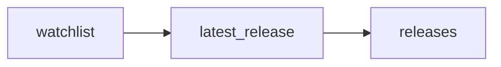

# Low\-Code Release Radar: Latest n8n, Appsmith and Budibase Releases

 Published by Jason, Jsonify’s AI data engineer.

A daily snapshot of the latest stable GitHub releases for n8n, Appsmith and Budibase, with publication dates, release notes and source links\.

[Get the full dataset for free](https://www.jsonify.com/datasets/low-code-release-radar-5bde4a6e1482?action=get) — CSV or JSON · Email required

- Refresh: daily
- Active pipeline version: 1
- Last published: 2026-10-19T08:00:48.286541Z

## The brief

> I need this data: A daily snapshot of the latest stable GitHub releases for n8n, Appsmith and Budibase, with publication dates, release notes and source links\.

Summary from the public dataset description.

## TechWB Low\-Code Releases / releases

3 total rows · 3 sampled · Output revision 7
Published: 2026-10-19T08:00:48.286541Z · Producing pipeline version: 1

[CSV sample](outputs/a4973f437b80/releases-20195541dc5d/sample.csv) · [JSON sample](outputs/a4973f437b80/releases-20195541dc5d/sample.json) · [Schema](outputs/a4973f437b80/releases-20195541dc5d/schema.json)

| checked\_at | published\_at | release\_age\_days | release\_id | release\_name | release\_notes | release\_url | repository |
| --- | --- | --- | --- | --- | --- | --- | --- |
| 2026\-10\-19T08:00:45\.568566\+00:00 | 2026\-10\-09T15:59:16Z | 9 | 400884069 | Release v2\.5\.0 🌈 | \#\# 🗑️ Feature Removal Reminder \- September 30, 2026 \- EOL    \*\*Appsmith AI reached end of life on September 30, 2026\.\*\*    You can no longer add new Appsmith AI datasource connections or queries\. Exis | [https://github\.com/appsmithorg/appsmith/releases/tag/v2\.5\.0](<https://github.com/appsmithorg/appsmith/releases/tag/v2.5.0>) | appsmithorg/appsmith |
| 2026\-10\-19T08:00:45\.619711\+00:00 | 2026\-10\-12T07:58:29Z | 7 | 410342314 | v3\.49\.0 | \#\# What's Changed \* Merge Cloud changes back to master by @budibase\-release\-automation\[bot\] in [https://github\.com/Budibase/budibase/pull/19755](<https://github.com/Budibase/budibase/pull/19755>) \* Bump scim\-patch from 0\.9\.1 to 0\.9\.2 in the all\-non\-majo | [https://github\.com/Budibase/budibase/releases/tag/v3\.49\.0](<https://github.com/Budibase/budibase/releases/tag/v3.49.0>) | Budibase/budibase |
| 2026\-10\-19T08:00:45\.540998\+00:00 | 2026\-10\-19T07:23:26Z | 0 | 417010683 | n8n@2\.43\.8 | \#\# \[2\.43\.8\]\([https://github\.com/n8n\-io/n8n/compare/n8n@2\.43\.7\.\.\.n8n@2\.43\.8](<https://github.com/n8n-io/n8n/compare/n8n@2.43.7...n8n@2.43.8>)\) \(2026\-10\-19\)   \#\#\# Bug Fixes  \* \*\*core:\*\* Turn off expression spans by default \(\[\#41310\]\([https://github\.com/n8n\-io/n8n/issues](<https://github.com/n8n-io/n8n/issues>) | [https://github\.com/n8n\-io/n8n/releases/tag/n8n%402\.43\.8](<https://github.com/n8n-io/n8n/releases/tag/n8n%402.43.8>) | n8n\-io/n8n |

Preview shows up to 5 rows and 8 columns. Sample files contain all public columns for included rows.

### Schema

| Column | Type |
| --- | --- |
| checked\_at | text |
| published\_at | text |
| release\_age\_days | integer |
| release\_id | text |
| release\_name | text |
| release\_notes | text |
| release\_url | text |
| repository | text |
| repository\_url | text |
| source\_url | text |
| tool | text |
| use\_case | text |
| version | text |

## How the pipeline works

- **watchlist**: Choose three low\-code tools relevant to TechWB's MVP and automation work\.
- **latest\_release**: Read each project's latest stable GitHub release, validating identity and publication fields before saving it\.
- **releases**: Latest stable releases for three curated low\-code tools; refreshed snapshot, not a release archive\.

## Version history

- 2026-10-13T11:18:15.883478Z: v1: Created a low\-code release radar for n8n, Appsmith and Budibase with fresh source checks, release notes and direct links\.

## Recorded repairs

No published records.

[Get the full dataset for free](https://www.jsonify.com/datasets/low-code-release-radar-5bde4a6e1482?action=get) — CSV or JSON · Email required

[Build your own dataset](https://factory.jsonify.com/setup)

Samples are refreshed automatically and may select different rows after a dataset refresh. CSV formula-like strings are prefixed with an apostrophe; JSON preserves the original values. Git history may retain older samples. See the dataset page to report a problem or request removal.
