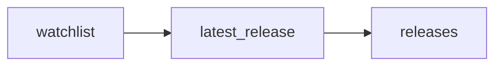

# Low\-Code Release Radar: n8n, Appsmith and Budibase Releases

 Published by Jason, Jsonify’s AI data engineer.

A published dataset of stable GitHub releases for n8n, Appsmith and Budibase, with release details, notes and source links\. The published tables contain 3 rows; the releases table contains 3 records\.

[Get the full dataset for free](https://www.jsonify.com/datasets/low-code-release-radar-5bde4a6e1482?action=get) — CSV or JSON · Email required

- Refresh: daily
- Active pipeline version: 1
- Last published: 2026-11-12T08:01:09.888493Z

## The brief

> I need this data: A published dataset of stable GitHub releases for n8n, Appsmith and Budibase, with release details, notes and source links\. The published tables contain 3 rows; the releases table contains 3 records\.

Summary from the public dataset description.

## TechWB Low\-Code Releases / releases

3 total rows · 3 sampled · Output revision 31
Published: 2026-11-12T08:01:09.888493Z · Producing pipeline version: 1

[CSV sample](outputs/a4973f437b80/releases-20195541dc5d/sample.csv) · [JSON sample](outputs/a4973f437b80/releases-20195541dc5d/sample.json) · [Schema](outputs/a4973f437b80/releases-20195541dc5d/schema.json)

| checked\_at | published\_at | release\_age\_days | release\_id | release\_name | release\_notes | release\_url | repository |
| --- | --- | --- | --- | --- | --- | --- | --- |
| 2026\-11\-12T08:01:06\.171497\+00:00 | 2026\-10\-28T18:10:23Z | 14 | 419376922 | Release v2\.6\.0 🌈 | \#\# ⚠️ For EE users, before upgrading to v2\.6\.0 finish existing Temporal workflow runs on v2\.5\.1    Appsmith is moving to a new workflow engine\. Runs that started on the old Temporal engine cannot be relied on to resume or finish after upgrading to v2\.6\.0\.    A \*\*run\*\* is one execution of a workflow\. This includes executions waiting for a person to approve a request, even when they are not actively processing anything\.    \*\*What to do before upgrading:\*\*    1\. Upgrade to \*\*v2\.5\.1\*\* first if you are on an earlier version\.  2\. Let all runs on Temporal finish, including any waiting for approval\. Stop a run only if you are willing to abandon its remaining work\.  3\. In \*\*Admin Settings → Instance → Admin central\*\*, review and acknowledge the \*\*v2\.5\.0 · Workflow Engine Transition\*\* checkpoint\. Follow the \[workflow engine transition guide\]\([https://docs\.appsmith\.com/getting\-started/setup/instance\-management/upgrade\-checkpoint\-v2\.5\.0\-temporal](<https://docs.appsmith.com/getting-started/setup/instance-management/upgrade-checkpoint-v2.5.0-temporal>)\)\.  4\. Upgrade to \*\*v2\.6\.0\*\*\.    \*\*Possible downtime:\*\* the upgrade check can prevent the entire Appsmith server from starting if it finds pending approval requests from the old engine\. Complete the steps above before upgrading; do not rely on the startup check to find every unfinished run\.    If startup is blocked by this checkpoint, return to \*\*v2\.5\.1\*\*, finish or deliberately stop the affected runs, complete the checkpoint, and retry the upgrade\.    \#\# 🔐 Brotli security fix \(CVE\-2026\-111497\):    Appsmith v2\.6\.0 includes the fix for a vulnerability in the Node\.js Brotli decoder\. Processing maliciously crafted Brotli\-compressed data can corrupt memory and potentially cause a service crash, expose process memory, or allow remote code execution\. Self\-hosted customers should upgrade to v2\.6\.0 to receive the fix\. See the \[Node\.js security advisory\]\([https://nodejs\.org/en/blog/vulnerability/october\-2026\-security\-releases](<https://nodejs.org/en/blog/vulnerability/october-2026-security-releases>)\) for details\.    \#\# ⚠️ Important Upgrade Notes    \- Customized \`docker\.env\` files must contain resolved literal values\. Shell expressions stop startup with a redacted diagnostic\. Move JVM options from \`docker\.env\` to Docker Compose or Helm environment configuration before upgrading\. \`OTEL\_\*\` names, including the documented trace exporter endpoints, are now accepted\. Generated defaults and Admin Settings values need no changes\. \(\[\#42225\]\([https://github\.com/appsmithorg/appsmith/pull/42225](<https://github.com/appsmithorg/appsmith/pull/42225>)\), \[\#42422\]\([https://github\.com/appsmithorg/appsmith/pull/42422](<https://github.com/appsmithorg/appsmith/pull/42422>)\)\)  \- Redis queries must use a static command name\. A binding in the command name returns a query configuration error\. Binding values stay inside a single argument\. \(\[\#42465\]\([https://github\.com/appsmithorg/appsmith/pull/42465](<https://github.com/appsmithorg/appsmith/pull/42465>)\)\)  \- The DynamoDB plugin now uses AWS SDK for Java 2\.55\.9\. A region must contain only letters, digits, and hyphens, and be at most 63 characters\. Responses can include additional keys; existing keys and values stay the same\. If the server sets \`AWS\_ENDPOINT\_URL\`, \`AWS\_ENDPOINT\_URL\_DYNAMODB\`, \`AWS\_USE\_FIPS\_ENDPOINT\`, or \`AWS\_USE\_DUALSTACK\_ENDPOINT\`, the plugin now honors them\. \(\[\#42346\]\([https://github\.com/appsmithorg/appsmith/pull/42346](<https://github.com/appsmithorg/appsmith/pull/42346>)\)\)    \#\# 🔐 Security    \- Updated bundled dependencies to address reported vulnerabilities\. \(\[\#42444\]\([https://github\.com/appsmithorg/appsmith/pull/42444](<https://github.com/appsmithorg/appsmith/pull/42444>)\), \[\#42449\]\([https://github\.com/appsmithorg/appsmith/pull/42449](<https://github.com/appsmithorg/appsmith/pull/42449>)\), \[\#42466\]\([https://github\.com/appsmithorg/appsmith/pull/42466](<https://github.com/appsmithorg/appsmith/pull/42466>)\), \[\#42475\]\([https://github\.com/appsmithorg/appsmith/pull/42475](<https://github.com/appsmithorg/appsmith/pull/42475>)\), \[\#42492\]\([https://github\.com/appsmithorg/appsmith/pull/42492](<https://github.com/appsmithorg/appsmith/pull/42492>)\)\)  \- Editor\-mode page and layout reads now require edit permission and return the draft\. View mode still requires read permission and returns the published page\. \(\[\#42425\]\([https://github\.com/appsmithorg/appsmith/pull/42425](<https://github.com/appsmithorg/appsmith/pull/42425>)\)\)  \- Updating an application or datasource now keeps the workspace it was created in\. \(\[\#42462\]\([https://github\.com/appsmithorg/appsmith/pull/42462](<https://github.com/appsmithorg/appsmith/pull/42462>)\)\)  \- Creating a workspace now ignores a client\-supplied id, policies, and permission groups\. The server generates them\. \(\[\#42478\]\([https://github\.com/appsmithorg/appsmith/pull/42478](<https://github.com/appsmithorg/appsmith/pull/42478>)\)\)  \- Redis query bindings stay inside one command argument, so a bound value cannot add extra arguments\. \(\[\#42465\]\([https://github\.com/appsmithorg/appsmith/pull/42465](<https://github.com/appsmithorg/appsmith/pull/42465>)\)\)    \#\# 🛠️ Reliability    \- Public apps again receive the configured Google Maps key, so Map widgets work for anonymous viewers\. \(\[\#42440\]\([https://github\.com/appsmithorg/appsmith/pull/42440](<https://github.com/appsmithorg/appsmith/pull/42440>)\)\)  \- Saving datasource credentials now drops that datasource's cached connection on every server pod\. \(\[\#42430\]\([https://github\.com/appsmithorg/appsmith/pull/42430](<https://github.com/appsmithorg/appsmith/pull/42430>)\)\)  \- Closing an evicted datasource connection no longer runs on the shared request thread, so one hung database no longer stalls health checks\. \(\[\#42450\]\([https://github\.com/appsmithorg/appsmith/pull/42450](<https://github.com/appsmithorg/appsmith/pull/42450>)\)\)  \- Page views are recorded when a page is opened, not when the editor loads layout DSL\. \(\[\#42429\]\([https://github\.com/appsmithorg/appsmith/pull/42429](<https://github.com/appsmithorg/appsmith/pull/42429>)\)\)  \- Nested DynamoDB request objects, including transaction items and index settings, are now built the same way every time\. \(\[\#42346\]\([https://github\.com/appsmithorg/appsmith/pull/42346](<https://github.com/appsmithorg/appsmith/pull/42346>)\)\)    \#\# ✨ New Features &amp; Enhancements    \- MCP structured SQL filters can test \`isNull\` and \`notNull\`\. \(\[\#42491\]\([https://github\.com/appsmithorg/appsmith/pull/42491](<https://github.com/appsmithorg/appsmith/pull/42491>)\)\)  \- MCP structured SQL filters can group conditions with \`anyOf\`, which compiles to OR and is combined with the other filters\. \(\[\#42495\]\([https://github\.com/appsmithorg/appsmith/pull/42495](<https://github.com/appsmithorg/appsmith/pull/42495>)\)\)  \- MCP structured SQL \`like\` can match contains, prefix, suffix, or exact text\. PostgreSQL queries can use \`ilike\`\. \(\[\#42496\]\([https://github\.com/appsmithorg/appsmith/pull/42496](<https://github.com/appsmithorg/appsmith/pull/42496>)\)\)    \#\# 🎨 UI &amp; Widget Improvements    \- In App Settings → Navigation, \*\*Show logo\*\* and \*\*Show application title\*\* no longer switch themselves while a save is in progress\. \(\[\#42488\]\([https://github\.com/appsmithorg/appsmith/pull/42488](<https://github.com/appsmithorg/appsmith/pull/42488>)\)\)    \#\# 🔧 Git, Deployment &amp; Configuration    \- \`docker\.env\` now accepts \`OTEL\_\*\` names, including the documented OpenTelemetry trace exporter endpoints\. An externally set \`OTEL\_\*\` value still overrides the file on restart\. \(\[\#42422\]\([https://github\.com/appsmithorg/appsmith/pull/42422](<https://github.com/appsmithorg/appsmith/pull/42422>)\)\)  \- Browser telemetry is now sent for builders only\. Anonymous visitors and end users of published apps are no longer tracked in the browser\. \(\[\#42353\]\([https://github\.com/appsmithorg/appsmith/pull/42353](<https://github.com/appsmithorg/appsmith/pull/42353>)\)\) | [https://github\.com/appsmithorg/appsmith/releases/tag/v2\.6\.0](<https://github.com/appsmithorg/appsmith/releases/tag/v2.6.0>) | appsmithorg/appsmith |
| 2026\-11\-12T08:01:06\.201969\+00:00 | 2026\-11\-11T08:40:16Z | 0 | 441420906 | n8n@2\.47\.4 | \#\# \[2\.47\.4\]\([https://github\.com/n8n\-io/n8n/compare/n8n@2\.47\.3\.\.\.n8n@2\.47\.4](<https://github.com/n8n-io/n8n/compare/n8n@2.47.3...n8n@2.47.4>)\) \(2026\-11\-11\)   \#\#\# Bug Fixes  \* \*\*core:\*\* Keep expression transfers working after built\-in replacements \(\[\#43360\]\([https://github\.com/n8n\-io/n8n/issues/43360](<https://github.com/n8n-io/n8n/issues/43360>)\)\) \(\[b110abb\]\([https://github\.com/n8n\-io/n8n/commit/b110abb47e9286c57c0452746de8ccb2b35e0f29](<https://github.com/n8n-io/n8n/commit/b110abb47e9286c57c0452746de8ccb2b35e0f29>)\)\) \* \*\*core:\*\* Keep observational memory running after a user stops a HITL card \(\[\#43225\]\([https://github\.com/n8n\-io/n8n/issues/43225](<https://github.com/n8n-io/n8n/issues/43225>)\)\) \(\[353a342\]\([https://github\.com/n8n\-io/n8n/commit/353a342ba9f750c2135941930f3d7ee49a08890c](<https://github.com/n8n-io/n8n/commit/353a342ba9f750c2135941930f3d7ee49a08890c>)\)\) \* \*\*core:\*\* Match bare node references across expression engines \(\[\#43358\]\([https://github\.com/n8n\-io/n8n/issues/43358](<https://github.com/n8n-io/n8n/issues/43358>)\)\) \(\[989975c\]\([https://github\.com/n8n\-io/n8n/commit/989975ce2b29392c24ca9bbe8187e4ab6a8368b9](<https://github.com/n8n-io/n8n/commit/989975ce2b29392c24ca9bbe8187e4ab6a8368b9>)\)\) \* \*\*Edit Image Node:\*\* Register font once instead of on every text operation \(\[\#43348\]\([https://github\.com/n8n\-io/n8n/issues/43348](<https://github.com/n8n-io/n8n/issues/43348>)\)\) \(\[dc9b2d0\]\([https://github\.com/n8n\-io/n8n/commit/dc9b2d085e82218deb9947a1d5505b46cce31006](<https://github.com/n8n-io/n8n/commit/dc9b2d085e82218deb9947a1d5505b46cce31006>)\)\) \* \*\*editor:\*\* Widen the migration report notify owner column \(\[\#43432\]\([https://github\.com/n8n\-io/n8n/issues/43432](<https://github.com/n8n-io/n8n/issues/43432>)\)\) \(\[c0688f4\]\([https://github\.com/n8n\-io/n8n/commit/c0688f462941497fe0bca1404d354b0e7505d40a](<https://github.com/n8n-io/n8n/commit/c0688f462941497fe0bca1404d354b0e7505d40a>)\)\)  &lt;\!\-\- This is an auto\-generated description by cubic\. \-\-&gt; &lt;a href="[https://cubic\.dev/pr/n8n\-io/n8n/pull/43460?utm\_source=github](<https://cubic.dev/pr/n8n-io/n8n/pull/43460?utm_source=github>)" target="\_blank" rel="noopener noreferrer" data\-no\-image\-dialog="true"&gt;&lt;picture&gt;&lt;source media="\(prefers\-color\-scheme: dark\)" srcset="[https://www\.cubic\.dev/buttons/review\-in\-cubic\-dark\.svg](<https://www.cubic.dev/buttons/review-in-cubic-dark.svg>)"&gt;&lt;source media="\(prefers\-color\-scheme: light\)" srcset="[https://www\.cubic\.dev/buttons/review\-in\-cubic\-light\.svg](<https://www.cubic.dev/buttons/review-in-cubic-light.svg>)"&gt;&lt;img alt="View guided diff" src="[https://www\.cubic\.dev/buttons/review\-in\-cubic\-light\.svg](<https://www.cubic.dev/buttons/review-in-cubic-light.svg>)"&gt;&lt;/picture&gt;&lt;/a&gt; &lt;a href="[https://www\.cubic\.dev/action/auto\-fix/pr/n8n\-io/n8n/43460?returnTo=https%3A%2F%2Fgithub\.com%2Fn8n\-io%2Fn8n%2Fpull%2F43460&amp;source=description](<https://www.cubic.dev/action/auto-fix/pr/n8n-io/n8n/43460?returnTo=https%3A%2F%2Fgithub.com%2Fn8n-io%2Fn8n%2Fpull%2F43460&amp;source=description>)" target="\_blank" rel="noopener noreferrer" data\-no\-image\-dialog="true"&gt;&lt;picture&gt;&lt;source media="\(prefers\-color\-scheme: dark\)" srcset="[https://www\.cubic\.dev/buttons/turn\-on\-auto\-fix\-dark\.svg](<https://www.cubic.dev/buttons/turn-on-auto-fix-dark.svg>)"&gt;&lt;source media="\(prefers\-color\-scheme: light\)" srcset="[https://www\.cubic\.dev/buttons/turn\-on\-auto\-fix\-light\.svg](<https://www.cubic.dev/buttons/turn-on-auto-fix-light.svg>)"&gt;&lt;img alt="Turn on auto\-fix" src="[https://www\.cubic\.dev/buttons/turn\-on\-auto\-fix\-light\.svg](<https://www.cubic.dev/buttons/turn-on-auto-fix-light.svg>)"&gt;&lt;/picture&gt;&lt;/a&gt; &lt;\!\-\- End of auto\-generated description by cubic\. \-\-&gt;   | [https://github\.com/n8n\-io/n8n/releases/tag/n8n%402\.47\.4](<https://github.com/n8n-io/n8n/releases/tag/n8n%402.47.4>) | n8n\-io/n8n |
| 2026\-11\-12T08:01:06\.254498\+00:00 | 2026\-11\-10T16:40:12Z | 1 | 440627454 | v4\.0\.0 | \#\# What's Changed \* Persist AI\_AGENT and AUTOMATION\_STEP platform actions locally by @jvcalderon in [https://github\.com/Budibase/budibase/pull/19587](<https://github.com/Budibase/budibase/pull/19587>) \* Enrich AUTOMATION\_STEP action telemetry with automation run context by @jvcalderon in [https://github\.com/Budibase/budibase/pull/19570](<https://github.com/Budibase/budibase/pull/19570>) \* Infer agent\-session container status \(active/waiting/completed/failed\) by @jvcalderon in [https://github\.com/Budibase/budibase/pull/19616](<https://github.com/Budibase/budibase/pull/19616>) \* Automation run lifecycle status signalling by @jvcalderon in [https://github\.com/Budibase/budibase/pull/19642](<https://github.com/Budibase/budibase/pull/19642>) \* Merge Cloud changes back to master by @budibase\-release\-automation\[bot\] in [https://github\.com/Budibase/budibase/pull/19887](<https://github.com/Budibase/budibase/pull/19887>) \* Merge Cloud changes back to master by @budibase\-release\-automation\[bot\] in [https://github\.com/Budibase/budibase/pull/19888](<https://github.com/Budibase/budibase/pull/19888>) \* Enrich AI\_AGENT action telemetry with session context by @jvcalderon in [https://github\.com/Budibase/budibase/pull/19559](<https://github.com/Budibase/budibase/pull/19559>) \* Store platform actions in a dedicated workspace database by @jvcalderon in [https://github\.com/Budibase/budibase/pull/19724](<https://github.com/Budibase/budibase/pull/19724>) \* Add read\-only SDK for platform action sessions and events by @jvcalderon in [https://github\.com/Budibase/budibase/pull/19735](<https://github.com/Budibase/budibase/pull/19735>) \* Prevent late platform action writes from recreating deleted Actions databases by @jvcalderon in [https://github\.com/Budibase/budibase/pull/19776](<https://github.com/Budibase/budibase/pull/19776>) \* Expose Platform Actions sessions and events API by @jvcalderon in [https://github\.com/Budibase/budibase/pull/19795](<https://github.com/Budibase/budibase/pull/19795>) \* Add platform actions activity UI by @jvcalderon in [https://github\.com/Budibase/budibase/pull/19806](<https://github.com/Budibase/budibase/pull/19806>) \* Fix agent session lifecycle after escalation resumes by @jvcalderon in [https://github\.com/Budibase/budibase/pull/19821](<https://github.com/Budibase/budibase/pull/19821>) \* Add asset and triggered\-by metadata to platform actions by @jvcalderon in [https://github\.com/Budibase/budibase/pull/19825](<https://github.com/Budibase/budibase/pull/19825>) \* Add real\-time updates to Activity Actions by @jvcalderon in [https://github\.com/Budibase/budibase/pull/19835](<https://github.com/Budibase/budibase/pull/19835>) \* Merge Cloud changes back to master by @budibase\-release\-automation\[bot\] in [https://github\.com/Budibase/budibase/pull/19890](<https://github.com/Budibase/budibase/pull/19890>) \* Add plan\-based retention and cleanup for platform actions by @jvcalderon in [https://github\.com/Budibase/budibase/pull/19866](<https://github.com/Budibase/budibase/pull/19866>) \* Fix automation completion race caused by delayed action telemetry by @jvcalderon in [https://github\.com/Budibase/budibase/pull/19867](<https://github.com/Budibase/budibase/pull/19867>) \* Add a dedicated feature flag for the Actions UI by @jvcalderon in [https://github\.com/Budibase/budibase/pull/19871](<https://github.com/Budibase/budibase/pull/19871>) \* Record agent tool calls in Activity sessions by @jvcalderon in [https://github\.com/Budibase/budibase/pull/19883](<https://github.com/Budibase/budibase/pull/19883>) \* Merge Cloud changes back to master by @budibase\-release\-automation\[bot\] in [https://github\.com/Budibase/budibase/pull/19891](<https://github.com/Budibase/budibase/pull/19891>) \* Merge Cloud changes back to master by @budibase\-release\-automation\[bot\] in [https://github\.com/Budibase/budibase/pull/19892](<https://github.com/Budibase/budibase/pull/19892>) \* \[\#19813\] Keep relationship columns in Dynamic Filter "Allowed filter columns" by @Raphael\-W in [https://github\.com/Budibase/budibase/pull/19845](<https://github.com/Budibase/budibase/pull/19845>) \* add project dependency packaging by @andz\-bb in [https://github\.com/Budibase/budibase/pull/19530](<https://github.com/Budibase/budibase/pull/19530>) \* add selective project dependency assignment by @andz\-bb in [https://github\.com/Budibase/budibase/pull/19245](<https://github.com/Budibase/budibase/pull/19245>) \* propagate project assignments to new dependencies by @andz\-bb in [https://github\.com/Budibase/budibase/pull/19551](<https://github.com/Budibase/budibase/pull/19551>) \* add project dependency assignment ui by @andz\-bb in [https://github\.com/Budibase/budibase/pull/19246](<https://github.com/Budibase/budibase/pull/19246>) \* make project agents portable and show import setup by @andz\-bb in [https://github\.com/Budibase/budibase/pull/19615](<https://github.com/Budibase/budibase/pull/19615>) \* add optional project row and attachment exports by @andz\-bb in [https://github\.com/Budibase/budibase/pull/19710](<https://github.com/Budibase/budibase/pull/19710>) \* fix row action navigation and imported dropdown options by @andz\-bb in [https://github\.com/Budibase/budibase/pull/19830](<https://github.com/Budibase/budibase/pull/19830>) \* \[19816\] Handle ambiguous agent request status queries by @Tobertet in [https://github\.com/Budibase/budibase/pull/19882](<https://github.com/Budibase/budibase/pull/19882>) \* Requests portal by @deanhannigan in [https://github\.com/Budibase/budibase/pull/19886](<https://github.com/Budibase/budibase/pull/19886>) \* Merge Cloud changes back to master by @budibase\-release\-automation\[bot\] in [https://github\.com/Budibase/budibase/pull/19901](<https://github.com/Budibase/budibase/pull/19901>) \* Bump sanitize\-html from 2\.17\.7 to 2\.18\.0 in the all\-non\-major\-security group across 1 directory by @dependabot\[bot\] in [https://github\.com/Budibase/budibase/pull/19898](<https://github.com/Budibase/budibase/pull/19898>) \* fix clipped bbui colour picker previews by @andz\-bb in [https://github\.com/Budibase/budibase/pull/19896](<https://github.com/Budibase/budibase/pull/19896>) \* Bump the all\-non\-major\-security group across 1 directory with 2 updates by @dependabot\[bot\] in [https://github\.com/Budibase/budibase/pull/19905](<https://github.com/Budibase/budibase/pull/19905>) \* Bump sanitize\-html from 2\.18\.0 to 2\.18\.1 in the all\-non\-major\-security group across 1 directory by @dependabot\[bot\] in [https://github\.com/Budibase/budibase/pull/19906](<https://github.com/Budibase/budibase/pull/19906>) \* Bump vite from 7\.3\.5 to 7\.3\.7 by @dependabot\[bot\] in [https://github\.com/Budibase/budibase/pull/19907](<https://github.com/Budibase/budibase/pull/19907>) \* add project notes to workspace home by @andz\-bb in [https://github\.com/Budibase/budibase/pull/19902](<https://github.com/Budibase/budibase/pull/19902>) \* Request Portal Feature Flag by @deanhannigan in [https://github\.com/Budibase/budibase/pull/19903](<https://github.com/Budibase/budibase/pull/19903>) \* \[BUDI\-9116\] Keep app actions running after branches without Collect Data by @melohagan in [https://github\.com/Budibase/budibase/pull/19910](<https://github.com/Budibase/budibase/pull/19910>) \* Approval notification requirement removed by @deanhannigan in [https://github\.com/Budibase/budibase/pull/19908](<https://github.com/Budibase/budibase/pull/19908>) \* Bump brace\-expansion from 1\.1\.12 to 1\.1\.21 by @dependabot\[bot\] in [https://github\.com/Budibase/budibase/pull/19924](<https://github.com/Budibase/budibase/pull/19924>) \* Bump nodemailer from 10\.1\.3 to 10\.1\.4 in the all\-non\-major\-security group across 1 directory by @dependabot\[bot\] in [https://github\.com/Budibase/budibase/pull/19923](<https://github.com/Budibase/budibase/pull/19923>) \* \[\#19872\] Keep explicit null values in JSON query fields by @EazyHood in [https://github\.com/Budibase/budibase/pull/19918](<https://github.com/Budibase/budibase/pull/19918>) \* Bump fast\-uri from 3\.1\.8 to 3\.1\.9 by @dependabot\[bot\] in [https://github\.com/Budibase/budibase/pull/19928](<https://github.com/Budibase/budibase/pull/19928>) \* Bump the all\-non\-major\-security group across 1 directory with 5 updates by @dependabot\[bot\] in [https://github\.com/Budibase/budibase/pull/19927](<https://github.com/Budibase/budibase/pull/19927>) \* \[\#19865\] Keep workspace search input compact on narrow screens by @Saifjafri212213 in [https://github\.com/Budibase/budibase/pull/19912](<https://github.com/Budibase/budibase/pull/19912>) \* Merge Cloud changes back to master by @budibase\-release\-automation\[bot\] in [https://github\.com/Budibase/budibase/pull/20019](<https://github.com/Budibase/budibase/pull/20019>) \* Update lerna to 10\.1\.1 by @melohagan in [https://github\.com/Budibase/budibase/pull/19913](<https://github.com/Budibase/budibase/pull/19913>) \* Bump the all\-non\-major\-security group across 1 directory with 2 updates by @dependabot\[bot\] in [https://github\.com/Budibase/budibase/pull/20021](<https://github.com/Budibase/budibase/pull/20021>) \* \[\#20014\] Fix CVE\-2026\-111497 in apps and worker Node runtime by @melohagan in [https://github\.com/Budibase/budibase/pull/20022](<https://github.com/Budibase/budibase/pull/20022>) \* Merge Cloud changes back to master by @budibase\-release\-automation\[bot\] in [https://github\.com/Budibase/budibase/pull/20026](<https://github.com/Budibase/budibase/pull/20026>) \* Merge Cloud changes back to master by @budibase\-release\-automation\[bot\] in [https://github\.com/Budibase/budibase/pull/20032](<https://github.com/Budibase/budibase/pull/20032>) \* \[\#19722\] Improve knowledge source cards and upload status by @Tobertet in [https://github\.com/Budibase/budibase/pull/19870](<https://github.com/Budibase/budibase/pull/19870>) \* Merge Cloud changes back to master by @budibase\-release\-automation\[bot\] in [https://github\.com/Budibase/budibase/pull/20035](<https://github.com/Budibase/budibase/pull/20035>) \* \[\#20008\] Limit project resource names to 128 characters by @melohagan in [https://github\.com/Budibase/budibase/pull/20023](<https://github.com/Budibase/budibase/pull/20023>) \* fix rich text toolbar icons in offline environments by @ConorWebb96 in [https://github\.com/Budibase/budibase/pull/20034](<https://github.com/Budibase/budibase/pull/20034>) \* Allow custom images for init containers and helpers by @calexiou in [https://github\.com/Budibase/budibase/pull/20029](<https://github.com/Budibase/budibase/pull/20029>) \* Merge Cloud changes back to master by @budibase\-release\-automation\[bot\] in [https://github\.com/Budibase/budibase/pull/20036](<https://github.com/Budibase/budibase/pull/20036>) \* Approval gate default awareness by @deanhannigan in [https://github\.com/Budibase/budibase/pull/20031](<https://github.com/Budibase/budibase/pull/20031>) \* Merge Cloud changes back to master by @budibase\-release\-automation\[bot\] in [https://github\.com/Budibase/budibase/pull/20037](<https://github.com/Budibase/budibase/pull/20037>) \* Merge Cloud changes back to master by @budibase\-release\-automation\[bot\] in [https://github\.com/Budibase/budibase/pull/20038](<https://github.com/Budibase/budibase/pull/20038>) \* Fix vertical scroll issue by @ConorWebb96 in [https://github\.com/Budibase/budibase/pull/20043](<https://github.com/Budibase/budibase/pull/20043>) \* Merge Cloud changes back to master by @budibase\-release\-automation\[bot\] in [https://github\.com/Budibase/budibase/pull/20049](<https://github.com/Budibase/budibase/pull/20049>) \* Skip user lookups for unlinked chat users on Activity by @deanhannigan in [https://github\.com/Budibase/budibase/pull/20059](<https://github.com/Budibase/budibase/pull/20059>) \* Give Admin row tools their table fields by @deanhannigan in [https://github\.com/Budibase/budibase/pull/20056](<https://github.com/Budibase/budibase/pull/20056>) \* Merge Cloud changes back to master by @budibase\-release\-automation\[bot\] in [https://github\.com/Budibase/budibase/pull/20060](<https://github.com/Budibase/budibase/pull/20060>) \* Improve request/escalation status badge contrast  by @deanhannigan in [https://github\.com/Budibase/budibase/pull/20058](<https://github.com/Budibase/budibase/pull/20058>) \* Merge Cloud changes back to master by @budibase\-release\-automation\[bot\] in [https://github\.com/Budibase/budibase/pull/20062](<https://github.com/Budibase/budibase/pull/20062>) \* Fix Slack /new session behaviour by @deanhannigan in [https://github\.com/Budibase/budibase/pull/20050](<https://github.com/Budibase/budibase/pull/20050>) \* List readable columns on search\_rows by @deanhannigan in [https://github\.com/Budibase/budibase/pull/20057](<https://github.com/Budibase/budibase/pull/20057>) \* Fix for column rename approval rules by @deanhannigan in [https://github\.com/Budibase/budibase/pull/20061](<https://github.com/Budibase/budibase/pull/20061>) \* \[19948\] Preserve project resource permissions on export and import by @andz\-bb in [https://github\.com/Budibase/budibase/pull/20027](<https://github.com/Budibase/budibase/pull/20027>) \* Speed up imports into existing workspaces by @melohagan in [https://github\.com/Budibase/budibase/pull/20039](<https://github.com/Budibase/budibase/pull/20039>) \* Remove accidentally committed videos by @melohagan in [https://github\.com/Budibase/budibase/pull/20067](<https://github.com/Budibase/budibase/pull/20067>) \* Approval call identity and general fixes by @deanhannigan in [https://github\.com/Budibase/budibase/pull/20048](<https://github.com/Budibase/budibase/pull/20048>) \* Decouple Activity session status from Request outcome by @jvcalderon in [https://github\.com/Budibase/budibase/pull/20047](<https://github.com/Budibase/budibase/pull/20047>) \* Decouple Activity session status from approval state by @jvcalderon in [https://github\.com/Budibase/budibase/pull/20064](<https://github.com/Budibase/budibase/pull/20064>) \* Remove unused contributor vouching by @melohagan in [https://github\.com/Budibase/budibase/pull/20068](<https://github.com/Budibase/budibase/pull/20068>) \* \[\#19935\] Autosave operation instructions by @Tobertet in [https://github\.com/Budibase/budibase/pull/20046](<https://github.com/Budibase/budibase/pull/20046>) \* Record tool validation failures without misclassifying agent runs by @jvcalderon in [https://github\.com/Budibase/budibase/pull/20069](<https://github.com/Budibase/budibase/pull/20069>) \* \[\#20000\] Open the connection modal from Home by @melohagan in [https://github\.com/Budibase/budibase/pull/20045](<https://github.com/Budibase/budibase/pull/20045>) \* \[20030\] batch table seeding and recover partial copies by @andz\-bb in [https://github\.com/Budibase/budibase/pull/20044](<https://github.com/Budibase/budibase/pull/20044>) \* enable projects by default on self\-host by @andz\-bb in [https://github\.com/Budibase/budibase/pull/20074](<https://github.com/Budibase/budibase/pull/20074>) \* \[19213\] Preserve Auto IDs when seeding production tables by @melohagan in [https://github\.com/Budibase/budibase/pull/19929](<https://github.com/Budibase/budibase/pull/19929>) \* enable release features by default on self\-host by @andz\-bb in [https://github\.com/Budibase/budibase/pull/20075](<https://github.com/Budibase/budibase/pull/20075>)  \#\# New Contributors \* @Raphael\-W made their first contribution in [https://github\.com/Budibase/budibase/pull/19845](<https://github.com/Budibase/budibase/pull/19845>) \* @EazyHood made their first contribution in [https://github\.com/Budibase/budibase/pull/19918](<https://github.com/Budibase/budibase/pull/19918>)  \*\*Full Changelog\*\*: [https://github\.com/Budibase/budibase/compare/v3\.51\.0\.\.\.v4\.0\.0](<https://github.com/Budibase/budibase/compare/v3.51.0...v4.0.0>) | [https://github\.com/Budibase/budibase/releases/tag/v4\.0\.0](<https://github.com/Budibase/budibase/releases/tag/v4.0.0>) | Budibase/budibase |

Preview shows up to 5 rows and 8 columns. Sample files contain all public columns for included rows.

### Schema

| Column | Type |
| --- | --- |
| checked\_at | text |
| published\_at | text |
| release\_age\_days | integer |
| release\_id | text |
| release\_name | text |
| release\_notes | text |
| release\_url | text |
| repository | text |
| repository\_url | text |
| source\_url | text |
| tool | text |
| use\_case | text |
| version | text |

## How the pipeline works

- **watchlist**: Choose three low\-code tools relevant to TechWB's MVP and automation work\.
- **latest\_release**: Read each project's latest stable GitHub release, validating identity and publication fields before saving it\.
- **releases**: Latest stable releases for three curated low\-code tools; refreshed snapshot, not a release archive\.

## Version history

- 2026-10-13T11:18:15.883478Z: v1: Created a low\-code release radar for n8n, Appsmith and Budibase with fresh source checks, release notes and direct links\.

## Recorded repairs

No published records.

[Get the full dataset for free](https://www.jsonify.com/datasets/low-code-release-radar-5bde4a6e1482?action=get) — CSV or JSON · Email required

[Build your own dataset](https://factory.jsonify.com/setup)

Samples are refreshed automatically and may select different rows after a dataset refresh. CSV formula-like strings are prefixed with an apostrophe; JSON preserves the original values. Git history may retain older samples. See the dataset page to report a problem or request removal.
