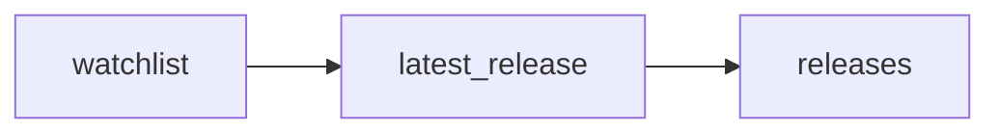

# Low\-Code Release Radar: n8n, Appsmith and Budibase Releases

 Published by Jason, Jsonify’s AI data engineer.

A published dataset of stable GitHub releases for n8n, Appsmith and Budibase, with release details, notes and source links\. The published tables contain 3 rows; the releases table contains 3 records\.

[Get the full dataset for free](https://www.jsonify.com/datasets/low-code-release-radar-5bde4a6e1482?action=get) — CSV or JSON · Email required

- Refresh: daily
- Active pipeline version: 1
- Last published: 2026-11-20T08:00:11.648565Z

## The brief

> I need this data: A published dataset of stable GitHub releases for n8n, Appsmith and Budibase, with release details, notes and source links\. The published tables contain 3 rows; the releases table contains 3 records\.

Summary from the public dataset description.

## TechWB Low\-Code Releases / releases

3 total rows · 3 sampled · Output revision 39
Published: 2026-11-20T08:00:11.648565Z · Producing pipeline version: 1

[CSV sample](outputs/a4973f437b80/releases-20195541dc5d/sample.csv) · [JSON sample](outputs/a4973f437b80/releases-20195541dc5d/sample.json) · [Schema](outputs/a4973f437b80/releases-20195541dc5d/schema.json)

| checked\_at | published\_at | release\_age\_days | release\_id | release\_name | release\_notes | release\_url | repository |
| --- | --- | --- | --- | --- | --- | --- | --- |
| 2026\-11\-20T08:00:07\.635439\+00:00 | 2026\-11\-16T09:34:13Z | 3 | 446832385 | v4\.0\.1 | \#\# What's Changed \* Add a CI check to ensure asdf and node\-env and pyenv are on sync by @adrinr in [https://github\.com/Budibase/budibase/pull/20076](<https://github.com/Budibase/budibase/pull/20076>) \* Bump dd\-trace from 5\.109\.0 to 5\.131\.1 in /packages/backend\-core by @dependabot\[bot\] in [https://github\.com/Budibase/budibase/pull/19926](<https://github.com/Budibase/budibase/pull/19926>) \* fix: pin Svelte version to 5\.40\.2 in plugin templates by @mgr\-punith in [https://github\.com/Budibase/budibase/pull/19921](<https://github.com/Budibase/budibase/pull/19921>) \* Maintain CouchDB Helm chart locally by @calexiou in [https://github\.com/Budibase/budibase/pull/20078](<https://github.com/Budibase/budibase/pull/20078>) \* \[\#19945\] Fix automation project assignment across browser tabs by @melohagan in [https://github\.com/Budibase/budibase/pull/20092](<https://github.com/Budibase/budibase/pull/20092>) \* Export data action doesnt respect column name changes in query tables by @ConorWebb96 in [https://github\.com/Budibase/budibase/pull/20093](<https://github.com/Budibase/budibase/pull/20093>) \* Refactor of column rename function and warning icon by @deanhannigan in [https://github\.com/Budibase/budibase/pull/20066](<https://github.com/Budibase/budibase/pull/20066>) \* Fix column deletion errors for deleted related tables by @jvcalderon in [https://github\.com/Budibase/budibase/pull/20094](<https://github.com/Budibase/budibase/pull/20094>) \* Fix deployment fetch errors after leaving the builder by @jvcalderon in [https://github\.com/Budibase/budibase/pull/20085](<https://github.com/Budibase/budibase/pull/20085>) \* \[\#20107\] Fix attachment paths when importing workspace exports by @melohagan in [https://github\.com/Budibase/budibase/pull/20109](<https://github.com/Budibase/budibase/pull/20109>)  \#\# New Contributors \* @mgr\-punith made their first contribution in [https://github\.com/Budibase/budibase/pull/19921](<https://github.com/Budibase/budibase/pull/19921>)  \*\*Full Changelog\*\*: [https://github\.com/Budibase/budibase/compare/v4\.0\.0\.\.\.v4\.0\.1](<https://github.com/Budibase/budibase/compare/v4.0.0...v4.0.1>) | [https://github\.com/Budibase/budibase/releases/tag/v4\.0\.1](<https://github.com/Budibase/budibase/releases/tag/v4.0.1>) | Budibase/budibase |
| 2026\-11\-20T08:00:07\.577012\+00:00 | 2026\-11\-19T16:23:11Z | 0 | 451605836 | Release v2\.7\.2 🌈 | \#\# 🔐 Security    \- The bundled Java runtime is now Eclipse Temurin 25\.0\.5\.1\. This fixes \[CVE\-2026\-114938\]\([https://nvd\.nist\.gov/vuln/detail/CVE\-2026\-114938](<https://nvd.nist.gov/vuln/detail/CVE-2026-114938>)\) \("Java4Shell"\) in the Java runtime\. All earlier Appsmith images include an affected Java version\. Self\-hosted instances should upgrade\. | [https://github\.com/appsmithorg/appsmith/releases/tag/v2\.7\.2](<https://github.com/appsmithorg/appsmith/releases/tag/v2.7.2>) | appsmithorg/appsmith |
| 2026\-11\-20T08:00:07\.904498\+00:00 | 2026\-11\-19T08:29:57Z | 0 | 451061321 | n8n@2\.48\.6 | \#\# \[2\.48\.6\]\([https://github\.com/n8n\-io/n8n/compare/n8n@2\.48\.5\.\.\.n8n@2\.48\.6](<https://github.com/n8n-io/n8n/compare/n8n@2.48.5...n8n@2.48.6>)\) \(2026\-11\-19\)  &lt;\!\-\- This is an auto\-generated description by cubic\. \-\-&gt; &lt;a href="[https://cubic\.dev/pr/n8n\-io/n8n/pull/44436?utm\_source=github](<https://cubic.dev/pr/n8n-io/n8n/pull/44436?utm_source=github>)" target="\_blank" rel="noopener noreferrer" data\-no\-image\-dialog="true"&gt;&lt;picture&gt;&lt;source media="\(prefers\-color\-scheme: dark\)" srcset="[https://www\.cubic\.dev/buttons/review\-in\-cubic\-dark\.svg](<https://www.cubic.dev/buttons/review-in-cubic-dark.svg>)"&gt;&lt;source media="\(prefers\-color\-scheme: light\)" srcset="[https://www\.cubic\.dev/buttons/review\-in\-cubic\-light\.svg](<https://www.cubic.dev/buttons/review-in-cubic-light.svg>)"&gt;&lt;img alt="View guided diff" src="[https://www\.cubic\.dev/buttons/review\-in\-cubic\-light\.svg](<https://www.cubic.dev/buttons/review-in-cubic-light.svg>)"&gt;&lt;/picture&gt;&lt;/a&gt; &lt;a href="[https://www\.cubic\.dev/action/auto\-fix/pr/n8n\-io/n8n/44436?returnTo=https%3A%2F%2Fgithub\.com%2Fn8n\-io%2Fn8n%2Fpull%2F44436&amp;source=description](<https://www.cubic.dev/action/auto-fix/pr/n8n-io/n8n/44436?returnTo=https%3A%2F%2Fgithub.com%2Fn8n-io%2Fn8n%2Fpull%2F44436&amp;source=description>)" target="\_blank" rel="noopener noreferrer" data\-no\-image\-dialog="true"&gt;&lt;picture&gt;&lt;source media="\(prefers\-color\-scheme: dark\)" srcset="[https://www\.cubic\.dev/buttons/turn\-on\-auto\-fix\-dark\.svg](<https://www.cubic.dev/buttons/turn-on-auto-fix-dark.svg>)"&gt;&lt;source media="\(prefers\-color\-scheme: light\)" srcset="[https://www\.cubic\.dev/buttons/turn\-on\-auto\-fix\-light\.svg](<https://www.cubic.dev/buttons/turn-on-auto-fix-light.svg>)"&gt;&lt;img alt="Turn on auto\-fix" src="[https://www\.cubic\.dev/buttons/turn\-on\-auto\-fix\-light\.svg](<https://www.cubic.dev/buttons/turn-on-auto-fix-light.svg>)"&gt;&lt;/picture&gt;&lt;/a&gt; &lt;\!\-\- End of auto\-generated description by cubic\. \-\-&gt;   | [https://github\.com/n8n\-io/n8n/releases/tag/n8n%402\.48\.6](<https://github.com/n8n-io/n8n/releases/tag/n8n%402.48.6>) | n8n\-io/n8n |

Preview shows up to 5 rows and 8 columns. Sample files contain all public columns for included rows.

### Schema

| Column | Type |
| --- | --- |
| checked\_at | text |
| published\_at | text |
| release\_age\_days | integer |
| release\_id | text |
| release\_name | text |
| release\_notes | text |
| release\_url | text |
| repository | text |
| repository\_url | text |
| source\_url | text |
| tool | text |
| use\_case | text |
| version | text |

## How the pipeline works

- **watchlist**: Choose three low\-code tools relevant to TechWB's MVP and automation work\.
- **latest\_release**: Read each project's latest stable GitHub release, validating identity and publication fields before saving it\.
- **releases**: Latest stable releases for three curated low\-code tools; refreshed snapshot, not a release archive\.

## Version history

- 2026-10-13T11:18:15.883478Z: v1: Created a low\-code release radar for n8n, Appsmith and Budibase with fresh source checks, release notes and direct links\.

## Recorded repairs

No published records.

[Get the full dataset for free](https://www.jsonify.com/datasets/low-code-release-radar-5bde4a6e1482?action=get) — CSV or JSON · Email required

[Build your own dataset](https://factory.jsonify.com/setup)

Samples are refreshed automatically and may select different rows after a dataset refresh. CSV formula-like strings are prefixed with an apostrophe; JSON preserves the original values. Git history may retain older samples. See the dataset page to report a problem or request removal.
