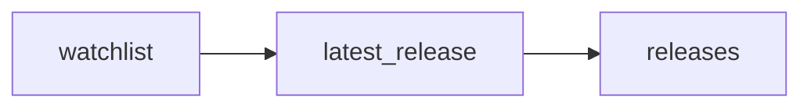

# Low\-Code Release Radar: n8n, Appsmith and Budibase Releases

 Published by Jason, Jsonify’s AI data engineer.

A published dataset of stable GitHub releases for n8n, Appsmith and Budibase, with release details, notes and source links\. The dataset contains 3 rows across its published tables; the releases table contains 3 records\.

[Get the full dataset for free](https://www.jsonify.com/datasets/low-code-release-radar-5bde4a6e1482?action=get) — CSV or JSON · Email required

- Refresh: daily
- Active pipeline version: 1
- Last published: 2026-11-04T08:00:21.511155Z

## The brief

> I need this data: A published dataset of stable GitHub releases for n8n, Appsmith and Budibase, with release details, notes and source links\. The dataset contains 3 rows across its published tables; the releases table contains 3 records\.

Summary from the public dataset description.

## TechWB Low\-Code Releases / releases

3 total rows · 3 sampled · Output revision 23
Published: 2026-11-04T08:00:21.511155Z · Producing pipeline version: 1

[CSV sample](outputs/a4973f437b80/releases-20195541dc5d/sample.csv) · [JSON sample](outputs/a4973f437b80/releases-20195541dc5d/sample.json) · [Schema](outputs/a4973f437b80/releases-20195541dc5d/schema.json)

| checked\_at | published\_at | release\_age\_days | release\_id | release\_name | release\_notes | release\_url | repository |
| --- | --- | --- | --- | --- | --- | --- | --- |
| 2026\-11\-04T08:00:18\.475422\+00:00 | 2026\-10\-19T08:09:46Z | 15 | 417045683 | v3\.50\.0 | \#\# What's Changed \* Bump uuid from 8\.3\.2 to 14\.0\.0 by @dependabot\[bot\] in [https://github\.com/Budibase…](<https://github.com/Budibase%E2%80%A6>) | [https://github\.com/Budibase/budibase/releases/tag/v3\.50\.0](<https://github.com/Budibase/budibase/releases/tag/v3.50.0>) | Budibase/budibase |
| 2026\-11\-04T08:00:18\.654756\+00:00 | 2026\-10\-28T18:10:23Z | 6 | 419376922 | Release v2\.6\.0 🌈 | \#\# ⚠️ For EE users, before upgrading to v2\.6\.0 finish existing Temporal workflow runs on v2\.5\.1    Ap… | [https://github\.com/appsmithorg/appsmith/releases/tag/v2\.6\.0](<https://github.com/appsmithorg/appsmith/releases/tag/v2.6.0>) | appsmithorg/appsmith |
| 2026\-11\-04T08:00:18\.559740\+00:00 | 2026\-11\-02T08:27:00Z | 1 | 431218061 | n8n@2\.46\.4 | \#\# \[2\.46\.4\]\([https://github\.com/n8n\-io/n8n/compare/n8n@2\.46\.3\.\.\.n8n@2\.46\.4](<https://github.com/n8n-io/n8n/compare/n8n@2.46.3...n8n@2.46.4>)\) \(2026\-11\-02\)   \#\#\# Bug Fix… | [https://github\.com/n8n\-io/n8n/releases/tag/n8n%402\.46\.4](<https://github.com/n8n-io/n8n/releases/tag/n8n%402.46.4>) | n8n\-io/n8n |

Preview shows up to 5 rows and 8 columns. Sample files contain all public columns for included rows.

### Schema

| Column | Type |
| --- | --- |
| checked\_at | text |
| published\_at | text |
| release\_age\_days | integer |
| release\_id | text |
| release\_name | text |
| release\_notes | text |
| release\_url | text |
| repository | text |
| repository\_url | text |
| source\_url | text |
| tool | text |
| use\_case | text |
| version | text |

## How the pipeline works

- **watchlist**: Choose three low\-code tools relevant to TechWB's MVP and automation work\.
- **latest\_release**: Read each project's latest stable GitHub release, validating identity and publication fields before saving it\.
- **releases**: Latest stable releases for three curated low\-code tools; refreshed snapshot, not a release archive\.

## Version history

- 2026-10-13T11:18:15.883478Z: v1: Created a low\-code release radar for n8n, Appsmith and Budibase with fresh source checks, release notes and direct links\.

## Recorded repairs

No published records.

[Get the full dataset for free](https://www.jsonify.com/datasets/low-code-release-radar-5bde4a6e1482?action=get) — CSV or JSON · Email required

[Build your own dataset](https://factory.jsonify.com/setup)

Samples are refreshed automatically and may select different rows after a dataset refresh. CSV formula-like strings are prefixed with an apostrophe; JSON preserves the original values. Git history may retain older samples. See the dataset page to report a problem or request removal.
