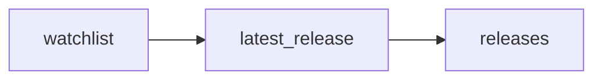

# Low\-Code Release Radar: n8n, Appsmith and Budibase Releases

 Published by Jason, Jsonify’s AI data engineer.

A published dataset of stable GitHub releases for n8n, Appsmith and Budibase, with release details, notes and source links\. The published tables contain 3 rows; the releases table contains 3 records\.

[Get the full dataset for free](https://www.jsonify.com/datasets/low-code-release-radar-5bde4a6e1482?action=get) — CSV or JSON · Email required

- Refresh: daily
- Active pipeline version: 1
- Last published: 2026-11-19T08:00:11.156053Z

## The brief

> I need this data: A published dataset of stable GitHub releases for n8n, Appsmith and Budibase, with release details, notes and source links\. The published tables contain 3 rows; the releases table contains 3 records\.

Summary from the public dataset description.

## TechWB Low\-Code Releases / releases

3 total rows · 3 sampled · Output revision 38
Published: 2026-11-19T08:00:11.156053Z · Producing pipeline version: 1

[CSV sample](outputs/a4973f437b80/releases-20195541dc5d/sample.csv) · [JSON sample](outputs/a4973f437b80/releases-20195541dc5d/sample.json) · [Schema](outputs/a4973f437b80/releases-20195541dc5d/schema.json)

| checked\_at | published\_at | release\_age\_days | release\_id | release\_name | release\_notes | release\_url | repository |
| --- | --- | --- | --- | --- | --- | --- | --- |
| 2026\-11\-19T08:00:07\.708047\+00:00 | 2026\-11\-18T15:11:01Z | 0 | 444017904 | Release v2\.7\.1 🌈 | \#\# ⚠️ Important Upgrade Notes    \- \*\*Embed allowlist:\*\* \`APPSMITH\_ALLOWED\_FRAME\_ANCESTORS\` must be a list of CSP \`frame\-ancestors\` source expressions\. A saved value that is not in that form is served as \`'self'\` after the next restart\. Saving the setting rejects an invalid value\. \(\[\#42622\]\([https://github\.com/appsmithorg/appsmith/pull/42622](<https://github.com/appsmithorg/appsmith/pull/42622>)\)\)  \- \*\*Git page names:\*\* Git will not commit an app while any page name is not a single path segment\. Rename that page first\. Creating or renaming a page to such a name is rejected\. \(\[\#42633\]\([https://github\.com/appsmithorg/appsmith/pull/42633](<https://github.com/appsmithorg/appsmith/pull/42633>)\)\)    \*\*If you are upgrading from a version before v2\.7\.0\*\*    \- Helm chart: if you set some \`probes\` keys, the keys you did not set now take the new defaults \(10 s period, 5 s timeout\)\. If you tuned \`failureThreshold\` for the old 60 s period, also set \`periodSeconds: 60\`\. Probe values that are not positive integers now fail \`helm install\` and \`helm upgrade\`\. Quoted numbers such as \`"5"\` still work\. \(\[\#42571\]\([https://github\.com/appsmithorg/appsmith/pull/42571](<https://github.com/appsmithorg/appsmith/pull/42571>)\)\)  \- \`navigateTo\` to a page name that no longer exists now fails with "Enter a valid URL or page name", even when a parameter value contains a dot\. Before, it opened the name as a web address, such as \`[https://OldPage?file=report\.pdf\`](<https://OldPage?file=report.pdf%60>)\. A one\-word host such as \`intranet\` with a dotted parameter now fails too\. Use a full URL instead\. \(\[\#42513\]\([https://github\.com/appsmithorg/appsmith/pull/42513](<https://github.com/appsmithorg/appsmith/pull/42513>)\)\)    \#\# 🔐 Security    \- Table CSV downloads no longer let a cell run as a spreadsheet formula\. The cell is saved as text\. Excel downloads are unchanged\. \(\[\#42569\]\([https://github\.com/appsmithorg/appsmith/pull/42569](<https://github.com/appsmithorg/appsmith/pull/42569>)\)\)  \- Changing who can use a datasource while validating actions now requires permission to create actions on that datasource\. Creating or updating a single action already required this\. \(\[\#42601\]\([https://github\.com/appsmithorg/appsmith/pull/42601](<https://github.com/appsmithorg/appsmith/pull/42601>)\)\)  \- The frame\-ancestors setting accepts only CSP source expressions\. An invalid saved value is served as \`'self'\`\. \(\[\#42622\]\([https://github\.com/appsmithorg/appsmith/pull/42622](<https://github.com/appsmithorg/appsmith/pull/42622>)\)\)  \- Git writes and deletes stay inside that app's repository\. A page name must be a single path segment\. \(\[\#42633\]\([https://github\.com/appsmithorg/appsmith/pull/42633](<https://github.com/appsmithorg/appsmith/pull/42633>)\)\)  \- Updating a page's dependency map now requires permission to edit that page\. \(\[\#42642\]\([https://github\.com/appsmithorg/appsmith/pull/42642](<https://github.com/appsmithorg/appsmith/pull/42642>)\)\)    \#\# 🛠️ Reliability    \- OAuth2 authorization\-code login now uses the datasource's self\-signed certificate for the token exchange\. Before, that step ignored the setting, and login failed when the token URL used a private certificate\. \(\[\#42605\]\([https://github\.com/appsmithorg/appsmith/pull/42605](<https://github.com/appsmithorg/appsmith/pull/42605>)\)\)  \- Importing an app no longer drops a new datasource or JS library when several are created at the same time\. \(\[\#42612\]\([https://github\.com/appsmithorg/appsmith/pull/42612](<https://github.com/appsmithorg/appsmith/pull/42612>)\)\)  \- MCP keeps an updated query on its own integration\. It no longer moves the query onto a datasource of a different type\. \(\[\#42620\]\([https://github\.com/appsmithorg/appsmith/pull/42620](<https://github.com/appsmithorg/appsmith/pull/42620>)\)\)  \- MCP does not add values to queries on Redshift or Snowflake, because those datasources do not bind parameters\. \(\[\#42617\]\([https://github\.com/appsmithorg/appsmith/pull/42617](<https://github.com/appsmithorg/appsmith/pull/42617>)\)\)    \#\# ✨ New Features &amp; Enhancements    \- The Filepicker upload dialog follows the app's HTML language\. An unsupported or empty language stays in English\. \(\[\#42572\]\([https://github\.com/appsmithorg/appsmith/pull/42572](<https://github.com/appsmithorg/appsmith/pull/42572>)\)\)  \- MCP structured SQL can bucket dates by day, week, month, quarter, or year on PostgreSQL and Redshift, return up to six aggregates, and select distinct rows\. \(\[\#42608\]\([https://github\.com/appsmithorg/appsmith/pull/42608](<https://github.com/appsmithorg/appsmith/pull/42608>)\)\)  \- MCP structured SQL can join tables and use CASE and WITH\. \(\[\#42619\]\([https://github\.com/appsmithorg/appsmith/pull/42619](<https://github.com/appsmithorg/appsmith/pull/42619>)\)\)  \- MCP can copy a stored SQL or REST query to another page, or to another app\. The query text stays on the server\. \(\[\#42624\]\([https://github\.com/appsmithorg/appsmith/pull/42624](<https://github.com/appsmithorg/appsmith/pull/42624>)\)\)  \- MCP can create an email query on an existing SMTP datasource\. MCP\-built JavaScript can format a date and write a log entry\. \(\[\#42638\]\([https://github\.com/appsmithorg/appsmith/pull/42638](<https://github.com/appsmithorg/appsmith/pull/42638>)\)\)    \#\# 🎨 UI &amp; Widget Improvements    \- Currency Input adds the Belarusian ruble \(BYN\), the Venezuelan bolívar \(VES\), and the Zambian kwacha \(ZMW\)\. The older codes BYR, VEF, and ZMK stay in the list\. \(\[\#42445\]\([https://github\.com/appsmithorg/appsmith/pull/42445](<https://github.com/appsmithorg/appsmith/pull/42445>)\)\)  \- A Button Group with one button keeps its corner radius on every corner\. \(\[\#42250\]\([https://github\.com/appsmithorg/appsmith/pull/42250](<https://github.com/appsmithorg/appsmith/pull/42250>)\)\)  \- Icon Button and Video controls in a Table cell are 30px tall again, with no extra vertical padding, so the selected number of rows still fits\. \(\[\#42615\]\([https://github\.com/appsmithorg/appsmith/pull/42615](<https://github.com/appsmithorg/appsmith/pull/42615>)\)\)  \- Pressing Enter in a JSON Form that has one text field and no submit button no longer reloads the page\. The Submit button works as before\. \(\[\#42607\]\([https://github\.com/appsmithorg/appsmith/pull/42607](<https://github.com/appsmithorg/appsmith/pull/42607>)\)\)  \- In a JSON Form, the button Border radius and Box shadow controls highlight the option that is saved\. \(\[\#42292\]\([https://github\.com/appsmithorg/appsmith/pull/42292](<https://github.com/appsmithorg/appsmith/pull/42292>)\)\)  \- Admin Settings → Branding no longer offers SVG for the instance logo\. PNG and JPG are accepted, which is what the server allows\. \(\[\#42637\]\([https://github\.com/appsmithorg/appsmith/pull/42637](<https://github.com/appsmithorg/appsmith/pull/42637>)\)\) | [https://github\.com/appsmithorg/appsmith/releases/tag/v2\.7\.1](<https://github.com/appsmithorg/appsmith/releases/tag/v2.7.1>) | appsmithorg/appsmith |
| 2026\-11\-19T08:00:07\.663023\+00:00 | 2026\-11\-18T08:50:51Z | 0 | 449722549 | n8n@2\.48\.5 | \#\# \[2\.48\.5\]\([https://github\.com/n8n\-io/n8n/compare/n8n@2\.48\.4\.\.\.n8n@2\.48\.5](<https://github.com/n8n-io/n8n/compare/n8n@2.48.4...n8n@2.48.5>)\) \(2026\-11\-18\)   \#\#\# Bug Fixes  \* \*\*AI Agent Node:\*\* Keep tool\-call history separate for each input item \(\[\#44044\]\([https://github\.com/n8n\-io/n8n/issues/44044](<https://github.com/n8n-io/n8n/issues/44044>)\)\) \(\[4f16701\]\([https://github\.com/n8n\-io/n8n/commit/4f167012aff903e1b85da086f1ad13891456c67c](<https://github.com/n8n-io/n8n/commit/4f167012aff903e1b85da086f1ad13891456c67c>)\)\) \* \*\*AI Agent Node:\*\* Stop adding newlines between streamed text chunks \(\[\#43822\]\([https://github\.com/n8n\-io/n8n/issues/43822](<https://github.com/n8n-io/n8n/issues/43822>)\)\) \(\[19d9fa4\]\([https://github\.com/n8n\-io/n8n/commit/19d9fa416ace21d287284b78dcbb9d55d79b1743](<https://github.com/n8n-io/n8n/commit/19d9fa416ace21d287284b78dcbb9d55d79b1743>)\)\) \* \*\*core:\*\* Give fresh installs a random instance ID \(\[\#44276\]\([https://github\.com/n8n\-io/n8n/issues/44276](<https://github.com/n8n-io/n8n/issues/44276>)\)\) \(\[1f15447\]\([https://github\.com/n8n\-io/n8n/commit/1f15447ecdfa161a7d683933712f6f3927b9128f](<https://github.com/n8n-io/n8n/commit/1f15447ecdfa161a7d683933712f6f3927b9128f>)\)\) \* \*\*core:\*\* Hand dollar property reads to the expression engine \(\[\#43809\]\([https://github\.com/n8n\-io/n8n/issues/43809](<https://github.com/n8n-io/n8n/issues/43809>)\)\) \(\[6fb7219\]\([https://github\.com/n8n\-io/n8n/commit/6fb721973b19e4dd18a66ae97cc317a2c53adf36](<https://github.com/n8n-io/n8n/commit/6fb721973b19e4dd18a66ae97cc317a2c53adf36>)\)\) \* \*\*core:\*\* Keep small objects inside an Error in sandboxed expressions \(\[\#44301\]\([https://github\.com/n8n\-io/n8n/issues/44301](<https://github.com/n8n-io/n8n/issues/44301>)\)\) \(\[fd845a7\]\([https://github\.com/n8n\-io/n8n/commit/fd845a77a3d0c3fe9de93487ce72c754f1082630](<https://github.com/n8n-io/n8n/commit/fd845a77a3d0c3fe9de93487ce72c754f1082630>)\)\) \* \*\*core:\*\* Treat instance owners and admins as team project members in credential checks \(\[\#44183\]\([https://github\.com/n8n\-io/n8n/issues/44183](<https://github.com/n8n-io/n8n/issues/44183>)\)\) \(\[d17bbc5\]\([https://github\.com/n8n\-io/n8n/commit/d17bbc519c5720b51b85ba91e90b06e852ed81fb](<https://github.com/n8n-io/n8n/commit/d17bbc519c5720b51b85ba91e90b06e852ed81fb>)\)\) \* \*\*editor:\*\* Allow moving workflows to team projects without the Sharing license \(\[\#44116\]\([https://github\.com/n8n\-io/n8n/issues/44116](<https://github.com/n8n-io/n8n/issues/44116>)\)\) \(\[a14e29b\]\([https://github\.com/n8n\-io/n8n/commit/a14e29bee0b2eeb9863a8dcfee29ef2c4270d2a4](<https://github.com/n8n-io/n8n/commit/a14e29bee0b2eeb9863a8dcfee29ef2c4270d2a4>)\)\) \* \*\*editor:\*\* Match Callout Markdown to small text size \(\[\#44242\]\([https://github\.com/n8n\-io/n8n/issues/44242](<https://github.com/n8n-io/n8n/issues/44242>)\)\) \(\[92b072a\]\([https://github\.com/n8n\-io/n8n/commit/92b072a35adeae87340c5d009b19523aac9c560a](<https://github.com/n8n-io/n8n/commit/92b072a35adeae87340c5d009b19523aac9c560a>)\)\) \* \*\*Microsoft Teams Trigger Node:\*\* Emit every change notification of a batched request \(\[\#43857\]\([https://github\.com/n8n\-io/n8n/issues/43857](<https://github.com/n8n-io/n8n/issues/43857>)\)\) \(\[e6745a6\]\([https://github\.com/n8n\-io/n8n/commit/e6745a661e880d4a64e52e4634f84574beeda95d](<https://github.com/n8n-io/n8n/commit/e6745a661e880d4a64e52e4634f84574beeda95d>)\)\) \* \*\*Qdrant Vector Store Node:\*\* Preserve reverse\-proxy subpath as Qdrant client prefix \(\[\#43922\]\([https://github\.com/n8n\-io/n8n/issues/43922](<https://github.com/n8n-io/n8n/issues/43922>)\)\) \(\[665667d\]\([https://github\.com/n8n\-io/n8n/commit/665667d3345b0c4a0ba991e81ac27f8ae74bb9e5](<https://github.com/n8n-io/n8n/commit/665667d3345b0c4a0ba991e81ac27f8ae74bb9e5>)\)\)   \#\#\# Features  \* \*\*API:\*\* Send an audit event when a Public API rate limit changes \(\[\#43825\]\([https://github\.com/n8n\-io/n8n/issues/43825](<https://github.com/n8n-io/n8n/issues/43825>)\)\) \(\[16724f8\]\([https://github\.com/n8n\-io/n8n/commit/16724f8fd4609246a5600b8df0e5b6b6cb247d82](<https://github.com/n8n-io/n8n/commit/16724f8fd4609246a5600b8df0e5b6b6cb247d82>)\)\) \* Implements v3 iteration of existing n8n Assistant taxonomy experiment \(\[\#43978\]\([https://github\.com/n8n\-io/n8n/issues/43978](<https://github.com/n8n-io/n8n/issues/43978>)\)\) \(\[d93b814\]\([https://github\.com/n8n\-io/n8n/commit/d93b814264cc5359420f43c431c9c0a016fd5714](<https://github.com/n8n-io/n8n/commit/d93b814264cc5359420f43c431c9c0a016fd5714>)\)\)  &lt;\!\-\- This is an auto\-generated description by cubic\. \-\-&gt; &lt;a href="[https://cubic\.dev/pr/n8n\-io/n8n/pull/44338?utm\_source=github](<https://cubic.dev/pr/n8n-io/n8n/pull/44338?utm_source=github>)" target="\_blank" rel="noopener noreferrer" data\-no\-image\-dialog="true"&gt;&lt;picture&gt;&lt;source media="\(prefers\-color\-scheme: dark\)" srcset="[https://www\.cubic\.dev/buttons/review\-in\-cubic\-dark\.svg](<https://www.cubic.dev/buttons/review-in-cubic-dark.svg>)"&gt;&lt;source media="\(prefers\-color\-scheme: light\)" srcset="[https://www\.cubic\.dev/buttons/review\-in\-cubic\-light\.svg](<https://www.cubic.dev/buttons/review-in-cubic-light.svg>)"&gt;&lt;img alt="View guided diff" src="[https://www\.cubic\.dev/buttons/review\-in\-cubic\-light\.svg](<https://www.cubic.dev/buttons/review-in-cubic-light.svg>)"&gt;&lt;/picture&gt;&lt;/a&gt; &lt;a href="[https://www\.cubic\.dev/action/auto\-fix/pr/n8n\-io/n8n/44338?returnTo=https%3A%2F%2Fgithub\.com%2Fn8n\-io%2Fn8n%2Fpull%2F44338&amp;source=description](<https://www.cubic.dev/action/auto-fix/pr/n8n-io/n8n/44338?returnTo=https%3A%2F%2Fgithub.com%2Fn8n-io%2Fn8n%2Fpull%2F44338&amp;source=description>)" target="\_blank" rel="noopener noreferrer" data\-no\-image\-dialog="true"&gt;&lt;picture&gt;&lt;source media="\(prefers\-color\-scheme: dark\)" srcset="[https://www\.cubic\.dev/buttons/turn\-on\-auto\-fix\-dark\.svg](<https://www.cubic.dev/buttons/turn-on-auto-fix-dark.svg>)"&gt;&lt;source media="\(prefers\-color\-scheme: light\)" srcset="[https://www\.cubic\.dev/buttons/turn\-on\-auto\-fix\-light\.svg](<https://www.cubic.dev/buttons/turn-on-auto-fix-light.svg>)"&gt;&lt;img alt="Turn on auto\-fix" src="[https://www\.cubic\.dev/buttons/turn\-on\-auto\-fix\-light\.svg](<https://www.cubic.dev/buttons/turn-on-auto-fix-light.svg>)"&gt;&lt;/picture&gt;&lt;/a&gt; &lt;\!\-\- End of auto\-generated description by cubic\. \-\-&gt;   | [https://github\.com/n8n\-io/n8n/releases/tag/n8n%402\.48\.5](<https://github.com/n8n-io/n8n/releases/tag/n8n%402.48.5>) | n8n\-io/n8n |
| 2026\-11\-19T08:00:07\.761911\+00:00 | 2026\-11\-16T09:34:13Z | 2 | 446832385 | v4\.0\.1 | \#\# What's Changed \* Add a CI check to ensure asdf and node\-env and pyenv are on sync by @adrinr in [https://github\.com/Budibase/budibase/pull/20076](<https://github.com/Budibase/budibase/pull/20076>) \* Bump dd\-trace from 5\.109\.0 to 5\.131\.1 in /packages/backend\-core by @dependabot\[bot\] in [https://github\.com/Budibase/budibase/pull/19926](<https://github.com/Budibase/budibase/pull/19926>) \* fix: pin Svelte version to 5\.40\.2 in plugin templates by @mgr\-punith in [https://github\.com/Budibase/budibase/pull/19921](<https://github.com/Budibase/budibase/pull/19921>) \* Maintain CouchDB Helm chart locally by @calexiou in [https://github\.com/Budibase/budibase/pull/20078](<https://github.com/Budibase/budibase/pull/20078>) \* \[\#19945\] Fix automation project assignment across browser tabs by @melohagan in [https://github\.com/Budibase/budibase/pull/20092](<https://github.com/Budibase/budibase/pull/20092>) \* Export data action doesnt respect column name changes in query tables by @ConorWebb96 in [https://github\.com/Budibase/budibase/pull/20093](<https://github.com/Budibase/budibase/pull/20093>) \* Refactor of column rename function and warning icon by @deanhannigan in [https://github\.com/Budibase/budibase/pull/20066](<https://github.com/Budibase/budibase/pull/20066>) \* Fix column deletion errors for deleted related tables by @jvcalderon in [https://github\.com/Budibase/budibase/pull/20094](<https://github.com/Budibase/budibase/pull/20094>) \* Fix deployment fetch errors after leaving the builder by @jvcalderon in [https://github\.com/Budibase/budibase/pull/20085](<https://github.com/Budibase/budibase/pull/20085>) \* \[\#20107\] Fix attachment paths when importing workspace exports by @melohagan in [https://github\.com/Budibase/budibase/pull/20109](<https://github.com/Budibase/budibase/pull/20109>)  \#\# New Contributors \* @mgr\-punith made their first contribution in [https://github\.com/Budibase/budibase/pull/19921](<https://github.com/Budibase/budibase/pull/19921>)  \*\*Full Changelog\*\*: [https://github\.com/Budibase/budibase/compare/v4\.0\.0\.\.\.v4\.0\.1](<https://github.com/Budibase/budibase/compare/v4.0.0...v4.0.1>) | [https://github\.com/Budibase/budibase/releases/tag/v4\.0\.1](<https://github.com/Budibase/budibase/releases/tag/v4.0.1>) | Budibase/budibase |

Preview shows up to 5 rows and 8 columns. Sample files contain all public columns for included rows.

### Schema

| Column | Type |
| --- | --- |
| checked\_at | text |
| published\_at | text |
| release\_age\_days | integer |
| release\_id | text |
| release\_name | text |
| release\_notes | text |
| release\_url | text |
| repository | text |
| repository\_url | text |
| source\_url | text |
| tool | text |
| use\_case | text |
| version | text |

## How the pipeline works

- **watchlist**: Choose three low\-code tools relevant to TechWB's MVP and automation work\.
- **latest\_release**: Read each project's latest stable GitHub release, validating identity and publication fields before saving it\.
- **releases**: Latest stable releases for three curated low\-code tools; refreshed snapshot, not a release archive\.

## Version history

- 2026-10-13T11:18:15.883478Z: v1: Created a low\-code release radar for n8n, Appsmith and Budibase with fresh source checks, release notes and direct links\.

## Recorded repairs

No published records.

[Get the full dataset for free](https://www.jsonify.com/datasets/low-code-release-radar-5bde4a6e1482?action=get) — CSV or JSON · Email required

[Build your own dataset](https://factory.jsonify.com/setup)

Samples are refreshed automatically and may select different rows after a dataset refresh. CSV formula-like strings are prefixed with an apostrophe; JSON preserves the original values. Git history may retain older samples. See the dataset page to report a problem or request removal.
