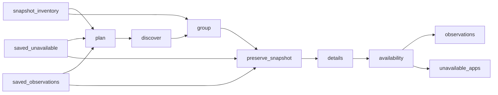

# Meta Quest App Catalogue and Charts

 Published by Jason, Jsonify’s AI data engineer.

Explore 13,060 published Meta Quest catalogue and chart rows, with app details such as prices, ratings, categories, and supported devices\. The published tables include 13,053 app observations and 7 unavailable\-app records\.

[Get the full dataset for free](https://www.jsonify.com/datasets/meta-quest-catalogue-and-charts-64282414adae?action=get) — CSV or JSON · Email required

- Refresh: On demand
- Active pipeline version: 15
- Last published: 2026-11-07T22:13:06.107459Z

## The brief

> I need this data: Explore 13,060 published Meta Quest catalogue and chart rows, with app details such as prices, ratings, categories, and supported devices\. The published tables include 13,053 app observations and 7 unavailable\-app records\.

Summary from the public dataset description.

## Meta Quest catalogue and charts / observations

13,053 total rows · 50 sampled · Output revision 1
Published: 2026-11-07T22:13:06.107459Z · Producing pipeline version: 12

[CSV sample](outputs/f342597f4e56/observations-bfc5a6b45b6a/sample.csv) · [JSON sample](outputs/f342597f4e56/observations-bfc5a6b45b6a/sample.json) · [Schema](outputs/f342597f4e56/observations-bfc5a6b45b6a/schema.json)

| app\_id | app\_name | category\_genres | chart\_name | collected\_at | currency | developer | last\_updated |
| --- | --- | --- | --- | --- | --- | --- | --- |
| 1336992516166666 | Clark Rooms | \{"genres": \["Platformer", "Action", "Adventure", "Survival"\], "category": "Games"} | None | 2026\-11\-07T01:33:23\.804180\+00:00 | EUR | jjwx | None |
| 2423260194849756 | HoloDentist | \{"genres": \["Learning", "Medical", "Productivity"\], "category": "Apps"} | None | 2026\-11\-07T04:56:40\.047324\+00:00 | USD | Fifth Ingenium | None |
| 8455397034566726 | Skill Issue VR | \{"genres": \["Arcade", "Puzzle", "Simulation", "Action"\], "category": "Games"} | None | 2026\-11\-07T13:01:52\.099278\+00:00 | USD | Ecsedi | None |
| 7008794785815209 | Monkeys Paradise | \{"genres": \["Platformer", "Action"\], "category": "Games"} | None | 2026\-11\-07T08:39:32\.527378\+00:00 | EUR | CheeseburgerOrg | None |
| 6057613437654197 | The Turn | \{"genres": \["Arcade", "Deportes", "Simulación", "Acción"\], "category": "Juegos"} | None | 2026\-11\-07T17:58:59\.152286\+00:00 | MXN | Yurii Kaplunov | None |

Preview shows up to 5 rows and 8 columns. Sample files contain all public columns for included rows.

### Schema

| Column | Type |
| --- | --- |
| app\_id | text |
| app\_name | text |
| category\_genres | jsonb |
| chart\_name | text |
| collected\_at | text |
| currency | text |
| developer | text |
| last\_updated | text |
| price | double precision |
| publisher | text |
| rank | integer |
| rating\_avg | double precision |
| rating\_count | integer |
| release\_date | text |
| store\_url | text |
| supported\_devices | jsonb |

## Meta Quest catalogue and charts / unavailable\_apps

7 total rows · 7 sampled · Output revision 1
Published: 2026-11-07T22:13:06.107459Z · Producing pipeline version: 12

[CSV sample](outputs/f342597f4e56/unavailable-apps-a66bf33be557/sample.csv) · [JSON sample](outputs/f342597f4e56/unavailable-apps-a66bf33be557/sample.json) · [Schema](outputs/f342597f4e56/unavailable-apps-a66bf33be557/schema.json)

| app\_id | appearances | availability\_status | collected\_at | reason | store\_url |
| --- | --- | --- | --- | --- | --- |
| 9465027033537283 | \[\{"rank": null, "chart\_name": null}\] | source\_confirmed\_unavailable | 2026\-11\-07T22:11:05\.077734\+00:00 | Meta says this page is temporarily unavailable\. | [https://www\.meta\.com/experiences/9465027033537283/](<https://www.meta.com/experiences/9465027033537283/>) |
| 6707631349366674 | \[\{"rank": null, "chart\_name": null}\] | source\_confirmed\_unavailable | 2026\-11\-07T22:12:58\.453978\+00:00 | Meta says this page is temporarily unavailable\. | [https://www\.meta\.com/experiences/6707631349366674/](<https://www.meta.com/experiences/6707631349366674/>) |
| 7322868361059572 | \[\{"rank": null, "chart\_name": null}\] | source\_confirmed\_unavailable | 2026\-11\-07T22:10:39\.628576\+00:00 | Meta says this page is temporarily unavailable\. | [https://www\.meta\.com/experiences/7322868361059572/](<https://www.meta.com/experiences/7322868361059572/>) |
| 23954694280811521 | \[\{"rank": null, "chart\_name": null}\] | source\_confirmed\_unavailable | 2026\-11\-07T22:12:27\.564796\+00:00 | Meta says this page is temporarily unavailable\. | [https://www\.meta\.com/experiences/23954694280811521/](<https://www.meta.com/experiences/23954694280811521/>) |
| 6122534951199045 | \[\{"rank": null, "chart\_name": null}\] | source\_confirmed\_unavailable | 2026\-11\-07T22:12:24\.097533\+00:00 | Meta says this page is temporarily unavailable\. | [https://www\.meta\.com/experiences/6122534951199045/](<https://www.meta.com/experiences/6122534951199045/>) |

Preview shows up to 5 rows and 8 columns. Sample files contain all public columns for included rows.

### Schema

| Column | Type |
| --- | --- |
| app\_id | text |
| appearances | jsonb |
| availability\_status | text |
| collected\_at | text |
| reason | text |
| store\_url | text |

## How the pipeline works

- **snapshot\_inventory**: Saved one\-off catalogue identities and chart appearances, reused without rediscovering the catalogue\.
- **saved\_unavailable**: Published unavailable app records retained in the one\-off snapshot\.
- **saved\_observations**: Published snapshot observations to preserve while correcting missing release dates\.
- **plan**: Select the public Meta catalogue lists and chart pages for this refresh\.
- **discover**: Follow each official catalogue or chart to its final page, preserving the source order\.
- **group**: Combine catalogue and chart appearances by the exact Meta app identifier\.
- **preserve\_snapshot**: Match saved observations and unavailable listings to the exact snapshot app identities\.
- **details**: Preserve the snapshot and check only app pages whose release date was missed\.
- **availability**: Separate verified app details from source\-confirmed unavailable app pages\.
- **unavailable\_apps**: Apps whose own Meta page explicitly says it is temporarily unavailable; details are not inferred\.
- **observations**: Catalogue records and chart appearances, with null ranks for unranked lists\.

## Version history

- 2026-11-06T19:36:05.800981Z: v1: Track the complete active Quest catalogue using a reconciled app index, verified official Meta details and ranked chart observations\. Refresh charts daily and the catalogue on Wednesdays\.
- 2026-11-06T21:40:34.136825Z: v2: Allow overlapping Meta catalogue pages without stopping collection\. Chart ranking checks and full catalogue count checks remain unchanged\.
- 2026-11-06T22:28:21.176849Z: v3: Capture and reconcile the complete secondary catalogue before reading Meta pages, retrying if the catalogue changes during collection\.
- 2026-11-06T23:02:24.443482Z: v4: Use equivalent public Meta catalogue section pages when initializing catalogue collection\.
- 2026-11-06T23:14:22.971999Z: v5: Allow coming\-soon app pages without a release\-date label while retaining all metadata and identity checks\.
- 2026-11-07T00:30:10.423328Z: v6: Retry temporary app\-page loading failures up to twice before stopping, preserving completed collection work\.
- 2026-11-07T01:10:52.861066Z: v7: Read supported headsets from official app compatibility metadata when Meta omits the visible device list\.
- 2026-11-07T03:28:48.659940Z: v8: Parse prices displayed using Arabic digits and decimal marks while preserving source currency\.
- 2026-11-07T04:12:18.664775Z: v9: Retain confirmed Quest pre\-order apps when Meta has not yet published headset compatibility\.
- 2026-11-07T05:54:58.054838Z: v10: Keep unpublished developer names blank and parse both British and US English release dates\.
- 2026-11-07T17:20:35.733285Z: v11: Retry incomplete official app responses before stopping the catalogue collection, preserving exact app identity and required fields\.
- 2026-11-07T22:08:47.889705Z: v12: List source\-confirmed unavailable apps separately and reuse the saved catalogue inventory for the one\-off snapshot\.
- 2026-11-07T22:20:59.272765Z: v13: Fill missed release dates using Meta’s English pages, preserving the original snapshot’s other values and unavailable listings\.
- 2026-11-07T22:27:14.427697Z: v14: Corrects localized decimal prices using official pages in the original currency while preserving saved snapshot details\.
- 2026-11-07T23:39:32.161820Z: v15: Handles Meta’s additional explicit unavailable\-page message so missing\-date checks can continue without losing saved details\.

## Recorded repairs

No published records.

[Get the full dataset for free](https://www.jsonify.com/datasets/meta-quest-catalogue-and-charts-64282414adae?action=get) — CSV or JSON · Email required

[Build your own dataset](https://factory.jsonify.com/setup)

Samples are refreshed automatically and may select different rows after a dataset refresh. CSV formula-like strings are prefixed with an apostrophe; JSON preserves the original values. Git history may retain older samples. See the dataset page to report a problem or request removal.
