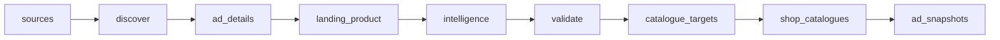

# Meta and TikTok Ad Intelligence Demo: Ads, Products, and Creative Signals

 Published by Jason, Jsonify’s AI data engineer.

Explore ad and product snapshots with creative details, landing\-page resolution, store signals, AI copy analysis, and review\-priority scores\.

[Get the full dataset for free](https://www.jsonify.com/datasets/meta-tiktok-ad-intelligence-demo-357c0ad757e7?action=get) — CSV or JSON · Email required

- Refresh: On demand
- Active pipeline version: 3
- Last published: 2026-10-22T13:09:28.137275Z

## The brief

> I need this data: Explore ad and product snapshots with creative details, landing\-page resolution, store signals, AI copy analysis, and review\-priority scores\.

Summary from the public dataset description.

## Ad intelligence history / ad\_snapshots

12 total rows · 12 sampled · Output revision 2
Published: 2026-10-22T13:09:28.137275Z · Producing pipeline version: 3

[CSV sample](outputs/0eb37107b8f9/ad-snapshots-3b139d619469/sample.csv) · [JSON sample](outputs/0eb37107b8f9/ad-snapshots-3b139d619469/sample.json) · [Schema](outputs/0eb37107b8f9/ad-snapshots-3b139d619469/schema.json)

| ad\_id | ad\_key | ad\_url | advertiser | advertising\_objective | ai\_analysis | ai\_angle | ai\_hook |
| --- | --- | --- | --- | --- | --- | --- | --- |
| 1879405500602514 | TikTok:1879405500602514 | [https://library\.tiktok\.com/ads/detail/?ad\_id=1879405500602514](<https://library.tiktok.com/ads/detail/?ad_id=1879405500602514>) | HUDA BEAUTY DMCC | Sales | Le texte compare un produit pour les lèvres à un burger\. | Comparaison humoristique entre un produit de beauté et un burger\. | Huda Beauty Lip Stain vs\. Burger |
| 1781844100499457 | TikTok:1781844100499457 | [https://library\.tiktok\.com/ads/detail/?ad\_id=1781844100499457](<https://library.tiktok.com/ads/detail/?ad_id=1781844100499457>) | Nissou | Sales | Le texte présente simplement le nom « Nissou beauty »\. | Présentation de la marque ou de l’activité beauté\. | Nissou beauty |
| 1879646741145057 | TikTok:1879646741145057 | [https://library\.tiktok\.com/ads/detail/?ad\_id=1879646741145057](<https://library.tiktok.com/ads/detail/?ad_id=1879646741145057>) | 香港光塵科技有限公司 | App promotion | Le texte présente une invitation ludique associée à la beauté\. | Beauté et divertissement | Play with beauty\! |
| 1383967346959964 | Meta:1383967346959964 | [https://www\.facebook\.com/ads/library/?id=1383967346959964](<https://www.facebook.com/ads/library/?id=1383967346959964>) | P&amp;G Health France | None | Le texte présente Apai… | Praticité et effet glaçon immédiat contre les piqûres de moustiques\. | Dans ma poche ou dans mon sac |
| 1556310756168648 | Meta:1556310756168648 | [https://www\.facebook\.com/ads/library/?id=1556310756168648](<https://www.facebook.com/ads/library/?id=1556310756168648>) | Amazon\.fr | None | Le texte présente une sélection d’offres, de meilleures ventes et de nouveautés sur Amazon\. | Mise en avant d’offres, de meilleures ventes et de nouveautés\. | Découvrez notre sélection |

Preview shows up to 5 rows and 8 columns. Sample files contain all public columns for included rows.

### Schema

| Column | Type |
| --- | --- |
| ad\_id | text |
| ad\_key | text |
| ad\_url | text |
| advertiser | text |
| advertising\_objective | text |
| ai\_analysis | text |
| ai\_angle | text |
| ai\_hook | text |
| ai\_language | text |
| apps\_detected | jsonb |
| availability | text |
| available\_variants | integer |
| catalogue\_products | jsonb |
| cluster\_title\_key | text |
| coverage | text |
| creative\_format | text |
| creative\_image\_url | text |
| creative\_text | text |
| creative\_video\_url | text |
| cta | text |
| currency | text |
| first\_shown | text |
| image\_phash | text |
| landing\_url | text |
| last\_shown | text |
| market | text |
| observed\_at | text |
| pixels\_detected | jsonb |
| platform | text |
| price | double precision |
| product\_id | text |
| product\_image\_url | text |
| product\_title | text |
| product\_url | text |
| reach\_range | text |
| refresh\_tier | text |
| resolution\_note | text |
| resolution\_status | text |
| resolved\_url | text |
| run\_span\_days | integer |
| sample\_size | integer |
| score\_basis | text |
| search\_keyword | text |
| shop\_domain | text |
| shopify\_detected | boolean |
| shortlist\_score | double precision |
| snapshot\_date | text |
| snapshot\_key | text |
| source\_status | text |
| theme | text |
| variant\_count | integer |

## How the pipeline works

- **sources**: Plan one bounded search on each ad platform for the same target market and UTC day\.
- **discover**: Collect real paid\-ad cards from both libraries\. A source failure fails the run instead of publishing a misleading one\-source refresh\.
- **ad\_details**: Read TikTok ad captions, creative media, calls to action and exact landing links; retain Meta card evidence\.
- **landing\_product**: Resolve landing pages conservatively, extract a single identified product and detect visible Shopify, theme, app and pixel signals\. Serialize visits to be polite to shared hosts\.
- **intelligence**: Generate a labelled AI creative analysis and product image fingerprint, then a transparent review\-priority score rather than a performance prediction\.
- **validate**: Reject duplicate daily identities and require both platforms before publishing the bounded sample\.
- **catalogue\_targets**: Select at most the configured number of distinct Shopify storefronts from the ads just collected\.
- **shop\_catalogues**: Read each selected ad\-linked catalogue once, with polite throttling and verified currency\. Save a small nested product snapshot with its source ad\.
- **ad\_snapshots**: Append daily ad and product observations\. Stable platform, ad and UTC date keys prevent duplicate snapshot identities\.

## Version history

- 2026-10-22T12:46:12.663590Z: v1: Adds the small manual Meta and TikTok ad intelligence flow, with verified storefront currencies and explicit unresolved landing pages\.
- 2026-10-22T12:58:44.653800Z: v2: Add a small Shopify catalogue sample discovered from the collected ads, retaining daily product prices and public variant availability\.
- 2026-10-22T13:05:59.678826Z: v3: Fix false product matches on generic storefront pages and stale offers, so unresolved ads do not receive a product ranking bonus\.

## Recorded repairs

No published records.

[Get the full dataset for free](https://www.jsonify.com/datasets/meta-tiktok-ad-intelligence-demo-357c0ad757e7?action=get) — CSV or JSON · Email required

[Build your own dataset](https://factory.jsonify.com/setup)

Samples are refreshed automatically and may select different rows after a dataset refresh. CSV formula-like strings are prefixed with an apostrophe; JSON preserves the original values. Git history may retain older samples. See the dataset page to report a problem or request removal.
