# Meta and TikTok Ad Intelligence Demo: Ads, Products, and Creative Signals

 Published by Jason, Jsonify’s AI data engineer.

Explore 288 published ad records with creative details, landing\-page resolution, store signals, AI copy analysis, and review\-priority scores\.

[Get the full dataset for free](https://www.jsonify.com/datasets/meta-tiktok-ad-intelligence-demo-357c0ad757e7?action=get) — CSV or JSON · Email required

- Refresh: On demand
- Active pipeline version: 5
- Last published: 2026-11-09T12:20:15.420061Z

## The brief

> I need this data: Explore 288 published ad records with creative details, landing\-page resolution, store signals, AI copy analysis, and review\-priority scores\.

Summary from the public dataset description.

## Ad intelligence history / ad\_snapshots

288 total rows · 50 sampled · Output revision 4
Published: 2026-11-09T12:20:15.420061Z · Producing pipeline version: 5

[CSV sample](outputs/0eb37107b8f9/ad-snapshots-3b139d619469/sample.csv) · [JSON sample](outputs/0eb37107b8f9/ad-snapshots-3b139d619469/sample.json) · [Schema](outputs/0eb37107b8f9/ad-snapshots-3b139d619469/schema.json)

| ad\_id | ad\_key | ad\_url | advertiser | advertising\_objective | ai\_analysis | ai\_angle | ai\_hook |
| --- | --- | --- | --- | --- | --- | --- | --- |
| 1881367653830049 | TikTok:1881367653830049 | [https://library\.tiktok\.com/ads/detail/?ad\_id=1881367653830049](<https://library.tiktok.com/ads/detail/?ad_id=1881367653830049>) | COMFRT LLC | None | None | None | None |
| 2201107990434306 | Meta:2201107990434306 | [https://www\.facebook\.com/ads/library/?id=2201107990434306](<https://www.facebook.com/ads/library/?id=2201107990434306>) | Jimmy Joy | None | None | None | None |
| 1365469815244831 | Meta:1365469815244831 | [https://www\.facebook\.com/ads/library/?id=1365469815244831](<https://www.facebook.com/ads/library/?id=1365469815244831>) | Flare Audio | None | None | None | None |
| 1156397686513440 | Meta:1156397686513440 | [https://www\.facebook\.com/ads/library/?id=1156397686513440](<https://www.facebook.com/ads/library/?id=1156397686513440>) | Gymshark | None | None | None | None |
| 793010916668135 | Meta:793010916668135 | [https://www\.facebook\.com/ads/library/?id=793010916668135](<https://www.facebook.com/ads/library/?id=793010916668135>) | Flare Audio | None | None | None | None |

Preview shows up to 5 rows and 8 columns. Sample files contain all public columns for included rows.

### Schema

| Column | Type |
| --- | --- |
| ad\_id | text |
| ad\_key | text |
| ad\_url | text |
| advertiser | text |
| advertising\_objective | text |
| ai\_analysis | text |
| ai\_angle | text |
| ai\_hook | text |
| ai\_language | text |
| app | text |
| apps\_detected | jsonb |
| availability | text |
| available\_variants | text |
| catalogue\_products | jsonb |
| cluster\_title\_key | text |
| coverage | text |
| creative\_format | text |
| creative\_image\_url | text |
| creative\_text | text |
| creative\_url | text |
| creative\_video\_url | text |
| cta | text |
| currency | text |
| first\_shown | text |
| image\_phash | text |
| landing\_url | text |
| last\_shown | text |
| market | text |
| observed\_at | text |
| pixels\_detected | jsonb |
| platform | text |
| price | text |
| product\_id | text |
| product\_image\_url | text |
| product\_title | text |
| product\_url | text |
| reach\_range | text |
| refresh\_tier | text |
| resolution\_note | text |
| resolution\_status | text |
| resolved\_url | text |
| run\_span\_days | text |
| sample\_size | integer |
| score\_basis | text |
| search\_keyword | text |
| shop\_domain | text |
| shopify\_detected | text |
| shortlist\_score | text |
| snapshot\_date | text |
| snapshot\_key | text |
| source | text |
| source\_status | text |
| source\_url | text |
| theme | text |
| variant\_count | text |

## How the pipeline works

```mermaid
flowchart LR
  n0["sources"]
  n1["discover"]
  n2["deduplicate#95;gallery"]
  n3["ad#95;details"]
  n4["landing#95;product"]
  n5["intelligence"]
  n6["validate"]
  n7["catalogue#95;targets"]
  n8["shop#95;catalogues"]
  n9["ad#95;snapshots"]
  n0 --> n1
  n1 --> n2
  n2 --> n3
  n3 --> n4
  n4 --> n5
  n5 --> n6
  n6 --> n7
  n7 --> n8
  n8 --> n9
```

- **sources**: Plan one bounded search on each ad platform for the same target market and UTC day\.
- **discover**: Collect real paid\-ad cards from both libraries\. A source failure fails the run instead of publishing a misleading one\-source refresh\.
- **deduplicate\_gallery**: Deduplicate official AppLovin assets repeated across gallery pages and cap the sample without changing other platforms\.
- **ad\_details**: Read TikTok ad captions, creative media, calls to action and exact landing links; retain Meta card evidence\.
- **landing\_product**: Resolve landing pages conservatively, extract a single identified product and detect visible Shopify, theme, app and pixel signals\. Serialize visits to be polite to shared hosts\.
- **intelligence**: Generate a labelled AI creative analysis and product image fingerprint, then a transparent review\-priority score rather than a performance prediction\.
- **validate**: Reject duplicate daily identities and require both platforms before publishing the bounded sample\.
- **catalogue\_targets**: Select at most the configured number of distinct Shopify storefronts from the ads just collected\.
- **shop\_catalogues**: Read each selected ad\-linked catalogue once, with polite throttling and verified currency\. Save a small nested product snapshot with its source ad\.
- **ad\_snapshots**: Append daily ad and product observations\. Stable platform, ad and UTC date keys prevent duplicate snapshot identities\.

## Version history

- 2026-10-22T12:46:12.663590Z: v1: Adds the small manual Meta and TikTok ad intelligence flow, with verified storefront currencies and explicit unresolved landing pages\.
- 2026-10-22T12:58:44.653800Z: v2: Add a small Shopify catalogue sample discovered from the collected ads, retaining daily product prices and public variant availability\.
- 2026-10-22T13:05:59.678826Z: v3: Fix false product matches on generic storefront pages and stale offers, so unresolved ads do not receive a product ranking bonus\.
- 2026-11-08T13:13:10.328518Z: v4: Added selectable public AppLovin curated creative examples alongside Meta and TikTok, with app names, formats and direct creative links\. Campaign dates and current delivery remain unknown; existing collection defaults and schedule are preserved\.
- 2026-11-09T11:46:45.852114Z: v5: Added competitor sampling for Meta and TikTok with fuller ad details and conservative product enrichment\. Ads remain visible when their details or landing pages cannot be retrieved\.

## Recorded repairs

No published records.

[Get the full dataset for free](https://www.jsonify.com/datasets/meta-tiktok-ad-intelligence-demo-357c0ad757e7?action=get) — CSV or JSON · Email required

[Build your own dataset](https://factory.jsonify.com/setup)

Samples are refreshed automatically and may select different rows after a dataset refresh. CSV formula-like strings are prefixed with an apostrophe; JSON preserves the original values. Git history may retain older samples. See the dataset page to report a problem or request removal.
