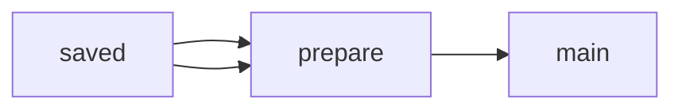

# Mexico New Housing Developments and Prices per m²

 Published by Jason, Jsonify’s AI data engineer.

A saved sample of residential developments in Querétaro, San Miguel de Allende, Mexico City, and Guadalajara/Zapopan, with advertised prices and housing details\.

[Get the full dataset for free](https://www.jsonify.com/datasets/mexico-new-housing-developments-and-price-per-m-45f3f885ec8f?action=get) — CSV or JSON · Email required

- Refresh: On demand
- Active pipeline version: 1
- Last published: 2026-11-16T12:25:31.824093Z

## The brief

> I need this data: A saved sample of residential developments in Querétaro, San Miguel de Allende, Mexico City, and Guadalajara/Zapopan, with advertised prices and housing details\.

Summary from the public dataset description.

## Mexico New Housing Developments and Price per m² / main

144 total rows · 50 sampled · Output revision 1
Published: 2026-11-16T12:25:31.824093Z · Producing pipeline version: 1

[CSV sample](outputs/8ea6cac86939/main-0d6e4079e367/sample.csv) · [JSON sample](outputs/8ea6cac86939/main-0d6e4079e367/sample.json) · [Schema](outputs/8ea6cac86939/main-0d6e4079e367/schema.json)

| advertiser\_name | amenities | area\_evidence | bedrooms\_from | bedrooms\_to | city | coordinate\_precision | currency |
| --- | --- | --- | --- | --- | --- | --- | --- |
| None | None | Superficie 41 m²; Recámaras 1 | 1 | 1 | CDMX | None | MXN |
| Grupo Guía | \["Jacuzzi", "Asador", "Lobby", "Gimnasio", "coffe station", "sport bar"\] | Desde: 42\.87 m² · Hasta: 87\.22 m² | 1 | 2 | Guadalajara | None | MXN |
| Teukhein | \["Common\-use terraces", "Equipped gym", "Elevator", "24/7 security", "Video surveillance", "Cisterns", "LED lighting in common areas", "Solar water heaters", "Rainwater collection system"\] | 96 \- 190 m² | 2 | 3 | CDMX | approximate | MXN |
| None | None | Departamento Con 1 Recámaras, 1 Baños, Estancia/Comedor/Cocineta,, Closet de lavado,, Desde $2,089,046\.00Elegir Departamentos \[\_\_\]\([https://api\.whatsapp\.com/send/?phone=5215550018397&amp;text=%C2%A1Hola\!%20Buen%20d%C3%ADa&amp;app\_absent=0](<https://api.whatsapp.com/send/?phone=5215550018397&amp;text=%C2%A1Hola!%20Buen%20d%C3%ADa&amp;app_absent=0>)\) \[Maqueta Virtual \_\_\]\([https://maquetas\.quierocasa\.com\.mx/maquetasWebGL/RC1/\)Elegir](<https://maquetas.quierocasa.com.mx/maquetasWebGL/RC1/)Elegir>) Departamentos \_\_Departamento A Departamento 0309\_\_1 \_\_1 \_\_0 0$2,089,046\.00  Generales Área habitable: 41\.45m² Área total: 41\.4m² Ubicación: N003 Estacionamientos: 0\.0 Edificio: RC1\-0A Características Departamento Con 1 Recámaras | 1 | 2 | CDMX | None | MXN |
| None | \["Alberca", "Área de asadores", "Camastros", "Salón abierto para eventos", "Salón de working", "Gimnasio", "Terraza al aire libre", "Parques", "Cancha de pádel", "Andadores"\] | METROS DE CONSTRUCCIÓN: 114\.17 m² | 2 | 3 | Querétaro | None | MXN |

Preview shows up to 5 rows and 8 columns. Sample files contain all public columns for included rows.

### Schema

| Column | Type |
| --- | --- |
| advertiser\_name | text |
| amenities | text |
| area\_evidence | text |
| bedrooms\_from | integer |
| bedrooms\_to | double precision |
| city | text |
| coordinate\_precision | text |
| currency | text |
| delivery\_date\_text | text |
| developer\_name | text |
| development\_key | text |
| development\_name | text |
| evidence\_url | text |
| last\_updated | text |
| latitude | double precision |
| listing\_date | text |
| longitude | double precision |
| lot\_surface\_from\_m2 | integer |
| lot\_surface\_to\_m2 | integer |
| municipality | text |
| neighbourhood | text |
| number\_of\_units | integer |
| paired\_model\_name | text |
| paired\_model\_price\_mxn | double precision |
| paired\_model\_price\_per\_m2\_mxn | double precision |
| paired\_model\_source\_url | text |
| paired\_model\_surface\_m2 | double precision |
| price\_evidence | text |
| price\_from\_mxn | double precision |
| price\_per\_m2\_basis | text |
| price\_per\_m2\_mxn | double precision |
| price\_to\_mxn | double precision |
| property\_type | text |
| quality\_notes | text |
| range\_basis | text |
| scraped\_at | text |
| source | text |
| source\_observation\_count | integer |
| source\_type | text |
| source\_url | text |
| source\_urls | text |
| stage | text |
| surface\_basis | text |
| surface\_from\_m2 | double precision |
| surface\_to\_m2 | double precision |

## How the pipeline works

- **saved**: Read the already saved 144\-development sample without revisiting source websites\.
- **prepare**: Preserve the saved project fields and observation dates, check the complete sample, and sort the main markets first\.
- **main**: Saved Mexican new housing developments with original prices, floor areas and source evidence\.

## Version history

- 2026-11-16T12:25:06.230175Z: v1: Prepared the existing 144\-development Mexico housing sample for a neutral public dataset page\. Saved fields, source links and original observation dates are preserved\.

## Recorded repairs

No published records.

[Get the full dataset for free](https://www.jsonify.com/datasets/mexico-new-housing-developments-and-price-per-m-45f3f885ec8f?action=get) — CSV or JSON · Email required

[Build your own dataset](https://factory.jsonify.com/setup)

Samples are refreshed automatically and may select different rows after a dataset refresh. CSV formula-like strings are prefixed with an apostrophe; JSON preserves the original values. Git history may retain older samples. See the dataset page to report a problem or request removal.
