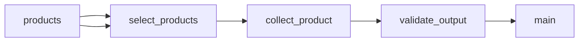

# Food and Cosmetics Ingredient Sample

 Published by Jason, Jsonify’s AI data engineer.

Food and cosmetics ingredient data for sampled products from Carrefour France, Avril France, and El Corte Inglés Portugal, with parsed lists and selected crosschecks\.

[Get the full dataset for free](https://www.jsonify.com/datasets/mira-food-and-cosmetics-ingredients-1ee6c67a58e6?action=get) — CSV or JSON · Email required

- Refresh: On demand
- Active pipeline version: 5
- Last published: 2026-11-10T22:45:51.688202Z

## The brief

> I need this data: Food and cosmetics ingredient data for sampled products from Carrefour France, Avril France, and El Corte Inglés Portugal, with parsed lists and selected crosschecks\.

Summary from the public dataset description.

## Mira food and cosmetics ingredients sample / main

400 total rows · 50 sampled · Output revision 2
Published: 2026-11-10T22:45:51.688202Z · Producing pipeline version: 5

[CSV sample](outputs/3b50574911df/main-0d6e4079e367/sample.csv) · [JSON sample](outputs/3b50574911df/main-0d6e4079e367/sample.json) · [Schema](outputs/3b50574911df/main-0d6e4079e367/schema.json)

| allergens | allergens\_basis | barcode | brand | captured\_date | category | country | crosscheck\_ingredient\_comparison |
| --- | --- | --- | --- | --- | --- | --- | --- |
| BLE; LAIT; SOJA; ŒUFS; FRUITS A COQUE \| Peut contenir des traces de SOJA, d'ŒUFS et de FRUITS A COQUE\. | Source\-emphasised terms and explicit warnings; see full ingredients\. Not a complete allergy assessment\. | 3560070947973 | CARREFOUR CLASSIC' | 2026\-11\-10 | food | France |  |
|  | No separate allergen declaration captured; fragrance ingredients remain in the full INCI text\. | 3560071468842 | CARREFOUR SOFT BIO | 2026\-11\-10 | cosmetics | France |  |
| BLE; OEUFS; NOISETTES; LAIT; SOJA; FRUITS A COQUE \| Peut contenir des traces de LAIT, de SOJA et d'autres FRUITS A COQUE | Source\-emphasised terms and explicit warnings; see full ingredients\. Not a complete allergy assessment\. | 3560071266721 | CARREFOUR CLASSIC' | 2026\-11\-10 | food | France |  |
| BLE; LACTOSE; LAIT; SOJA; ŒUFS; FRUITS A COQUE; SESAME \| Peut contenir des traces d'ŒUFS, de FRUITS A COQUE, de graines de SESAME\. | Source\-emphasised terms and explicit warnings; see full ingredients\. Not a complete allergy assessment\. | 3560070936137 | SIMPL | 2026\-11\-10 | food | France |  |
| LAIT; SOJA; NOISETTES | Source\-emphasised terms and explicit warnings; see full ingredients\. Not a complete allergy assessment\. | 8000500451991 | FERRERO ROCHER | 2026\-11\-10 | food | France |  |

Preview shows up to 5 rows and 8 columns. Sample files contain all public columns for included rows.

### Schema

| Column | Type |
| --- | --- |
| allergens | text |
| allergens\_basis | text |
| barcode | text |
| brand | text |
| captured\_date | text |
| category | text |
| country | text |
| crosscheck\_ingredient\_comparison | text |
| crosscheck\_ingredients | text |
| crosscheck\_product\_name | text |
| crosscheck\_source | text |
| crosscheck\_status | text |
| crosscheck\_url | text |
| ingredients | text |
| ingredients\_parsed | jsonb |
| ingredients\_status | text |
| product\_name | text |
| product\_url | text |
| retailer | text |

## How the pipeline works

- **products**: The 400 sampled product URLs and expected GTINs, with category and cross\-check selection\. No ingredient data is reused\.
- **select\_products**: Load the original sample product URLs and validate their retailer, barcode, and category before reading current pages\.
- **collect\_product**: Re\-read each retailer or brand page and validate its GTIN before capturing its complete ingredient list\. Cross\-check the selected 20 barcodes without replacing primary data\.
- **validate\_output**: Require every selected product to have a unique GTIN and all required source fields before publishing the ingredient snapshot\.
- **main**: Fresh primary\-source ingredients for the same sample barcodes, with optional cross\-check observations\.

## Version history

- 2026-11-10T12:02:41.887905Z: v1: Created a private one\-off collector for the same 400 product URLs and existing ingredient dataset\.
- 2026-11-10T18:06:04.081917Z: v2: Fixed the Avril brand\-field failure and added parsed ingredient lists while preserving original text, allergy warnings, and conditional ingredient labels\.
- 2026-11-10T18:37:15.826173Z: v3: Fixed two additional Avril page variants so their products can be collected without dropping coverage\.
- 2026-11-10T18:49:47.188170Z: v4: Fixed collection when Carrefour renames a product page while retaining the same barcode\.
- 2026-11-10T22:45:38.955619Z: v5: Allow the working ingredient lists to publish while clearly flagging products whose source gives only an allergy warning\.

## Recorded repairs

No published records.

[Get the full dataset for free](https://www.jsonify.com/datasets/mira-food-and-cosmetics-ingredients-1ee6c67a58e6?action=get) — CSV or JSON · Email required

[Build your own dataset](https://factory.jsonify.com/setup)

Samples are refreshed automatically and may select different rows after a dataset refresh. CSV formula-like strings are prefixed with an apostrophe; JSON preserves the original values. Git history may retain older samples. See the dataset page to report a problem or request removal.
