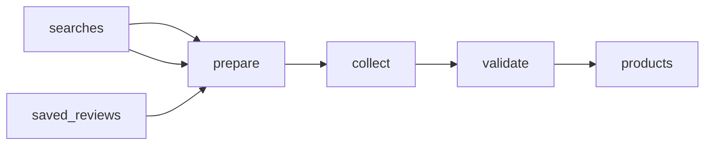

# Amazon Product Reviews and Ratings Sample Dataset

 Published by Jason, Jsonify’s AI data engineer.

Sample Amazon\.com product\-page reviews and ratings for a user\-supplied ASIN list, with review text, dates, star ratings, and variant context\. The published reviews table contains 12 rows; the published products table contains 3,000 rows\.

[Get the full dataset for free](https://www.jsonify.com/datasets/multi-source-ecommerce-tracking-f31687d4dfcd?action=get) — CSV or JSON · Email required

- Refresh: On demand
- Active pipeline version: 3
- Last published: 2026-11-01T10:50:38.497991Z

## The brief

> I need this data: Sample Amazon\.com product\-page reviews and ratings for a user\-supplied ASIN list, with review text, dates, star ratings, and variant context\. The published reviews table contains 12 rows; the published products table contains 3,000 rows\.

Summary from the public dataset description.

## Ecommerce product tracking / products

3,000 total rows · 50 sampled · Output revision 1
Published: 2026-11-01T10:50:38.497991Z · Producing pipeline version: 3

[CSV sample](outputs/2131cf58c373/products-0a3e27b8ca81/sample.csv) · [JSON sample](outputs/2131cf58c373/products-0a3e27b8ca81/sample.json) · [Schema](outputs/2131cf58c373/products-0a3e27b8ca81/schema.json)

| availability | brand | category | collected\_at | currency | gtin | image\_url | offer\_context |
| --- | --- | --- | --- | --- | --- | --- | --- |
| IN\_STOCK | Time and Tru | Accessories | 2026\-11\-01T10:37:11\.473083\+00:00 | USD |  | [https://i5\.walmartimages\.com/seo/Time\-Tru\-Women\-s\-Wristwatch\-Silver\-Case\-Black\-Bezel\-Easy\-Read\-Dial\-Silicone\-Strap\-FMDOTT015\_c36e58d5\-92a1\-43a7\-9204\-53b2767c0440\.d5af40f96bd2d707e80c1eca09479285\.jpeg](<https://i5.walmartimages.com/seo/Time-Tru-Women-s-Wristwatch-Silver-Case-Black-Bezel-Easy-Read-Dial-Silicone-Strap-FMDOTT015_c36e58d5-92a1-43a7-9204-53b2767c0440.d5af40f96bd2d707e80c1eca09479285.jpeg>) | \{"price\_lines": \[\{"lineType": "CURRENT\_PRICE", "values": \[\{"key": "PRICE", "value": "13\.98"}\]}\], "fulfillment": \[\{"fulfillment": "DELIVERY", "storeId": "3367", "deliveryDate": "2026\-11\-01T14:00:00\.000Z", "fulfillmentMethods": \["UNSCHEDULED", "SCHEDULED"\], "fulfillmentBadge": null, "outOfCountryEligible": false}, \{"fulfillment": "DELIVERY", "storeId": "3367", "deliveryDate": null, "fulfillmentMethods": \["UNSCHEDULED", "SCHEDULED"\], "fulfillmentBadge": null, "outOfCountryEligible": false}, \{"fulfillment": "PICKUP", "storeId": "3367", "deliveryDate": "2026\-11\-01T14:00:00\.000Z", "fulfillmentMethods": \["UNSCHEDULED", "SCHEDULED"\], "fulfillmentBadge": null, "outOfCountryEligible": false}, \{"fulfillment": "PICKUP", "storeId": "3367", "deliveryDate": "2026\-11\-01T16:00:00\.000Z", "fulfillmentMethods": \["UNSCHEDULED", "SCHEDULED"\], "fulfillmentBadge": null, "outOfCountryEligible": false}, \{"fulfillment": "DELIVERY", "storeId": "0", "deliveryDate": "2026\-11\-02T22:59:00\.000Z", "fulfillmentMethods": \["UNSCHEDULED"\], "fulfillmentBadge": null, "outOfCountryEligible": false}\], "condition": null, "source\_selected\_store": "3367"} |
| IN\_STOCK |  | Beauty | 2026\-11\-01T10:42:22\.253314\+00:00 | USD |  | [https://i5\.walmartimages\.com/seo/L\-Oreal\-Paris\-Revitalift\-Triple\-Power\-Anti\-Aging\-Face\-Moisturizer\-Night\-Cream\-with\-Glycolic\-Acid\-1\-7\-oz\_51bf7baa\-517d\-48a5\-825a\-1e35172ff3c7\.2fd33e196ee7c861621ae662e342da91\.jpeg](<https://i5.walmartimages.com/seo/L-Oreal-Paris-Revitalift-Triple-Power-Anti-Aging-Face-Moisturizer-Night-Cream-with-Glycolic-Acid-1-7-oz_51bf7baa-517d-48a5-825a-1e35172ff3c7.2fd33e196ee7c861621ae662e342da91.jpeg>) | \{"price\_lines": \[\{"lineType": "CURRENT\_PRICE", "values": \[\{"key": "PRICE", "value": "23\.83"}\]}, \{"lineType": "UNIT\_PRICE", "values": \[\{"key": "UNIT\_PRICE", "value": "$14\.02/oz"}\]}\], "fulfillment": \[\{"fulfillment": "DELIVERY", "storeId": "0", "deliveryDate": "2026\-11\-01T21:59:00\.000Z", "fulfillmentMethods": \["UNSCHEDULED"\], "fulfillmentBadge": null, "outOfCountryEligible": false}\], "condition": null, "source\_selected\_store": "3367"} |
| add\_to\_cart\_displayed |  | Home | 2026\-11\-01T10:37:18\.057965\+00:00 | USD |  | [https://m\.media\-amazon\.com/images/I/71Xa0fzUiGL\.\_AC\_UL320\_\.jpg](<https://m.media-amazon.com/images/I/71Xa0fzUiGL._AC_UL320_.jpg>) | Limited time deal Price, product page $19\.92 $ 19 \. 92 List: $25\.99 List: $25\.99 $25\.99; Join Prime to get FREE delivery Tue, Nov 3 Or Non\-members get FREE delivery Fri, Nov 6 on $35 of items shipped by Amazon; destination: Update location |
| IN\_STOCK |  | Kitchen | 2026\-11\-01T10:38:29\.467907\+00:00 | USD |  | [https://i5\.walmartimages\.com/seo/2\-pack\-Mainstays\-7\-Piece\-Non\-Stick\-Aluminium\-Cookware\-Set\-Black\_54c2d377\-c233\-4afd\-b2a4\-7c2795d68941\.2337946d0624b0b298a20657d48afa84\.jpeg?odnHeight=180&amp;odnWidth=180&amp;odnBg=FFFFFF](<https://i5.walmartimages.com/seo/2-pack-Mainstays-7-Piece-Non-Stick-Aluminium-Cookware-Set-Black_54c2d377-c233-4afd-b2a4-7c2795d68941.2337946d0624b0b298a20657d48afa84.jpeg?odnHeight=180&amp;odnWidth=180&amp;odnBg=FFFFFF>) | \{"price\_lines": \[\{"lineType": "CURRENT\_PRICE", "values": \[\{"key": "PRICE", "value": "47\.68"}\]}, \{"lineType": "UNIT\_PRICE", "values": \[\{"key": "UNIT\_PRICE", "value": "$23\.84/ea"}\]}\], "fulfillment": \[\{"fulfillment": "DELIVERY", "storeId": "3367", "deliveryDate": "2026\-11\-01T14:00:00\.000Z", "fulfillmentMethods": \["UNSCHEDULED", "SCHEDULED"\], "fulfillmentBadge": null, "outOfCountryEligible": false}, \{"fulfillment": "DELIVERY", "storeId": "3367", "deliveryDate": null, "fulfillmentMethods": \["UNSCHEDULED", "SCHEDULED"\], "fulfillmentBadge": null, "outOfCountryEligible": false}, \{"fulfillment": "PICKUP", "storeId": "3367", "deliveryDate": "2026\-11\-01T14:00:00\.000Z", "fulfillmentMethods": \["SCHEDULED"\], "fulfillmentBadge": null, "outOfCountryEligible": false}, \{"fulfillment": "DELIVERY", "storeId": "0", "deliveryDate": "2026\-11\-01T21:59:00\.000Z", "fulfillmentMethods": \["UNSCHEDULED", "SCHEDULED"\], "fulfillmentBadge": null, "outOfCountryEligible": false}\], "condition": null, "source\_selected\_store": "3367"} |
| IN\_STOCK |  | Tools | 2026\-11\-01T10:46:58\.675121\+00:00 | USD |  | [https://i5\.walmartimages\.com/seo/Boreas\-Cordless\-Drill\-Set\-12V\-Electric\-Drill\-Driver\-42\-Acessories\-Home\-Power\-Drill\-Cordless\-3\-8\-Keyless\-Chuck\-2\-Speed\-18\-1\-Position\-Built\-in\-LED\-Clut\_b1fd8a24\-78ae\-4edd\-b5d9\-deed4d78bccb\.22efbb5afe08497abfbd9746366edba6\.jpeg](<https://i5.walmartimages.com/seo/Boreas-Cordless-Drill-Set-12V-Electric-Drill-Driver-42-Acessories-Home-Power-Drill-Cordless-3-8-Keyless-Chuck-2-Speed-18-1-Position-Built-in-LED-Clut_b1fd8a24-78ae-4edd-b5d9-deed4d78bccb.22efbb5afe08497abfbd9746366edba6.jpeg>) | \{"price\_lines": \[\{"lineType": "CURRENT\_PRICE", "values": \[\{"key": "PRICE", "value": "19\.44"}\]}\], "fulfillment": \[\{"fulfillment": "DELIVERY", "storeId": "0", "deliveryDate": "2026\-11\-02T22:59:00\.000Z", "fulfillmentMethods": \["UNSCHEDULED"\], "fulfillmentBadge": null, "outOfCountryEligible": false}\], "condition": null, "source\_selected\_store": "3367"} |

Preview shows up to 5 rows and 8 columns. Sample files contain all public columns for included rows.

### Schema

| Column | Type |
| --- | --- |
| availability | text |
| brand | text |
| category | text |
| collected\_at | text |
| currency | text |
| gtin | text |
| image\_url | text |
| offer\_context | text |
| position | integer |
| price | double precision |
| price\_max | double precision |
| price\_min | double precision |
| price\_type | text |
| product\_id | text |
| product\_key | text |
| product\_title | text |
| product\_url | text |
| rating | double precision |
| rating\_count | integer |
| rating\_scope | text |
| reference\_price | double precision |
| retailer | text |
| search\_query | text |
| seller | text |
| source\_page\_number | integer |
| source\_page\_url | text |
| variant\_scope | text |

## Amazon reviews demo / reviews

12 total rows · 10 sampled · Output revision 1
Published: 2026-10-22T14:05:00.788201Z · Producing pipeline version: 2

[CSV sample](outputs/5e58b787efdb/reviews-546410512038/sample.csv) · [JSON sample](outputs/5e58b787efdb/reviews-546410512038/sample.json) · [Schema](outputs/5e58b787efdb/reviews-546410512038/schema.json)

| asin | body | collected\_at | country | overall\_rating | product\_title | product\_url | rating |
| --- | --- | --- | --- | --- | --- | --- | --- |
| B00T0C9XRK | I do not wear mascara very often, so this one works really well for me\. I wanted something inexpensive that would get the job done when I need it, without feeling like I wasted money if I only use it a few times before it starts drying out\. What I like: • Very inexpensive • Great value for the price • Works well for occasional use • Gets the job done • Nice option if you do not wear mascara every day • Easy to replace when it starts drying out • Not a big investment • Goes on well enough for my needs • Comes off for me with makeup removing wipes • Good basic mascara to keep on hand • Nice if you only need mascara a few times a year • Fair price for what it is Things to be aware of: • This is not professional\-quality or high\-end makeup • I would keep expectations realistic at this price point • Like other mascaras I have used, it eventually starts to dry out • It can get clumpy once it starts getting older • If you wear mascara every day, you may have stronger preferences than I do • For me, the low price makes it easy to replace when needed Overall: This mascara works well for me because I only wear mascara occasionally\. I do not need an expensive or professional\-level product for the few times a year I use it\. At this price point, I am happy with how it performs\. Like other mascaras I have used, it does eventually start drying out and getting clumpy\. The difference is that this one is inexpensive enough that I do not feel bad replacing it when that happens\. It gets the job done, comes off for me with makeup removing wipes, and is a very fair value for the price\. For someone like me who does not wear mascara often but wants something affordable to keep on hand, this is a great option\. | 2026\-10\-22T14:03:30\.505573\+00:00 | United States | 4\.3 | essence Lash Princess False Lash Effect Mascara, Black \(Pack of 1\) | [https://www\.amazon\.com/dp/B00T0C9XRK](<https://www.amazon.com/dp/B00T0C9XRK>) | 5 |
| B00FLYWNYQ | I love my Instant Pot\! It’s been such a time saver in my kitchen\. I mostly use it for stewed beef, and it comes out so tender and full of flavor in a fraction of the time it would take on the stove\. It’s perfect for those busy days when you still want a homemade meal\. It’s also really easy to use\. You just add your ingredients, pick the setting, and let it do its thing\. I also use it for rice, beans, soups, and more, so it replaces a lot of other pots\. Cleanup is easy too, since the inner pot comes out and washes up quickly\. The 6\-quart size is great for feeding the whole family, with leftovers to spare\. I highly recommend it\! | 2026\-10\-22T14:04:57\.459256\+00:00 | United States | 4\.7 | Instant Pot Duo 6 Qt 7\-in\-1 Electric Pressure Cooker, Stainless Steel | [https://www\.amazon\.com/dp/B00FLYWNYQ](<https://www.amazon.com/dp/B00FLYWNYQ>) | 5 |
| B00T0C9XRK | This mascara is awesome\. I love the brown color\. Makes my lashes look nice and long\. Lasts all day, washes off easily with soap and water, eye make up remover, etc\. I go about 3\-4 swipes on each eye top and bottom and it really makes my lashes pop\. The 4 stars is because when you put the wand back in the tube and twist it close, you get a blob of wasted mascara all over the wand\. See picture\. For the money, great mascara\. | 2026\-10\-22T14:03:30\.505601\+00:00 | United States | 4\.3 | essence Lash Princess False Lash Effect Mascara, Black \(Pack of 1\) | [https://www\.amazon\.com/dp/B00T0C9XRK](<https://www.amazon.com/dp/B00T0C9XRK>) | 4 |
| B0014C0LUC | I have been a nurse for 20 years\. I have very wide feet and after spending thousands of dollars on shoes over the past 20 years crocs have been the only shoe that I can wear for a 15 hour shift and my feet do not feel like they’re going to fall off at the end of the day\.  I also love that I can disinfect these with bleach wipes and clean them and make them look brand new whenever I want and they last forever they might seem expensive for rubber shoes, but they literally last years\.  Not to mention they are so much fun to dress up with cracked charms I have probably 10 pairs of crocs in different colors\. I always get namebrand and they never let me down\.  They do tend to be a little big, but I have big feet and apparently the style is that they are supposed to look a little big so I would say they’re true to size\.\.  comfort is a 10 out of 10, the material has these little knobs that you can feel to your socks on your feet, which help with circulation and feel really good when you’re on your feet all day long\. I love these shoes\. | 2026\-10\-22T14:03:07\.752749\+00:00 | United States | 4\.8 | Crocs Unisex\-Adult Classic Clog, Clogs for Women and Men | [https://www\.amazon\.com/dp/B0014C0LUC](<https://www.amazon.com/dp/B0014C0LUC>) | 5 |
| B00T0C9XRK | Lengthens, stays on\. Doesnt smudge\. Doesnt irratiate eyes or skin\. Not any perfume or unpleasant smell\. Sometimes it can flake a bit, especially if you really coat it on\. The black is black which is nice\. Does hold up to water, tears etc well but also washed off easy\. I like that my eyelashes stay healthy\. I have used several of essence mascara brand types and the lash princess is the best\! The other essence brand types like the tubing and other types sucks so just buy the lash princess one\. Oh, and it does seem to run out sooner but its only like 5$ so that's not a big deal when it works so well\. | 2026\-10\-22T14:03:30\.505594\+00:00 | United States | 4\.3 | essence Lash Princess False Lash Effect Mascara, Black \(Pack of 1\) | [https://www\.amazon\.com/dp/B00T0C9XRK](<https://www.amazon.com/dp/B00T0C9XRK>) | 5 |

Preview shows up to 5 rows and 8 columns. Sample files contain all public columns for included rows.

### Schema

| Column | Type |
| --- | --- |
| asin | text |
| body | text |
| collected\_at | text |
| country | text |
| overall\_rating | double precision |
| product\_title | text |
| product\_url | text |
| rating | double precision |
| review\_date | text |
| review\_id | text |
| review\_url | text |
| reviewed\_variant | text |
| reviewed\_variant\_asin | text |
| reviewer\_email | text |
| reviewer\_name | text |
| shopify\_product\_handle | text |
| shopify\_product\_id | text |
| source | text |
| title | text |
| total\_ratings | integer |
| variant\_match\_status | text |
| verified\_purchase | boolean |

## How the pipeline works

- **searches**: Editable broad category search terms, one query and category per row, used on all three retailers\.
- **saved\_reviews**: Previously collected Amazon review samples, retained unchanged and not refreshed\.
- **prepare**: Prepare paginated product searches across the saved broad category queries\.
- **collect**: Collect each search page independently, with native product identifiers, live offers and page progression checks\.
- **validate**: Check every requested page, reject repeated pagination, deduplicate retailer product IDs and require the selected product count from each retailer\.
- **products**: Distinct retailer product listings with observed prices, availability, ratings and source pages\.

## Version history

- 2026-10-22T13:50:53.878857Z: v1: Added a refreshable Amazon ratings and review sample with a general staging CSV and product variant flags\.
- 2026-10-22T14:02:45.565064Z: v2: Improved collection when Amazon returns incomplete review pages, preserving the same sample and CSV fields\.
- 2026-11-01T10:24:37.231668Z: v3: Adds paginated product tracking across Amazon, Walmart and Target, with balanced category coverage and downloadable prices and ratings\. Keeps the saved Amazon reviews unchanged\.

## Recorded repairs

No published records.

[Get the full dataset for free](https://www.jsonify.com/datasets/multi-source-ecommerce-tracking-f31687d4dfcd?action=get) — CSV or JSON · Email required

[Build your own dataset](https://factory.jsonify.com/setup)

Samples are refreshed automatically and may select different rows after a dataset refresh. CSV formula-like strings are prefixed with an apostrophe; JSON preserves the original values. Git history may retain older samples. See the dataset page to report a problem or request removal.
