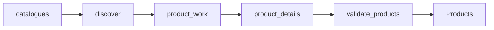

# Netherlands Fashion Competitor Prices

 Published by Jason, Jsonify’s AI data engineer.

Netherlands fashion competitor prices with product colours, EUR prices, markdowns, and size availability\.

[Get the full dataset for free](https://www.jsonify.com/datasets/netherlands-fashion-competitor-prices-cbaaa49bc3b1?action=get) — CSV or JSON · Email required

- Refresh: On demand
- Active pipeline version: 3
- Last published: 2026-11-11T02:25:33.742247Z

## The brief

> I need this data: Netherlands fashion competitor prices with product colours, EUR prices, markdowns, and size availability\.

Summary from the public dataset description.

## Weekday competitor fashion sample · Netherlands · 9 Nov 2026 / Products

3,657 total rows · 50 sampled · Output revision 3
Published: 2026-11-11T02:25:33.742247Z · Producing pipeline version: 3

[CSV sample](outputs/81ff836ef0b1/products-4edc8bfafc6b/sample.csv) · [JSON sample](outputs/81ff836ef0b1/products-4edc8bfafc6b/sample.json) · [Schema](outputs/81ff836ef0b1/products-4edc8bfafc6b/schema.json)

| availability | brand | captured\_at | category | colour | currency | current\_price | discount\_pct |
| --- | --- | --- | --- | --- | --- | --- | --- |
| in\_stock | Mango | 2026\-11\-11T02:08:01\.372691\+00:00 | Dresses &amp; jumpsuits | Off White | EUR | 39\.99 | 33\.34 |
| in\_stock | Our Legacy | 2026\-11\-10T12:17:24\.537382\+00:00 | Outerwear &amp; tailoring | Deep Pangoa Issue Wool | EUR | 1100 | 0 |
| in\_stock | Mango | 2026\-11\-11T02:21:55\.969862\+00:00 | Footwear | Silver | EUR | 39\.99 | 28\.58 |
| in\_stock | Zara | 2026\-11\-10T13:42:18\.151836\+00:00 | Outerwear &amp; tailoring | Black / White | EUR | 25\.99 | 43\.44 |
| in\_stock | Zara | 2026\-11\-10T12:46:53\.417499\+00:00 | Knitwear | Dark plum | EUR | 99\.95 | 0 |

Preview shows up to 5 rows and 8 columns. Sample files contain all public columns for included rows.

### Schema

| Column | Type |
| --- | --- |
| availability | text |
| brand | text |
| captured\_at | text |
| category | text |
| colour | text |
| currency | text |
| current\_price | double precision |
| discount\_pct | double precision |
| gender | text |
| image\_url | text |
| is\_new\_arrival | boolean |
| is\_on\_sale | boolean |
| original\_price | double precision |
| product\_name | text |
| product\_url | text |
| size\_availability | jsonb |
| sizes | jsonb |
| source\_category | text |
| source\_page | text |
| storefront | text |

## How the pipeline works

- **catalogues**: Choose the official Netherlands men's and women's new\-arrival and sale sections for all four brands\.
- **discover**: Read each complete catalogue, following source pagination and checking whether public sales are open\.
- **product\_work**: Combine repeated catalogue memberships and group colourways by exact product identity before reading details\.
- **product\_details**: Read current EUR prices, exact colourways and size\-level stock for one source product; retain all its catalogue memberships\.
- **validate\_products**: Merge duplicate colourways, preserve gender and catalogue memberships, and validate prices, images and size arrays\.
- **Products**: One current Netherlands fashion product\-colour listing, with EUR prices, markdowns and size availability\.

## Version history

- 2026-11-10T11:58:26.413785Z: v1: Saved the Netherlands fashion collection as a pipeline that reads all four official stores and writes current prices, markdowns and size availability into the existing dataset\.
- 2026-11-10T17:58:28.126696Z: v2: New\-arrival flags now follow retailer new\-section membership, and repeated photographic looks are merged into one product colourway\.
- 2026-11-10T18:42:32.666112Z: v3: Zara product\-name changes no longer stop collection when the product and colourway remain the same\.

## Recorded repairs

No published records.

[Get the full dataset for free](https://www.jsonify.com/datasets/netherlands-fashion-competitor-prices-cbaaa49bc3b1?action=get) — CSV or JSON · Email required

[Build your own dataset](https://factory.jsonify.com/setup)

Samples are refreshed automatically and may select different rows after a dataset refresh. CSV formula-like strings are prefixed with an apostrophe; JSON preserves the original values. Git history may retain older samples. See the dataset page to report a problem or request removal.
