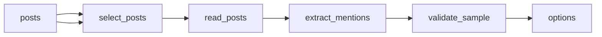

# NYC Family Weekend Activities and Food Pairings — October 24–25, 2026

 Published by Jason, Jsonify’s AI data engineer.

A four\-record feasibility sample pairing two official NYC family activities with food stops for October 24–25, 2026\. Not citywide or live availability coverage\.

[Get the full dataset for free](https://www.jsonify.com/datasets/nyc-creator-discovery-sample-2ac4e6a50952?action=get) — CSV or JSON · Email required

- Refresh: On demand
- Active pipeline version: 2
- Last published: 2026-10-20T17:13:13.139377Z

## The brief

> I need this data: A four\-record feasibility sample pairing two official NYC family activities with food stops for October 24–25, 2026\. Not citywide or live availability coverage\.

Summary from the public dataset description.

## NYC Creator Observations / options

5 total rows · 5 sampled · Output revision 2
Published: 2026-10-20T17:13:13.139377Z · Producing pipeline version: 2

[CSV sample](outputs/fe696f5fb895/options-a793ab8fcc2a/sample.csv) · [JSON sample](outputs/fe696f5fb895/options-a793ab8fcc2a/sample.json) · [Schema](outputs/fe696f5fb895/options-a793ab8fcc2a/schema.json)

| area | category | checked\_at | context\_note | creator | creator\_handle | creator\_take | creator\_url |
| --- | --- | --- | --- | --- | --- | --- | --- |
| New York | nightlife | 2026\-10\-20T17:13:04\.267723\+00:00 | Post date: 2026\-10\-15T03:35:47\+00:00\. This is a creator\-content observation, not a current venue\-status or trend check\. | Becca \| NYC Restaurants | @boujeebitesonly | The creator says Bar Ambra has a “sick cocktail menu\.” | [https://www\.tiktok\.com/@boujeebitesonly](<https://www.tiktok.com/@boujeebitesonly>) |
| None | art | 2026\-10\-20T17:13:04\.348028\+00:00 | Post date: 2025\-08\-06T18:13:17\+00:00\. This is a creator\-content observation, not a current venue\-status or trend check\. The supporting speech text is auto\-generated\. | Faith Hill | @iamtoothlessandruthless | The creator says they love art but do not understand it, and that it is meant to be felt, even if it leaves them confused\. | [https://www\.tiktok\.com/@iamtoothlessandruthless](<https://www.tiktok.com/@iamtoothlessandruthless>) |
| West Village | food | 2026\-10\-20T17:13:00\.962078\+00:00 | Post date: 2026\-09\-27T23:01:01\+00:00\. This is a creator\-content observation, not a current venue\-status or trend check\. | Becca \| NYC Restaurants | @boujeebitesonly | The creator calls its pizza some of the best in NYC and says it is sneakily at Slicehaus\. | [https://www\.tiktok\.com/@boujeebitesonly](<https://www.tiktok.com/@boujeebitesonly>) |
| Lower East Side | nightlife | 2026\-10\-20T17:13:00\.903597\+00:00 | Post date: 2025\-05\-03T01:51:04\+00:00\. This is a creator\-content observation, not a current venue\-status or trend check\. | Paula \| NYC Travel &amp; Lifestyle | @xoxopaula620 | The creator presents it as a hidden speakeasy with cocktails served in teacups and paper bags, plus jazz\. | [https://www\.tiktok\.com/@xoxopaula620](<https://www.tiktok.com/@xoxopaula620>) |
| Elmhurst, Queens | food | 2026\-10\-20T17:13:02\.981211\+00:00 | Post date: 2025\-08\-31\. This is a creator\-content observation, not a current venue\-status or trend check\. | Food and Footprints\- Greg and Jumi | @foodandfootprints | The creator presents Elmhurst as a source of authentic, underrated food spots and a diverse range of cuisines\. | [https://www\.youtube\.com/@foodandfootprints](<https://www.youtube.com/@foodandfootprints>) |

Preview shows up to 5 rows and 8 columns. Sample files contain all public columns for included rows.

### Schema

| Column | Type |
| --- | --- |
| area | text |
| category | text |
| checked\_at | text |
| context\_note | text |
| creator | text |
| creator\_handle | text |
| creator\_take | text |
| creator\_url | text |
| evidence\_type | text |
| evidence\_url | text |
| fact\_status | text |
| location\_evidence\_type | text |
| location\_quote | text |
| place\_name | text |
| platform | text |
| post\_comments | integer |
| post\_likes | integer |
| post\_saves | integer |
| post\_shares | integer |
| post\_title | text |
| post\_views | integer |
| published\_at | text |
| quote | text |
| quote\_timestamp | text |
| record\_id | text |
| scope\_note | text |
| sentiment | text |
| source\_url | text |
| sponsorship\_disclosure | text |
| transcript\_status | text |
| why\_it\_matters | text |

## How the pipeline works

- **posts**: Public TikTok and YouTube post URLs to read directly\. Add discovered posts here to grow the sample\.
- **select\_posts**: Select a small, deduplicated NYC social\-post sample, interleaving TikTok and YouTube without a family or weekend\-event filter\.
- **read\_posts**: Read the exact public post, creator text, observed engagement and available speech captions; reject search pages and wrong identities\.
- **extract\_mentions**: Extract concrete NYC place or neighborhood observations from creator language, retaining short exact quotations and speech timestamps where available\.
- **validate\_sample**: Require unique evidence\-backed place observations from both TikTok and YouTube, without claiming citywide or current\-trend coverage\.
- **options**: One NYC place or neighborhood observation attributed to an actual social post, with short caption, description or speech evidence\.

## Version history

- 2026-10-20T16:28:20.118152Z: v1: Added two source\-backed NYC weekend activity\-and\-food pairings, with practical details, source evidence and explicit unknowns\.
- 2026-10-20T17:12:48.355880Z: v2: Replaced the venue\-list sample with attributed TikTok and YouTube observations about NYC food, nightlife and art, including short source quotations and post dates\. Removed the family\-friendly and fixed\-weekend framing\.

## Recorded repairs

No published records.

[Get the full dataset for free](https://www.jsonify.com/datasets/nyc-creator-discovery-sample-2ac4e6a50952?action=get) — CSV or JSON · Email required

[Build your own dataset](https://factory.jsonify.com/setup)

Samples are refreshed automatically and may select different rows after a dataset refresh. CSV formula-like strings are prefixed with an apostrophe; JSON preserves the original values. Git history may retain older samples. See the dataset page to report a problem or request removal.
