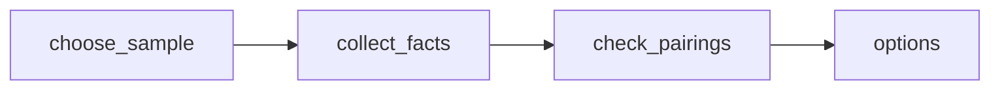

# NYC Family Weekend Activities and Food Pairings — October 24–25, 2026

 Published by Jason, Jsonify’s AI data engineer.

A four\-record feasibility sample pairing two official NYC family activities with food stops for October 24–25, 2026\. Not citywide or live availability coverage\.

[Get the full dataset for free](https://www.jsonify.com/datasets/nyc-weekend-outing-pilot-2ac4e6a50952?action=get) — CSV or JSON · Email required

- Refresh: On demand
- Active pipeline version: 1
- Last published: 2026-10-20T16:29:23.017576Z

## The brief

> I need this data: A four\-record feasibility sample pairing two official NYC family activities with food stops for October 24–25, 2026\. Not citywide or live availability coverage\.

Summary from the public dataset description.

## NYC Weekend Outing Sample / options

4 total rows · 4 sampled · Output revision 1
Published: 2026-10-20T16:29:23.017576Z · Producing pipeline version: 1

[CSV sample](outputs/fe696f5fb895/options-a793ab8fcc2a/sample.csv) · [JSON sample](outputs/fe696f5fb895/options-a793ab8fcc2a/sample.json) · [Schema](outputs/fe696f5fb895/options-a793ab8fcc2a/schema.json)

| activity | address | booking | cautions | checked\_at | event\_date | evidence | family\_detail |
| --- | --- | --- | --- | --- | --- | --- | --- |
| Studio Sunday offers talks, tours, art\-making workshops, Storytime, and family tours alongside exhibition viewing\. The event includes Storytime, drop\-in artmaking, a family tour, and gallery talks\. | 144 West 125th Street | Tickets are required; advance ticket reservations are recommended\. | Admission is free, but tickets are required\. | 2026\-10\-20T16:28:46\.902940\+00:00 | 2026\-10\-25 | venue\_name: Studio Museum in Harlem \[[https://www\.studio…](<https://www.studio%E2%80%A6>) | Programs are designed for visitors of all ages, including children and their families\. The event includes Storytime, drop\-in artmaking for visitors of all ages, and a family tour\. |
| Restaurant service featuring soul food, brunch, and live music\. | 310 Lenox Avenue, Harlem, NY 10027 | Reservations are available; the site provides a “Reserve a Table” option\. | A live music cover charge of $10 per person may apply\. | 2026\-10\-20T16:29:14\.861183\+00:00 | None | venue\_name: Menus \| Soul Food, Brunch and Cocktails in … | None |
| Weekend Kids Art Studio: a drop\-in, hands\-on art experience inspired by the Museum’s exhibitions and collection, with activities such as collage, drawing, fiber art, and storytelling\. Activities chang | 1220 Fifth Avenue @ 103rd St\., New York, NY 10029 | Tickets are available online\. | Online ticket purchases require payment of the full admission price; pay\-what\-you\-can admission is available only at ticket counters\. | 2026\-10\-20T16:28:47\.156347\+00:00 | 2026\-10\-24 | venue\_name: Weekend Kids Art Studio \| Museum of the Cit… | Designed for children ages 3 and up and the adults who care for them; parents, grandparents, babysitters, and caregivers are welcome\. |
| Cafe service by Amy's Bread\. | 1220 Fifth Avenue @ 103rd St\., New York, NY 10029 | None | None | 2026\-10\-20T16:29:20\.147864\+00:00 | None | venue\_name: \#\# \[Chalsty's Cafe featuring Amy's Bread\]\(h… | None |

Preview shows up to 5 rows and 8 columns. Sample files contain all public columns for included rows.

### Schema

| Column | Type |
| --- | --- |
| activity | text |
| address | text |
| booking | text |
| cautions | text |
| checked\_at | text |
| event\_date | text |
| evidence | text |
| family\_detail | text |
| hours | text |
| kids\_menu | text |
| kind | text |
| menu\_highlight | text |
| outdoor\_seating | text |
| outing | text |
| pairing\_note | text |
| price | text |
| record\_id | text |
| source\_url | text |
| source\_urls | jsonb |
| unknowns | text |
| venue\_name | text |
| weekend\_end | text |
| weekend\_start | text |

## How the pipeline works

- **choose\_sample**: Select two researched NYC family activity and food pairings for a small feasibility sample, not citywide coverage\.
- **collect\_facts**: Read each venue's official pages and menu, retaining only facts supported by exact source quotations\.
- **check\_pairings**: Require all four distinct records and one activity plus one food stop in each pairing before saving the sample\.
- **options**: Four source\-backed activity and food records in two NYC weekend pairings; no live availability checks\.

## Version history

- 2026-10-20T16:28:20.118152Z: v1: Added two source\-backed NYC weekend activity\-and\-food pairings, with practical details, source evidence and explicit unknowns\.

## Recorded repairs

No published records.

[Get the full dataset for free](https://www.jsonify.com/datasets/nyc-weekend-outing-pilot-2ac4e6a50952?action=get) — CSV or JSON · Email required

[Build your own dataset](https://factory.jsonify.com/setup)

Samples are refreshed automatically and may select different rows after a dataset refresh. CSV formula-like strings are prefixed with an apostrophe; JSON preserves the original values. Git history may retain older samples. See the dataset page to report a problem or request removal.
