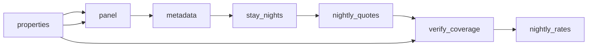

# Vitória Airbnb and Booking\.com Nightly Rates

 Published by Jason, Jsonify’s AI data engineer.

Vitória apartment listings from Airbnb and Booking\.com, with nightly prices, availability, listing details and source\-reported ratings\. The published table contains 2,790 rows\.

[Get the full dataset for free](https://www.jsonify.com/datasets/operent-vit-ria-expanded-one-off-snapshot-f91e4efb1101?action=get) — CSV or JSON · Email required

- Refresh: On demand
- Active pipeline version: 4
- Last published: 2026-11-09T14:23:29.336648Z

## The brief

> I need this data: Vitória apartment listings from Airbnb and Booking\.com, with nightly prices, availability, listing details and source\-reported ratings\. The published table contains 2,790 rows\.

Summary from the public dataset description.

## Vitória expanded one\-off nightly snapshot / nightly\_rates

2,790 total rows · 50 sampled · Output revision 1
Published: 2026-11-09T14:23:29.336648Z · Producing pipeline version: 4

[CSV sample](outputs/98daa1ec20b8/nightly-rates-115ea5b7fd74/sample.csv) · [JSON sample](outputs/98daa1ec20b8/nightly-rates-115ea5b7fd74/sample.json) · [Schema](outputs/98daa1ec20b8/nightly-rates-115ea5b7fd74/schema.json)

| available | bedrooms | collected\_at | currency | date | listing\_id | listing\_url | max\_guests |
| --- | --- | --- | --- | --- | --- | --- | --- |
| False | 2 | 2026\-11\-09T13:13:54\.968007\+00:00 | BRL | 2026\-11\-16 | 824767347536958994 | [https://www\.airbnb\.com/rooms/824767347536958994](<https://www.airbnb.com/rooms/824767347536958994>) | 4 |
| False | 0 | 2026\-11\-09T13:21:43\.261909\+00:00 | BRL | 2026\-11\-19 | 13130310 | [https://www\.booking\.com/hotel/br/estudio\-908\-conforto\-e\-sofisticacao\-no\-coracao\-de\-jardim\-camburi\.html](<https://www.booking.com/hotel/br/estudio-908-conforto-e-sofisticacao-no-coracao-de-jardim-camburi.html>) | 4 |
| True | 1 | 2026\-11\-09T14:03:53\.887122\+00:00 | BRL | 2026\-12\-02 | 1639987158805694619 | [https://www\.airbnb\.com/rooms/1639987158805694619](<https://www.airbnb.com/rooms/1639987158805694619>) | 2 |
| False | 1 | 2026\-11\-09T14:06:26\.895961\+00:00 | BRL | 2026\-12\-03 | 861562115124019216 | [https://www\.airbnb\.com/rooms/861562115124019216](<https://www.airbnb.com/rooms/861562115124019216>) | 2 |
| False | 2 | 2026\-11\-09T13:24:54\.871613\+00:00 | BRL | 2026\-11\-21 | 824767347536958994 | [https://www\.airbnb\.com/rooms/824767347536958994](<https://www.airbnb.com/rooms/824767347536958994>) | 4 |

Preview shows up to 5 rows and 8 columns. Sample files contain all public columns for included rows.

### Schema

| Column | Type |
| --- | --- |
| available | boolean |
| bedrooms | integer |
| collected\_at | text |
| currency | text |
| date | text |
| listing\_id | text |
| listing\_url | text |
| max\_guests | integer |
| min\_nights | integer |
| neighbourhood | text |
| nightly\_price | double precision |
| property\_type | text |
| rating | double precision |
| review\_count | integer |
| source | text |
| title | text |

## How the pipeline works

- **properties**: Expanded one\-off panel of Airbnb and Booking\.com apartments in Vitória\. Both platforms remain separate listings\.
- **panel**: Load the fixed Vitória property panel and set the next consecutive stay nights using local time\.
- **metadata**: Read Airbnb whole\-home metadata and its calendar\. Retain the Booking\.com property links for exact dated apartment checks\.
- **stay\_nights**: Create one exact one\-night, two\-adult check per property for every requested stay night\.
- **nightly\_quotes**: Check each exact overnight stay for two adults in BRL\. Require a source offer or an explicit unavailable response, never infer sold out from absence\.
- **verify\_coverage**: Require all property\-night checks, both platforms, unique listing\-night records and valid source\-confirmed prices before replacing saved results\.
- **nightly\_rates**: One\-off expanded snapshot of source\-displayed one\-night apartment quotes in BRL for two adults\. Includes cleaning fees where included in the offer; additional excluded taxes are not added\. Airbnb ratings are out of 5, Booking\.com ratings out of 10\. False means no offer for the exact one\-night search, not proof of occupancy\. Minimum stay restrictions can make a night unavailable\. Unknown or blocked checks fail without replacing saved data\.

## Version history

- 2026-11-09T12:58:00.524776Z: v1: Added a separate expanded one\-off Vitória apartment snapshot for the Web Summit meeting, without changing the daily sample\.
- 2026-11-09T12:59:23.969734Z: v2: Corrected source\-based neighbourhood matching in the expanded one\-off snapshot\.
- 2026-11-09T13:56:40.417884Z: v3: Fixed recognition of Booking\.com’s compact price display so the one\-off snapshot can continue without repeating completed checks\.
- 2026-11-09T14:16:08.412605Z: v4: Added a fresh\-page retry when Booking\.com ignores the requested currency or stay dates\.

## Recorded repairs

No published records.

[Get the full dataset for free](https://www.jsonify.com/datasets/operent-vit-ria-expanded-one-off-snapshot-f91e4efb1101?action=get) — CSV or JSON · Email required

[Build your own dataset](https://factory.jsonify.com/setup)

Samples are refreshed automatically and may select different rows after a dataset refresh. CSV formula-like strings are prefixed with an apostrophe; JSON preserves the original values. Git history may retain older samples. See the dataset page to report a problem or request removal.
