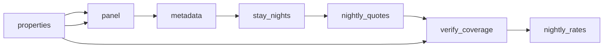

# Vitória Short\-Term Rental Rates

 Published by Jason, Jsonify’s AI data engineer.

Vitória rental listings with displayed nightly quotes and availability for specific stay dates\. The published dataset contains 960 rows\.

[Get the full dataset for free](https://www.jsonify.com/datasets/operent-vit-ria-nightly-rental-rates-daa743691e70?action=get) — CSV or JSON · Email required

- Refresh: daily
- Active pipeline version: 9
- Last published: 2026-11-08T10:35:05.441108Z

## The brief

> I need this data: Vitória rental listings with displayed nightly quotes and availability for specific stay dates\. The published dataset contains 960 rows\.

Summary from the public dataset description.

## Vitória nightly rental rates / nightly\_rates

960 total rows · 50 sampled · Output revision 3
Published: 2026-11-08T10:35:05.441108Z · Producing pipeline version: 9

[CSV sample](outputs/de4b65c24d43/nightly-rates-115ea5b7fd74/sample.csv) · [JSON sample](outputs/de4b65c24d43/nightly-rates-115ea5b7fd74/sample.json) · [Schema](outputs/de4b65c24d43/nightly-rates-115ea5b7fd74/schema.json)

| available | bedrooms | collected\_at | currency | date | listing\_id | listing\_url | max\_guests |
| --- | --- | --- | --- | --- | --- | --- | --- |
| False | 1 | 2026\-11\-08T10:22:13\.415471\+00:00 | BRL | 2026\-12\-06 | 9649466 | [https://www\.booking\.com/hotel/br/flat\-praia\-do\-canto\-apart\.html](<https://www.booking.com/hotel/br/flat-praia-do-canto-apart.html>) | 2 |
| False | 1 | 2026\-11\-08T09:57:19\.938819\+00:00 | BRL | 2026\-11\-27 | 8067157 | [https://www\.booking\.com/hotel/br/praia\-do\-canto\-apart\-vitoria\.html](<https://www.booking.com/hotel/br/praia-do-canto-apart-vitoria.html>) | 4 |
| True | 1 | 2026\-11\-08T09:07:30\.804500\+00:00 | BRL | 2026\-11\-13 | 2842150 | [https://www\.booking\.com/hotel/br/apart\-quartier\-latin\-vitoria\-espirito\-santo1\.html](<https://www.booking.com/hotel/br/apart-quartier-latin-vitoria-espirito-santo1.html>) | 5 |
| True | 1 | 2026\-11\-08T10:01:48\.143757\+00:00 | BRL | 2026\-11\-30 | 12233624 | [https://www\.booking\.com/hotel/br/praia\-do\-canto\-apart\-vista\-para\-o\-mar\-102a\.html](<https://www.booking.com/hotel/br/praia-do-canto-apart-vista-para-o-mar-102a.html>) | 4 |
| True | 1 | 2026\-11\-08T09:07:43\.564318\+00:00 | BRL | 2026\-11\-13 | 1497988894417555510 | [https://www\.airbnb\.com/rooms/1497988894417555510](<https://www.airbnb.com/rooms/1497988894417555510>) | 4 |

Preview shows up to 5 rows and 8 columns. Sample files contain all public columns for included rows.

### Schema

| Column | Type |
| --- | --- |
| available | boolean |
| bedrooms | integer |
| collected\_at | text |
| currency | text |
| date | text |
| listing\_id | text |
| listing\_url | text |
| max\_guests | integer |
| min\_nights | integer |
| neighbourhood | text |
| nightly\_price | double precision |
| property\_type | text |
| rating | double precision |
| review\_count | integer |
| source | text |
| title | text |

## How the pipeline works

- **properties**: The fixed sample panel of Airbnb and Booking\.com apartments and entire homes in Vitória\. Both sources are retained independently\.
- **panel**: Load the fixed Vitória property panel and set the next consecutive stay nights using local time\.
- **metadata**: Read Airbnb whole\-home metadata and its calendar\. Retain the Booking\.com property links for exact dated apartment checks\.
- **stay\_nights**: Create one exact one\-night, two\-adult check per property for every requested stay night\.
- **nightly\_quotes**: Check each exact overnight stay for two adults in BRL\. Require a source offer or an explicit unavailable response, never infer sold out from absence\.
- **verify\_coverage**: Require all property\-night checks, both platforms, unique listing\-night records and valid source\-confirmed prices before replacing saved results\.
- **nightly\_rates**: Latest daily snapshot of source\-displayed one\-night apartment quotes in BRL for two adults\. Includes cleaning fees where included in the offer; additional excluded taxes are not added\. Airbnb ratings are out of 5, Booking\.com ratings out of 10\. False means no offer for the exact one\-night search, not proof of occupancy\. Minimum stay restrictions can make a night unavailable\. Unknown or blocked checks fail without replacing saved data\.

## Version history

- 2026-11-06T18:57:51.580757Z: v1: Adds the daily Vitória sample of Airbnb and Booking\.com apartments and whole homes, with nightly BRL rates and availability for one\-night stays by two adults across the next thirty days\.
- 2026-11-06T19:48:34.003663Z: v2: Fixed discounted Airbnb offers so their current BRL totals can be collected alongside regular prices\.
- 2026-11-06T20:02:24.530196Z: v3: Added one retry for temporary Booking\.com page\-loading failures while preserving complete daily coverage\.
- 2026-11-06T20:36:25.938903Z: v4: Improved recovery from incomplete Booking\.com availability pages without treating unresolved checks as unavailable\.
- 2026-11-06T20:51:13.837996Z: v5: Improved the alternative page read for Booking\.com stays whose rendered availability is incomplete\.
- 2026-11-06T21:48:00.980405Z: v6: Recognizes an additional Booking\.com offer format when the listing explicitly confirms two adults\.
- 2026-11-06T22:27:51.478293Z: v7: Fixed the final completeness check so interrupted collections can save their verified results after recovery\.
- 2026-11-08T09:37:47.987878Z: v8: Added a final fallback for Booking\.com pages that remain blocked or incomplete, preserving exact stay checks and existing results\.
- 2026-11-08T10:16:36.478563Z: v9: Recover incomplete Booking\.com pages with a fresh browser while retaining strict stay validation\.

## Recorded repairs

- 2026-11-07T09:16:19.969928Z: no change
- 2026-11-07T09:17:13.686705Z: repaired
- 2026-11-08T09:34:43.129053Z: no change
- 2026-11-08T09:37:55.192548Z: repaired

[Get the full dataset for free](https://www.jsonify.com/datasets/operent-vit-ria-nightly-rental-rates-daa743691e70?action=get) — CSV or JSON · Email required

[Build your own dataset](https://factory.jsonify.com/setup)

Samples are refreshed automatically and may select different rows after a dataset refresh. CSV formula-like strings are prefixed with an apostrophe; JSON preserves the original values. Git history may retain older samples. See the dataset page to report a problem or request removal.
