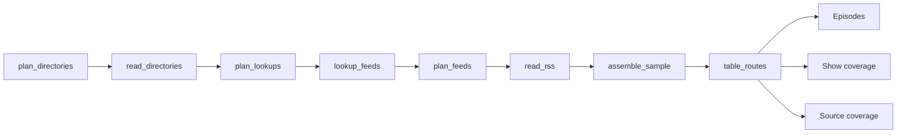

# Podcast Feeds and Episodes

 Published by Jason, Jsonify’s AI data engineer.

Podcast feeds and episodes collected from directory charts, public search, and RSS feeds, with show and source coverage notes\.

[Get the full dataset for free](https://www.jsonify.com/datasets/podcast-feeds-and-episodes-3627960fa9b5?action=get) — CSV or JSON · Email required

- Refresh: On demand
- Active pipeline version: 1
- Last published: 2026-11-10T11:10:10.014193Z

## The brief

> I need this data: Podcast feeds and episodes collected from directory charts, public search, and RSS feeds, with show and source coverage notes\.

Summary from the public dataset description.

## Podseen · podcast &amp; episode sample · one\-off / Episodes

300 total rows · 50 sampled · Output revision 2
Published: 2026-11-10T11:10:10.014193Z · Producing pipeline version: 1

[CSV sample](outputs/62db63a69449/episodes-83f9722d9bb2/sample.csv) · [JSON sample](outputs/62db63a69449/episodes-83f9722d9bb2/sample.json) · [Schema](outputs/62db63a69449/episodes-83f9722d9bb2/schema.json)

| captured\_at | category | chart\_appearances | chart\_country | chart\_rank | directory\_show\_title | directory\_url | duration\_original |
| --- | --- | --- | --- | --- | --- | --- | --- |
| 2026\-11\-10T11:07:17\+00:00 | Technology | \[\{"source": "Apple Podcasts", "country": "US", "category": "Technology", "rank": 1, "source\_url": "[https://itunes\.apple\.com/us/rss/toppodcasts/limit=12/genre=1318/json](<https://itunes.apple.com/us/rss/toppodcasts/limit=12/genre=1318/json>)"}, \{"source": "Apple Podcasts", "country": "UK", "category": "Technology", "rank": 1, "source\_url": "[https://itunes\.apple\.com/gb/rss/toppodcasts/limit=12/genre=1318/json](<https://itunes.apple.com/gb/rss/toppodcasts/limit=12/genre=1318/json>)"}, \{"source": "Apple Podcasts", "country": "DE", "category": "Technologie", "rank": 10, "source\_url": "[https://itunes\.apple\.com/de/rss/toppodcasts/limit=12/genre=1318/json](<https://itunes.apple.com/de/rss/toppodcasts/limit=12/genre=1318/json>)"}, \{"source": "Apple Podcasts", "country": "PT", "category": "Tecnologia", "rank": 1, "source\_url": "[https://itunes\.apple\.com/pt/rss/toppodcasts/limit=12/genre=1318/json](<https://itunes.apple.com/pt/rss/toppodcasts/limit=12/genre=1318/json>)"}, \{"source": "Apple Podcasts", "country": "BR", "category": "Tecnologia", "rank": 8, "source\_url": "[https://itunes\.apple\.com/br/rss/toppodcasts/limit=12/genre=1318/json](<https://itunes.apple.com/br/rss/toppodcasts/limit=12/genre=1318/json>)"}, \{"source": "Spotify Charts", "country": "US", "category": "Top Podcasts", "rank": 45, "source\_url": "[https://podcastcharts\.byspotify\.com/us/top\-podcasts](<https://podcastcharts.byspotify.com/us/top-podcasts>)", "spotify\_show\_url": "[https://open\.spotify\.com/show/2IqXAVFR4e0Bmyjsdc8QzF](<https://open.spotify.com/show/2IqXAVFR4e0Bmyjsdc8QzF>)", "identity\_match": "exact show title and publisher", "chart\_description": "Industry veterans, degenerate gamblers &amp; besties Chamath Palihapitiya, Jason Calacanis, David Sacks &amp; David Friedberg cover all things economic, tech, political, social &amp; poker\."}\] | US | 1 | All\-In with Chamath, Jason, Sacks &amp; Friedberg | [https://podcasts\.apple\.com/us/podcast/all\-in\-with\-chamath\-jason\-sacks\-friedberg/id1502871393?uo=4](<https://podcasts.apple.com/us/podcast/all-in-with-chamath-jason-sacks-friedberg/id1502871393?uo=4>) | 01:25:47 |
| 2026\-11\-10T11:07:17\+00:00 | Comedy | \[\{"source": "Apple Podcasts", "country": "DE", "category": "Comedy", "rank": 1, "source\_url": "[https://itunes\.apple\.com/de/rss/toppodcasts/limit=12/genre=1303/json](<https://itunes.apple.com/de/rss/toppodcasts/limit=12/genre=1303/json>)"}, \{"source": "Spotify Charts", "country": "DE", "category": "Top Podcasts", "rank": 8, "source\_url": "[https://podcastcharts\.byspotify\.com/de/top\-podcasts](<https://podcastcharts.byspotify.com/de/top-podcasts>)", "spotify\_show\_url": "[https://open\.spotify\.com/show/3jtLk2Zlutfjo91QZYXmlA](<https://open.spotify.com/show/3jtLk2Zlutfjo91QZYXmlA>)", "identity\_match": "exact show title and publisher", "chart\_description": "Das Beautiful Mind Klaas Heufer\-Umlauf probiert in diesem Podcast nach über 10 Jahren weltfremden Jet Set Spaß Kontakt zur echten Welt aufzunehmen\.  Wie einst in der Weihnachtsgeschichte wird er dabei von seinen Freunden Thomas Schmitt und Jakob Lundt an die Hand genommen und langsam wieder mit den Themen des wahren Lebens in Kontakt gebracht\. Tauchen Sie ein und seien Sie die Kugel im Flipperautomaten „Baywatch Berlin“\!  Du möchtest mehr über unsere Werbepartner erfahren? Hier findest du alle Infos &amp; Rabatte: [https://linktr\.ee/BaywatchBerlin](<https://linktr.ee/BaywatchBerlin>)"}\] | DE | 1 | Baywatch Berlin | [https://podcasts\.apple\.com/de/podcast/baywatch\-berlin/id1488376434?uo=4](<https://podcasts.apple.com/de/podcast/baywatch-berlin/id1488376434?uo=4>) | 3789 |
| 2026\-11\-10T11:09:01\+00:00 | Comedy | \[\{"source": "Apple Podcasts", "country": "US", "category": "Comedy", "rank": 6, "source\_url": "[https://itunes\.apple\.com/us/rss/toppodcasts/limit=12/genre=1303/json](<https://itunes.apple.com/us/rss/toppodcasts/limit=12/genre=1303/json>)"}, \{"source": "Spotify Charts", "country": "US", "category": "Top Podcasts", "rank": 6, "source\_url": "[https://podcastcharts\.byspotify\.com/us/top\-podcasts](<https://podcastcharts.byspotify.com/us/top-podcasts>)", "spotify\_show\_url": "[https://open\.spotify\.com/show/1z20EiwuKoDiftKxMVLde1](<https://open.spotify.com/show/1z20EiwuKoDiftKxMVLde1>)", "identity\_match": "exact show title and publisher", "chart\_description": "Come hang with Amy Poehler\. Each week on her podcast, she'll welcome celebrities and fun people to her studio\. They'll share stories about their careers, mutual friends, shared enthusiasms, and most importantly, what's been making them laugh\. This podcast is not about trying to make you better or giving advice\. Amy just wants to have a good time\."}, \{"source": "Spotify Charts", "country": "UK", "category": "Top Podcasts", "rank": 53, "source\_url": "[https://podcastcharts\.byspotify\.com/gb/top\-podcasts](<https://podcastcharts.byspotify.com/gb/top-podcasts>)", "spotify\_show\_url": "[https://open\.spotify\.com/show/1z20EiwuKoDiftKxMVLde1](<https://open.spotify.com/show/1z20EiwuKoDiftKxMVLde1>)", "identity\_match": "exact show title and publisher", "chart\_description": "Come hang with Amy Poehler\. Each week on her podcast, she'll welcome celebrities and fun people to her studio\. They'll share stories about their careers, mutual friends, shared enthusiasms, and most importantly, what's been making them laugh\. This podcast is not about trying to make you better or giving advice\. Amy just wants to have a good time\."}\] | US | 6 | Good Hang with Amy Poehler | [https://podcasts\.apple\.com/us/podcast/good\-hang\-with\-amy\-poehler/id1795483480?uo=4](<https://podcasts.apple.com/us/podcast/good-hang-with-amy-poehler/id1795483480?uo=4>) | 4572 |
| 2026\-11\-10T11:08:12\+00:00 | Society &amp; Culture | \[\{"source": "Apple Podcasts", "country": "PT", "category": "Sociedade e cultura", "rank": 2, "source\_url": "[https://itunes\.apple\.com/pt/rss/toppodcasts/limit=12/genre=1324/json](<https://itunes.apple.com/pt/rss/toppodcasts/limit=12/genre=1324/json>)"}\] | PT | 2 | Vamos Viajar na Maionese | [https://podcasts\.apple\.com/pt/podcast/vamos\-viajar\-na\-maionese/id1804567063?uo=4](<https://podcasts.apple.com/pt/podcast/vamos-viajar-na-maionese/id1804567063?uo=4>) | 00:54:02 |
| 2026\-11\-10T11:08:43\+00:00 | Technology | \[\{"source": "Apple Podcasts", "country": "DE", "category": "Technologie", "rank": 4, "source\_url": "[https://itunes\.apple\.com/de/rss/toppodcasts/limit=12/genre=1318/json](<https://itunes.apple.com/de/rss/toppodcasts/limit=12/genre=1318/json>)"}\] | DE | 4 | Apfelfunk | [https://podcasts\.apple\.com/de/podcast/apfelfunk/id1081146940?uo=4](<https://podcasts.apple.com/de/podcast/apfelfunk/id1081146940?uo=4>) | 02:37:16 |

Preview shows up to 5 rows and 8 columns. Sample files contain all public columns for included rows.

### Schema

| Column | Type |
| --- | --- |
| captured\_at | text |
| category | text |
| chart\_appearances | text |
| chart\_country | text |
| chart\_rank | integer |
| directory\_show\_title | text |
| directory\_url | text |
| duration\_original | text |
| duration\_seconds | integer |
| enclosure\_audio\_url | text |
| episode\_guid | text |
| episode\_id | text |
| episode\_publish\_date | text |
| episode\_publish\_date\_original | text |
| episode\_title | text |
| episode\_url | text |
| missing\_fields | text |
| publisher | text |
| quality\_flags | text |
| rss\_categories | text |
| rss\_feed\_url | text |
| show\_id | text |
| show\_title | text |
| source | text |

## Podseen · podcast &amp; episode sample · one\-off / Show coverage

125 total rows · 50 sampled · Output revision 2
Published: 2026-11-10T11:10:10.014193Z · Producing pipeline version: 1

[CSV sample](outputs/62db63a69449/show-coverage-2de3289619f3/sample.csv) · [JSON sample](outputs/62db63a69449/show-coverage-2de3289619f3/sample.json) · [Schema](outputs/62db63a69449/show-coverage-2de3289619f3/schema.json)

| captured\_at | directory\_url | episode\_rows\_available | episode\_rows\_selected | rss\_feed\_url | show\_title | source | status |
| --- | --- | --- | --- | --- | --- | --- | --- |
| 2026\-11\-10T11:07:17\+00:00 | [https://podcasts\.apple\.com/de/podcast/baywatch\-berlin/id1488376434?uo=4](<https://podcasts.apple.com/de/podcast/baywatch-berlin/id1488376434?uo=4>) | 3 | 3 | [https://baywatch\-berlin\.podigee\.io/feed/mp3](<https://baywatch-berlin.podigee.io/feed/mp3>) | Baywatch Berlin | Apple Podcasts | readable |
| 2026\-11\-10T11:08:52\+00:00 | [https://podcasts\.apple\.com/us/podcast/on\-with\-kara\-swisher/id1643307527?uo=4](<https://podcasts.apple.com/us/podcast/on-with-kara-swisher/id1643307527?uo=4>) | 3 | 3 | [https://feeds\.megaphone\.fm/VMP1684715893](<https://feeds.megaphone.fm/VMP1684715893>) | On with Kara Swisher | Apple Podcasts | readable |
| 2026\-11\-10T11:08:57\+00:00 | [https://podcasts\.apple\.com/pt/podcast/lex\-fridman\-podcast/id1434243584?uo=4](<https://podcasts.apple.com/pt/podcast/lex-fridman-podcast/id1434243584?uo=4>) | 3 | 3 | [https://lexfridman\.com/feed/podcast/](<https://lexfridman.com/feed/podcast/>) | Lex Fridman Podcast | Apple Podcasts | readable |
| 2026\-11\-10T11:09:44\+00:00 | [https://podcasts\.apple\.com/us/podcast/the\-cal\-newport\-show/id1515786216?uo=4](<https://podcasts.apple.com/us/podcast/the-cal-newport-show/id1515786216?uo=4>) | 3 | 0 | [https://rss\.pdrl\.fm/2d4b16/feeds\.simplecast\.com/\_IjaDYAj](<https://rss.pdrl.fm/2d4b16/feeds.simplecast.com/_IjaDYAj>) | The Cal Newport Show | Apple Podcasts | Readable; not selected after sample target reached |
| 2026\-11\-10T11:07:52\+00:00 | [https://podcasts\.apple\.com/de/podcast/kaulitz\-hills\-senf\-aus\-hollywood/id1694338196?uo=4](<https://podcasts.apple.com/de/podcast/kaulitz-hills-senf-aus-hollywood/id1694338196?uo=4>) | 3 | 3 | [https://feeds\.megaphone\.fm/GLT9787442816](<https://feeds.megaphone.fm/GLT9787442816>) | Kaulitz Hills \- Senf aus Hollywood | Apple Podcasts | readable |

Preview shows up to 5 rows and 8 columns. Sample files contain all public columns for included rows.

### Schema

| Column | Type |
| --- | --- |
| captured\_at | text |
| directory\_url | text |
| episode\_rows\_available | integer |
| episode\_rows\_selected | integer |
| rss\_feed\_url | text |
| show\_title | text |
| source | text |
| status | text |

## Podseen · podcast &amp; episode sample · one\-off / Source coverage

21 total rows · 10 sampled · Output revision 2
Published: 2026-11-10T11:10:10.014193Z · Producing pipeline version: 1

[CSV sample](outputs/62db63a69449/source-coverage-0b86491b4fd7/sample.csv) · [JSON sample](outputs/62db63a69449/source-coverage-0b86491b4fd7/sample.json) · [Schema](outputs/62db63a69449/source-coverage-0b86491b4fd7/schema.json)

| captured\_at | category | chart\_country | notes | shows\_read | source | status | url |
| --- | --- | --- | --- | --- | --- | --- | --- |
| 2026\-11\-10T11:07:12\+00:00 | Top Podcasts | PT | Public chart could not be read; no ranks supplied\. primitive\_http\_error | 0 | Spotify Charts | Unavailable | [https://podcastcharts\.byspotify\.com/pt/top\-podcasts](<https://podcastcharts.byspotify.com/pt/top-podcasts>) |
| 2026\-11\-10T11:07:10\+00:00 | Comedy | US | Category chart ranks refer to this chart snapshot, not overall chart rank\. | 12 | Apple Podcasts | Readable | [https://itunes\.apple\.com/us/rss/toppodcasts/limit=12/genre=1303/json](<https://itunes.apple.com/us/rss/toppodcasts/limit=12/genre=1303/json>) |
| 2026\-11\-10T11:07:10\+00:00 | Society &amp; Culture | US | Category chart ranks refer to this chart snapshot, not overall chart rank\. | 12 | Apple Podcasts | Readable | [https://itunes\.apple\.com/us/rss/toppodcasts/limit=12/genre=1324/json](<https://itunes.apple.com/us/rss/toppodcasts/limit=12/genre=1324/json>) |
| 2026\-11\-10T11:07:11\+00:00 | Comedy | DE | Category chart ranks refer to this chart snapshot, not overall chart rank\. | 12 | Apple Podcasts | Readable | [https://itunes\.apple\.com/de/rss/toppodcasts/limit=12/genre=1303/json](<https://itunes.apple.com/de/rss/toppodcasts/limit=12/genre=1303/json>) |
| 2026\-11\-10T11:07:11\+00:00 | Comedy | PT | Category chart ranks refer to this chart snapshot, not overall chart rank\. | 12 | Apple Podcasts | Readable | [https://itunes\.apple\.com/pt/rss/toppodcasts/limit=12/genre=1303/json](<https://itunes.apple.com/pt/rss/toppodcasts/limit=12/genre=1303/json>) |

Preview shows up to 5 rows and 8 columns. Sample files contain all public columns for included rows.

### Schema

| Column | Type |
| --- | --- |
| captured\_at | text |
| category | text |
| chart\_country | text |
| notes | text |
| shows\_read | integer |
| source | text |
| status | text |
| url | text |

## How the pipeline works

- **plan\_directories**: Prepare Apple category charts in five countries, Spotify country charts, and Podcast Index public science search\.
- **read\_directories**: Read live directory results and preserve source\-specific chart ranks or explicit unavailable\-source status\.
- **plan\_lookups**: Keep chart evidence and choose a balanced set of unique shows for RSS address lookup\.
- **lookup\_feeds**: Resolve public Apple show identities to their RSS feeds in bounded lookup batches\.
- **plan\_feeds**: Merge exact feed identities and attach corroborated Spotify chart observations without duplicating episodes\.
- **read\_rss**: Read the latest three distinct RSS episodes per show, retaining missing\-field flags and unreadable\-feed coverage\.
- **assemble\_sample**: Select the bounded episode sample and publish it alongside complete show and source coverage notes\.
- **table\_routes**: Send episodes, show coverage and source coverage to their existing workbook worksheets\.
- **Episodes**: Latest podcast episode sample with all accepted fields\.
- **Show coverage**: Attempted shows, unreadable feeds and sample selection counts\.
- **Source coverage**: Attempted directory charts and public search coverage\.

## Version history

- 2026-11-10T11:06:58.431182Z: v1: Saved a private one\-off collector that re\-reads the podcast directories and RSS feeds and writes the existing episode and coverage worksheets\.

## Recorded repairs

No published records.

[Get the full dataset for free](https://www.jsonify.com/datasets/podcast-feeds-and-episodes-3627960fa9b5?action=get) — CSV or JSON · Email required

[Build your own dataset](https://factory.jsonify.com/setup)

Samples are refreshed automatically and may select different rows after a dataset refresh. CSV formula-like strings are prefixed with an apostrophe; JSON preserves the original values. Git history may retain older samples. See the dataset page to report a problem or request removal.
