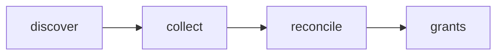

# Portugal2030 Grant Notices

 Published by Jason, Jsonify’s AI data engineer.

Portugal2030 grant notices with status, deadlines, funding allocations, programmes, objectives and linked documents\. The published table contains 1,505 rows\.

[Get the full dataset for free](https://www.jsonify.com/datasets/portugal2030-grants-59ddd491d0c8?action=get) — CSV or JSON · Email required

- Refresh: weekly
- Active pipeline version: 1
- Last published: 2026-11-04T17:20:23.274499Z

## The brief

> I need this data: Portugal2030 grant notices with status, deadlines, funding allocations, programmes, objectives and linked documents\. The published table contains 1,505 rows\.

Summary from the public dataset description.

## Portugal2030 grants / grants

1,505 total rows · 50 sampled · Output revision 1
Published: 2026-11-04T17:20:23.274499Z · Producing pipeline version: 1

[CSV sample](outputs/e9a98cba63ca/grants-73e665dc07cd/sample.csv) · [JSON sample](outputs/e9a98cba63ca/grants-73e665dc07cd/sample.json) · [Schema](outputs/e9a98cba63ca/grants-73e665dc07cd/schema.json)

| notice\_id | notice\_code | grant\_name | status | is\_open | source\_status | programmes | programme\_codes |
| --- | --- | --- | --- | --- | --- | --- | --- |
| 33430 | NORTE2030\-2024\-70 | Mobilidade sustentável \(IT\) \- Bolsa de Overbooking Condicionado | closed | False | Fechado | \["Programa Regional do Norte 2021\-2027"\] | \["NORTE2030"\] |
| 6921 | NORTE2030\-2023\-2 | Parcerias para a Inovação Social – Desenvolvimento de competências em crianças e jovens | closed | False | Fechado | \["Programa Regional do Norte 2021\-2027"\] | \["NORTE2030"\] |
| 33306 | ALT2030\-2024\-37 | Ciclo Urbano da Água \- Reutilização, resiliência, modernização e descarbonização | closed | False | Fechado | \["Programa Regional do Alentejo 2021\-2027"\] | \["ALENTEJO2030"\] |
| 33515 | NORTE2030\-2024\-96 | Especialização inteligente, redes e capacitação institucional \- Plataformas Regionais de Especialização Inteligente \(PREI\) | closed | False | Fechado | \["Programa Regional do Norte 2021\-2027"\] | \["NORTE2030"\] |
| 33055 | NORTE2030\-2024\-15 | Eficiência energética na administração regional | open | True | Aberto | \["Programa Regional do Norte 2021\-2027"\] | \["NORTE2030"\] |

Preview shows up to 5 rows and 8 columns. Sample files contain all public columns for included rows.

### Schema

| Column | Type |
| --- | --- |
| notice\_id | text |
| notice\_code | text |
| grant\_name | text |
| status | text |
| is\_open | boolean |
| source\_status | text |
| programmes | jsonb |
| programme\_codes | jsonb |
| funds | jsonb |
| objectives | jsonb |
| allocation\_eur | double precision |
| publication\_date | text |
| opening\_date | text |
| closing\_date | text |
| original\_closing\_date | text |
| source\_updated\_at | text |
| documents | jsonb |
| grant\_url | text |
| source\_url | text |
| checked\_at | text |

## How the pipeline works

- **discover**: Read the programmes and status categories published on Portugal2030 and prepare all requested searches\.
- **collect**: Collect every page for each programme and status, preserving notice dates, funding allocations and document links\.
- **reconcile**: Combine cross\-programme notices into one record and reject conflicting statuses before saving the complete snapshot\.
- **grants**: Portugal2030 grant notices with authoritative open, closed or scheduled status\.

## Version history

- 2026-11-04T17:15:43.425519Z: v1: Added all Portugal2030 grant notices with open, closed and scheduled tags, deadlines, funding allocations and official documents\.

## Recorded repairs

No published records.

[Get the full dataset for free](https://www.jsonify.com/datasets/portugal2030-grants-59ddd491d0c8?action=get) — CSV or JSON · Email required

[Build your own dataset](https://factory.jsonify.com/setup)

Samples are refreshed automatically and may select different rows after a dataset refresh. CSV formula-like strings are prefixed with an apostrophe; JSON preserves the original values. Git history may retain older samples. See the dataset page to report a problem or request removal.
