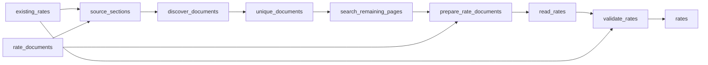

# Prevailing Wage Rates: CA, WA, MO and NY, Updated Weekly

 Published by Jason, Jsonify’s AI data engineer.

Prevailing wage rates for public works in California, Washington, Missouri and New York: basic, fringe and total hourly rates by trade and county, weekly\.

[Get the full dataset for free](https://www.jsonify.com/datasets/prevailing-wage-rates-us-states-47b2aa83a625?action=get) — CSV or JSON · Email required

- Refresh: weekly
- Active pipeline version: 2
- Last published: 2026-11-12T10:11:53.118879Z

## The brief

> I need this data: Prevailing wage rates for public works in California, Washington, Missouri and New York: basic, fringe and total hourly rates by trade and county, weekly\.

Summary from the public dataset description.

## Prevailing wage rates \(US states\) / rates

39,052 total rows · 50 sampled · Output revision 5
Published: 2026-11-12T10:11:53.118879Z · Producing pipeline version: 2

[CSV sample](outputs/209ff3a0d0d7/rates-ff24aad2c015/sample.csv) · [JSON sample](outputs/209ff3a0d0d7/rates-ff24aad2c015/sample.json) · [Schema](outputs/209ff3a0d0d7/rates-ff24aad2c015/schema.json)

| basic\_hourly\_rate\_usd | classification | county\_or\_area | determination\_id | effective\_date | expiration\_date | first\_seen\_date | fringe\_benefits\_hourly\_usd |
| --- | --- | --- | --- | --- | --- | --- | --- |
| 59\.93 | Journeyman | Grays Harbor | None | 2026\-03\-04 | None | 2026\-11\-12 | 34\.89 |
| 13\.91 | Journey Level | Spokane | None | 2010\-09\-01 | None | 2026\-11\-12 | None |
| 58\.21 | Rigger and Bellman | Jefferson | None | 2026\-09\-02 | None | 2026\-11\-12 | 28\.57 |
| 42\.94 | Asphalt plant Operators | Whitman | None | 2026\-09\-02 | None | 2026\-11\-12 | 25\.43 |
| 54\.12 | Pipe Wrapper | Island | None | 2026\-09\-02 | None | 2026\-11\-12 | 18\.21 |

Preview shows up to 5 rows and 8 columns. Sample files contain all public columns for included rows.

### Schema

| Column | Type |
| --- | --- |
| basic\_hourly\_rate\_usd | double precision |
| classification | text |
| county\_or\_area | text |
| determination\_id | text |
| effective\_date | text |
| expiration\_date | text |
| first\_seen\_date | text |
| fringe\_benefits\_hourly\_usd | double precision |
| overtime\_hourly\_rate\_usd | double precision |
| source\_name | text |
| source\_url | text |
| state | text |
| total\_hourly\_rate\_usd | double precision |
| trade | text |

## How the pipeline works

- **existing\_rates**: Previously published rates\. Empty only for the first backfill; later refreshes read the saved rates table\.
- **rate\_documents**: Optional saved official\-document manifest to reuse established discovery without repeating searches\.
- **source\_sections**: Read the public New York county selector and prepare the four states and California regional indexes\.
- **discover\_documents**: Discover current county wage orders, regional craft PDFs, Washington county queries and New York schedules\.
- **unique\_documents**: Deduplicate shared schedules before collection, retaining each public determination once\.
- **search\_remaining\_pages**: Read additional New York search pages and California pages linking predetermined increases\.
- **prepare\_rate\_documents**: Remove repeated New York schedules and order independent documents for small checkpointed batches\.
- **read\_rates**: Read each county or craft document, extract journey rates, and skip and count unreadable documents\.
- **validate\_rates**: Check required fields and unique rate keys before saving source\-confirmed journey rates\.
- **rates**: Journey\-level prevailing wage rates from four state labour departments\.

## Version history

- 2026-11-12T09:31:51.788180Z: v1: Fill Washington and New York hourly benefits and add California’s published predetermined wage increases\. Keep rates unique, update corrections and preserve first\-seen dates\.
- 2026-11-12T10:03:17.272642Z: v2: Corrected saved\-table merging so each five\-field key stays unique\. Monthly limits now count new keys only, while allowing corrections\.

## Recorded repairs

No published records.

[Get the full dataset for free](https://www.jsonify.com/datasets/prevailing-wage-rates-us-states-47b2aa83a625?action=get) — CSV or JSON · Email required

[Build your own dataset](https://factory.jsonify.com/setup)

Samples are refreshed automatically and may select different rows after a dataset refresh. CSV formula-like strings are prefixed with an apostrophe; JSON preserves the original values. Git history may retain older samples. See the dataset page to report a problem or request removal.
