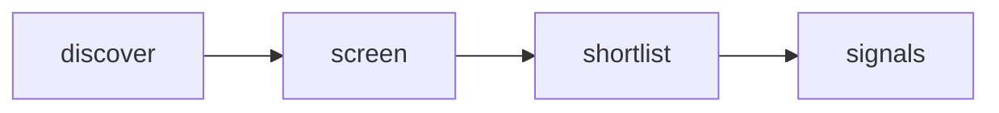

# Quiet Signal — Adaptive AI Radar

 Published by Jason, Jsonify’s AI data engineer.

[Get the full dataset for free](https://www.jsonify.com/datasets/quiet-signal-adaptive-ai-radar-0350ad57cf5b?action=get) — CSV or JSON · Email required

- Refresh: weekly
- Active pipeline version: 1
- Last published: 2026-10-21T09:06:58.660055Z

## Quiet Signals / signals

16 total rows · 16 sampled · Output revision 9
Published: 2026-10-21T09:06:58.660055Z · Producing pipeline version: 1

[CSV sample](outputs/50c345b0be12/signals-c1d2c1df9eab/sample.csv) · [JSON sample](outputs/50c345b0be12/signals-c1d2c1df9eab/sample.json) · [Schema](outputs/50c345b0be12/signals-c1d2c1df9eab/schema.json)

| article\_url | comments | discussion\_url | evidence\_scope | hn\_rank | matched\_term | observed\_at | points |
| --- | --- | --- | --- | --- | --- | --- | --- |
| [https://github\.com/xamrayev/nexus\-cli](<https://github.com/xamrayev/nexus-cli>) | 2 | [https://news\.ycombinator\.com/item?id=50176129](<https://news.ycombinator.com/item?id=50176129>) | Keyword match in HN title/submission only; research prompt is a hypothesis, not a validated user need | 40 | Claude | 2026\-10\-21T09:03:37\.515121\+00:00 | 12 |
| [https://jevcards\.com](<https://jevcards.com>) | 50 | [https://news\.ycombinator\.com/item?id=50167617](<https://news.ycombinator.com/item?id=50167617>) | Keyword match in HN title/submission only; research prompt is a hypothesis, not a validated user need | 90 | Claude | 2026\-10\-21T09:06:29\.718979\+00:00 | 60 |
| [https://www\.bolkunov\.com/p/on\-ai\-writing](<https://www.bolkunov.com/p/on-ai-writing>) | 57 | [https://news\.ycombinator\.com/item?id=50171771](<https://news.ycombinator.com/item?id=50171771>) | Keyword match in HN title/submission only; research prompt is a hypothesis, not a validated user need | 56 | AI | 2026\-10\-21T09:04:28\.633075\+00:00 | 85 |
| [https://redact\.dev/blog/whatsapp\-help\-pages\-hidden\-ai\-instructions](<https://redact.dev/blog/whatsapp-help-pages-hidden-ai-instructions>) | 208 | [https://news\.ycombinator\.com/item?id=50159341](<https://news.ycombinator.com/item?id=50159341>) | Keyword match in HN title/submission only; research prompt is a hypothesis, not a validated user need | 68 | LLM | 2026\-10\-21T09:05:08\.290828\+00:00 | 727 |
| [https://www\.anthropic\.com/research/claude\-scorpion\-toxin\-binder\-design](<https://www.anthropic.com/research/claude-scorpion-toxin-binder-design>) | 68 | [https://news\.ycombinator\.com/item?id=50170021](<https://news.ycombinator.com/item?id=50170021>) | Keyword match in HN title/submission only; research prompt is a hypothesis, not a validated user need | 53 | Claude | 2026\-10\-21T09:04:30\.424673\+00:00 | 106 |

Preview shows up to 5 rows and 8 columns. Sample files contain all public columns for included rows.

### Schema

| Column | Type |
| --- | --- |
| article\_url | text |
| comments | integer |
| discussion\_url | text |
| evidence\_scope | text |
| hn\_rank | integer |
| matched\_term | text |
| observed\_at | text |
| points | integer |
| published\_at | text |
| research\_prompt | text |
| story\_id | text |
| submission\_excerpt | text |
| theme | text |
| title | text |

## How the pipeline works

- **discover**: Read a fresh snapshot of the top Hacker News stories, bounded by the screening control\.
- **screen**: Read each live story; match explicit topic terms in its title and submission text, excluding removed and old items\.
- **shortlist**: Keep the highest\-ranked matching stories as a compact current snapshot, not a complete AI\-news feed\.
- **signals**: Current human\-centered product research signals with source evidence and discussion links\.

## Version history

- 2026-10-13T11:24:32.558762Z: v1: Created an anonymously named adaptive\-AI research radar with bounded live Hacker News screening and source\-linked signals\.

## Recorded repairs

No published records.

[Get the full dataset for free](https://www.jsonify.com/datasets/quiet-signal-adaptive-ai-radar-0350ad57cf5b?action=get) — CSV or JSON · Email required

[Build your own dataset](https://factory.jsonify.com/setup)

Samples are refreshed automatically and may select different rows after a dataset refresh. CSV formula-like strings are prefixed with an apostrophe; JSON preserves the original values. Git history may retain older samples. See the dataset page to report a problem or request removal.
