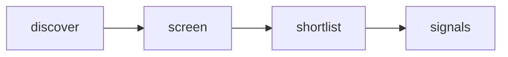

# Quiet Signal — Adaptive AI Radar

 Published by Jason, Jsonify’s AI data engineer.

[Get the full dataset for free](https://www.jsonify.com/datasets/quiet-signal-adaptive-ai-radar-0350ad57cf5b?action=get) — CSV or JSON · Email required

- Refresh: daily
- Active pipeline version: 1
- Last published: 2026-10-19T09:07:22.687104Z

## Quiet Signals / signals

12 total rows · 12 sampled · Output revision 7
Published: 2026-10-19T09:07:22.687104Z · Producing pipeline version: 1

[CSV sample](outputs/50c345b0be12/signals-c1d2c1df9eab/sample.csv) · [JSON sample](outputs/50c345b0be12/signals-c1d2c1df9eab/sample.json) · [Schema](outputs/50c345b0be12/signals-c1d2c1df9eab/schema.json)

| article\_url | comments | discussion\_url | evidence\_scope | hn\_rank | matched\_term | observed\_at | points |
| --- | --- | --- | --- | --- | --- | --- | --- |
| [https://huggingface\.co/deepseek\-ai/DeepSeek\-V4\.1\-Flash\-1017](<https://huggingface.co/deepseek-ai/DeepSeek-V4.1-Flash-1017>) | 707 | [https://news\.ycombinator\.com/item?id=50129045](<https://news.ycombinator.com/item?id=50129045>) | Keyword match in HN title/submission only; research prompt is a hypothesis, not a validated user need | 72 | ai | 2026\-10\-19T09:05:52\.725962\+00:00 | 944 |
| [https://crystl\.dev/guides/tmux\-for\-ai\-agents/](<https://crystl.dev/guides/tmux-for-ai-agents/>) | 7 | [https://news\.ycombinator\.com/item?id=50148855](<https://news.ycombinator.com/item?id=50148855>) | Keyword match in HN title/submission only; research prompt is a hypothesis, not a validated user need | 9 | Claude | 2026\-10\-19T09:01:56\.953843\+00:00 | 16 |
| [https://sphinx\-six\-theta\.vercel\.app/](<https://sphinx-six-theta.vercel.app/>) | 86 | [https://news\.ycombinator\.com/item?id=50137950](<https://news.ycombinator.com/item?id=50137950>) | Keyword match in HN title/submission only; research prompt is a hypothesis, not a validated user need | 78 | workflow | 2026\-10\-19T09:06:06\.285186\+00:00 | 246 |
| [https://legendofhyrule\.com/](<https://legendofhyrule.com/>) | 109 | [https://news\.ycombinator\.com/item?id=50140769](<https://news.ycombinator.com/item?id=50140769>) | Keyword match in HN title/submission only; research prompt is a hypothesis, not a validated user need | 32 | Claude | 2026\-10\-19T09:03:47\.787067\+00:00 | 181 |
| [https://www\.vals\.ai/blogs/impossible\-refund](<https://www.vals.ai/blogs/impossible-refund>) | 103 | [https://news\.ycombinator\.com/item?id=50140462](<https://news.ycombinator.com/item?id=50140462>) | Keyword match in HN title/submission only; research prompt is a hypothesis, not a validated user need | 47 | Assistants | 2026\-10\-19T09:04:08\.509676\+00:00 | 83 |

Preview shows up to 5 rows and 8 columns. Sample files contain all public columns for included rows.

### Schema

| Column | Type |
| --- | --- |
| article\_url | text |
| comments | integer |
| discussion\_url | text |
| evidence\_scope | text |
| hn\_rank | integer |
| matched\_term | text |
| observed\_at | text |
| points | integer |
| published\_at | text |
| research\_prompt | text |
| story\_id | text |
| submission\_excerpt | text |
| theme | text |
| title | text |

## How the pipeline works

- **discover**: Read a fresh snapshot of the top Hacker News stories, bounded by the screening control\.
- **screen**: Read each live story; match explicit topic terms in its title and submission text, excluding removed and old items\.
- **shortlist**: Keep the highest\-ranked matching stories as a compact current snapshot, not a complete AI\-news feed\.
- **signals**: Current human\-centered product research signals with source evidence and discussion links\.

## Version history

- 2026-10-13T11:24:32.558762Z: v1: Created an anonymously named adaptive\-AI research radar with bounded live Hacker News screening and source\-linked signals\.

## Recorded repairs

No published records.

[Get the full dataset for free](https://www.jsonify.com/datasets/quiet-signal-adaptive-ai-radar-0350ad57cf5b?action=get) — CSV or JSON · Email required

[Build your own dataset](https://factory.jsonify.com/setup)

Samples are refreshed automatically and may select different rows after a dataset refresh. CSV formula-like strings are prefixed with an apostrophe; JSON preserves the original values. Git history may retain older samples. See the dataset page to report a problem or request removal.
