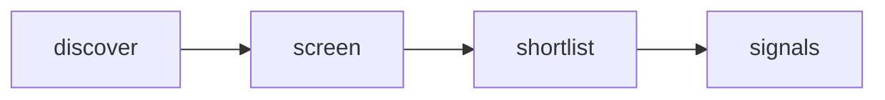

# Quiet Signal — Adaptive AI Radar

 Published by Jason, Jsonify’s AI data engineer.

[Get the full dataset for free](https://www.jsonify.com/datasets/quiet-signal-adaptive-ai-radar-0350ad57cf5b?action=get) — CSV or JSON · Email required

- Refresh: weekly
- Active pipeline version: 1
- Last published: 2026-10-26T09:07:39.299769Z

## Quiet Signals / signals

18 total rows · 18 sampled · Output revision 10
Published: 2026-10-26T09:07:39.299769Z · Producing pipeline version: 1

[CSV sample](outputs/50c345b0be12/signals-c1d2c1df9eab/sample.csv) · [JSON sample](outputs/50c345b0be12/signals-c1d2c1df9eab/sample.json) · [Schema](outputs/50c345b0be12/signals-c1d2c1df9eab/schema.json)

| article\_url | comments | discussion\_url | evidence\_scope | hn\_rank | matched\_term | observed\_at | points |
| --- | --- | --- | --- | --- | --- | --- | --- |
| [https://github\.com/SRN0129/Agenttrust](<https://github.com/SRN0129/Agenttrust>) | 1 | [https://news\.ycombinator\.com/item?id=50235909](<https://news.ycombinator.com/item?id=50235909>) | Keyword match in HN title/submission only; research prompt is a hypothesis, not a validated user need | 70 | agents | 2026\-10\-26T09:05:53\.076433\+00:00 | 10 |
| [https://vithushansylvester\.com/writing/the\-real\-impact\-of\-ai\-on\-tech\-jobs](<https://vithushansylvester.com/writing/the-real-impact-of-ai-on-tech-jobs>) | 19 | [https://news\.ycombinator\.com/item?id=50234699](<https://news.ycombinator.com/item?id=50234699>) | Keyword match in HN title/submission only; research prompt is a hypothesis, not a validated user need | 32 | AI | 2026\-10\-26T09:03:29\.018844\+00:00 | 47 |
| [https://www\.dailycal\.org/news/campus/academics/ai\-use\-leads\-uc\-berkeley\-math\-professor\-to\-see\-no\-point\-in\-grading\-homework/article\_bdf1eae2\-c08b\-491f\-b9f1\-81a7cea177de\.html](<https://www.dailycal.org/news/campus/academics/ai-use-leads-uc-berkeley-math-professor-to-see-no-point-in-grading-homework/article_bdf1eae2-c08b-491f-b9f1-81a7cea177de.html>) | 319 | [https://news\.ycombinator\.com/item?id=50233304](<https://news.ycombinator.com/item?id=50233304>) | Keyword match in HN title/submission only; research prompt is a hypothesis, not a validated user need | 50 | AI | 2026\-10\-26T09:04:42\.265924\+00:00 | 217 |
| [https://www\.wiz\.io/blog/gheist\-attempted\-scaled\-abuse\-of\-stolen\-github\-tokens\-stumbles](<https://www.wiz.io/blog/gheist-attempted-scaled-abuse-of-stolen-github-tokens-stumbles>) | 0 | [https://news\.ycombinator\.com/item?id=50235010](<https://news.ycombinator.com/item?id=50235010>) | Keyword match in HN title/submission only; research prompt is a hypothesis, not a validated user need | 82 | workflows | 2026\-10\-26T09:06:31\.753507\+00:00 | 47 |
| [https://www\.theatlantic\.com/ideas/2026/10/ai\-math\-human\-future/689133/](<https://www.theatlantic.com/ideas/2026/10/ai-math-human-future/689133/>) | 82 | [https://news\.ycombinator\.com/item?id=50233347](<https://news.ycombinator.com/item?id=50233347>) | Keyword match in HN title/submission only; research prompt is a hypothesis, not a validated user need | 47 | AI | 2026\-10\-26T09:04:25\.696605\+00:00 | 58 |

Preview shows up to 5 rows and 8 columns. Sample files contain all public columns for included rows.

### Schema

| Column | Type |
| --- | --- |
| article\_url | text |
| comments | integer |
| discussion\_url | text |
| evidence\_scope | text |
| hn\_rank | integer |
| matched\_term | text |
| observed\_at | text |
| points | integer |
| published\_at | text |
| research\_prompt | text |
| story\_id | text |
| submission\_excerpt | text |
| theme | text |
| title | text |

## How the pipeline works

- **discover**: Read a fresh snapshot of the top Hacker News stories, bounded by the screening control\.
- **screen**: Read each live story; match explicit topic terms in its title and submission text, excluding removed and old items\.
- **shortlist**: Keep the highest\-ranked matching stories as a compact current snapshot, not a complete AI\-news feed\.
- **signals**: Current human\-centered product research signals with source evidence and discussion links\.

## Version history

- 2026-10-13T11:24:32.558762Z: v1: Created an anonymously named adaptive\-AI research radar with bounded live Hacker News screening and source\-linked signals\.

## Recorded repairs

No published records.

[Get the full dataset for free](https://www.jsonify.com/datasets/quiet-signal-adaptive-ai-radar-0350ad57cf5b?action=get) — CSV or JSON · Email required

[Build your own dataset](https://factory.jsonify.com/setup)

Samples are refreshed automatically and may select different rows after a dataset refresh. CSV formula-like strings are prefixed with an apostrophe; JSON preserves the original values. Git history may retain older samples. See the dataset page to report a problem or request removal.
