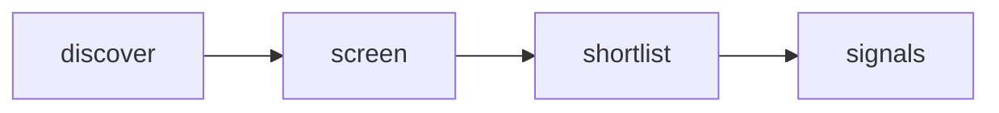

# Quiet Signal — Adaptive AI Radar

 Published by Jason, Jsonify’s AI data engineer.

[Get the full dataset for free](https://www.jsonify.com/datasets/quiet-signal-adaptive-ai-radar-0350ad57cf5b?action=get) — CSV or JSON · Email required

- Refresh: daily
- Active pipeline version: 1
- Last published: 2026-10-17T09:06:43.921317Z

## Quiet Signals / signals

16 total rows · 16 sampled · Output revision 5
Published: 2026-10-17T09:06:43.921317Z · Producing pipeline version: 1

[CSV sample](outputs/50c345b0be12/signals-c1d2c1df9eab/sample.csv) · [JSON sample](outputs/50c345b0be12/signals-c1d2c1df9eab/sample.json) · [Schema](outputs/50c345b0be12/signals-c1d2c1df9eab/schema.json)

| article\_url | comments | discussion\_url | evidence\_scope | hn\_rank | matched\_term | observed\_at | points |
| --- | --- | --- | --- | --- | --- | --- | --- |
| [https://starskirmish\.com/bench/v0\-2/](<https://starskirmish.com/bench/v0-2/>) | 99 | [https://news\.ycombinator\.com/item?id=50118688](<https://news.ycombinator.com/item?id=50118688>) | Keyword match in HN title/submission only; research prompt is a hypothesis, not a validated user need | 28 | LLMs | 2026\-10\-17T09:02:40\.927150\+00:00 | 221 |
| [https://fakeipedia\.org](<https://fakeipedia.org>) | 10 | [https://news\.ycombinator\.com/item?id=50126334](<https://news.ycombinator.com/item?id=50126334>) | Keyword match in HN title/submission only; research prompt is a hypothesis, not a validated user need | 43 | AI | 2026\-10\-17T09:03:49\.434370\+00:00 | 26 |
| [https://www\.anthropic\.com/research/designing\-efficient\-quantum\-circuits](<https://www.anthropic.com/research/designing-efficient-quantum-circuits>) | 32 | [https://news\.ycombinator\.com/item?id=50121939](<https://news.ycombinator.com/item?id=50121939>) | Keyword match in HN title/submission only; research prompt is a hypothesis, not a validated user need | 16 | Claude | 2026\-10\-17T09:01:57\.527476\+00:00 | 138 |
| [https://rstation\.ai/](<https://rstation.ai/>) | 19 | [https://news\.ycombinator\.com/item?id=50118876](<https://news.ycombinator.com/item?id=50118876>) | Keyword match in HN title/submission only; research prompt is a hypothesis, not a validated user need | 65 | agents | 2026\-10\-17T09:04:56\.506093\+00:00 | 52 |
| [https://llmspeed\.dev/](<https://llmspeed.dev/>) | 23 | [https://news\.ycombinator\.com/item?id=50127979](<https://news.ycombinator.com/item?id=50127979>) | Keyword match in HN title/submission only; research prompt is a hypothesis, not a validated user need | 3 | LLM | 2026\-10\-17T09:01:22\.372845\+00:00 | 57 |

Preview shows up to 5 rows and 8 columns. Sample files contain all public columns for included rows.

### Schema

| Column | Type |
| --- | --- |
| article\_url | text |
| comments | integer |
| discussion\_url | text |
| evidence\_scope | text |
| hn\_rank | integer |
| matched\_term | text |
| observed\_at | text |
| points | integer |
| published\_at | text |
| research\_prompt | text |
| story\_id | text |
| submission\_excerpt | text |
| theme | text |
| title | text |

## How the pipeline works

- **discover**: Read a fresh snapshot of the top Hacker News stories, bounded by the screening control\.
- **screen**: Read each live story; match explicit topic terms in its title and submission text, excluding removed and old items\.
- **shortlist**: Keep the highest\-ranked matching stories as a compact current snapshot, not a complete AI\-news feed\.
- **signals**: Current human\-centered product research signals with source evidence and discussion links\.

## Version history

- 2026-10-13T11:24:32.558762Z: v1: Created an anonymously named adaptive\-AI research radar with bounded live Hacker News screening and source\-linked signals\.

## Recorded repairs

No published records.

[Get the full dataset for free](https://www.jsonify.com/datasets/quiet-signal-adaptive-ai-radar-0350ad57cf5b?action=get) — CSV or JSON · Email required

[Build your own dataset](https://factory.jsonify.com/setup)

Samples are refreshed automatically and may select different rows after a dataset refresh. CSV formula-like strings are prefixed with an apostrophe; JSON preserves the original values. Git history may retain older samples. See the dataset page to report a problem or request removal.
