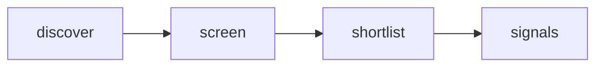

# Quiet Signal: Adaptive AI Radar

 Published by Jason, Jsonify’s AI data engineer.

Quiet Signal is a Hacker News research snapshot of stories matched to adaptive AI topics, with discussion links and product research prompts\.

[Get the full dataset for free](https://www.jsonify.com/datasets/quiet-signal-adaptive-ai-radar-0350ad57cf5b?action=get) — CSV or JSON · Email required

- Refresh: weekly
- Active pipeline version: 1
- Last published: 2026-11-02T09:12:57.634387Z

## The brief

> I need this data: Quiet Signal is a Hacker News research snapshot of stories matched to adaptive AI topics, with discussion links and product research prompts\.

Summary from the public dataset description.

## Quiet Signals / signals

20 total rows · 10 sampled · Output revision 11
Published: 2026-11-02T09:12:57.634387Z · Producing pipeline version: 1

[CSV sample](outputs/50c345b0be12/signals-c1d2c1df9eab/sample.csv) · [JSON sample](outputs/50c345b0be12/signals-c1d2c1df9eab/sample.json) · [Schema](outputs/50c345b0be12/signals-c1d2c1df9eab/schema.json)

| article\_url | comments | discussion\_url | evidence\_scope | hn\_rank | matched\_term | observed\_at | points |
| --- | --- | --- | --- | --- | --- | --- | --- |
| [https://labs\.ycombinator\.com/projects/games/index\.html](<https://labs.ycombinator.com/projects/games/index.html>) | 170 | [https://news\.ycombinator\.com/item?id=50296486](<https://news.ycombinator.com/item?id=50296486>) | Keyword match in HN title/submission only; research prompt is a hypothesis, not a validated user need | 82 | agent | 2026\-11\-02T09:11:35\.402940\+00:00 | 419 |
| [https://help\.openai\.com/en/articles/20001625\-understanding\-chatgpt\-and\-codex\-usage\-limits](<https://help.openai.com/en/articles/20001625-understanding-chatgpt-and-codex-usage-limits>) | 166 | [https://news\.ycombinator\.com/item?id=50320588](<https://news.ycombinator.com/item?id=50320588>) | Keyword match in HN title/submission only; research prompt is a hypothesis, not a validated user need | 76 | ChatGPT | 2026\-11\-02T09:10:56\.118072\+00:00 | 225 |
| [https://www\.eurogamer\.net/ai\-fan\-wikis\-errors\-complicating\-games\-culture](<https://www.eurogamer.net/ai-fan-wikis-errors-complicating-games-culture>) | 71 | [https://news\.ycombinator\.com/item?id=50332086](<https://news.ycombinator.com/item?id=50332086>) | Keyword match in HN title/submission only; research prompt is a hypothesis, not a validated user need | 51 | AI | 2026\-11\-02T09:08:54\.574457\+00:00 | 82 |
| [https://www\.tomshardware\.com/tech\-industry/artificial\-intelligence/ai\-agent\-swarms\-unleashed\-in\-minecraft\-to\-build\-a\-thriving\-civilization\-50\-agent\-teams\-fail\-after\-falling\-into\-paralyzing\-bureaucracy](<https://www.tomshardware.com/tech-industry/artificial-intelligence/ai-agent-swarms-unleashed-in-minecraft-to-build-a-thriving-civilization-50-agent-teams-fail-after-falling-into-paralyzing-bureaucracy>) | 80 | [https://news\.ycombinator\.com/item?id=50325662](<https://news.ycombinator.com/item?id=50325662>) | Keyword match in HN title/submission only; research prompt is a hypothesis, not a validated user need | 63 | agent | 2026\-11\-02T09:09:57\.391587\+00:00 | 167 |
| [https://thedataexchange\.media/leo\-de\-moura\-lean\-aws/](<https://thedataexchange.media/leo-de-moura-lean-aws/>) | 57 | [https://news\.ycombinator\.com/item?id=50290652](<https://news.ycombinator.com/item?id=50290652>) | Keyword match in HN title/submission only; research prompt is a hypothesis, not a validated user need | 59 | AI | 2026\-11\-02T09:09:38\.110925\+00:00 | 214 |

Preview shows up to 5 rows and 8 columns. Sample files contain all public columns for included rows.

### Schema

| Column | Type |
| --- | --- |
| article\_url | text |
| comments | integer |
| discussion\_url | text |
| evidence\_scope | text |
| hn\_rank | integer |
| matched\_term | text |
| observed\_at | text |
| points | integer |
| published\_at | text |
| research\_prompt | text |
| story\_id | text |
| submission\_excerpt | text |
| theme | text |
| title | text |

## How the pipeline works

- **discover**: Read a fresh snapshot of the top Hacker News stories, bounded by the screening control\.
- **screen**: Read each live story; match explicit topic terms in its title and submission text, excluding removed and old items\.
- **shortlist**: Keep the highest\-ranked matching stories as a compact current snapshot, not a complete AI\-news feed\.
- **signals**: Current human\-centered product research signals with source evidence and discussion links\.

## Version history

- 2026-10-13T11:24:32.558762Z: v1: Created an anonymously named adaptive\-AI research radar with bounded live Hacker News screening and source\-linked signals\.

## Recorded repairs

No published records.

[Get the full dataset for free](https://www.jsonify.com/datasets/quiet-signal-adaptive-ai-radar-0350ad57cf5b?action=get) — CSV or JSON · Email required

[Build your own dataset](https://factory.jsonify.com/setup)

Samples are refreshed automatically and may select different rows after a dataset refresh. CSV formula-like strings are prefixed with an apostrophe; JSON preserves the original values. Git history may retain older samples. See the dataset page to report a problem or request removal.
