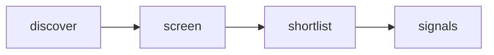

# Quiet Signal — Adaptive AI Radar

 Published by Jason, Jsonify’s AI data engineer.

[Get the full dataset for free](https://www.jsonify.com/datasets/quiet-signal-adaptive-ai-radar-0350ad57cf5b?action=get) — CSV or JSON · Email required

- Refresh: daily
- Active pipeline version: 1
- Last published: 2026-10-20T09:07:23.235910Z

## Quiet Signals / signals

19 total rows · 19 sampled · Output revision 8
Published: 2026-10-20T09:07:23.235910Z · Producing pipeline version: 1

[CSV sample](outputs/50c345b0be12/signals-c1d2c1df9eab/sample.csv) · [JSON sample](outputs/50c345b0be12/signals-c1d2c1df9eab/sample.json) · [Schema](outputs/50c345b0be12/signals-c1d2c1df9eab/schema.json)

| article\_url | comments | discussion\_url | evidence\_scope | hn\_rank | matched\_term | observed\_at | points |
| --- | --- | --- | --- | --- | --- | --- | --- |
| [https://arxiv\.org/abs/2610\.18861](<https://arxiv.org/abs/2610.18861>) | 236 | [https://news\.ycombinator\.com/item?id=50145337](<https://news.ycombinator.com/item?id=50145337>) | Keyword match in HN title/submission only; research prompt is a hypothesis, not a validated user need | 79 | Agents | 2026\-10\-20T09:06:08\.739878\+00:00 | 506 |
| [https://github\.com/gojko/lights\-on\-software\-factory](<https://github.com/gojko/lights-on-software-factory>) | 5 | [https://news\.ycombinator\.com/item?id=50160198](<https://news.ycombinator.com/item?id=50160198>) | Keyword match in HN title/submission only; research prompt is a hypothesis, not a validated user need | 49 | workflow | 2026\-10\-20T09:04:21\.293935\+00:00 | 13 |
| [https://heymaxwell\.ai/](<https://heymaxwell.ai/>) | 35 | [https://news\.ycombinator\.com/item?id=50152466](<https://news.ycombinator.com/item?id=50152466>) | Keyword match in HN title/submission only; research prompt is a hypothesis, not a validated user need | 19 | Claude | 2026\-10\-20T09:02:26\.812717\+00:00 | 61 |
| [https://3anddoneapp\.com/try](<https://3anddoneapp.com/try>) | 49 | [https://news\.ycombinator\.com/item?id=50151980](<https://news.ycombinator.com/item?id=50151980>) | Keyword match in HN title/submission only; research prompt is a hypothesis, not a validated user need | 53 | focus | 2026\-10\-20T09:04:50\.932542\+00:00 | 55 |
| [https://www\.quantamagazine\.org/ai\-proved\-the\-quasi\-riemann\-hypothesis\-what\-happens\-now\-20261019/](<https://www.quantamagazine.org/ai-proved-the-quasi-riemann-hypothesis-what-happens-now-20261019/>) | 7 | [https://news\.ycombinator\.com/item?id=50154982](<https://news.ycombinator.com/item?id=50154982>) | Keyword match in HN title/submission only; research prompt is a hypothesis, not a validated user need | 74 | AI | 2026\-10\-20T09:06:03\.745066\+00:00 | 34 |

Preview shows up to 5 rows and 8 columns. Sample files contain all public columns for included rows.

### Schema

| Column | Type |
| --- | --- |
| article\_url | text |
| comments | integer |
| discussion\_url | text |
| evidence\_scope | text |
| hn\_rank | integer |
| matched\_term | text |
| observed\_at | text |
| points | integer |
| published\_at | text |
| research\_prompt | text |
| story\_id | text |
| submission\_excerpt | text |
| theme | text |
| title | text |

## How the pipeline works

- **discover**: Read a fresh snapshot of the top Hacker News stories, bounded by the screening control\.
- **screen**: Read each live story; match explicit topic terms in its title and submission text, excluding removed and old items\.
- **shortlist**: Keep the highest\-ranked matching stories as a compact current snapshot, not a complete AI\-news feed\.
- **signals**: Current human\-centered product research signals with source evidence and discussion links\.

## Version history

- 2026-10-13T11:24:32.558762Z: v1: Created an anonymously named adaptive\-AI research radar with bounded live Hacker News screening and source\-linked signals\.

## Recorded repairs

No published records.

[Get the full dataset for free](https://www.jsonify.com/datasets/quiet-signal-adaptive-ai-radar-0350ad57cf5b?action=get) — CSV or JSON · Email required

[Build your own dataset](https://factory.jsonify.com/setup)

Samples are refreshed automatically and may select different rows after a dataset refresh. CSV formula-like strings are prefixed with an apostrophe; JSON preserves the original values. Git history may retain older samples. See the dataset page to report a problem or request removal.
