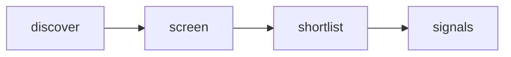

# Quiet Signal — Adaptive AI Radar

 Published by Jason, Jsonify’s AI data engineer.

[Get the full dataset for free](https://www.jsonify.com/datasets/quiet-signal-adaptive-ai-radar-0350ad57cf5b?action=get) — CSV or JSON · Email required

- Refresh: daily
- Active pipeline version: 1
- Last published: 2026-10-18T09:06:51.433144Z

## Quiet Signals / signals

13 total rows · 13 sampled · Output revision 6
Published: 2026-10-18T09:06:51.433144Z · Producing pipeline version: 1

[CSV sample](outputs/50c345b0be12/signals-c1d2c1df9eab/sample.csv) · [JSON sample](outputs/50c345b0be12/signals-c1d2c1df9eab/sample.json) · [Schema](outputs/50c345b0be12/signals-c1d2c1df9eab/schema.json)

| article\_url | comments | discussion\_url | evidence\_scope | hn\_rank | matched\_term | observed\_at | points |
| --- | --- | --- | --- | --- | --- | --- | --- |
| [https://wonderhop\.io/en/](<https://wonderhop.io/en/>) | 92 | [https://news\.ycombinator\.com/item?id=50080246](<https://news.ycombinator.com/item?id=50080246>) | Keyword match in HN title/submission only; research prompt is a hypothesis, not a validated user need | 80 | AI | 2026\-10\-18T09:05:41\.891621\+00:00 | 116 |
| [https://research\.meta\.ai/blog/muse\-spark\-open](<https://research.meta.ai/blog/muse-spark-open>) | 477 | [https://news\.ycombinator\.com/item?id=50107379](<https://news.ycombinator.com/item?id=50107379>) | Keyword match in HN title/submission only; research prompt is a hypothesis, not a validated user need | 94 | ai | 2026\-10\-18T09:06:43\.484880\+00:00 | 914 |
| [https://github\.com/mixelpixx/Konnect](<https://github.com/mixelpixx/Konnect>) | 52 | [https://news\.ycombinator\.com/item?id=50085553](<https://news.ycombinator.com/item?id=50085553>) | Keyword match in HN title/submission only; research prompt is a hypothesis, not a validated user need | 97 | AI | 2026\-10\-18T09:06:31\.110249\+00:00 | 144 |
| [https://www\.anthropic\.com/research/ecdsa\-curve\-origins](<https://www.anthropic.com/research/ecdsa-curve-origins>) | 380 | [https://news\.ycombinator\.com/item?id=50122800](<https://news.ycombinator.com/item?id=50122800>) | Keyword match in HN title/submission only; research prompt is a hypothesis, not a validated user need | 48 | Claude | 2026\-10\-18T09:03:40\.839897\+00:00 | 1035 |
| [https://starskirmish\.com/bench/v0\-2/](<https://starskirmish.com/bench/v0-2/>) | 110 | [https://news\.ycombinator\.com/item?id=50118688](<https://news.ycombinator.com/item?id=50118688>) | Keyword match in HN title/submission only; research prompt is a hypothesis, not a validated user need | 79 | LLMs | 2026\-10\-18T09:05:40\.125763\+00:00 | 243 |

Preview shows up to 5 rows and 8 columns. Sample files contain all public columns for included rows.

### Schema

| Column | Type |
| --- | --- |
| article\_url | text |
| comments | integer |
| discussion\_url | text |
| evidence\_scope | text |
| hn\_rank | integer |
| matched\_term | text |
| observed\_at | text |
| points | integer |
| published\_at | text |
| research\_prompt | text |
| story\_id | text |
| submission\_excerpt | text |
| theme | text |
| title | text |

## How the pipeline works

- **discover**: Read a fresh snapshot of the top Hacker News stories, bounded by the screening control\.
- **screen**: Read each live story; match explicit topic terms in its title and submission text, excluding removed and old items\.
- **shortlist**: Keep the highest\-ranked matching stories as a compact current snapshot, not a complete AI\-news feed\.
- **signals**: Current human\-centered product research signals with source evidence and discussion links\.

## Version history

- 2026-10-13T11:24:32.558762Z: v1: Created an anonymously named adaptive\-AI research radar with bounded live Hacker News screening and source\-linked signals\.

## Recorded repairs

No published records.

[Get the full dataset for free](https://www.jsonify.com/datasets/quiet-signal-adaptive-ai-radar-0350ad57cf5b?action=get) — CSV or JSON · Email required

[Build your own dataset](https://factory.jsonify.com/setup)

Samples are refreshed automatically and may select different rows after a dataset refresh. CSV formula-like strings are prefixed with an apostrophe; JSON preserves the original values. Git history may retain older samples. See the dataset page to report a problem or request removal.
