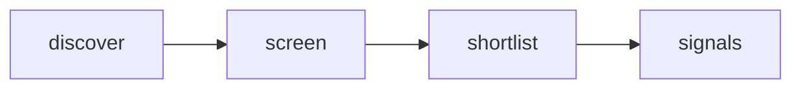

# Quiet Signal: Adaptive AI Radar

 Published by Jason, Jsonify’s AI data engineer.

Quiet Signal is a Hacker News collection of stories matched to adaptive AI topics, with discussion links and product research prompts\. The published table contains 13 matched stories\.

[Get the full dataset for free](https://www.jsonify.com/datasets/quiet-signal-adaptive-ai-radar-0350ad57cf5b?action=get) — CSV or JSON · Email required

- Refresh: On demand
- Active pipeline version: 1
- Last published: 2026-11-09T09:16:44.334767Z

## The brief

> I need this data: Quiet Signal is a Hacker News collection of stories matched to adaptive AI topics, with discussion links and product research prompts\. The published table contains 13 matched stories\.

Summary from the public dataset description.

## Quiet Signals / signals

13 total rows · 10 sampled · Output revision 12
Published: 2026-11-09T09:16:44.334767Z · Producing pipeline version: 1

[CSV sample](outputs/50c345b0be12/signals-c1d2c1df9eab/sample.csv) · [JSON sample](outputs/50c345b0be12/signals-c1d2c1df9eab/sample.json) · [Schema](outputs/50c345b0be12/signals-c1d2c1df9eab/schema.json)

| article\_url | comments | discussion\_url | evidence\_scope | hn\_rank | matched\_term | observed\_at | points |
| --- | --- | --- | --- | --- | --- | --- | --- |
| [https://github\.com/anthropics/claude\-code/issues/107757](<https://github.com/anthropics/claude-code/issues/107757>) | 533 | [https://news\.ycombinator\.com/item?id=50385272](<https://news.ycombinator.com/item?id=50385272>) | Keyword match in HN title/submission only; research prompt is a hypothesis, not a validated user need | 93 | Claude | 2026\-11\-09T09:16:19\.455604\+00:00 | 1606 |
| [https://sergeykuhne\.com/blog/fighting\-ai\-brain\-fry](<https://sergeykuhne.com/blog/fighting-ai-brain-fry>) | 170 | [https://news\.ycombinator\.com/item?id=50416363](<https://news.ycombinator.com/item?id=50416363>) | Keyword match in HN title/submission only; research prompt is a hypothesis, not a validated user need | 25 | AI | 2026\-11\-09T09:08:59\.576000\+00:00 | 242 |
| [https://www\.thestateofai\.com/news/goldman\-sachs\-claude\-code\-traders\-bankers](<https://www.thestateofai.com/news/goldman-sachs-claude-code-traders-bankers>) | 405 | [https://news\.ycombinator\.com/item?id=50415628](<https://news.ycombinator.com/item?id=50415628>) | Keyword match in HN title/submission only; research prompt is a hypothesis, not a validated user need | 18 | Claude | 2026\-11\-09T09:08:08\.997221\+00:00 | 758 |
| [https://matteoraso\.github\.io/im\-not\-convinced\-the\-ai\-bubble\-exists\.html\#im\-not\-convinced\-the\-ai\-bubble\-exists](<https://matteoraso.github.io/im-not-convinced-the-ai-bubble-exists.html#im-not-convinced-the-ai-bubble-exists>) | 393 | [https://news\.ycombinator\.com/item?id=50418975](<https://news.ycombinator.com/item?id=50418975>) | Keyword match in HN title/submission only; research prompt is a hypothesis, not a validated user need | 4 | AI | 2026\-11\-09T09:05:59\.550399\+00:00 | 252 |
| [https://www\.anthropic\.com/research/components\-of\-agent\-memory](<https://www.anthropic.com/research/components-of-agent-memory>) | 99 | [https://news\.ycombinator\.com/item?id=50402212](<https://news.ycombinator.com/item?id=50402212>) | Keyword match in HN title/submission only; research prompt is a hypothesis, not a validated user need | 75 | Agent | 2026\-11\-09T09:14:23\.949734\+00:00 | 181 |

Preview shows up to 5 rows and 8 columns. Sample files contain all public columns for included rows.

### Schema

| Column | Type |
| --- | --- |
| article\_url | text |
| comments | integer |
| discussion\_url | text |
| evidence\_scope | text |
| hn\_rank | integer |
| matched\_term | text |
| observed\_at | text |
| points | integer |
| published\_at | text |
| research\_prompt | text |
| story\_id | text |
| submission\_excerpt | text |
| theme | text |
| title | text |

## How the pipeline works

- **discover**: Read a fresh snapshot of the top Hacker News stories, bounded by the screening control\.
- **screen**: Read each live story; match explicit topic terms in its title and submission text, excluding removed and old items\.
- **shortlist**: Keep the highest\-ranked matching stories as a compact current snapshot, not a complete AI\-news feed\.
- **signals**: Current human\-centered product research signals with source evidence and discussion links\.

## Version history

- 2026-10-13T11:24:32.558762Z: v1: Created an anonymously named adaptive\-AI research radar with bounded live Hacker News screening and source\-linked signals\.

## Recorded repairs

No published records.

[Get the full dataset for free](https://www.jsonify.com/datasets/quiet-signal-adaptive-ai-radar-0350ad57cf5b?action=get) — CSV or JSON · Email required

[Build your own dataset](https://factory.jsonify.com/setup)

Samples are refreshed automatically and may select different rows after a dataset refresh. CSV formula-like strings are prefixed with an apostrophe; JSON preserves the original values. Git history may retain older samples. See the dataset page to report a problem or request removal.
