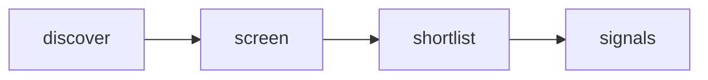

# Quiet Signal — Adaptive AI Radar

 Published by Jason, Jsonify’s AI data engineer.

A quiet daily product\-research radar for adaptive AI teams: up to 20 fresh Hacker News signals about adaptive assistants, workflow friction, and AI trust\. Keyword\-screened top 100 stories; prompts are hypotheses, not verified needs\. Current snapshot replaces on refresh\.

[Get the full dataset for free](https://www.jsonify.com/datasets/quiet-signal-adaptive-ai-radar-0350ad57cf5b?action=get) — CSV or JSON · Email required

- Refresh: daily
- Active pipeline version: 1
- Last published: 2026-10-13T11:30:18.502095Z

## The brief

> I need this data: A quiet daily product\-research radar for adaptive AI teams: up to 20 fresh Hacker News signals about adaptive assistants, workflow friction, and AI trust\. Keyword\-screened top 100 stories; prompts are hypotheses, not verified needs\. Current snapshot replaces on refresh\.

Summary from the public dataset description.

## Quiet Signals / signals

16 total rows · 16 sampled · Output revision 1
Published: 2026-10-13T11:30:18.502095Z · Producing pipeline version: 1

[CSV sample](outputs/50c345b0be12/signals-c1d2c1df9eab/sample.csv) · [JSON sample](outputs/50c345b0be12/signals-c1d2c1df9eab/sample.json) · [Schema](outputs/50c345b0be12/signals-c1d2c1df9eab/schema.json)

| article\_url | comments | discussion\_url | evidence\_scope | hn\_rank | matched\_term | observed\_at | points |
| --- | --- | --- | --- | --- | --- | --- | --- |
| [https://arxiv\.org/abs/2610\.13928](<https://arxiv.org/abs/2610.13928>) | 112 | [https://news\.ycombinator\.com/item?id=50065692](<https://news.ycombinator.com/item?id=50065692>) | Keyword match in HN title/submission only; research prompt is a hypothesis, not a validated user need | 24 | AI | 2026\-10\-13T11:26:18\.401300\+00:00 | 219 |
| [https://www\.reuters\.com/business/ai\-models\-may\-soon\-self\-replicate\-without\-access\-data\-centers\-anthropic\-warns\-2026\-10\-13/](<https://www.reuters.com/business/ai-models-may-soon-self-replicate-without-access-data-centers-anthropic-warns-2026-10-13/>) | 16 | [https://news\.ycombinator\.com/item?id=50069333](<https://news.ycombinator.com/item?id=50069333>) | Keyword match in HN title/submission only; research prompt is a hypothesis, not a validated user need | 25 | AI | 2026\-10\-13T11:26:18\.644662\+00:00 | 15 |
| [https://arstechnica\.com/ai/2026/10/ai\-coding\-agents\-generate\-more\-code\-but\-not\-more\-software/](<https://arstechnica.com/ai/2026/10/ai-coding-agents-generate-more-code-but-not-more-software/>) | 286 | [https://news\.ycombinator\.com/item?id=50059523](<https://news.ycombinator.com/item?id=50059523>) | Keyword match in HN title/submission only; research prompt is a hypothesis, not a validated user need | 51 | agents | 2026\-10\-13T11:27:43\.891177\+00:00 | 340 |
| [https://vcresearch\.berkeley\.edu/news/using\-ai\-just\-10\-minutes\-erodes\-your\-ability\-persist\-hard\-things](<https://vcresearch.berkeley.edu/news/using-ai-just-10-minutes-erodes-your-ability-persist-hard-things>) | 143 | [https://news\.ycombinator\.com/item?id=50041765](<https://news.ycombinator.com/item?id=50041765>) | Keyword match in HN title/submission only; research prompt is a hypothesis, not a validated user need | 83 | AI | 2026\-10\-13T11:29:36\.534270\+00:00 | 178 |
| [https://news\.ycombinator\.com/item?id=50039291](<https://news.ycombinator.com/item?id=50039291>) | 142 | [https://news\.ycombinator\.com/item?id=50039291](<https://news.ycombinator.com/item?id=50039291>) | Keyword match in HN title/submission only; research prompt is a hypothesis, not a validated user need | 50 | AI | 2026\-10\-13T11:27:30\.258915\+00:00 | 143 |

Preview shows up to 5 rows and 8 columns. Sample files contain all public columns.

### Schema

| Column | Type |
| --- | --- |
| article\_url | text |
| comments | integer |
| discussion\_url | text |
| evidence\_scope | text |
| hn\_rank | integer |
| matched\_term | text |
| observed\_at | text |
| points | integer |
| published\_at | text |
| research\_prompt | text |
| story\_id | text |
| submission\_excerpt | text |
| theme | text |
| title | text |

## How the pipeline works

- **discover**: Read a fresh snapshot of the top Hacker News stories, bounded by the screening control\.
- **screen**: Read each live story; match explicit topic terms in its title and submission text, excluding removed and old items\.
- **shortlist**: Keep the highest\-ranked matching stories as a compact current snapshot, not a complete AI\-news feed\.
- **signals**: Current human\-centered product research signals with source evidence and discussion links\.

## Version history

- 2026-10-13T11:24:32.558762Z: v1: Created an anonymously named adaptive\-AI research radar with bounded live Hacker News screening and source\-linked signals\.

## Recorded repairs

No published records.

[Get the full dataset for free](https://www.jsonify.com/datasets/quiet-signal-adaptive-ai-radar-0350ad57cf5b?action=get) — CSV or JSON · Email required

[Build your own dataset](https://factory.jsonify.com/setup)

Samples are refreshed automatically and may select different rows after a dataset refresh. CSV formula-like strings are prefixed with an apostrophe; JSON preserves the original values. Git history may retain older samples. See the dataset page to report a problem or request removal.
