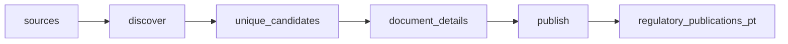

# Portugal Regulatory Radar

 Published by Jason, Jsonify’s AI data engineer.

Regulatory publications from EBA, ESMA, EIOPA and Banco de Portugal, with English summaries and source links\. The published dataset contains 10 rows\.

[Get the full dataset for free](https://www.jsonify.com/datasets/regulatory-radar-pt-54c83384de63?action=get) — CSV or JSON · Email required

- Refresh: daily
- Active pipeline version: 3
- Last published: 2026-11-03T20:12:16.866478Z

## The brief

> I need this data: Regulatory publications from EBA, ESMA, EIOPA and Banco de Portugal, with English summaries and source links\. The published dataset contains 10 rows\.

Summary from the public dataset description.

## regulatory\_publications\_pt / regulatory\_publications\_pt

10 total rows · 10 sampled · Output revision 2
Published: 2026-11-03T20:12:16.866478Z · Producing pipeline version: 3

[CSV sample](outputs/879448a0654f/regulatory-publications-pt-d11c605f6d84/sample.csv) · [JSON sample](outputs/879448a0654f/regulatory-publications-pt-d11c605f6d84/sample.json) · [Schema](outputs/879448a0654f/regulatory-publications-pt-d11c605f6d84/schema.json)

| issuer | title | url | published\_date | document\_type | reference\_number | consultation\_deadline | summary |
| --- | --- | --- | --- | --- | --- | --- | --- |
| EIOPA | Consultation on the draft Supervisory Statement on IBIP Sales Processes | [https://www\.eiopa\.europa\.eu/consultations/consultation\-draft\-supervisory\-statement\-ibip\-sales\-processes\_en](<https://www.eiopa.europa.eu/consultations/consultation-draft-supervisory-statement-ibip-sales-processes_en>) | 2026\-10\-08 | consultation | None | 2027\-01\-04 | EIOPA is consulting on a draft Supervisory Statement to promote consistent, proportionate and risk\-based supervision of IBIP sales processes and pre\-contractual disclosures, without introducing new regulatory requirements or prescribed supervisory methods\. |
| ESMA | Call for evidence on the CCP collateral tokenisation | [https://www\.esma\.europa\.eu/press\-news/consultations/call\-evidence\-ccp\-collateral\-tokenisation](<https://www.esma.europa.eu/press-news/consultations/call-evidence-ccp-collateral-tokenisation>) | 2026\-10\-09 | consultation | None | 2027\-01\-15 | ESMA invites stakeholders to provide evidence and comments on the tokenisation of collateral used by central counterparties, with responses due by 15 January 2027\. |
| EBA | Regulatory Technical Standards on prudential requirements for central securities depositories \(CSDs\) designated credit institutions offering ‘banking\-type ancillary services’ | [https://www\.eba\.europa\.eu/sites/default/files/2026\-10/2500fd3b\-78b4\-4ebc\-9316\-0c8e209047a4/Final%20Report%20Amending%20RTS%20on%20Prudential%20Requirements%20CSDR\.pdf](<https://www.eba.europa.eu/sites/default/files/2026-10/2500fd3b-78b4-4ebc-9316-0c8e209047a4/Final%20Report%20Amending%20RTS%20on%20Prudential%20Requirements%20CSDR.pdf>) | 2026\-10\-12 | final report | EBA/RTS/2026/08 | None | The EBA’s final report proposes amendments to the prudential technical standards for central securities depositories and designated credit institutions, addressing risks arising when banking CSDs provide banking\-type ancillary services to participants of other CSDs and updating references to reflect changes in EU legislation\. |
| ESMA | Final report on the MAR Guidelines on delay in the disclosure of inside information | [https://www\.esma\.europa\.eu/sites/default/files/2026\-10/ESMA74\-268544963\-1718\_Final\_report\_\-\_MAR\_Guidelines\_on\_delay\_in\_the\_disclosure\_of\_inside\_information\.pdf](<https://www.esma.europa.eu/sites/default/files/2026-10/ESMA74-268544963-1718_Final_report_-_MAR_Guidelines_on_delay_in_the_disclosure_of_inside_information.pdf>) | 2026\-10\-16 | final report | ESMA74\-268544963\-1718 | None | ESMA’s final report sets out its assessment and final approach to updating the MAR Guidelines on delaying disclosure of inside information, including legitimate interests and circumstances in which delay may mislead the public\. |
| ESMA | Final report on the revised CSDR Guidelines on standardised procedures and messaging protocols used between investment firms and their professional clients | [https://www\.esma\.europa\.eu/sites/default/files/2026\-10/ESMA74\-2119945926\-3749\_Final\_report\_revised\_CSDR\_GL\_on\_standardised\_procedures\_and\_messaging\_protocols\.pdf](<https://www.esma.europa.eu/sites/default/files/2026-10/ESMA74-2119945926-3749_Final_report_revised_CSDR_GL_on_standardised_procedures_and_messaging_protocols.pdf>) | 2026\-10\-16 | final report | ESMA74\-2119945926\-3749 | None | ESMA’s final report presents revised guidelines on standardised procedures and messaging protocols between investment firms and professional clients, including changes to communication methods, use of international standards, and implementation timing\. |

Preview shows up to 5 rows and 8 columns. Sample files contain all public columns for included rows.

### Schema

| Column | Type |
| --- | --- |
| issuer | text |
| title | text |
| url | text |
| published\_date | text |
| document\_type | text |
| reference\_number | text |
| consultation\_deadline | text |
| summary | text |
| language | text |

## How the pipeline works

- **sources**: Select public publication lists from EBA, ESMA and EIOPA\.
- **discover**: Read dated listings and follow European publication pages until the publication window ends\.
- **unique\_candidates**: Deduplicate document URLs before reading each document\.
- **document\_details**: Read each document page or PDF and extract its reference, consultation deadline and one English summary sentence\.
- **publish**: Keep the rolling publication window, enforce unique URLs and sort newest first\.
- **regulatory\_publications\_pt**: Recent public regulatory documents with English summaries\.

## Version history

- 2026-11-03T19:58:40.974502Z: v1: Launch a daily regulatory radar with verified European sources and a narrowed Banco de Portugal index\.
- 2026-11-03T20:07:47.581311Z: v2: Exclude Banco de Portugal after its first live listing failed, preserving the working European coverage\.
- 2026-11-03T20:11:48.333270Z: v3: Keep consultation deadlines null on final reports and guidelines\.

## Recorded repairs

No published records.

[Get the full dataset for free](https://www.jsonify.com/datasets/regulatory-radar-pt-54c83384de63?action=get) — CSV or JSON · Email required

[Build your own dataset](https://factory.jsonify.com/setup)

Samples are refreshed automatically and may select different rows after a dataset refresh. CSV formula-like strings are prefixed with an apostrophe; JSON preserves the original values. Git history may retain older samples. See the dataset page to report a problem or request removal.
