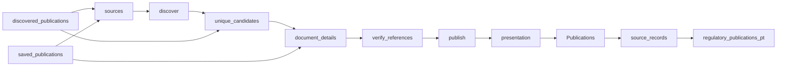

# Portugal Regulatory Radar

 Published by Jason, Jsonify’s AI data engineer.

Regulatory publications from EBA, ESMA, EIOPA and Banco de Portugal, with English summaries and source links\. The published dataset contains 72 rows\.

[Get the full dataset for free](https://www.jsonify.com/datasets/regulatory-radar-pt-54c83384de63?action=get) — CSV or JSON · Email required

- Refresh: daily
- Active pipeline version: 13
- Last published: 2026-11-07T06:12:53.467631Z

## The brief

> I need this data: Regulatory publications from EBA, ESMA, EIOPA and Banco de Portugal, with English summaries and source links\. The published dataset contains 72 rows\.

Summary from the public dataset description.

## Regulatory publications / Publications

36 total rows · 10 sampled · Output revision 11
Published: 2026-11-07T06:12:53.467631Z · Producing pipeline version: 13

[CSV sample](outputs/879448a0654f/publications-82b2eb07aaea/sample.csv) · [JSON sample](outputs/879448a0654f/publications-82b2eb07aaea/sample.json) · [Schema](outputs/879448a0654f/publications-82b2eb07aaea/schema.json)

| title | Issuer | Document type | Published date | Consultation deadline | Summary | source | Reference |
| --- | --- | --- | --- | --- | --- | --- | --- |
| Instrução \(Histórico\) n\.º 8/2026 | Banco de Portugal | Instrução | 2026\-08\-26 | None | This instruction revokes Instruction No\. 7/2019 and concerns financial information, prudential standards, credit securitisation and supervision\. | [https://www\.bportugal\.pt/instrucao/82026](<https://www.bportugal.pt/instrucao/82026>) | 8/2026 |
| Final Report on the Guidelines on supplements which introduce new securities to a base prospectus | European Securities and Markets Authority \(ESMA\) | Final report | 2026\-09\-09 | None | ESMA’s final report sets out guidelines specifying when a supplement to a base prospectus introduces a new type of security, aiming to promote consistent supervision and regulatory convergence across the EU\. | [https://www\.esma\.europa\.eu/sites/default/files/2026\-09/ESMA32\-753890202\-3034\_Final\_Report\_Guidelines\_on\_supplements\_which\_introduce\_new\_securities\_to\_a\_base\_prospectus\.pdf](<https://www.esma.europa.eu/sites/default/files/2026-09/ESMA32-753890202-3034_Final_Report_Guidelines_on_supplements_which_introduce_new_securities_to_a_base_prospectus.pdf>) | ESMA32\-753890202\-3034 |
| Final report on the revised CSDR Guidelines on standardised procedures and messaging protocols used between investment firms and their professional clients | European Securities and Markets Authority \(ESMA\) | Final report | 2026\-10\-16 | None | ESMA’s final report presents revised CSDR guidelines on arrangements, communication procedures and messaging protocols for investment firms and their professional clients, including the use of electronic and international open standards\. | [https://www\.esma\.europa\.eu/sites/default/files/2026\-10/ESMA74\-2119945926\-3749\_Final\_report\_revised\_CSDR\_GL\_on\_standardised\_procedures\_and\_messaging\_protocols\.pdf](<https://www.esma.europa.eu/sites/default/files/2026-10/ESMA74-2119945926-3749_Final_report_revised_CSDR_GL_on_standardised_procedures_and_messaging_protocols.pdf>) | ESMA74\-2119945926\-3749 |
| EIOPA Report on the impacts of climate change on life and health and potential emerging risks for the insurance and IORP sectors | European Insurance and Occupational Pensions Authority \(EIOPA\) | Final report | 2026\-09\-30 | None | The report identifies extreme heat as the leading climate\-related liability risk for life and health insurers and occupational pension providers, noting that current financial impacts are limited but risks are expected to increase in coming decades\. | [https://www\.eiopa\.europa\.eu/publications/eiopa\-report\-impacts\-climate\-change\-life\-and\-health\-and\-potential\-emerging\-risks\-insurance\-and\-iorp\_en](<https://www.eiopa.europa.eu/publications/eiopa-report-impacts-climate-change-life-and-health-and-potential-emerging-risks-insurance-and-iorp_en>) | None |
| Final report on the Regulatory Standards on the requirements for Post\-Trade Risk Reduction services for the purpose of the clearing obligation exemption under EMIR | European Securities and Markets Authority \(ESMA\) | Final report | 2026\-10\-20 | None | ESMA’s final report sets out regulatory technical standards specifying requirements for post\-trade risk reduction services and exercises to qualify for the clearing obligation exemption under EMIR, including provider operating conditions and monitoring of the exemption\. | [https://www\.esma\.europa\.eu/sites/default/files/2026\-10/ESMA74\-1049116226\-981\_Final\_Report\_on\_post\_trade\_risk\_reduction\_services\_RTS\_Exemption\_CO\.pdf](<https://www.esma.europa.eu/sites/default/files/2026-10/ESMA74-1049116226-981_Final_Report_on_post_trade_risk_reduction_services_RTS_Exemption_CO.pdf>) | ESMA74\-1049116226\-981 |

Preview shows up to 5 rows and 8 columns. Sample files contain all public columns for included rows.

### Schema

| Column | Type |
| --- | --- |
| title | text |
| Issuer | text |
| Document type | text |
| Published date | text |
| Consultation deadline | text |
| Summary | text |
| source | text |
| Reference | text |
| Language | text |

## Regulatory publications / regulatory\_publications\_pt

36 total rows · 10 sampled · Output revision 11
Published: 2026-11-07T06:12:53.467631Z · Producing pipeline version: 13

[CSV sample](outputs/879448a0654f/regulatory-publications-pt-d11c605f6d84/sample.csv) · [JSON sample](outputs/879448a0654f/regulatory-publications-pt-d11c605f6d84/sample.json) · [Schema](outputs/879448a0654f/regulatory-publications-pt-d11c605f6d84/schema.json)

| consultation\_deadline | document\_type | issuer | language | published\_date | reference\_number | summary | title |
| --- | --- | --- | --- | --- | --- | --- | --- |
| None | instrução | Banco de Portugal | pt | 2026\-08\-17 | 6/2026 | This instruction amends Instruction No\. 16/2022, which regulates the operation of TARGET\-PT, the national component of TARGET\. | Instrução \(Histórico\) n\.º 6/2026 |
| None | circular | ASF | pt | 2026\-08\-17 | 8/2026 | The circular publicises FATF statements and maintains enhanced due diligence for North Korea, Iran and Myanmar, as well as risk\-proportionate countermeasures for North Korea and Iran\. | Circular n\.º 8/2026, de 14 de julho \- Prevenção do Branqueamento de Capitais e do Financiamento do Terrorismo |
| None | circular | CMVM | pt | 2026\-08\-17 | 006/2026 | The CMVM communicates the FATF’s June 2026 jurisdiction updates and requires countermeasures for North Korea and Iran, enhanced due diligence for those jurisdictions and Myanmar, and risk\-proportionate enhanced measures for monitored jurisdictions and other high\-risk third countries\. | Circular 006/2026 \- GAFI \- Prevenção e Combate ao Branqueamento de Capitais e ao Financiamento do Terrorismo |
| None | carta circular | Banco de Portugal | pt | 2026\-08\-17 | CC/2026/00000021 | Following the FATF’s June 2026 plenary communications, the circular informs institutions of risk\-proportionate countermeasures concerning North Korea and Iran and the continued suspension of Russia’s membership status\. | Carta Circular n\.º CC/2026/00000021 |
| 2026\-10\-12 | consultation | ESMA | en | 2026\-08\-18 | ESMA12\-2121844265\-6008 | ESMA consults on draft regulatory and implementing technical standards specifying the reporting framework for clearing activity at recognised third\-country CCPs under EMIR Article 7d\. | Consultation on the reporting framework under EMIR for clearing activity at recognised third\-country CCPs |

Preview shows up to 5 rows and 8 columns. Sample files contain all public columns for included rows.

### Schema

| Column | Type |
| --- | --- |
| consultation\_deadline | text |
| document\_type | text |
| issuer | text |
| language | text |
| published\_date | text |
| reference\_number | text |
| summary | text |
| title | text |
| url | text |

## How the pipeline works

- **discovered\_publications**: Optional saved publication candidates for resuming document enrichment without recollecting listings; unset for normal daily collection\.
- **saved\_publications**: Optional exact saved source records for focused reference verification without recollecting other publications; leave unset for normal daily collection\.
- **sources**: Select public publication lists from EBA, ESMA and EIOPA\.
- **discover**: Read dated listings and follow European publication pages until the publication window ends\.
- **unique\_candidates**: Deduplicate document URLs before reading each document\.
- **document\_details**: Read each document page or PDF and extract its reference, consultation deadline and one English summary sentence\.
- **verify\_references**: Verify missing ESMA consultation references against the exact document title in the official related\-document table\.
- **publish**: Keep the rolling publication window, enforce unique URLs and sort newest first\.
- **presentation**: Prepare a readable publication table while retaining the original source fields separately\.
- **Publications**: Readable regulatory publications\. Source links open the original documents\.
- **source\_records**: Preserve the unchanged original source fields and URL join key in the audit worksheet\.
- **regulatory\_publications\_pt**: Original source fields and technical URL join keys for audit and existing integrations\.

## Version history

- 2026-11-03T19:58:40.974502Z: v1: Launch a daily regulatory radar with verified European sources and a narrowed Banco de Portugal index\.
- 2026-11-03T20:07:47.581311Z: v2: Exclude Banco de Portugal after its first live listing failed, preserving the working European coverage\.
- 2026-11-03T20:11:48.333270Z: v3: Keep consultation deadlines null on final reports and guidelines\.
- 2026-11-03T21:20:23.660161Z: v4: Add a readable Publications worksheet with full issuer names and source links, retaining the original fields separately for audit\.
- 2026-11-03T21:32:25.234181Z: v5: Preserve the readable worksheet’s intended title\-first column order\.
- 2026-11-03T22:30:41.308390Z: v6: Recover missing ESMA consultation references from the matching official document table, keeping reply forms separate\. Support focused verification of saved publications while preserving the other records\.
- 2026-11-04T10:40:55.489483Z: v7: Expanded the publication window to ninety calendar days and added Portuguese regulator publications, including source\-supported references, English summaries and consultation deadlines\.
- 2026-11-04T11:04:35.922351Z: v8: Fixed EIOPA pagination so the ninety\-day regulatory update can finish without losing completed source work\.
- 2026-11-04T11:20:29.654106Z: v9: Fixed EIOPA closed\-consultation coverage and read consultation dates directly from labelled source fields\.
- 2026-11-06T06:07:02.827018Z: v10: Fixed Banco de Portugal publication reading and kept year and issuer filters intact across listing pages\.
- 2026-11-06T06:19:45.259690Z: v11: Fixed CMVM collection stopping before its publication cards finished loading\.
- 2026-11-06T06:40:17.349458Z: v12: Fixed repeated ASF summary failures by changing its document reader, and added support for resuming from saved publication candidates\.
- 2026-11-06T06:48:37.151740Z: v13: Recovered missing CMVM listing publication dates from its official publication records\.

## Recorded repairs

- 2026-11-06T06:01:16.411532Z: no change
- 2026-11-06T06:05:21.548457Z: no change
- 2026-11-06T06:07:17.579886Z: repaired

[Get the full dataset for free](https://www.jsonify.com/datasets/regulatory-radar-pt-54c83384de63?action=get) — CSV or JSON · Email required

[Build your own dataset](https://factory.jsonify.com/setup)

Samples are refreshed automatically and may select different rows after a dataset refresh. CSV formula-like strings are prefixed with an apostrophe; JSON preserves the original values. Git history may retain older samples. See the dataset page to report a problem or request removal.
