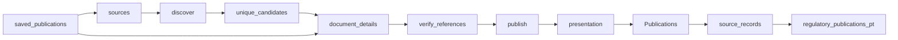

# Portugal Regulatory Radar

 Published by Jason, Jsonify’s AI data engineer.

Regulatory publications from EBA, ESMA, EIOPA and Banco de Portugal, with English summaries and source links\. The published dataset contains 68 rows\.

[Get the full dataset for free](https://www.jsonify.com/datasets/regulatory-radar-pt-54c83384de63?action=get) — CSV or JSON · Email required

- Refresh: daily
- Active pipeline version: 9
- Last published: 2026-11-04T11:30:39.371648Z

## The brief

> I need this data: Regulatory publications from EBA, ESMA, EIOPA and Banco de Portugal, with English summaries and source links\. The published dataset contains 68 rows\.

Summary from the public dataset description.

## Regulatory publications / Publications

34 total rows · 10 sampled · Output revision 8
Published: 2026-11-04T11:30:39.371648Z · Producing pipeline version: 9

[CSV sample](outputs/879448a0654f/publications-82b2eb07aaea/sample.csv) · [JSON sample](outputs/879448a0654f/publications-82b2eb07aaea/sample.json) · [Schema](outputs/879448a0654f/publications-82b2eb07aaea/schema.json)

| title | Issuer | Document type | Published date | Consultation deadline | Summary | source | Reference |
| --- | --- | --- | --- | --- | --- | --- | --- |
| Final report on the revised CSDR Guidelines on standardised procedures and messaging protocols used between investment firms and their professional clients | European Securities and Markets Authority \(ESMA\) | Final report | 2026\-10\-16 | None | ESMA’s final report presents revised CSDR guidelines on arrangements, communication procedures and messaging protocols for investment firms and their professional clients, including the use of electronic and international open standards\. | [https://www\.esma\.europa\.eu/sites/default/files/2026\-10/ESMA74\-2119945926\-3749\_Final\_report\_revised\_CSDR\_GL\_on\_standardised\_procedures\_and\_messaging\_protocols\.pdf](<https://www.esma.europa.eu/sites/default/files/2026-10/ESMA74-2119945926-3749_Final_report_revised_CSDR_GL_on_standardised_procedures_and_messaging_protocols.pdf>) | ESMA74\-2119945926\-3749 |
| Consultation Paper on draft RTS on reclassification of investment firms as credit institutions | European Banking Authority \(EBA\) | Consultation | 2026\-08\-25 | 2026\-11\-25 | The EBA consults on three draft regulatory technical standards covering calculation of credit\-institution thresholds for investment firms, information for monitoring those thresholds, and factors competent authorities should consider when granting a waiver\. | [https://www\.eba\.europa\.eu/sites/default/files/2026\-08/faa39dd8\-20fe\-4149\-9125\-f6a33b68babd/Consultation%20Paper%20on%20draft%20RTS%20on%20reclassification%20of%20IFs%20as%20credit%20institutions\.pdf](<https://www.eba.europa.eu/sites/default/files/2026-08/faa39dd8-20fe-4149-9125-f6a33b68babd/Consultation%20Paper%20on%20draft%20RTS%20on%20reclassification%20of%20IFs%20as%20credit%20institutions.pdf>) | EBA/CP/2026/17 |
| Consulta Pública n\.º 6/2026 Projeto de Norma Regulamentar que estabelece os índices trimestrais de atualização de capitais para as apólices do ramo "Incêndio e elementos da natureza" com início ou vencimento no primeiro trimestre de 2027 | Autoridade de Supervisão de Seguros e Fundos de Pensões \(ASF\) | Consultation | 2026\-10\-14 | 2026\-11\-04 | The ASF is consulting on a draft regulatory standard setting quarterly capital adjustment indices for fire and natural elements insurance policies beginning or renewing in the first quarter of 2027\. | [https://www\.asf\.com\.pt/w/consulta\-p%C3%BAblica\-n\.%C2%BA\-6/2026\-projeto\-de\-norma\-regulamentar\-que\-estabelece\-os\-%C3%ADndices\-trimestrais\-de\-atualiza%C3%A7%C3%A3o\-de\-capitais\-para\-as\-ap%C3%B3lices\-do\-ramo\-inc%C3%AAndio\-e\-elementos\-da\-natureza\-com\-in%C3%ADcio\-ou\-vencimento\-no\-primei](<https://www.asf.com.pt/w/consulta-p%C3%BAblica-n.%C2%BA-6/2026-projeto-de-norma-regulamentar-que-estabelece-os-%C3%ADndices-trimestrais-de-atualiza%C3%A7%C3%A3o-de-capitais-para-as-ap%C3%B3lices-do-ramo-inc%C3%AAndio-e-elementos-da-natureza-com-in%C3%ADcio-ou-vencimento-no-primei>) | 6/2026 |
| Instrução \(Histórico\) n\.º 9/2026 | Banco de Portugal | Instrução | 2026\-10\-15 | None | This instruction amends Instruction No\. 11/2025, which regulates the Interbank Clearing System \(SICOI\)\. | [https://www\.bportugal\.pt/instrucao/92026](<https://www.bportugal.pt/instrucao/92026>) | 9/2026 |
| Circular 006/2026 \- GAFI \- Prevenção e Combate ao Branqueamento de Capitais e ao Financiamento do Terrorismo | Comissão do Mercado de Valores Mobiliários \(CMVM\) | Circular | 2026\-08\-17 | None | CMVM Circular 006/2026 concerns the Financial Action Task Force \(GAFI\) and the prevention and combating of money laundering and terrorist financing\. | [https://www\.cmvm\.pt/PInstitucional/ContentDynamic?Input=1C1BDF990ACC464DD18DEE0D6CDD0C85D76D1BC54EACA99C25530A3B32512422D22D1B23925FE4B7A2EA138D4D090F33](<https://www.cmvm.pt/PInstitucional/ContentDynamic?Input=1C1BDF990ACC464DD18DEE0D6CDD0C85D76D1BC54EACA99C25530A3B32512422D22D1B23925FE4B7A2EA138D4D090F33>) | 006/2026 |

Preview shows up to 5 rows and 8 columns. Sample files contain all public columns for included rows.

### Schema

| Column | Type |
| --- | --- |
| title | text |
| Issuer | text |
| Document type | text |
| Published date | text |
| Consultation deadline | text |
| Summary | text |
| source | text |
| Reference | text |
| Language | text |

## Regulatory publications / regulatory\_publications\_pt

34 total rows · 10 sampled · Output revision 8
Published: 2026-11-04T11:30:39.371648Z · Producing pipeline version: 9

[CSV sample](outputs/879448a0654f/regulatory-publications-pt-d11c605f6d84/sample.csv) · [JSON sample](outputs/879448a0654f/regulatory-publications-pt-d11c605f6d84/sample.json) · [Schema](outputs/879448a0654f/regulatory-publications-pt-d11c605f6d84/schema.json)

| consultation\_deadline | document\_type | issuer | language | published\_date | reference\_number | summary | title |
| --- | --- | --- | --- | --- | --- | --- | --- |
| None | carta circular | Banco de Portugal | pt | 2026\-08\-17 | CC/2026/00000021 | The circular informs institutions of FATF countermeasures proportionate to the very high money\-laundering and terrorist\-financing risks associated with North Korea and Iran, and notes that Russia’s membership suspension remains in place\. | Carta Circular n\.º CC/2026/00000021 |
| None | circular | ASF | pt | 2026\-08\-17 | 8/2026 | The circular communicates the FATF’s June plenary updates, maintaining enhanced customer identification and due diligence measures for North Korea, Iran and Myanmar, and proportionate countermeasures for North Korea and Iran\. | Circular n\.º 8/2026, de 14 de julho \- Prevenção do Branqueamento de Capitais e do Financiamento do Terrorismo |
| None | circular | CMVM | pt | 2026\-08\-17 | 006/2026 | CMVM Circular 006/2026 concerns the Financial Action Task Force \(GAFI\) and the prevention and combating of money laundering and terrorist financing\. | Circular 006/2026 \- GAFI \- Prevenção e Combate ao Branqueamento de Capitais e ao Financiamento do Terrorismo |
| None | instrução | Banco de Portugal | pt | 2026\-08\-17 | 6/2026 | This instruction amends Instruction No\. 16/2022, which regulates the operation of the Portuguese national component of TARGET \(TARGET\-PT\)\. | Instrução \(Histórico\) n\.º 6/2026 |
| 2026\-10\-12 | consultation | ESMA | en | 2026\-08\-18 | ESMA12\-2121844265\-6008 | ESMA consults on draft regulatory and implementing technical standards specifying the reporting framework for clearing activity at recognised third\-country central counterparties under EMIR Article 7d\. | Consultation on the reporting framework under EMIR for clearing activity at recognised third\-country CCPs |

Preview shows up to 5 rows and 8 columns. Sample files contain all public columns for included rows.

### Schema

| Column | Type |
| --- | --- |
| consultation\_deadline | text |
| document\_type | text |
| issuer | text |
| language | text |
| published\_date | text |
| reference\_number | text |
| summary | text |
| title | text |
| url | text |

## How the pipeline works

- **saved\_publications**: Optional exact saved source records for focused reference verification without recollecting other publications; leave unset for normal daily collection\.
- **sources**: Select public publication lists from EBA, ESMA and EIOPA\.
- **discover**: Read dated listings and follow European publication pages until the publication window ends\.
- **unique\_candidates**: Deduplicate document URLs before reading each document\.
- **document\_details**: Read each document page or PDF and extract its reference, consultation deadline and one English summary sentence\.
- **verify\_references**: Verify missing ESMA consultation references against the exact document title in the official related\-document table\.
- **publish**: Keep the rolling publication window, enforce unique URLs and sort newest first\.
- **presentation**: Prepare a readable publication table while retaining the original source fields separately\.
- **Publications**: Readable regulatory publications\. Source links open the original documents\.
- **source\_records**: Preserve the unchanged original source fields and URL join key in the audit worksheet\.
- **regulatory\_publications\_pt**: Original source fields and technical URL join keys for audit and existing integrations\.

## Version history

- 2026-11-03T19:58:40.974502Z: v1: Launch a daily regulatory radar with verified European sources and a narrowed Banco de Portugal index\.
- 2026-11-03T20:07:47.581311Z: v2: Exclude Banco de Portugal after its first live listing failed, preserving the working European coverage\.
- 2026-11-03T20:11:48.333270Z: v3: Keep consultation deadlines null on final reports and guidelines\.
- 2026-11-03T21:20:23.660161Z: v4: Add a readable Publications worksheet with full issuer names and source links, retaining the original fields separately for audit\.
- 2026-11-03T21:32:25.234181Z: v5: Preserve the readable worksheet’s intended title\-first column order\.
- 2026-11-03T22:30:41.308390Z: v6: Recover missing ESMA consultation references from the matching official document table, keeping reply forms separate\. Support focused verification of saved publications while preserving the other records\.
- 2026-11-04T10:40:55.489483Z: v7: Expanded the publication window to ninety calendar days and added Portuguese regulator publications, including source\-supported references, English summaries and consultation deadlines\.
- 2026-11-04T11:04:35.922351Z: v8: Fixed EIOPA pagination so the ninety\-day regulatory update can finish without losing completed source work\.
- 2026-11-04T11:20:29.654106Z: v9: Fixed EIOPA closed\-consultation coverage and read consultation dates directly from labelled source fields\.

## Recorded repairs

No published records.

[Get the full dataset for free](https://www.jsonify.com/datasets/regulatory-radar-pt-54c83384de63?action=get) — CSV or JSON · Email required

[Build your own dataset](https://factory.jsonify.com/setup)

Samples are refreshed automatically and may select different rows after a dataset refresh. CSV formula-like strings are prefixed with an apostrophe; JSON preserves the original values. Git history may retain older samples. See the dataset page to report a problem or request removal.
