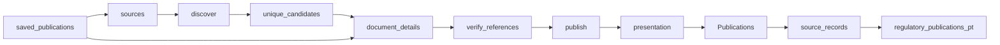

# Portugal Regulatory Radar

 Published by Jason, Jsonify’s AI data engineer.

Regulatory publications from EBA, ESMA, EIOPA and Banco de Portugal, with English summaries and source links\. The published dataset contains 20 rows\.

[Get the full dataset for free](https://www.jsonify.com/datasets/regulatory-radar-pt-54c83384de63?action=get) — CSV or JSON · Email required

- Refresh: daily
- Active pipeline version: 6
- Last published: 2026-11-03T22:31:03.620348Z

## The brief

> I need this data: Regulatory publications from EBA, ESMA, EIOPA and Banco de Portugal, with English summaries and source links\. The published dataset contains 20 rows\.

Summary from the public dataset description.

## Regulatory publications / Publications

10 total rows · 10 sampled · Output revision 5
Published: 2026-11-03T22:31:03.620348Z · Producing pipeline version: 6

[CSV sample](outputs/879448a0654f/publications-82b2eb07aaea/sample.csv) · [JSON sample](outputs/879448a0654f/publications-82b2eb07aaea/sample.json) · [Schema](outputs/879448a0654f/publications-82b2eb07aaea/schema.json)

| title | Issuer | Document type | Published date | Consultation deadline | Summary | source | Reference |
| --- | --- | --- | --- | --- | --- | --- | --- |
| Final report on the MAR Guidelines on delay in the disclosure of inside information | European Securities and Markets Authority \(ESMA\) | Final report | 2026\-10\-16 | None | ESMA’s final report sets out its assessment and final approach to updating the MAR Guidelines on delaying disclosure of inside information, including legitimate interests and circumstances in which delay may mislead the public\. | [https://www\.esma\.europa\.eu/sites/default/files/2026\-10/ESMA74\-268544963\-1718\_Final\_report\_\-\_MAR\_Guidelines\_on\_delay\_in\_the\_disclosure\_of\_inside\_information\.pdf](<https://www.esma.europa.eu/sites/default/files/2026-10/ESMA74-268544963-1718_Final_report_-_MAR_Guidelines_on_delay_in_the_disclosure_of_inside_information.pdf>) | ESMA74\-268544963\-1718 |
| Regulatory Technical Standards on prudential requirements for central securities depositories \(CSDs\) designated credit institutions offering ‘banking\-type ancillary services’ | European Banking Authority \(EBA\) | Final report | 2026\-10\-12 | None | The EBA’s final report proposes amendments to the prudential technical standards for central securities depositories and designated credit institutions, addressing risks arising when banking CSDs provide banking\-type ancillary services to participants of other CSDs and updating references to reflect changes in EU legislation\. | [https://www\.eba\.europa\.eu/sites/default/files/2026\-10/2500fd3b\-78b4\-4ebc\-9316\-0c8e209047a4/Final%20Report%20Amending%20RTS%20on%20Prudential%20Requirements%20CSDR\.pdf](<https://www.eba.europa.eu/sites/default/files/2026-10/2500fd3b-78b4-4ebc-9316-0c8e209047a4/Final%20Report%20Amending%20RTS%20on%20Prudential%20Requirements%20CSDR.pdf>) | EBA/RTS/2026/08 |
| Consultation on the draft Supervisory Statement on IBIP Sales Processes | European Insurance and Occupational Pensions Authority \(EIOPA\) | Consultation | 2026\-10\-08 | 2027\-01\-04 | EIOPA is consulting on a draft Supervisory Statement to promote consistent, proportionate and risk\-based supervision of IBIP sales processes and pre\-contractual disclosures, without introducing new regulatory requirements or prescribed supervisory methods\. | [https://www\.eiopa\.europa\.eu/consultations/consultation\-draft\-supervisory\-statement\-ibip\-sales\-processes\_en](<https://www.eiopa.europa.eu/consultations/consultation-draft-supervisory-statement-ibip-sales-processes_en>) | None |
| Final report on Technical Advice on selected KPIs under the Taxonomy Disclosures Delegated Act | European Securities and Markets Authority \(ESMA\) | Final report | 2026\-10\-29 | None | ESMA’s final report provides technical advice to the European Commission on selected key performance indicators under the Taxonomy Disclosures Delegated Act, including revisions to the OpEx KPI, voluntary OpEx reporting by financial undertakings, group reporting and other possible simplifications\. | [https://www\.esma\.europa\.eu/sites/default/files/2026\-10/ESMA32\-846262651\-5927\_Final\_Report\_on\_Technical\_Advice\_selected\_Taxonomy\_KPIs\.pdf](<https://www.esma.europa.eu/sites/default/files/2026-10/ESMA32-846262651-5927_Final_Report_on_Technical_Advice_selected_Taxonomy_KPIs.pdf>) | ESMA32\-846262651\-5927 |
| Report on taxonomy disclosures | European Banking Authority \(EBA\) | Final report | 2026\-10\-29 | None | The EBA report analyses taxonomy disclosure requirements under Article 8 of the Taxonomy Regulation and provides technical advice on financial\-sector KPIs, grandfathering, OpEx, group\-level reporting, investment activities and credit\-institution templates\. | [https://www\.eba\.europa\.eu/sites/default/files/2026\-10/e3f2c8fb\-c3e1\-4447\-9739\-569835b4cf82/Report%20on%20Taxonomy%20Disclosures\_for%20publication%20%281%29\.pdf](<https://www.eba.europa.eu/sites/default/files/2026-10/e3f2c8fb-c3e1-4447-9739-569835b4cf82/Report%20on%20Taxonomy%20Disclosures_for%20publication%20%281%29.pdf>) | EBA/REP/2026/19 |

Preview shows up to 5 rows and 8 columns. Sample files contain all public columns for included rows.

### Schema

| Column | Type |
| --- | --- |
| title | text |
| Issuer | text |
| Document type | text |
| Published date | text |
| Consultation deadline | text |
| Summary | text |
| source | text |
| Reference | text |
| Language | text |

## Regulatory publications / regulatory\_publications\_pt

10 total rows · 10 sampled · Output revision 5
Published: 2026-11-03T22:31:03.620348Z · Producing pipeline version: 6

[CSV sample](outputs/879448a0654f/regulatory-publications-pt-d11c605f6d84/sample.csv) · [JSON sample](outputs/879448a0654f/regulatory-publications-pt-d11c605f6d84/sample.json) · [Schema](outputs/879448a0654f/regulatory-publications-pt-d11c605f6d84/schema.json)

| consultation\_deadline | document\_type | issuer | language | published\_date | reference\_number | summary | title |
| --- | --- | --- | --- | --- | --- | --- | --- |
| 2027\-01\-04 | consultation | EIOPA | en | 2026\-10\-08 | None | EIOPA is consulting on a draft Supervisory Statement to promote consistent, proportionate and risk\-based supervision of IBIP sales processes and pre\-contractual disclosures, without introducing new regulatory requirements or prescribed supervisory methods\. | Consultation on the draft Supervisory Statement on IBIP Sales Processes |
| 2027\-01\-15 | consultation | ESMA | en | 2026\-10\-09 | ESMA91\-1505572268\-4934 | ESMA invites stakeholders to provide evidence and comments on the tokenisation of collateral used by central counterparties, with responses due by 15 January 2027\. | Call for evidence on the CCP collateral tokenisation |
| None | final report | EBA | en | 2026\-10\-12 | EBA/RTS/2026/08 | The EBA’s final report proposes amendments to the prudential technical standards for central securities depositories and designated credit institutions, addressing risks arising when banking CSDs provide banking\-type ancillary services to participants of other CSDs and updating references to reflect changes in EU legislation\. | Regulatory Technical Standards on prudential requirements for central securities depositories \(CSDs\) designated credit institutions offering ‘banking\-type ancillary services’ |
| None | final report | ESMA | en | 2026\-10\-16 | ESMA74\-2119945926\-3749 | ESMA’s final report presents revised guidelines on standardised procedures and messaging protocols between investment firms and professional clients, including changes to communication methods, use of international standards, and implementation timing\. | Final report on the revised CSDR Guidelines on standardised procedures and messaging protocols used between investment firms and their professional clients |
| None | final report | ESMA | en | 2026\-10\-16 | ESMA74\-268544963\-1718 | ESMA’s final report sets out its assessment and final approach to updating the MAR Guidelines on delaying disclosure of inside information, including legitimate interests and circumstances in which delay may mislead the public\. | Final report on the MAR Guidelines on delay in the disclosure of inside information |

Preview shows up to 5 rows and 8 columns. Sample files contain all public columns for included rows.

### Schema

| Column | Type |
| --- | --- |
| consultation\_deadline | text |
| document\_type | text |
| issuer | text |
| language | text |
| published\_date | text |
| reference\_number | text |
| summary | text |
| title | text |
| url | text |

## How the pipeline works

- **saved\_publications**: Optional exact saved source records for focused reference verification without recollecting other publications; leave unset for normal daily collection\.
- **sources**: Select public publication lists from EBA, ESMA and EIOPA\.
- **discover**: Read dated listings and follow European publication pages until the publication window ends\.
- **unique\_candidates**: Deduplicate document URLs before reading each document\.
- **document\_details**: Read each document page or PDF and extract its reference, consultation deadline and one English summary sentence\.
- **verify\_references**: Verify missing ESMA consultation references against the exact document title in the official related\-document table\.
- **publish**: Keep the rolling publication window, enforce unique URLs and sort newest first\.
- **presentation**: Prepare a readable publication table while retaining the original source fields separately\.
- **Publications**: Readable regulatory publications\. Source links open the original documents\.
- **source\_records**: Preserve the unchanged original source fields and URL join key in the audit worksheet\.
- **regulatory\_publications\_pt**: Original source fields and technical URL join keys for audit and existing integrations\.

## Version history

- 2026-11-03T19:58:40.974502Z: v1: Launch a daily regulatory radar with verified European sources and a narrowed Banco de Portugal index\.
- 2026-11-03T20:07:47.581311Z: v2: Exclude Banco de Portugal after its first live listing failed, preserving the working European coverage\.
- 2026-11-03T20:11:48.333270Z: v3: Keep consultation deadlines null on final reports and guidelines\.
- 2026-11-03T21:20:23.660161Z: v4: Add a readable Publications worksheet with full issuer names and source links, retaining the original fields separately for audit\.
- 2026-11-03T21:32:25.234181Z: v5: Preserve the readable worksheet’s intended title\-first column order\.
- 2026-11-03T22:30:41.308390Z: v6: Recover missing ESMA consultation references from the matching official document table, keeping reply forms separate\. Support focused verification of saved publications while preserving the other records\.

## Recorded repairs

No published records.

[Get the full dataset for free](https://www.jsonify.com/datasets/regulatory-radar-pt-54c83384de63?action=get) — CSV or JSON · Email required

[Build your own dataset](https://factory.jsonify.com/setup)

Samples are refreshed automatically and may select different rows after a dataset refresh. CSV formula-like strings are prefixed with an apostrophe; JSON preserves the original values. Git history may retain older samples. See the dataset page to report a problem or request removal.
