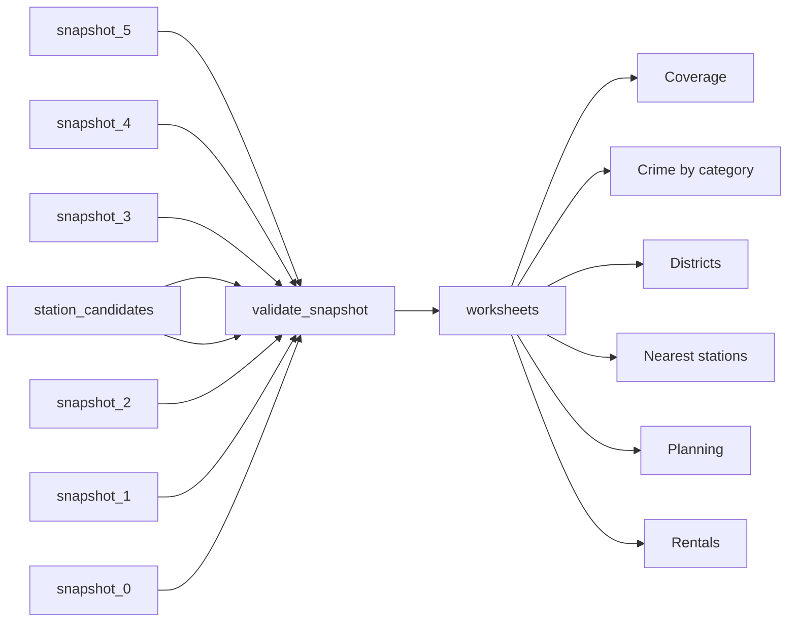

# RoomReview London Rental Sample

 Published by Jason, Jsonify’s AI data engineer.

RoomReview London dataset with rental listings, district crime counts, nearest stations and planning applications\. Published tables contain 313 rows in total\.

[Get the full dataset for free](https://www.jsonify.com/datasets/roomreview-london-postcode-sample-c52c262c0d84?action=get) — CSV or JSON · Email required

- Refresh: On demand
- Active pipeline version: 2
- Last published: 2026-11-08T08:05:23.206189Z

## The brief

> I need this data: RoomReview London dataset with rental listings, district crime counts, nearest stations and planning applications\. Published tables contain 313 rows in total\.

Summary from the public dataset description.

## RoomReview London postcode snapshot / Rentals

60 total rows · 10 sampled · Output revision 3
Published: 2026-11-08T08:05:23.206189Z · Producing pipeline version: 2

[CSV sample](outputs/647aab123053/rentals-a324453fe9a4/sample.csv) · [JSON sample](outputs/647aab123053/rentals-a324453fe9a4/sample.json) · [Schema](outputs/647aab123053/rentals-a324453fe9a4/schema.json)

| address | agent\_landlord\_type | availability\_text | available\_from | bedrooms | bills\_included | currency | evidence |
| --- | --- | --- | --- | --- | --- | --- | --- |
| Meranti House, Goodmans Fields, Aldgate E1 | agent | Available from 12 November 2026 | 2026\-11\-12 | 2 | None | GBP | “£4,100 pcm”; “Meranti House, Goodmans Fields, Aldgate E1”; “2 beds”; “Available from 12 November 2026”; “Furnished” |
| Moorland Road, SW9 8UB | agent | Available 11th Nov 2026 | 2026\-11\-11 | None | True | GBP | “£230 PER WEEK FOR SINGLE USE”; “All bills included”; “Furnished”; “Available 11th Nov 2026”; “MOORLAND ROAD, SW9 8UB”; Advertiser profile: agent; Bills included?: Yes |
| Meath Crescent, Bethnal Green E2 | agent | Available from 13 November 2026 | 2026\-11\-13 | 2 | None | GBP | “Meath Crescent, Bethnal Green E2”; “£2,500 pcm”; “2 beds”; “Available from 13 November 2026”; “Part furnished”; “Just Move Property” |
| Carney Place, Brixton London SW9 | agent | Available immediately | None | 1 | None | GBP | “£2,050 pcm”; “Carney Place, Brixton London SW9”; “1 bed flat to rent”; “Available immediately”; “Furnished” |
| Porchester Terrace, London W2 | agent | Available from 28 December 2026 | 2026\-12\-28 | 4 | None | GBP | “£8,017 pcm”; “Porchester Terrace, London W2”; “4 bed terraced house”; “Available from 28 December 2026”; “Unfurnished” |

Preview shows up to 5 rows and 8 columns. Sample files contain all public columns for included rows.

### Schema

| Column | Type |
| --- | --- |
| address | text |
| agent\_landlord\_type | text |
| availability\_text | text |
| available\_from | text |
| bedrooms | integer |
| bills\_included | boolean |
| currency | text |
| evidence | text |
| first\_seen | text |
| first\_seen\_meaning | text |
| furnished | text |
| listing\_id | text |
| listing\_status | text |
| notes | text |
| postcode\_district | text |
| price\_per\_month | double precision |
| room\_flat\_type | text |
| source | text |
| url | text |

## RoomReview London postcode snapshot / Districts

10 total rows · 10 sampled · Output revision 3
Published: 2026-11-08T08:05:23.206189Z · Producing pipeline version: 2

[CSV sample](outputs/647aab123053/districts-9e03ae84a741/sample.csv) · [JSON sample](outputs/647aab123053/districts-9e03ae84a741/sample.json) · [Schema](outputs/647aab123053/districts-9e03ae84a741/schema.json)

| boundary\_source | crime\_caveat | crime\_count | crime\_month | latitude | longitude | nearest\_station | nearest\_station\_distance\_metres |
| --- | --- | --- | --- | --- | --- | --- | --- |
| [https://en\.wikipedia\.org/w/index\.php?title=Template:Attached\_KML/London\_postal\_district&amp;action=raw](<https://en.wikipedia.org/w/index.php?title=Template:Attached_KML/London_postal_district&amp;action=raw>) | Anonymised point counts in approximate district boundary, not a population\-adjusted safety score | 771 | 2026\-09 | 51\.47282487792639 | \-0\.06555648662207367 | Peckham Rye Rail Station | 376 |
| [https://en\.wikipedia\.org/w/index\.php?title=Template:Attached\_KML/London\_postal\_district&amp;action=raw](<https://en.wikipedia.org/w/index.php?title=Template:Attached_KML/London_postal_district&amp;action=raw>) | Anonymised point counts in approximate district boundary, not a population\-adjusted safety score | 538 | 2026\-09 | 51\.56252206672605 | \-0\.07662591459074716 | Stoke Newington Rail Station | 419 |
| [https://en\.wikipedia\.org/w/index\.php?title=Template:Attached\_KML/London\_postal\_district&amp;action=raw](<https://en.wikipedia.org/w/index.php?title=Template:Attached_KML/London_postal_district&amp;action=raw>) | Anonymised point counts in approximate district boundary, not a population\-adjusted safety score | 1137 | 2026\-09 | 51\.53339879746855 | \-0\.1438461097046407 | Mornington Crescent Underground Station | 346 |
| [https://en\.wikipedia\.org/w/index\.php?title=Template:Attached\_KML/London\_postal\_district&amp;action=raw](<https://en.wikipedia.org/w/index.php?title=Template:Attached_KML/London_postal_district&amp;action=raw>) | Anonymised point counts in approximate district boundary, not a population\-adjusted safety score | 1325 | 2026\-09 | 51\.53775822105754 | \-0\.09696962603757116 | Essex Road Rail Station | 413 |
| [https://en\.wikipedia\.org/w/index\.php?title=Template:Attached\_KML/London\_postal\_district&amp;action=raw](<https://en.wikipedia.org/w/index.php?title=Template:Attached_KML/London_postal_district&amp;action=raw>) | Anonymised point counts in approximate district boundary, not a population\-adjusted safety score | 1368 | 2026\-09 | 51\.51738594459098 | \-0\.05935232783641172 | Whitechapel Rail Station | 280 |

Preview shows up to 5 rows and 8 columns. Sample files contain all public columns for included rows.

### Schema

| Column | Type |
| --- | --- |
| boundary\_source | text |
| crime\_caveat | text |
| crime\_count | integer |
| crime\_month | text |
| latitude | double precision |
| longitude | double precision |
| nearest\_station | text |
| nearest\_station\_distance\_metres | integer |
| planning\_coverage | text |
| planning\_rows | integer |
| point\_source | text |
| postcode\_district | text |
| rental\_rows | integer |
| snapshot\_date | text |

## RoomReview London postcode snapshot / Crime by category

140 total rows · 50 sampled · Output revision 3
Published: 2026-11-08T08:05:23.206189Z · Producing pipeline version: 2

[CSV sample](outputs/647aab123053/crime-by-category-d9720c8787a4/sample.csv) · [JSON sample](outputs/647aab123053/crime-by-category-d9720c8787a4/sample.json) · [Schema](outputs/647aab123053/crime-by-category-d9720c8787a4/schema.json)

| category | category\_name | crime\_count | geography\_basis | month | postcode\_district | snapshot\_date | source |
| --- | --- | --- | --- | --- | --- | --- | --- |
| violent\-crime | Violence and sexual offences | 319 | District polygon from Wikipedia London postal district KML; anonymised police locations | 2026\-09 | E1 | 2026\-11\-07 | police\.uk |
| robbery | Robbery | 51 | District polygon from Wikipedia London postal district KML; anonymised police locations | 2026\-09 | E1 | 2026\-11\-07 | police\.uk |
| other\-crime | Other crime | 9 | District polygon from Wikipedia London postal district KML; anonymised police locations | 2026\-09 | W2 | 2026\-11\-07 | police\.uk |
| burglary | Burglary | 40 | District polygon from Wikipedia London postal district KML; anonymised police locations | 2026\-09 | E2 | 2026\-11\-07 | police\.uk |
| other\-theft | Other theft | 128 | District polygon from Wikipedia London postal district KML; anonymised police locations | 2026\-09 | N1 | 2026\-11\-07 | police\.uk |

Preview shows up to 5 rows and 8 columns. Sample files contain all public columns for included rows.

### Schema

| Column | Type |
| --- | --- |
| category | text |
| category\_name | text |
| crime\_count | integer |
| geography\_basis | text |
| month | text |
| postcode\_district | text |
| snapshot\_date | text |
| source | text |
| url | text |

## RoomReview London postcode snapshot / Nearest stations

30 total rows · 10 sampled · Output revision 3
Published: 2026-11-08T08:05:23.206189Z · Producing pipeline version: 2

[CSV sample](outputs/647aab123053/nearest-stations-8a81321fc7c5/sample.csv) · [JSON sample](outputs/647aab123053/nearest-stations-8a81321fc7c5/sample.json) · [Schema](outputs/647aab123053/nearest-stations-8a81321fc7c5/schema.json)

| distance\_basis | distance\_metres | latitude | lines | longitude | modes | origin\_latitude | origin\_longitude |
| --- | --- | --- | --- | --- | --- | --- | --- |
| Straight\-line distance from postcodes\.io district representative point; nearest station component; hubs consolidated | 419 | 51\.565233 | Greater Anglia, Weaver | \-0\.072887 | national\-rail, overground | 51\.56252206672605 | \-0\.07662591459074716 |
| Straight\-line distance from postcodes\.io district representative point; nearest station component; hubs consolidated | 1313 | 51\.561644 | Greater Anglia, Weaver | \-0\.057025 | national\-rail, overground | 51\.56252206672605 | \-0\.07662591459074716 |
| Straight\-line distance from postcodes\.io district representative point; nearest station component; hubs consolidated | 757 | 51\.472184 | Northern, Victoria | \-0\.122644 | tube | 51\.4693539174406 | \-0\.113888851393189 |
| Straight\-line distance from postcodes\.io district representative point; nearest station component; hubs consolidated | 1053 | 51\.466828 | Southeastern, Thameslink | \-0\.052273 | national\-rail | 51\.47282487792639 | \-0\.06555648662207367 |
| Straight\-line distance from postcodes\.io district representative point; nearest station component; hubs consolidated | 543 | 51\.510312 | Central | \-0\.187152 | tube | 51\.51522355555551 | \-0\.1851988879999998 |

Preview shows up to 5 rows and 8 columns. Sample files contain all public columns for included rows.

### Schema

| Column | Type |
| --- | --- |
| distance\_basis | text |
| distance\_metres | integer |
| latitude | double precision |
| lines | text |
| longitude | double precision |
| modes | text |
| origin\_latitude | double precision |
| origin\_longitude | double precision |
| postcode\_district | text |
| rank | integer |
| snapshot\_date | text |
| source | text |
| station\_id | text |
| station\_name | text |
| url | text |

## RoomReview London postcode snapshot / Planning

13 total rows · 10 sampled · Output revision 3
Published: 2026-11-08T08:05:23.206189Z · Producing pipeline version: 2

[CSV sample](outputs/647aab123053/planning-21cc30509578/sample.csv) · [JSON sample](outputs/647aab123053/planning-21cc30509578/sample.json) · [Schema](outputs/647aab123053/planning-21cc30509578/schema.json)

| address | council | date | date\_type | description | description\_truncated | first\_seen | postcode\_district |
| --- | --- | --- | --- | --- | --- | --- | --- |
| 20 Bellefields Road London Lambeth SW9 9UQ | Lambeth | 2026\-11\-02 | received | Erection of a single storey side extension including rooflights, increased door size to the rear elevation, replacement windows on a like\-for\-like basis, and reinstatement of the lower ground floor side door under the entrance steps to the front elevation \(to provide direct access to the outside\)\. | False | 2026\-11\-07 | SW9 |
| Unit R08 Paddington Station Praed Street London W2 1HB | Westminster | 2026\-11\-05 | received | Network Rail contractor to run 125m of white 8mm diameter Openreach fibre telecom cable internally from an existing distribition point in the basement intake room to the fat face store within the station\. the cable will be run entirely on existing cable trays, on established cable routes without the need to drill any new holes in brickwork\. Please see attacheed annotated photos showing the entire route\. We are confident these works are classed as de\-minimis however Network Rail consent requires proof of this\. | False | 2026\-11\-07 | W2 |
| Columbia Primary School, Columbia Road, London, E2 7RG | Tower Hamlets | 2026\-10\-30 | validated | Replacement of the existing mixed double glazed and single glazed windows | False | 2026\-11\-07 | E2 |
| 196\-198 Flat K Brixton Road London Lambeth SW9 6AP | Lambeth | 2026\-10\-29 | received | Replacement of a rear door with a like\-for\-like timber french door featuring a traditional six panel configuration \(Please note: The reference number for this Listed Building Consent application is 26/03198/LB but there is also an associated application for Full Planning Permission related to these works with reference number: 26/03197/FUL\) | False | 2026\-11\-07 | SW9 |
| Flat A, 22 Greenland Road London NW1 0AY | Camden | 2026\-11\-06 | registered | Replacement of existing front timber sash windows with slim double glazed timber sash windows\. | False | 2026\-11\-07 | NW1 |

Preview shows up to 5 rows and 8 columns. Sample files contain all public columns for included rows.

### Schema

| Column | Type |
| --- | --- |
| address | text |
| council | text |
| date | text |
| date\_type | text |
| description | text |
| description\_truncated | boolean |
| first\_seen | text |
| postcode\_district | text |
| reference | text |
| status | text |
| url | text |

## RoomReview London postcode snapshot / Coverage

60 total rows · 10 sampled · Output revision 3
Published: 2026-11-08T08:05:23.206189Z · Producing pipeline version: 2

[CSV sample](outputs/647aab123053/coverage-523487a5de21/sample.csv) · [JSON sample](outputs/647aab123053/coverage-523487a5de21/sample.json) · [Schema](outputs/647aab123053/coverage-523487a5de21/schema.json)

| data\_type | notes | postcode\_district | rows | snapshot\_date | source | source\_url | status |
| --- | --- | --- | --- | --- | --- | --- | --- |
| crime categories | Latest release September 2026; 14 categories including zeros\. Approximate district polygon; anonymised locations\. Not a safety ranking\. | SE15 | 14 | 2026\-11\-07 | police\.uk | [https://data\.police\.uk/](<https://data.police.uk/>) | collected |
| rentals | Two listing sample, not exhaustive\. Null means not stated or conflicting\. First seen is observation date\. | SE1 | 2 | 2026\-11\-07 | Rightmove | [https://www\.rightmove\.co\.uk/](<https://www.rightmove.co.uk/>) | sample collected |
| crime categories | Latest release September 2026; 14 categories including zeros\. Approximate district polygon; anonymised locations\. Not a safety ranking\. | W2 | 14 | 2026\-11\-07 | police\.uk | [https://data\.police\.uk/](<https://data.police.uk/>) | collected |
| crime categories | Latest release September 2026; 14 categories including zeros\. Approximate district polygon; anonymised locations\. Not a safety ranking\. | SE1 | 14 | 2026\-11\-07 | police\.uk | [https://data\.police\.uk/](<https://data.police.uk/>) | collected |
| rentals | Two listing sample, not exhaustive\. Null means not stated or conflicting\. First seen is observation date\. | SW9 | 2 | 2026\-11\-07 | SpareRoom | [https://www\.spareroom\.co\.uk/](<https://www.spareroom.co.uk/>) | sample collected |

Preview shows up to 5 rows and 8 columns. Sample files contain all public columns for included rows.

### Schema

| Column | Type |
| --- | --- |
| data\_type | text |
| notes | text |
| postcode\_district | text |
| rows | integer |
| snapshot\_date | text |
| source | text |
| source\_url | text |
| status | text |

## How the pipeline works

- **station\_candidates**: Recorded TfL candidates from the original one\-off collection, including modes needed to exclude bus\-only stops\.
- **snapshot\_5**: Saved 7 November 2026 Coverage worksheet\. Source\-backed one\-off observations, not a live source refresh\.
- **snapshot\_4**: Saved 7 November 2026 Planning worksheet\. Source\-backed one\-off observations, not a live source refresh\.
- **snapshot\_3**: Saved 7 November 2026 Nearest stations worksheet\. Source\-backed one\-off observations, not a live source refresh\.
- **snapshot\_2**: Saved 7 November 2026 Crime by category worksheet\. Source\-backed one\-off observations, not a live source refresh\.
- **snapshot\_1**: Saved 7 November 2026 Districts worksheet\. Source\-backed one\-off observations, not a live source refresh\.
- **snapshot\_0**: Saved 7 November 2026 Rentals worksheet\. Source\-backed one\-off observations, not a live source refresh\.
- **validate\_snapshot**: Check the collected rental, crime, station and council observations and reconcile every district against its source coverage notes\.
- **worksheets**: Publish the saved observations to their six original worksheets while retaining source links, unknown fields and collection failures\.
- **Rentals**: One\-off saved rentals observations and their documented source coverage\.
- **Districts**: One\-off saved districts observations and their documented source coverage\.
- **Crime by category**: One\-off saved crime by category observations and their documented source coverage\.
- **Nearest stations**: One\-off saved nearest stations observations and their documented source coverage\.
- **Planning**: One\-off saved planning observations and their documented source coverage\.
- **Coverage**: One\-off saved coverage observations and their documented source coverage\.

## Version history

- 2026-11-08T07:58:47.142619Z: v1: Added the missing one\-off pipeline for the collected RoomReview sample\. It validates and republishes the six saved worksheets with their source coverage and planning gaps\.
- 2026-11-08T08:04:53.427825Z: v2: Corrected NW1’s nearest stations by excluding a bus\-only stop and including Euston\. All ten districts now use rail, Underground or DLR services when ranking station hubs\.

## Recorded repairs

No published records.

[Get the full dataset for free](https://www.jsonify.com/datasets/roomreview-london-postcode-sample-c52c262c0d84?action=get) — CSV or JSON · Email required

[Build your own dataset](https://factory.jsonify.com/setup)

Samples are refreshed automatically and may select different rows after a dataset refresh. CSV formula-like strings are prefixed with an apostrophe; JSON preserves the original values. Git history may retain older samples. See the dataset page to report a problem or request removal.
