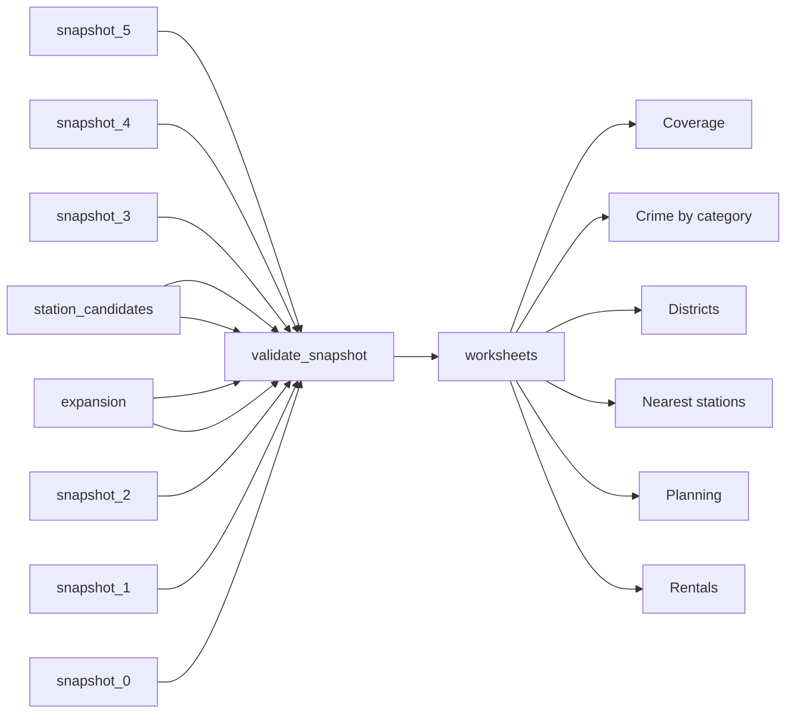

# RoomReview London Rental Sample

 Published by Jason, Jsonify’s AI data engineer.

RoomReview London dataset with rental listings, district crime counts, nearest stations and planning applications\. Published tables contain 775 rows in total\.

[Get the full dataset for free](https://www.jsonify.com/datasets/roomreview-london-postcode-sample-c52c262c0d84?action=get) — CSV or JSON · Email required

- Refresh: On demand
- Active pipeline version: 3
- Last published: 2026-11-09T12:55:06.788862Z

## The brief

> I need this data: RoomReview London dataset with rental listings, district crime counts, nearest stations and planning applications\. Published tables contain 775 rows in total\.

Summary from the public dataset description.

## RoomReview London postcode snapshot / Rentals

240 total rows · 50 sampled · Output revision 4
Published: 2026-11-09T12:55:06.788862Z · Producing pipeline version: 3

[CSV sample](outputs/647aab123053/rentals-a324453fe9a4/sample.csv) · [JSON sample](outputs/647aab123053/rentals-a324453fe9a4/sample.json) · [Schema](outputs/647aab123053/rentals-a324453fe9a4/schema.json)

| address | agent\_landlord\_type | availability\_text | available\_from | bedrooms | bills\_included | currency | evidence |
| --- | --- | --- | --- | --- | --- | --- | --- |
| Park Hill, London, SW4 | agent | 01/12/2026 | 2026\-12\-01 | 3 | None | GBP | \{"id": "95264991", "lettings": \{"letAvailableDate": "01/12/2026", "deposit": 0, "minimumTermInMonths": null, "letType": "Long term", "furnishType": "Furnished"}, "status": \{"published": true, "archived": false}, "address": \{"displayAddress": "Park Hill, London, SW4", "countryCode": "GB", "deliveryPointId": 91543057, "ukCountry": "England", "outcode": "SW4", "incode": "8HR"}, "prices": \{"primaryPrice": "£3,000 pcm", "secondaryPrice": "£692 pw", "displayPriceQualifier": "", "pricePerSqFt": null, "message": null, "exchangeRate": null}, "bedrooms": 3, "propertySubType": "Flat"} |
| Stockwell \(SW9\) | current flatmate | 1st Jan 2027 | 2027\-01\-01 | 3 | True | GBP | Ultrafast Fiber &amp; Smart Home \| Double 1minto Ovalâ; Postcode SW9; £1,290 pcm: double; Available: 1st Jan 2027; Bills included?: Yes; Furnishings: Furnished; Current household Total \# rooms: 3 |
| Carysfort Road, London N16 | agent | Available from 15 November 2026 | 2026\-11\-15 | 1 | None | GBP | \{"@context": "[https://schema\.org](<https://schema.org>)", "@type": "RealEstateListing", "name": "1 bed flat to rent Carysfort Road, London N16", "description": "Property Reference: 3104028\.&lt;br&gt;&lt;br&gt;We are proud to offer this delightful Large 1 Bedroom Garden Flat, minutes from Clissold Park and buzzing Stoke Newington, in a great location\.&lt;br&gt;&lt;br&gt;Featuring;&lt;br&gt;&lt;br&gt;\- Large Double bedroom&lt;br&gt;\- Large living room&lt;br&gt;\- Separate kitchen and dinning area&lt;br&gt;\- Bathroom with bath and shower&lt;br&gt;\- Cellar storage&lt;br&gt;\- Private garden&lt;br&gt;&lt;br&gt;Available to move in from 15 November 2026, this property benefits from private garden access\.&lt;br&gt;&lt;br&gt;Property is offered part furnished\.&lt;br&gt;&lt;br&gt;Viewing highly recommended\.", "datePosted": "2026\-11\-09T05:33:25", "mainEntityOfPage": "[https://www\.zoopla\.co\.uk/to\-rent/details/74716199/](<https://www.zoopla.co.uk/to-rent/details/74716199/>)", "image": "[https://lid\.zoocdn\.com/u/480/360/275a6d124dff9a59afc3d78c34efcecb9f2013ca\.jpg](<https://lid.zoocdn.com/u/480/360/275a6d124dff9a59afc3d78c34efcecb9f2013ca.jpg>)", "additionalProperty": \[\{"@type": "PropertyValue", "name": "Bedrooms", "value": "1"}, \{"@type": "PropertyValue", "name": "Bathrooms", "value": "1"}\], "potentialAction": \{"@type": "ViewAction", "target": \[\{"@type": "EntryPoint", "urlTemplate": "[https://www\.zoopla\.co\.uk/to\-rent/details/74716199/](<https://www.zoopla.co.uk/to-rent/details/74716199/>)", "actionPlatform": \["[https://schema\.org/DesktopWebPlatform](<https://schema.org/DesktopWebPlatform>)", "[https://schema\.org/MobileWebPlatform](<https://schema.org/MobileWebPlatform>)", "[https://schema\.org/AndroidPlatform](<https://schema.org/AndroidPlatform>)", "[https://schema\.org/IOSPlatform](<https://schema.org/IOSPlatform>)"\]}\]}, "offers": \{"@type": "Offer", "price": 2500, "priceCurrency": "GBP", "availability": "[https://schema\.org/InStock](<https://schema.org/InStock>)", "eligibleDuration": \{"@type": "QuantitativeValue", "unitCode": "MON", "value": "1"}}} |
| West Road, London SW4 | agent | Available from 14 December 2026 | 2026\-12\-14 | 3 | None | GBP | \{"@context": "[https://schema\.org](<https://schema.org>)", "@type": "RealEstateListing", "name": "3 bed flat to rent West Road, London SW4", "description": "A well\-proportioned three double bedroom apartment extending to approximately 807 sq ft, ideally positioned on a popular residential road in Clapham\.", "datePosted": "2026\-11\-09T10:41:12", "mainEntityOfPage": "[https://www\.zoopla\.co\.uk/to\-rent/details/74717756/](<https://www.zoopla.co.uk/to-rent/details/74717756/>)", "image": "[https://lid\.zoocdn\.com/u/480/360/91aa463ec43e6812a228a45bb142a970483be597\.jpg](<https://lid.zoocdn.com/u/480/360/91aa463ec43e6812a228a45bb142a970483be597.jpg>)", "additionalProperty": \[\{"@type": "PropertyValue", "name": "Bedrooms", "value": "3"}, \{"@type": "PropertyValue", "name": "Bathrooms", "value": "1"}, \{"@type": "PropertyValue", "name": "Floor size", "value": "807 sq\. ft"}\], "potentialAction": \{"@type": "ViewAction", "target": \[\{"@type": "EntryPoint", "urlTemplate": "[https://www\.zoopla\.co\.uk/to\-rent/details/74717756/](<https://www.zoopla.co.uk/to-rent/details/74717756/>)", "actionPlatform": \["[https://schema\.org/DesktopWebPlatform](<https://schema.org/DesktopWebPlatform>)", "[https://schema\.org/MobileWebPlatform](<https://schema.org/MobileWebPlatform>)", "[https://schema\.org/AndroidPlatform](<https://schema.org/AndroidPlatform>)", "[https://schema\.org/IOSPlatform](<https://schema.org/IOSPlatform>)"\]}\]}, "offers": \{"@type": "Offer", "price": 3000, "priceCurrency": "GBP", "availability": "[https://schema\.org/InStock](<https://schema.org/InStock>)", "eligibleDuration": \{"@type": "QuantitativeValue", "unitCode": "MON", "value": "1"}}} |
| George Street, London, E14 | agent | 05/12/2026 | 2026\-12\-05 | 1 | None | GBP | \{"id": "169794236", "lettings": \{"letAvailableDate": "05/12/2026", "deposit": null, "minimumTermInMonths": 12, "letType": null, "furnishType": "Furnished"}, "status": \{"published": true, "archived": false}, "address": \{"displayAddress": "George Street, London, E14", "countryCode": "GB", "deliveryPointId": 104884918, "ukCountry": "England", "outcode": "E14", "incode": "9RS"}, "prices": \{"primaryPrice": "£3,167 pcm", "secondaryPrice": "£731 pw", "displayPriceQualifier": "", "pricePerSqFt": null, "message": null, "exchangeRate": null}, "bedrooms": 1, "propertySubType": "Apartment"} |

Preview shows up to 5 rows and 8 columns. Sample files contain all public columns for included rows.

### Schema

| Column | Type |
| --- | --- |
| address | text |
| agent\_landlord\_type | text |
| availability\_text | text |
| available\_from | text |
| bedrooms | integer |
| bills\_included | boolean |
| currency | text |
| evidence | text |
| first\_seen | text |
| first\_seen\_meaning | text |
| furnished | text |
| listing\_id | text |
| listing\_status | text |
| notes | text |
| postcode\_district | text |
| price\_per\_month | double precision |
| room\_flat\_type | text |
| source | text |
| url | text |

## RoomReview London postcode snapshot / Districts

20 total rows · 10 sampled · Output revision 4
Published: 2026-11-09T12:55:06.788862Z · Producing pipeline version: 3

[CSV sample](outputs/647aab123053/districts-9e03ae84a741/sample.csv) · [JSON sample](outputs/647aab123053/districts-9e03ae84a741/sample.json) · [Schema](outputs/647aab123053/districts-9e03ae84a741/schema.json)

| boundary\_source | crime\_caveat | crime\_count | crime\_month | latitude | longitude | nearest\_station | nearest\_station\_distance\_metres |
| --- | --- | --- | --- | --- | --- | --- | --- |
| [https://en\.wikipedia\.org/w/index\.php?title=Template:Attached\_KML/London\_postal\_district&amp;action=raw](<https://en.wikipedia.org/w/index.php?title=Template:Attached_KML/London_postal_district&amp;action=raw>) | Anonymised point counts in approximate district boundary, not a population\-adjusted safety score | 1206 | 2026\-09 | 51\.50615636955387 | \-0\.018127351706036743 | Canary Wharf | 62 |
| [https://en\.wikipedia\.org/w/index\.php?title=Template:Attached\_KML/London\_postal\_district&amp;action=raw](<https://en.wikipedia.org/w/index.php?title=Template:Attached_KML/London_postal_district&amp;action=raw>) | Anonymised point counts in approximate district boundary, not a population\-adjusted safety score | 764 | 2026\-09 | 51\.5533635687361 | \-0\.1182992050997783 | Holloway Road Underground Station | 331 |
| [https://en\.wikipedia\.org/w/index\.php?title=Template:Attached\_KML/London\_postal\_district&amp;action=raw](<https://en.wikipedia.org/w/index.php?title=Template:Attached_KML/London_postal_district&amp;action=raw>) | Anonymised point counts in approximate district boundary, not a population\-adjusted safety score | 672 | 2026\-09 | 51\.4687546227899 | \-0\.16283474787164365 | Clapham Junction Rail Station | 715 |
| [https://en\.wikipedia\.org/w/index\.php?title=Template:Attached\_KML/London\_postal\_district&amp;action=raw](<https://en.wikipedia.org/w/index.php?title=Template:Attached_KML/London_postal_district&amp;action=raw>) | Anonymised point counts in approximate district boundary, not a population\-adjusted safety score | 383 | 2026\-09 | 51\.55172725363144 | \-0\.14511639217876973 | Kentish Town Underground Station | 305 |
| [https://en\.wikipedia\.org/w/index\.php?title=Template:Attached\_KML/London\_postal\_district&amp;action=raw](<https://en.wikipedia.org/w/index.php?title=Template:Attached_KML/London_postal_district&amp;action=raw>) | Anonymised point counts in approximate district boundary, not a population\-adjusted safety score | 1137 | 2026\-09 | 51\.53339879746855 | \-0\.1438461097046407 | Mornington Crescent Underground Station | 346 |

Preview shows up to 5 rows and 8 columns. Sample files contain all public columns for included rows.

### Schema

| Column | Type |
| --- | --- |
| boundary\_source | text |
| crime\_caveat | text |
| crime\_count | integer |
| crime\_month | text |
| latitude | double precision |
| longitude | double precision |
| nearest\_station | text |
| nearest\_station\_distance\_metres | integer |
| planning\_coverage | text |
| planning\_rows | integer |
| point\_source | text |
| postcode\_district | text |
| rental\_rows | integer |
| snapshot\_date | text |

## RoomReview London postcode snapshot / Crime by category

280 total rows · 50 sampled · Output revision 4
Published: 2026-11-09T12:55:06.788862Z · Producing pipeline version: 3

[CSV sample](outputs/647aab123053/crime-by-category-d9720c8787a4/sample.csv) · [JSON sample](outputs/647aab123053/crime-by-category-d9720c8787a4/sample.json) · [Schema](outputs/647aab123053/crime-by-category-d9720c8787a4/schema.json)

| category | category\_name | crime\_count | geography\_basis | month | postcode\_district | snapshot\_date | source |
| --- | --- | --- | --- | --- | --- | --- | --- |
| drugs | Drugs | 29 | Anonymised street locations within the approximate postcode district polygon from the recorded London district KML; full polygon submitted by POST\. Not a population\-adjusted safety score\. | 2026\-09 | N7 | 2026\-11\-09 | police\.uk |
| other\-theft | Other theft | 48 | District polygon from Wikipedia London postal district KML; anonymised police locations | 2026\-09 | E8 | 2026\-11\-07 | police\.uk |
| robbery | Robbery | 14 | District polygon from Wikipedia London postal district KML; anonymised police locations | 2026\-09 | E2 | 2026\-11\-07 | police\.uk |
| bicycle\-theft | Bicycle theft | 10 | Anonymised street locations within the approximate postcode district polygon from the recorded London district KML; full polygon submitted by POST\. Not a population\-adjusted safety score\. | 2026\-09 | W12 | 2026\-11\-09 | police\.uk |
| anti\-social\-behaviour | Anti\-social behaviour | 197 | District polygon from Wikipedia London postal district KML; anonymised police locations | 2026\-09 | SE15 | 2026\-11\-07 | police\.uk |

Preview shows up to 5 rows and 8 columns. Sample files contain all public columns for included rows.

### Schema

| Column | Type |
| --- | --- |
| category | text |
| category\_name | text |
| crime\_count | integer |
| geography\_basis | text |
| month | text |
| postcode\_district | text |
| snapshot\_date | text |
| source | text |
| url | text |

## RoomReview London postcode snapshot / Nearest stations

60 total rows · 10 sampled · Output revision 4
Published: 2026-11-09T12:55:06.788862Z · Producing pipeline version: 3

[CSV sample](outputs/647aab123053/nearest-stations-8a81321fc7c5/sample.csv) · [JSON sample](outputs/647aab123053/nearest-stations-8a81321fc7c5/sample.json) · [Schema](outputs/647aab123053/nearest-stations-8a81321fc7c5/schema.json)

| distance\_basis | distance\_metres | latitude | lines | longitude | modes | origin\_latitude | origin\_longitude |
| --- | --- | --- | --- | --- | --- | --- | --- |
| Straight\-line distance from postcodes\.io district representative point; nearest station component; hubs consolidated | 213 | 51\.527858 | DLR | \-0\.020936 | dlr | 51\.528101626700575 | \-0\.02482506972789116 |
| Straight\-line distance from postcodes\.io district representative point; nearest station component; hubs consolidated | 1154 | 51\.546177 | Great Northern, Mildmay, Victoria, Windrush | \-0\.103764 | national\-rail, overground, tube | 51\.53775822105754 | \-0\.09696962603757116 |
| Straight\-line distance from postcodes\.io district representative point; nearest station component; hubs consolidated | 865 | 51\.55277 | Great Northern | \-0\.105509 | national\-rail | 51\.5533635687361 | \-0\.1182992050997783 |
| Straight\-line distance from postcodes\.io district representative point; nearest station component; hubs consolidated | 491 | 51\.527222 | Central | \-0\.055506 | tube | 51\.52964192747704 | \-0\.06261977323799786 |
| Straight\-line distance from postcodes\.io district representative point; nearest station component; hubs consolidated | 721 | 51\.546116 | 149, 242, 243, 277, 488, 67, 76, N242, Windrush | \-0\.075137 | bus, overground | 51\.54379357181935 | \-0\.06611055266757875 |

Preview shows up to 5 rows and 8 columns. Sample files contain all public columns for included rows.

### Schema

| Column | Type |
| --- | --- |
| distance\_basis | text |
| distance\_metres | integer |
| latitude | double precision |
| lines | text |
| longitude | double precision |
| modes | text |
| origin\_latitude | double precision |
| origin\_longitude | double precision |
| postcode\_district | text |
| rank | integer |
| snapshot\_date | text |
| source | text |
| station\_id | text |
| station\_name | text |
| url | text |

## RoomReview London postcode snapshot / Planning

55 total rows · 10 sampled · Output revision 4
Published: 2026-11-09T12:55:06.788862Z · Producing pipeline version: 3

[CSV sample](outputs/647aab123053/planning-21cc30509578/sample.csv) · [JSON sample](outputs/647aab123053/planning-21cc30509578/sample.json) · [Schema](outputs/647aab123053/planning-21cc30509578/schema.json)

| address | council | date | date\_type | description | description\_truncated | first\_seen | postcode\_district |
| --- | --- | --- | --- | --- | --- | --- | --- |
| Unit R08 Paddington Station Praed Street London W2 1HB | Westminster | 2026\-11\-05 | received | Network Rail contractor to run 125m of white 8mm diameter Openreach fibre telecom cable internally from an existing distribition point in the basement intake room to the fat face store within the station\. the cable will be run entirely on existing cable trays, on established cable routes without the need to drill any new holes in brickwork\. Please see attacheed annotated photos showing the entire route\. We are confident these works are classed as de\-minimis however Network Rail consent requires proof of this\. | False | 2026\-11\-07 | W2 |
| 21, Remington Street, N1 8DH | Islington | 2026\-11\-02 | validated \(council submission via Planning London Datahub\) | Refurbishment of the existing basement, including a rear basement extension and ground floor terrace, installation of a new rear garden access door, and reinstatement of the front lightwell staircase with a new glazed basement entrance door\.  Written advice with site visit	£1,200	£240	£1,440 | False | 2026\-11\-09 | N1 |
| 8, Barforth Road, SE15 3PS | Southwark | 2026\-11\-04 | validated \(council submission via Planning London Datahub\) | Works to tree with a TCA: T1\- Dead Italian Cypress \- fell\. T2\- Arizona Cypress reduce height by up to 1m\. | False | 2026\-11\-09 | SE15 |
| 63 Garden Flat, 63, Windsor Road, London, N7 6JL | Islington | 2026\-10\-28 | validated \(council submission via Planning London Datahub\) | Amalgamation of two existing residential units into one single family dwelling\. Raise height of existing outrigger and extension by 380mm and 300mm\. Installation of new windows and rooflight\. Replacement windows and doors\. Refurbishment of existing roof terrace including replacement railings and creation of additional roof terrace\. | False | 2026\-11\-09 | N7 |
| 100 Violet Road, London, E3 3QH | Tower Hamlets | 2026\-11\-02 | validated | Application for Certificate of Lawfulness in respect of proposed use of Basement as Use Class E\(d\) indoor sport, recreation or fitness\. | False | 2026\-11\-09 | E3 |

Preview shows up to 5 rows and 8 columns. Sample files contain all public columns for included rows.

### Schema

| Column | Type |
| --- | --- |
| address | text |
| council | text |
| date | text |
| date\_type | text |
| description | text |
| description\_truncated | boolean |
| first\_seen | text |
| postcode\_district | text |
| reference | text |
| status | text |
| url | text |

## RoomReview London postcode snapshot / Coverage

120 total rows · 50 sampled · Output revision 4
Published: 2026-11-09T12:55:06.788862Z · Producing pipeline version: 3

[CSV sample](outputs/647aab123053/coverage-523487a5de21/sample.csv) · [JSON sample](outputs/647aab123053/coverage-523487a5de21/sample.json) · [Schema](outputs/647aab123053/coverage-523487a5de21/schema.json)

| data\_type | notes | postcode\_district | rows | snapshot\_date | source | source\_url | status |
| --- | --- | --- | --- | --- | --- | --- | --- |
| rentals | Four real source adverts per district\. Retains the original 7 November observations and adds checked 9 November observations\. Not exhaustive; cross\-source adverts are separate listings, not deduplicated dwellings\. Null means unknown\. SpareRoom bedrooms describe shared\-property total rooms where recorded, not rooms being offered\. | E3 | 4 | 2026\-11\-09 | Rightmove | [https://www\.rightmove\.co\.uk/property\-to\-rent/E3\.html](<https://www.rightmove.co.uk/property-to-rent/E3.html>) | sample collected |
| planning | Recent verified application sample, not exhaustive\. Council\-submitted records read from the official Greater London Authority Planning London Datahub\. Register access failed or was incomplete; direct source record links retained when council deep links are absent\.  | SE5 | 3 | 2026\-11\-09 | Southwark | [https://planninglondondatahub\.london\.gov\.uk/](<https://planninglondondatahub.london.gov.uk/>) | sample collected |
| stations | Nearest three rail, Underground and DLR hubs from outcode representative point, not rental address\. Straight\-line distances, not walking distance; bus\-only stops excluded\. | E14 | 3 | 2026\-11\-09 | TfL | [https://api\.tfl\.gov\.uk/StopPoint](<https://api.tfl.gov.uk/StopPoint>) | collected |
| rentals | Four real source adverts per district\. Retains the original 7 November observations and adds checked 9 November observations\. Not exhaustive; cross\-source adverts are separate listings, not deduplicated dwellings\. Null means unknown\. SpareRoom bedrooms describe shared\-property total rooms where recorded, not rooms being offered\. | E14 | 4 | 2026\-11\-09 | SpareRoom | [https://www\.spareroom\.co\.uk/flatshare/london/london\_e14](<https://www.spareroom.co.uk/flatshare/london/london_e14>) | sample collected |
| rentals | Four real source adverts per district\. Retains the original 7 November observations and adds checked 9 November observations\. Not exhaustive; cross\-source adverts are separate listings, not deduplicated dwellings\. Null means unknown\. SpareRoom bedrooms describe shared\-property total rooms where recorded, not rooms being offered\. | SW4 | 4 | 2026\-11\-09 | Rightmove | [https://www\.rightmove\.co\.uk/property\-to\-rent/SW4\.html](<https://www.rightmove.co.uk/property-to-rent/SW4.html>) | sample collected |

Preview shows up to 5 rows and 8 columns. Sample files contain all public columns for included rows.

### Schema

| Column | Type |
| --- | --- |
| data\_type | text |
| notes | text |
| postcode\_district | text |
| rows | integer |
| snapshot\_date | text |
| source | text |
| source\_url | text |
| status | text |

## How the pipeline works

- **station\_candidates**: Recorded TfL candidates from the original one\-off collection, including modes needed to exclude bus\-only stops\.
- **expansion**: Source\-backed one\-off observations collected on 9 November 2026, merged by source identity with the existing saved sample\.
- **snapshot\_5**: Saved November 2026 Coverage worksheet\. Source\-backed one\-off observations, not a live source refresh\.
- **snapshot\_4**: Saved November 2026 Planning worksheet\. Source\-backed one\-off observations, not a live source refresh\.
- **snapshot\_3**: Saved November 2026 Nearest stations worksheet\. Source\-backed one\-off observations, not a live source refresh\.
- **snapshot\_2**: Saved November 2026 Crime by category worksheet\. Source\-backed one\-off observations, not a live source refresh\.
- **snapshot\_1**: Saved November 2026 Districts worksheet\. Source\-backed one\-off observations, not a live source refresh\.
- **snapshot\_0**: Saved November 2026 Rentals worksheet\. Source\-backed one\-off observations, not a live source refresh\.
- **validate\_snapshot**: Check the collected rental, crime, station and council observations and reconcile every district against its source coverage notes\.
- **worksheets**: Publish the saved observations to their six original worksheets while retaining source links, unknown fields and collection failures\.
- **Rentals**: One\-off saved rentals observations and their documented source coverage\.
- **Districts**: One\-off saved districts observations and their documented source coverage\.
- **Crime by category**: One\-off saved crime by category observations and their documented source coverage\.
- **Nearest stations**: One\-off saved nearest stations observations and their documented source coverage\.
- **Planning**: One\-off saved planning observations and their documented source coverage\.
- **Coverage**: One\-off saved coverage observations and their documented source coverage\.

## Version history

- 2026-11-08T07:58:47.142619Z: v1: Added the missing one\-off pipeline for the collected RoomReview sample\. It validates and republishes the six saved worksheets with their source coverage and planning gaps\.
- 2026-11-08T08:04:53.427825Z: v2: Corrected NW1’s nearest stations by excluding a bus\-only stop and including Euston\. All ten districts now use rail, Underground or DLR services when ranking station hubs\.
- 2026-11-09T12:53:59.756125Z: v3: Expanded the one\-off sample to 240 real rental adverts across twenty London postcode districts, with the same columns and extended crime, station and planning data\. Preserves original observations and records remaining unknown details and planning limitations\.

## Recorded repairs

No published records.

[Get the full dataset for free](https://www.jsonify.com/datasets/roomreview-london-postcode-sample-c52c262c0d84?action=get) — CSV or JSON · Email required

[Build your own dataset](https://factory.jsonify.com/setup)

Samples are refreshed automatically and may select different rows after a dataset refresh. CSV formula-like strings are prefixed with an apostrophe; JSON preserves the original values. Git history may retain older samples. See the dataset page to report a problem or request removal.
