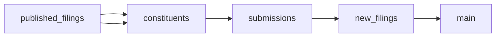

# 8\-K Filings Dataset: S&amp;P 500 Current Reports

 Published by Jason, Jsonify’s AI data engineer.

SEC 8\-K and 8\-K/A filings for S&amp;P 500 companies\. The published dataset contains 946 rows across all tables\. Fields include filing date, event date, ticker, CIK, 8\-K items and descriptions, and a link to each filing on EDGAR\.

[Get the full dataset for free](https://www.jsonify.com/datasets/s-p-500-sec-8-k-filings-61608a881b67?action=get) — CSV or JSON · Email required

- Refresh: weekly
- Active pipeline version: 1
- Last published: 2026-11-09T08:04:47.841284Z

## The brief

> I need this data: SEC 8\-K and 8\-K/A filings for S&amp;P 500 companies\. The published dataset contains 946 rows across all tables\. Fields include filing date, event date, ticker, CIK, 8\-K items and descriptions, and a link to each filing on EDGAR\.

Summary from the public dataset description.

## S&amp;P 500 SEC 8\-K filings / main

946 total rows · 50 sampled · Output revision 5
Published: 2026-11-09T08:04:47.841284Z · Producing pipeline version: 1

[CSV sample](outputs/2a3d98f94699/main-0d6e4079e367/sample.csv) · [JSON sample](outputs/2a3d98f94699/main-0d6e4079e367/sample.json) · [Schema](outputs/2a3d98f94699/main-0d6e4079e367/schema.json)

| accession\_number | cik | company | filed\_date | filing\_url | form | item\_descriptions | items |
| --- | --- | --- | --- | --- | --- | --- | --- |
| 0001628280\-26\-065936 | 0000713676 | PNC Financial Services | 2026\-10\-15 | [https://www\.sec\.gov/Archives/edgar/data/713676/000162828026065936/0001628280\-26\-065936\-index\.html](<https://www.sec.gov/Archives/edgar/data/713676/000162828026065936/0001628280-26-065936-index.html>) | 8\-K | Results of Operations and Financial Condition; Financial Statements and Exhibits | 2\.02, 9\.01 |
| 0000004962\-26\-000411 | 0000004962 | American Express | 2026\-10\-30 | [https://www\.sec\.gov/Archives/edgar/data/4962/000000496226000411/0000004962\-26\-000411\-index\.html](<https://www.sec.gov/Archives/edgar/data/4962/000000496226000411/0000004962-26-000411-index.html>) | 8\-K | Other Events; Financial Statements and Exhibits | 8\.01, 9\.01 |
| 0001564708\-26\-000215 | 0001564708 | News Corp \(Class A\) | 2026\-10\-05 | [https://www\.sec\.gov/Archives/edgar/data/1564708/000156470826000215/0001564708\-26\-000215\-index\.html](<https://www.sec.gov/Archives/edgar/data/1564708/000156470826000215/0001564708-26-000215-index.html>) | 8\-K | Other Events; Financial Statements and Exhibits | 8\.01, 9\.01 |
| 0001104659\-26\-117587 | 0000001800 | Abbott Laboratories | 2026\-10\-21 | [https://www\.sec\.gov/Archives/edgar/data/1800/000110465926117587/0001104659\-26\-117587\-index\.html](<https://www.sec.gov/Archives/edgar/data/1800/000110465926117587/0001104659-26-117587-index.html>) | 8\-K | Other Events; Financial Statements and Exhibits | 8\.01, 9\.01 |
| 0000051434\-26\-000147 | 0000051434 | International Paper | 2026\-10\-28 | [https://www\.sec\.gov/Archives/edgar/data/51434/000005143426000147/0000051434\-26\-000147\-index\.html](<https://www.sec.gov/Archives/edgar/data/51434/000005143426000147/0000051434-26-000147-index.html>) | 8\-K | Results of Operations and Financial Condition; Financial Statements and Exhibits | 2\.02, 9\.01 |

Preview shows up to 5 rows and 8 columns. Sample files contain all public columns for included rows.

### Schema

| Column | Type |
| --- | --- |
| accession\_number | text |
| cik | text |
| company | text |
| filed\_date | text |
| filing\_url | text |
| form | text |
| item\_descriptions | text |
| items | text |
| report\_date | text |
| ticker | text |

## How the pipeline works

- **published\_filings**: Previously saved filings used to exclude published accession numbers\.
- **constituents**: Read the current S&amp;P 500 constituent table and previously published accessions\.
- **submissions**: Read each company’s SEC submissions and relevant older files, counting unreadable sources and filings\.
- **new\_filings**: Deduplicate new filings and reserve at most 5,000 distinct accessions per UTC month, logging skipped counts\.
- **main**: One SEC 8\-K or 8\-K/A filing per unique accession number\.

## Version history

- 2026-10-23T15:40:07.854192Z: v1: Created the private S&amp;P 500 SEC current\-report feed with incremental accession deduplication, a monthly cap and counted skips\.

## Recorded repairs

No published records.

[Get the full dataset for free](https://www.jsonify.com/datasets/s-p-500-sec-8-k-filings-61608a881b67?action=get) — CSV or JSON · Email required

[Build your own dataset](https://factory.jsonify.com/setup)

Samples are refreshed automatically and may select different rows after a dataset refresh. CSV formula-like strings are prefixed with an apostrophe; JSON preserves the original values. Git history may retain older samples. See the dataset page to report a problem or request removal.
