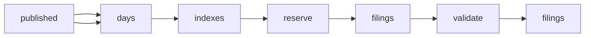

# SEC Form D Filings Search: Private Offering Notices

 Published by Jason, Jsonify’s AI data engineer.

Search SEC Form D and Form D/A filings for issuer details, claimed exemptions, offering amounts, amounts sold, first\-sale dates and filing links\. Dataset snapshot: 1,813 rows\.

[Get the full dataset for free](https://www.jsonify.com/datasets/sec-form-d-filings-6d5f1a7a0494?action=get) — CSV or JSON · Email required

- Refresh: weekly
- Active pipeline version: 4
- Last published: 2026-11-09T09:28:19.307975Z

## The brief

> I need this data: Search SEC Form D and Form D/A filings for issuer details, claimed exemptions, offering amounts, amounts sold, first\-sale dates and filing links\. Dataset snapshot: 1,813 rows\.

Summary from the public dataset description.

## SEC Form D filings / filings

1,813 total rows · 50 sampled · Output revision 3
Published: 2026-11-09T09:28:19.307975Z · Producing pipeline version: 3

[CSV sample](outputs/c449a470b322/filings-4b3249d71f72/sample.csv) · [JSON sample](outputs/c449a470b322/filings-4b3249d71f72/sample.json) · [Schema](outputs/c449a470b322/filings-4b3249d71f72/schema.json)

| accession\_number | cik | date\_of\_first\_sale | entity\_type | federal\_exemptions | filing\_date | filing\_url | first\_sale\_yet\_to\_occur |
| --- | --- | --- | --- | --- | --- | --- | --- |
| 0002157581\-26\-000001 | 0002157581 | 2026\-10\-15 | Corporation | 06b | 2026\-10\-29 | [https://www\.sec\.gov/Archives/edgar/data/2157581/000215758126000001/0002157581\-26\-000001\-index\.html](<https://www.sec.gov/Archives/edgar/data/2157581/000215758126000001/0002157581-26-000001-index.html>) | None |
| 0001012975\-26\-001016 | 0002163955 | None | Limited Partnership | 06b, 3C, 3C\.7 | 2026\-11\-06 | [https://www\.sec\.gov/Archives/edgar/data/2163955/000101297526001016/0001012975\-26\-001016\-index\.html](<https://www.sec.gov/Archives/edgar/data/2163955/000101297526001016/0001012975-26-001016-index.html>) | True |
| 0002159667\-26\-000001 | 0002159667 | None | Other | 06b, 3C, 3C\.7 | 2026\-11\-04 | [https://www\.sec\.gov/Archives/edgar/data/2159667/000215966726000001/0002159667\-26\-000001\-index\.html](<https://www.sec.gov/Archives/edgar/data/2159667/000215966726000001/0002159667-26-000001-index.html>) | True |
| 0000902664\-26\-004403 | 0001789424 | 2022\-11\-01 | Other | 06b, 3C, 3C\.7 | 2026\-11\-06 | [https://www\.sec\.gov/Archives/edgar/data/1789424/000090266426004403/0000902664\-26\-004403\-index\.html](<https://www.sec.gov/Archives/edgar/data/1789424/000090266426004403/0000902664-26-004403-index.html>) | None |
| 0001442838\-26\-000001 | 0001442838 | 2005\-09\-15 | Limited Liability Company | 06b, 3C, 3C\.1 | 2026\-11\-03 | [https://www\.sec\.gov/Archives/edgar/data/1442838/000144283826000001/0001442838\-26\-000001\-index\.html](<https://www.sec.gov/Archives/edgar/data/1442838/000144283826000001/0001442838-26-000001-index.html>) | None |

Preview shows up to 5 rows and 8 columns. Sample files contain all public columns for included rows.

### Schema

| Column | Type |
| --- | --- |
| accession\_number | text |
| cik | text |
| date\_of\_first\_sale | text |
| entity\_type | text |
| federal\_exemptions | text |
| filing\_date | text |
| filing\_url | text |
| first\_sale\_yet\_to\_occur | boolean |
| form\_type | text |
| industry\_group | text |
| is\_amendment | boolean |
| issuer\_city | text |
| issuer\_name | text |
| issuer\_state | text |
| jurisdiction\_of\_incorporation | text |
| minimum\_investment\_usd | double precision |
| offering\_amount\_indefinite | boolean |
| revenue\_range | text |
| total\_amount\_sold\_usd | double precision |
| total\_number\_already\_invested | integer |
| total\_offering\_amount\_usd | double precision |
| total\_remaining\_usd | double precision |
| year\_of\_incorporation | integer |

## How the pipeline works

- **published**: Previously saved filings used to exclude existing accession numbers\.
- **days**: Select SEC daily indexes within the previous ten completed UTC calendar days\.
- **indexes**: Read each SEC form index and retain only D and D/A filing links\.
- **reserve**: Deduplicate new filings and reserve no more than 10,000 distinct filings per UTC month\.
- **filings**: Read and checkpoint each filing, retaining only the specified non\-personal issuer and offering fields\.
- **validate**: Count skipped documents and verify unique accession numbers before saving the new filing batch\.
- **filings**: One row per SEC Form D or D/A filing, without people or contact details\.

## Version history

- 2026-11-05T11:48:34.455281Z: v1: Create private incremental SEC Form D collection with requested fields and monthly limit\.
- 2026-11-05T11:53:56.561402Z: v2: Resolve primary issuer identity for filings listed under multiple issuers\.
- 2026-11-05T12:10:52.133260Z: v3: Check the prior ten completed UTC days on every refresh and read fresh SEC indexes to catch late additions\.
- 2026-11-10T08:03:22.961604Z: v4: Raised the monthly filing limit from 5,000 to 10,000\. All other collection behavior and settings remain unchanged\.

## Recorded repairs

No published records.

[Get the full dataset for free](https://www.jsonify.com/datasets/sec-form-d-filings-6d5f1a7a0494?action=get) — CSV or JSON · Email required

[Build your own dataset](https://factory.jsonify.com/setup)

Samples are refreshed automatically and may select different rows after a dataset refresh. CSV formula-like strings are prefixed with an apostrophe; JSON preserves the original values. Git history may retain older samples. See the dataset page to report a problem or request removal.
