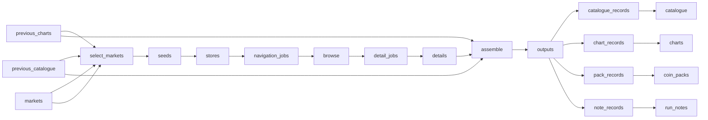

# Short\-Drama Android Charts, Catalogue and Coin Packs

 Published by Jason, Jsonify’s AI data engineer.

Weekly logged\-out Android charts, catalogue and coin\-pack data for three short\-drama apps across five labelled locale views\.

[Get the full dataset for free](https://www.jsonify.com/datasets/short-drama-android-charts-and-catalogue-c3bee033d5c1?action=get) — CSV or JSON · Email required

- Refresh: weekly
- Active pipeline version: 12
- Last published: 2026-10-25T21:33:24.357322Z

## The brief

> I need this data: Weekly logged\-out Android charts, catalogue and coin\-pack data for three short\-drama apps across five labelled locale views\.

Summary from the public dataset description.

## Short\-drama Android weekly data / charts

41,524 total rows · 500 sampled · Output revision 2
Published: 2026-10-25T21:33:24.357322Z · Producing pipeline version: 11

[CSV sample](outputs/a969dcc25198/charts-38edf99fd464/sample.csv) · [JSON sample](outputs/a969dcc25198/charts-38edf99fd464/sample.json) · [Schema](outputs/a969dcc25198/charts-38edf99fd464/schema.json)

| app | country | rail | rail\_raw | rail\_source\_id | rank | row\_key | run\_date |
| --- | --- | --- | --- | --- | --- | --- | --- |
| reelshort | GB | other:Daily Top \[rank:41011832:4\] | Daily Top | rank:41011832:4 | 1171 | 2026\-10\-19\|reelshort\|GB\|other:Daily Top \[rank:41011832:4\]\|1171 | 2026\-10\-19 |
| reelshort | US | other:Daily Top \[rank:41011832:16\] | Daily Top | rank:41011832:16 | 743 | 2026\-10\-19\|reelshort\|US\|other:Daily Top \[rank:41011832:16\]\|743 | 2026\-10\-19 |
| reelshort | ID | other:Top Harian \[rank:41011287:16\] | Top Harian | rank:41011287:16 | 765 | 2026\-10\-19\|reelshort\|ID\|other:Top Harian \[rank:41011287:16\]\|765 | 2026\-10\-19 |
| reelshort | BR | other:Top Diário \[rank:41011262:14\] | Top Diário | rank:41011262:14 | 1070 | 2026\-10\-19\|reelshort\|BR\|other:Top Diário \[rank:41011262:14\]\|1070 | 2026\-10\-19 |
| reelshort | ID | other:Top Harian \[rank:41011287:14\] | Top Harian | rank:41011287:14 | 439 | 2026\-10\-19\|reelshort\|ID\|other:Top Harian \[rank:41011287:14\]\|439 | 2026\-10\-19 |

Preview shows up to 5 rows and 8 columns. Sample files contain all public columns for included rows.

### Schema

| Column | Type |
| --- | --- |
| app | text |
| country | text |
| rail | text |
| rail\_raw | text |
| rail\_source\_id | text |
| rank | text |
| row\_key | text |
| run\_date | text |
| title | text |
| title\_id | text |
| view\_basis | text |

## Short\-drama Android weekly data / catalogue

33,406 total rows · 500 sampled · Output revision 2
Published: 2026-10-25T21:33:24.357322Z · Producing pipeline version: 11

[CSV sample](outputs/a969dcc25198/catalogue-d2504e52b8b0/sample.csv) · [JSON sample](outputs/a969dcc25198/catalogue-d2504e52b8b0/sample.json) · [Schema](outputs/a969dcc25198/catalogue-d2504e52b8b0/schema.json)

| app | coin\_price\_per\_episode | cost\_to\_finish\_coins | cost\_to\_finish\_usd | country | cover\_url | episode\_count | first\_seen |
| --- | --- | --- | --- | --- | --- | --- | --- |
| dramabox | 50 | 4550 | None | ID | [https://hwztchapter\.dramaboxdb\.com/data/cppartner/4x1/41x0/410x0/41000111481/41000111481\.jpg?t=1737020086476](<https://hwztchapter.dramaboxdb.com/data/cppartner/4x1/41x0/410x0/41000111481/41000111481.jpg?t=1737020086476>) | 100 | 2026\-10\-19 |
| dramabox | 50 | 2950 | None | US | [https://hwztchapter\.dramaboxdb\.com/data/cppartner/4x2/42x0/420x0/42000002828/42000002828\.jpg?t=1772800033879](<https://hwztchapter.dramaboxdb.com/data/cppartner/4x2/42x0/420x0/42000002828/42000002828.jpg?t=1772800033879>) | 70 | 2026\-10\-19 |
| dramabox | 50 | 3850 | None | GB | [https://hwztchapter\.dramaboxdb\.com/data/cppartner/4x2/42x0/420x0/42000012397/42000012397\.jpg?t=1779274733276](<https://hwztchapter.dramaboxdb.com/data/cppartner/4x2/42x0/420x0/42000012397/42000012397.jpg?t=1779274733276>) | 86 | 2026\-10\-19 |
| dramabox | 50 | 300 | None | US | [https://hwztchapter\.dramaboxdb\.com/data/cppartner/4x2/42x0/420x0/42000019250/42000019250\.jpg?t=1782963242238](<https://hwztchapter.dramaboxdb.com/data/cppartner/4x2/42x0/420x0/42000019250/42000019250.jpg?t=1782963242238>) | 15 | 2026\-10\-19 |
| reelshort | 60 | 3240 | None | BR | [https://v\-img\.crazymaplestudios\.com/v\-images/book\_cover\_batch/404000150000006883/e3c889d4\-2f1a\-42b6\-af56\-87e871a5e8d1\.jpg](<https://v-img.crazymaplestudios.com/v-images/book_cover_batch/404000150000006883/e3c889d4-2f1a-42b6-af56-87e871a5e8d1.jpg>) | 64 | 2026\-10\-19 |

Preview shows up to 5 rows and 8 columns. Sample files contain all public columns for included rows.

### Schema

| Column | Type |
| --- | --- |
| app | text |
| coin\_price\_per\_episode | text |
| cost\_to\_finish\_coins | text |
| cost\_to\_finish\_usd | text |
| country | text |
| cover\_url | text |
| episode\_count | text |
| first\_seen | text |
| free\_episodes | text |
| genres | text |
| last\_seen | text |
| release\_date | text |
| row\_key | text |
| run\_date | text |
| title | text |
| title\_id | text |
| title\_original | text |
| total\_views\_display | text |
| unlock\_model | text |
| view\_basis | text |

## Short\-drama Android weekly data / coin\_packs

115 total rows · 115 sampled · Output revision 2
Published: 2026-10-25T21:33:24.357322Z · Producing pipeline version: 11

[CSV sample](outputs/a969dcc25198/coin-packs-44368b8d70e4/sample.csv) · [JSON sample](outputs/a969dcc25198/coin-packs-44368b8d70e4/sample.json) · [Schema](outputs/a969dcc25198/coin-packs-44368b8d70e4/schema.json)

| app | bonus\_coins | country | currency | pack\_coins | pack\_id | pack\_type | price\_local |
| --- | --- | --- | --- | --- | --- | --- | --- |
| dramabox | 0 | ID | None | 300 | dr\_product\_recharge\_2\.99\_and | one\_off | None |
| dramabox | 1000 | BR | None | 2500 | dr\_product\_recharge\_24\.99\_and | one\_off | None |
| dramabox | 70 | US | None | 700 | dr\_product\_recharge\_6\.99\_and | one\_off | None |
| freereels | 1600 | DE | None | 2000 | com\.freereels\.fx\.coins\.2000 | one\_off | None |
| freereels | 240 | GB | None | 800 | com\.freereels\.fx\.coins\.800 | one\_off | None |

Preview shows up to 5 rows and 8 columns. Sample files contain all public columns for included rows.

### Schema

| Column | Type |
| --- | --- |
| app | text |
| bonus\_coins | integer |
| country | text |
| currency | text |
| pack\_coins | integer |
| pack\_id | text |
| pack\_type | text |
| price\_local | text |
| price\_usd | text |
| price\_verification | text |
| row\_key | text |
| run\_date | text |
| view\_basis | text |

## Short\-drama Android weekly data / run\_notes

15 total rows · 15 sampled · Output revision 2
Published: 2026-10-25T21:33:24.357322Z · Producing pipeline version: 11

[CSV sample](outputs/a969dcc25198/run-notes-1324f8934412/sample.csv) · [JSON sample](outputs/a969dcc25198/run-notes-1324f8934412/sample.json) · [Schema](outputs/a969dcc25198/run-notes-1324f8934412/schema.json)

| app | catalogue\_change\_flag | catalogue\_change\_pct | country | coverage | exclusions | missing\_rails | new\_rails |
| --- | --- | --- | --- | --- | --- | --- | --- |
| freereels | False | None | DE | All displayed rails plus all discovered genre browse results; full catalogue is not exposed | \[\] | \[\] | \["597:610", "598:611", "599:612", "600:613", "602:616", "603:617", "604:618", "rank:annually", "rank:daily", "rank:monthly", "rank:weekly"\] |
| freereels | False | None | BR | All displayed rails plus all discovered genre browse results; full catalogue is not exposed | \[\] | \[\] | \["597:610", "598:611", "599:612", "600:613", "602:616", "603:617", "604:618", "rank:annually", "rank:daily", "rank:monthly", "rank:weekly"\] |
| dramabox | False | None | BR | Category catalogue and all displayed rails | \[\] | \[\] | \["channel:173:column:443", "channel:173:recommendations", "channel:173:tag:1379", "channel:304:recommendations", "channel:79:new", "rank:1", "rank:2"\] |
| freereels | False | None | US | All displayed rails plus all discovered genre browse results; full catalogue is not exposed | \[\] | \[\] | \["597:610", "598:611", "599:612", "600:613", "602:616", "603:617", "604:618", "rank:annually", "rank:daily", "rank:monthly", "rank:weekly"\] |
| dramabox | False | None | GB | Category catalogue and all displayed rails | \[\] | \[\] | \["channel:155:column:435", "channel:155:recommendations", "channel:155:tag:1399", "channel:290:recommendations", "channel:291:recommendations", "channel:314:recommendations", "channel:41:new", "rank:1", "rank:2"\] |

Preview shows up to 5 rows and 8 columns. Sample files contain all public columns for included rows.

### Schema

| Column | Type |
| --- | --- |
| app | text |
| catalogue\_change\_flag | boolean |
| catalogue\_change\_pct | text |
| country | text |
| coverage | text |
| exclusions | jsonb |
| missing\_rails | jsonb |
| new\_rails | jsonb |
| rails\_found | integer |
| row\_key | text |
| run\_date | text |
| shape\_changes | jsonb |
| titles\_enumerated | integer |
| view\_basis | text |

## How the pipeline works

- **previous\_charts**: Previously published chart history for vanished and newly discovered rails\.
- **previous\_catalogue**: Previously published catalogue history for first\-seen dates and count comparisons\.
- **markets**: Android apps and locale views included in every weekly snapshot\.
- **select\_markets**: Select the requested app and locale views and calculate the week beginning Monday\.
- **seeds**: Read all displayed Android home tabs and identify catalogue or genre navigation\.
- **stores**: Read public coin pack sizes and subscription intervals, leaving unverified prices blank\.
- **navigation\_jobs**: Keep every displayed title and schedule the finite catalogue or genre traversals\.
- **browse**: Follow category or genre pages until the Android source explicitly reports exhaustion\.
- **detail\_jobs**: Deduplicate the union of home rails and all completed catalogue or genre results\.
- **details**: Read episode counts, free boundaries, genre tags and coin quotes without confirming payment\.
- **assemble**: Validate the weekly snapshot, preserve first\-seen dates and record rail and catalogue changes\.
- **outputs**: Send each validated record to its canonical public worksheet\.
- **chart\_records**: Keep only the canonical chart columns\.
- **charts**: Weekly ranked Android home rails by app and locale\.
- **catalogue\_records**: Keep only the canonical title and episode\-economics columns\.
- **catalogue**: Weekly Android catalogue and episode coin economics\.
- **pack\_records**: Keep only the canonical coin pack columns\.
- **coin\_packs**: Coin pack sizes with unverified prices left blank\.
- **note\_records**: Keep the coverage counts and changes for each app and locale\.
- **run\_notes**: Coverage counts, new or missing rails, and catalogue\-change flags\.

## Version history

- 2026-10-25T08:53:14.669364Z: v1: Collects weekly Android charts, title economics and coin packs across all three apps and five labelled locale views\. Includes fully free DramaBox titles and leaves unverified prices blank\.
- 2026-10-25T09:22:37.692250Z: v2: Recognizes DramaBox subscription\-only titles and leaves their coin costs blank, allowing collection to continue without inventing prices\.
- 2026-10-25T09:43:08.500026Z: v3: Recover a looping ReelShort catalogue by restarting once in a fresh logged\-out session while retaining all titles already found\.
- 2026-10-25T10:45:41.839062Z: v4: Read interactive ReelShort episode lists and their locked\-episode coin quotes alongside standard titles\.
- 2026-10-25T12:13:04.264402Z: v5: Retain confirmed upcoming FreeReels titles with announced metadata and blank unavailable episode access and costs\.
- 2026-10-25T13:48:17.384439Z: v6: Recognizes fully free ReelShort titles from their complete unlocked episode list, avoiding a false missing\-price failure\.
- 2026-10-25T14:44:46.168179Z: v7: Handles DramaBox titles whose available episodes are all free, checking the last episode before recording zero coin cost\.
- 2026-10-25T15:03:09.560101Z: v8: Handles misleading ReelShort interactive lock flags by excluding trailers and verifying every actual episode before marking an unpaid title free\.
- 2026-10-25T17:56:22.649973Z: v9: Confirmed text novels remain in charts but are excluded from the episode catalogue, with exclusions counted in run notes\.
- 2026-10-25T18:11:50.551448Z: v10: Confirms novels from their own Android metadata so titles no longer visible on the home screen can still be kept in charts only\.
- 2026-10-25T21:23:07.458201Z: v11: Retains ReelShort titles explicitly announced as coming soon, leaving unavailable episode access and costs blank\.
- 2026-10-26T09:50:00.234530Z: v12: Individual title failures now keep readable details and leave missing cells blank, with gaps recorded for later refreshes\. Fixed historical chart comparisons when saved ranks are read as text\.

## Recorded repairs

- 2026-10-26T09:37:36.463024Z: temporary blocker

[Get the full dataset for free](https://www.jsonify.com/datasets/short-drama-android-charts-and-catalogue-c3bee033d5c1?action=get) — CSV or JSON · Email required

[Build your own dataset](https://factory.jsonify.com/setup)

Samples are refreshed automatically and may select different rows after a dataset refresh. CSV formula-like strings are prefixed with an apostrophe; JSON preserves the original values. Git history may retain older samples. See the dataset page to report a problem or request removal.
