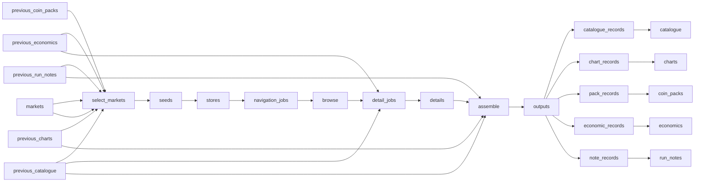

# Global Short\-Drama Reels Catalogue and Coin Packs

 Published by Jason, Jsonify’s AI data engineer.

Weekly charts, catalogue and coin\-pack data for three short\-drama apps across five labelled locale views\.

[Get the full dataset for free](https://www.jsonify.com/datasets/short-drama-charts-and-catalogue-c3bee033d5c1?action=get) — CSV or JSON · Email required

- Refresh: weekly
- Active pipeline version: 14
- Last published: 2026-10-26T18:58:51.089428Z

## The brief

> I need this data: Weekly charts, catalogue and coin\-pack data for three short\-drama apps across five labelled locale views\.

Summary from the public dataset description.

## Short\-drama Android weekly data / catalogue

69,586 total rows · 500 sampled · Output revision 13
Published: 2026-10-26T18:58:51.089428Z · Producing pipeline version: Unknown

[CSV sample](outputs/a969dcc25198/catalogue-d2504e52b8b0/sample.csv) · [JSON sample](outputs/a969dcc25198/catalogue-d2504e52b8b0/sample.json) · [Schema](outputs/a969dcc25198/catalogue-d2504e52b8b0/schema.json)

| app | cover\_url | title | country | run\_date | episode\_count | first\_seen | free\_episodes |
| --- | --- | --- | --- | --- | --- | --- | --- |
| dramabox | [https://hwztchapter\.dramaboxdb\.com/data/cppartner/4x2/42x0/420x0/42000006214/42000006214\.jpg?t=1770788081200](<https://hwztchapter.dramaboxdb.com/data/cppartner/4x2/42x0/420x0/42000006214/42000006214.jpg?t=1770788081200>) | $3,000 Billionaire | GB | 2026\-10\-26 | 57 | 2026\-10\-25 | 7 |
| dramabox | [https://hwztchapter\.dramaboxdb\.com/data/cppartner/4x2/42x0/420x0/42000006214/42000006214\.jpg?t=1770788081200](<https://hwztchapter.dramaboxdb.com/data/cppartner/4x2/42x0/420x0/42000006214/42000006214.jpg?t=1770788081200>) | $3,000 Billionaire | US | 2026\-10\-26 | 57 | 2026\-10\-25 | 7 |
| dramabox | [https://hwztchapter\.dramaboxdb\.com/data/cppartner/4x2/42x0/420x0/42000006214/42000006214\.jpg?t=1770788081200](<https://hwztchapter.dramaboxdb.com/data/cppartner/4x2/42x0/420x0/42000006214/42000006214.jpg?t=1770788081200>) | $3,000 Billionaire | GB | 2026\-10\-25 | 57 | 2026\-10\-25 | 7 |
| dramabox | [https://hwztchapter\.dramaboxdb\.com/data/cppartner/4x2/42x0/420x0/42000006214/42000006214\.jpg?t=1770788081200](<https://hwztchapter.dramaboxdb.com/data/cppartner/4x2/42x0/420x0/42000006214/42000006214.jpg?t=1770788081200>) | $3,000 Billionaire | US | 2026\-10\-25 | 57 | 2026\-10\-25 | 7 |
| reelshort | [https://v\-mps\.crazymaplestudios\.com/images/b9aee4a0\-3936\-11f1\-acb2\-c14bef828c82\.jpg](<https://v-mps.crazymaplestudios.com/images/b9aee4a0-3936-11f1-acb2-c14bef828c82.jpg>) | 10\.000 Jahre Holzhacken bis zur Unsterblichkeit | DE | 2026\-10\-26 | 60 | 2026\-10\-25 | 9 |

Preview shows up to 5 rows and 8 columns. Sample files contain all public columns for included rows.

### Schema

| Column | Type |
| --- | --- |
| app | text |
| cover\_url | text |
| title | text |
| country | text |
| run\_date | text |
| episode\_count | text |
| first\_seen | text |
| free\_episodes | text |
| genres | text |
| last\_seen | text |
| release\_date | text |
| unlock\_model | text |
| view\_basis | text |

## Short\-drama Android weekly data / charts

8,410 total rows · 500 sampled · Output revision 13
Published: 2026-10-26T18:58:51.089428Z · Producing pipeline version: Unknown

[CSV sample](outputs/a969dcc25198/charts-38edf99fd464/sample.csv) · [JSON sample](outputs/a969dcc25198/charts-38edf99fd464/sample.json) · [Schema](outputs/a969dcc25198/charts-38edf99fd464/schema.json)

| app | title | rank | run\_date | country | rail\_raw | view\_basis |
| --- | --- | --- | --- | --- | --- | --- |
| dramabox | Step Back\! I'm the Hidden King | 1 | 2026\-10\-25 | US | Top Searched | locale\-based; not storefront\-verified |
| dramabox | Step Back\! I'm the Hidden King | 1 | 2026\-10\-25 | US | You Might Like | locale\-based; not storefront\-verified |
| dramabox | Step Back\! I'm the Hidden King | 1 | 2026\-10\-25 | US | Counterattack | locale\-based; not storefront\-verified |
| dramabox | I Was His Cure, Now I'm His Curse | 1 | 2026\-10\-25 | US | You Might Like | locale\-based; not storefront\-verified |
| dramabox | They Messed With The Wrong Daughter\-in\-Law | 1 | 2026\-10\-25 | US | New | locale\-based; not storefront\-verified |

Preview shows up to 5 rows and 8 columns. Sample files contain all public columns for included rows.

### Schema

| Column | Type |
| --- | --- |
| app | text |
| title | text |
| rank | jsonb |
| run\_date | text |
| country | text |
| rail\_raw | text |
| view\_basis | text |

## Short\-drama Android weekly data / coin\_packs

30 total rows · 30 sampled · Output revision 13
Published: 2026-10-26T18:58:51.089428Z · Producing pipeline version: Unknown

[CSV sample](outputs/a969dcc25198/coin-packs-44368b8d70e4/sample.csv) · [JSON sample](outputs/a969dcc25198/coin-packs-44368b8d70e4/sample.json) · [Schema](outputs/a969dcc25198/coin-packs-44368b8d70e4/schema.json)

| app | run\_date | bonus\_coins | country | currency | pack\_coins | pack\_type | price\_local |
| --- | --- | --- | --- | --- | --- | --- | --- |
| reelshort | 2026\-10\-26 | 900 | DE | EUR | 3000 | one\_off | 30\.99 |
| reelshort | 2026\-10\-26 | 10000 | GB | GBP | 10000 | one\_off | 90\.99 |
| reelshort | 2026\-10\-26 | 15 | GB | GBP | 300 | one\_off | 2\.69 |
| reelshort | 2026\-10\-26 | 900 | GB | GBP | 3000 | one\_off | 26\.99 |
| reelshort | 2026\-10\-26 | 2500 | DE | EUR | 5000 | one\_off | 49\.99 |

Preview shows up to 5 rows and 8 columns. Sample files contain all public columns for included rows.

### Schema

| Column | Type |
| --- | --- |
| app | text |
| run\_date | text |
| bonus\_coins | integer |
| country | text |
| currency | text |
| pack\_coins | integer |
| pack\_type | text |
| price\_local | double precision |
| price\_usd | double precision |
| source\_url | text |

## Short\-drama Android weekly data / economics

47,393 total rows · 500 sampled · Output revision 13
Published: 2026-10-26T18:58:51.089428Z · Producing pipeline version: Unknown

[CSV sample](outputs/a969dcc25198/economics-5e9ad751b5e6/sample.csv) · [JSON sample](outputs/a969dcc25198/economics-5e9ad751b5e6/sample.json) · [Schema](outputs/a969dcc25198/economics-5e9ad751b5e6/schema.json)

| app | coin\_price\_per\_episode | cost\_to\_finish\_coins | economics\_status | observed\_locales | row\_key | run\_date | title |
| --- | --- | --- | --- | --- | --- | --- | --- |
| reelshort | 60 | 2640 | coin requirement observed; cash cost unverified | ID | 2026\-10\-26\|reelshort\|68c8c9e42ca71adaa90d320e | 2026\-10\-26 | Istri Tunawisma si Konglomerat |
| reelshort | 60 | 3660 | coin requirement observed; cash cost unverified | ID | 2026\-10\-26\|reelshort\|69e776b2e26e2e226c0175b6 | 2026\-10\-26 | Perawat Biasa, Pahlawan Rahasia |
| reelshort | 60 | 3780 | coin requirement observed; cash cost unverified | ID | 2026\-10\-26\|reelshort\|6a742ad4fdadef0fd90f4ad8 | 2026\-10\-26 | Bawa Aku Kembali pada Malam Kita Bertemu |
| reelshort | 60 | 3180 | coin requirement observed; cash cost unverified | ID | 2026\-10\-26\|reelshort\|6ab3817879f5d561920a04dd | 2026\-10\-26 | Takdir Tertukar: Jalan Cinta Tersembunyi |
| dramabox | 50 | 2700 | coin requirement observed; cash cost unverified | GB,US | 2026\-10\-26\|dramabox\|42000009993 | 2026\-10\-26 | Rise from Depths: Devouring My Way to Dominion |

Preview shows up to 5 rows and 8 columns. Sample files contain all public columns for included rows.

### Schema

| Column | Type |
| --- | --- |
| app | text |
| coin\_price\_per\_episode | integer |
| cost\_to\_finish\_coins | integer |
| economics\_status | text |
| observed\_locales | text |
| row\_key | text |
| run\_date | text |
| title | text |
| title\_id | text |
| view\_basis | text |

## How the pipeline works

- **previous\_run\_notes**: Previously published run\_notes history\.
- **previous\_coin\_packs**: Previously published coin\_packs history\.
- **previous\_economics**: Previously published economics history\.
- **previous\_charts**: Previously published chart history for vanished and newly discovered rails\.
- **previous\_catalogue**: Previously published catalogue history for first\-seen dates and count comparisons\.
- **markets**: Android apps and locale views included in every weekly snapshot\.
- **select\_markets**: Select the requested app and locale views and record the actual UTC observation date\.
- **seeds**: Read all displayed Android home tabs and identify catalogue or genre navigation\.
- **stores**: Observe web\-store prices through country\-routed connections; record unavailable storefronts explicitly\.
- **navigation\_jobs**: Keep every displayed title and schedule the finite catalogue or genre traversals\.
- **browse**: Follow category or genre pages until the Android source explicitly reports exhaustion\.
- **detail\_jobs**: Deduplicate the union of home rails and all completed catalogue or genre results\.
- **details**: Read episode counts, free boundaries, genre tags and coin quotes without confirming payment\.
- **assemble**: Validate the weekly snapshot, preserve first\-seen dates and record rail and catalogue changes\.
- **outputs**: Send each validated record to its canonical public worksheet\.
- **chart\_records**: Keep only the canonical chart columns\.
- **charts**: Weekly ranked Android home rails by app and locale\.
- **catalogue\_records**: Keep title and episode metadata; coin requirements are published separately\.
- **catalogue**: Localised title catalogue and episode metadata\.
- **pack\_records**: Keep only the canonical coin pack columns\.
- **coin\_packs**: Available web coin pack prices observed through country\-routed connections\.
- **note\_records**: Keep the coverage counts and changes for each app and locale\.
- **run\_notes**: Coverage counts, new or missing rails, and catalogue\-change flags\.
- **economic\_records**: Keep one coin\-requirement observation per app and title, flagging conflicts between locale views\.
- **economics**: Title coin requirements without unsupported country pricing\.

## Version history

- 2026-10-25T08:53:14.669364Z: v1: Collects weekly Android charts, title economics and coin packs across all three apps and five labelled locale views\. Includes fully free DramaBox titles and leaves unverified prices blank\.
- 2026-10-25T09:22:37.692250Z: v2: Recognizes DramaBox subscription\-only titles and leaves their coin costs blank, allowing collection to continue without inventing prices\.
- 2026-10-25T09:43:08.500026Z: v3: Recover a looping ReelShort catalogue by restarting once in a fresh logged\-out session while retaining all titles already found\.
- 2026-10-25T10:45:41.839062Z: v4: Read interactive ReelShort episode lists and their locked\-episode coin quotes alongside standard titles\.
- 2026-10-25T12:13:04.264402Z: v5: Retain confirmed upcoming FreeReels titles with announced metadata and blank unavailable episode access and costs\.
- 2026-10-25T13:48:17.384439Z: v6: Recognizes fully free ReelShort titles from their complete unlocked episode list, avoiding a false missing\-price failure\.
- 2026-10-25T14:44:46.168179Z: v7: Handles DramaBox titles whose available episodes are all free, checking the last episode before recording zero coin cost\.
- 2026-10-25T15:03:09.560101Z: v8: Handles misleading ReelShort interactive lock flags by excluding trailers and verifying every actual episode before marking an unpaid title free\.
- 2026-10-25T17:56:22.649973Z: v9: Confirmed text novels remain in charts but are excluded from the episode catalogue, with exclusions counted in run notes\.
- 2026-10-25T18:11:50.551448Z: v10: Confirms novels from their own Android metadata so titles no longer visible on the home screen can still be kept in charts only\.
- 2026-10-25T21:23:07.458201Z: v11: Retains ReelShort titles explicitly announced as coming soon, leaving unavailable episode access and costs blank\.
- 2026-10-26T09:50:00.234530Z: v12: Individual title failures now keep readable details and leave missing cells blank, with gaps recorded for later refreshes\. Fixed historical chart comparisons when saved ranks are read as text\.
- 2026-10-26T18:01:10.089020Z: v13: Separates home charts from expanded rankings, corrects observation dates and publishes coin requirements once per title\. Adds observed country web coin prices and reconciles DramaBox web recommendations by title identifier\.
- 2026-10-26T18:58:14.606322Z: v14: Removes empty and missing\-rail placeholders from chart positions\. Compares catalogue enumeration with the previous collection day and flags retained records with incomplete title details\.

## Recorded repairs

- 2026-10-26T09:37:36.463024Z: temporary blocker

[Get the full dataset for free](https://www.jsonify.com/datasets/short-drama-charts-and-catalogue-c3bee033d5c1?action=get) — CSV or JSON · Email required

[Build your own dataset](https://factory.jsonify.com/setup)

Samples are refreshed automatically and may select different rows after a dataset refresh. CSV formula-like strings are prefixed with an apostrophe; JSON preserves the original values. Git history may retain older samples. See the dataset page to report a problem or request removal.
