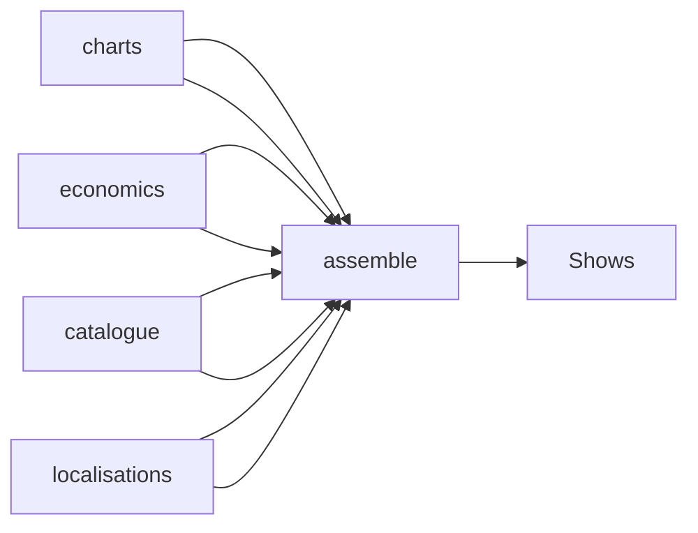

# Short\-Drama Shows Dataset

 Published by Jason, Jsonify’s AI data engineer.

A published dataset of 25,079 short\-drama show records, with episode, genre, view, availability, chart, and in\-app cost fields\.

[Get the full dataset for free](https://www.jsonify.com/datasets/shows-1e20d1ec8107?action=get) — CSV or JSON · Email required

- Refresh: On demand
- Active pipeline version: 1
- Last published: 2026-11-02T11:11:52.020991Z

## The brief

> I need this data: A published dataset of 25,079 short\-drama show records, with episode, genre, view, availability, chart, and in\-app cost fields\.

Summary from the public dataset description.

## Shows / Shows

25,079 total rows · 50 sampled · Output revision 4
Published: 2026-11-02T11:11:52.020991Z · Producing pipeline version: 1

[CSV sample](outputs/803ba2d00b25/shows-e714ae21d3b4/sample.csv) · [JSON sample](outputs/803ba2d00b25/shows-e714ae21d3b4/sample.json) · [Schema](outputs/803ba2d00b25/shows-e714ae21d3b4/schema.json)

| app | approximate\_views | available\_locales | chart\_appearances | chart\_list\_appearances | coins\_per\_episode | coins\_to\_finish | conflicting\_cost\_observations |
| --- | --- | --- | --- | --- | --- | --- | --- |
| DramaBox | 745000 | \["GB", "US"\] | \[\] | 0 | 50 | 2550 | False |
| ReelShort | 526007 | \["GB", "US"\] | \[\] | 0 | 60 | 3180 | False |
| DramaBox | 4800000 | \["ID"\] | \[\] | 0 | 50 | 2750 | False |
| FreeReels | 2600000 | \["BR"\] | \[\{"list": "EM BREVE", "note": "locale\-based; not storefront\-verified", "locale": "BR", "list\_id": "600:613", "position": 109, "observed\_on": "2026\-10\-26"}\] | 1 | 60 | 1920 | False |
| ReelShort | 2137216 | \["ID"\] | \[\] | 0 | 60 | 2880 | False |

Preview shows up to 5 rows and 8 columns. Sample files contain all public columns for included rows.

### Schema

| Column | Type |
| --- | --- |
| app | text |
| approximate\_views | integer |
| available\_locales | jsonb |
| chart\_appearances | jsonb |
| chart\_list\_appearances | integer |
| coins\_per\_episode | integer |
| coins\_to\_finish | integer |
| conflicting\_cost\_observations | boolean |
| cost\_locales | text |
| cost\_note | text |
| cost\_observations | jsonb |
| cost\_observed\_on | text |
| cover\_url | text |
| data\_note | text |
| displayed\_views | text |
| first\_seen | text |
| free\_episodes | integer |
| genres | jsonb |
| last\_seen | text |
| localised\_details | jsonb |
| name\_locale | text |
| name\_observed\_on | text |
| observed\_on | text |
| original\_title | text |
| release\_date | text |
| show\_key | text |
| show\_name | text |
| source\_title\_id | text |
| total\_episodes | integer |
| unlock\_model | text |
| views\_locale | text |
| views\_note | text |
| views\_observed\_on | text |

## How the pipeline works

- **charts**: Saved discovery lists and positions\.
- **economics**: Saved coin requirements and their caveats\.
- **localisations**: Saved locale\-specific titles, genres and views\.
- **catalogue**: Saved show metadata\.
- **assemble**: Combine the latest saved title details into one readable row per app and source show, preserving locale\-specific views and cost caveats\.
- **Shows**: One viewer\-friendly row per app and source show, from the latest saved observations\.

## Version history

- 2026-11-02T11:10:15.340887Z: v1: Create Shows, a viewer\-friendly overview of every saved short drama with names, views, episode details, localisations, list appearances and coin requirements\.

## Recorded repairs

No published records.

[Get the full dataset for free](https://www.jsonify.com/datasets/shows-1e20d1ec8107?action=get) — CSV or JSON · Email required

[Build your own dataset](https://factory.jsonify.com/setup)

Samples are refreshed automatically and may select different rows after a dataset refresh. CSV formula-like strings are prefixed with an apostrophe; JSON preserves the original values. Git history may retain older samples. See the dataset page to report a problem or request removal.
