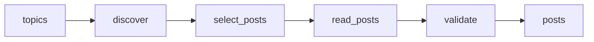

# TikTok, Instagram, and YouTube Shorts Posts with Music Credits

 Published by Jason, Jsonify’s AI data engineer.

A small refreshable dataset of public TikTok and YouTube Shorts posts linked to credited song titles or original\-sound labels, with available media references\.

[Get the full dataset for free](https://www.jsonify.com/datasets/social-posts-and-music-credits-618da9615d86?action=get) — CSV or JSON · Email required

- Refresh: On demand
- Active pipeline version: 2
- Last published: 2026-10-21T14:32:02.901284Z

## The brief

> I need this data: A small refreshable dataset of public TikTok and YouTube Shorts posts linked to credited song titles or original\-sound labels, with available media references\.

Summary from the public dataset description.

## Social posts and music credits / posts

25 total rows · 25 sampled · Output revision 2
Published: 2026-10-21T14:32:02.901284Z · Producing pipeline version: 2

[CSV sample](outputs/6d130e1215b0/posts-a44f1b975171/sample.csv) · [JSON sample](outputs/6d130e1215b0/posts-a44f1b975171/sample.json) · [Schema](outputs/6d130e1215b0/posts-a44f1b975171/schema.json)

| artist | audio\_id | audio\_label | audio\_media\_url | audio\_owner | audio\_page\_url | audio\_status | caption |
| --- | --- | --- | --- | --- | --- | --- | --- |
| Sabrina Carpenter | 358293566706433 | Sabrina Carpenter • Espresso | None | Sabrina Carpenter | [https://www\.instagram\.com/reels/audio/358293566706433/](<https://www.instagram.com/reels/audio/358293566706433/>) | credited\_song | Sabrina Carpenter \- Espresso \#espresso \#sabrinacarpenter \#letrasdecanciones \#lyrics \#ferchismejia |
| Miley Cyrus | 7187816271247853569 | Flowers | [https://sf16\-music\.tiktokcdn\-eu\.com/obj/tos\-alisg\-ve\-2774/oMXWwbf4UIz6uHOBBRcwt6hGxAUysH7Ao1OCQA](<https://sf16-music.tiktokcdn-eu.com/obj/tos-alisg-ve-2774/oMXWwbf4UIz6uHOBBRcwt6hGxAUysH7Ao1OCQA>) | Miley Cyrus | [https://www\.tiktok\.com/music/Flowers\-7187816271247853569](<https://www.tiktok.com/music/Flowers-7187816271247853569>) | credited\_song | I can love me better than you can…\. FLOWERS SINGLE \+ VIDEO OUT NOW\.  |
| Billie Eilish | 1583440292443189 | Billie Eilish • BIRDS OF A FEATHER | None | Billie Eilish | [https://www\.instagram\.com/reels/audio/1583440292443189/](<https://www.instagram.com/reels/audio/1583440292443189/>) | credited\_song | BIRDS OF A FEATHER VIDEO OUT NOWWWWWWW &amp; aidan directed it\!\!😭love you so much twin @aidanzamiri 🦆🐥 |
| Taylor Swift | 7211414788142794754 | Cruel Summer | [https://sf16\-music\.tiktokcdn\-eu\.com/obj/tos\-alisg\-ve\-2774/o4U21zgOfCQJ7hZedDZmTPBG8EBQFtHxb3qYR4](<https://sf16-music.tiktokcdn-eu.com/obj/tos-alisg-ve-2774/o4U21zgOfCQJ7hZedDZmTPBG8EBQFtHxb3qYR4>) | Taylor Swift | [https://www\.tiktok\.com/music/Cruel\-Summer\-7211414788142794754](<https://www.tiktok.com/music/Cruel-Summer-7211414788142794754>) | credited\_song | Summer forecast: Cruel\. 😎 |
| Calvin Harris \(ft\. Ellie Goulding\) | None | Outside · Calvin Harris \(ft\. Ellie Goulding\) | None | Calvin Harris \(ft\. Ellie Goulding\) | None | credited\_song | Calvin Harris ft\. Ellie Goulding \- Outside \#music \#song \#shorts |

Preview shows up to 5 rows and 8 columns. Sample files contain all public columns for included rows.

### Schema

| Column | Type |
| --- | --- |
| artist | text |
| audio\_id | text |
| audio\_label | text |
| audio\_media\_url | text |
| audio\_owner | text |
| audio\_page\_url | text |
| audio\_status | text |
| caption | text |
| collected\_at | text |
| creator | text |
| creator\_name | text |
| discovery\_query | text |
| duration\_seconds | integer |
| evidence\_method | text |
| media\_note | text |
| platform | text |
| post\_id | text |
| post\_media\_url | text |
| post\_url | text |
| published\_at | text |
| song\_title | text |
| thumbnail\_url | text |

## How the pipeline works

- **topics**: Choose the worldwide public\-post searches for each mainstream song across TikTok, YouTube Shorts and Instagram Reels\.
- **discover**: Discover candidate social post links by song and platform; search snippets are never accepted as proof of the music used\.
- **select\_posts**: Deduplicate the bounded candidate pool and interleave platforms and songs so the collection can replace rejected original sounds with other candidates\.
- **read\_posts**: Verify each exact post and read its native song attribution, preserving media links while allowing uncredited candidates to be excluded later\.
- **validate**: Exclude original sounds and unrelated credits, then save the requested number of unique mainstream\-song posts with all three platforms represented\.
- **posts**: Worldwide public social posts with explicit mainstream song credits and available media references\.

## Version history

- 2026-10-21T13:54:08.249064Z: v1: Added a refreshable starter dataset linking TikTok posts and YouTube Shorts to song credits, original sounds and available media links\.
- 2026-10-21T14:19:43.545151Z: v2: Added Instagram and repaired YouTube handling for posts without usable song credits\. The dataset now targets 25 posts using recognizable pop songs and excludes original sounds\.

## Recorded repairs

No published records.

[Get the full dataset for free](https://www.jsonify.com/datasets/social-posts-and-music-credits-618da9615d86?action=get) — CSV or JSON · Email required

[Build your own dataset](https://factory.jsonify.com/setup)

Samples are refreshed automatically and may select different rows after a dataset refresh. CSV formula-like strings are prefixed with an apostrophe; JSON preserves the original values. Git history may retain older samples. See the dataset page to report a problem or request removal.
