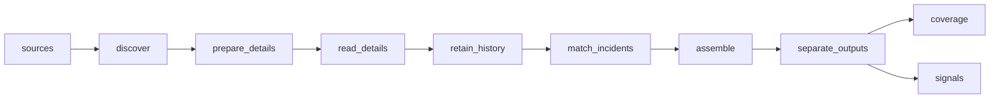

# Spain Public\-Safety Signals

 Published by Jason, Jsonify’s AI data engineer.

Spain public\-safety signals dataset with 3,939 rows across signals and source\-coverage tables\. The signals table contains 3,925 rows; the coverage table contains 14\.

[Get the full dataset for free](https://www.jsonify.com/datasets/spain-public-safety-signals-mentelejos-demo-85c1f9170c06?action=get) — CSV or JSON · Email required

- Refresh: On demand
- Active pipeline version: 2
- Last published: 2026-11-09T11:05:24.629643Z

## The brief

> I need this data: Spain public\-safety signals dataset with 3,939 rows across signals and source\-coverage tables\. The signals table contains 3,925 rows; the coverage table contains 14\.

Summary from the public dataset description.

## Spain public\-safety signals / signals

3,925 total rows · 50 sampled · Output revision 15
Published: 2026-11-09T11:05:24.629643Z · Producing pipeline version: 2

[CSV sample](outputs/15a77f8665eb/signals-c1d2c1df9eab/sample.csv) · [JSON sample](outputs/15a77f8665eb/signals-c1d2c1df9eab/sample.json) · [Schema](outputs/15a77f8665eb/signals-c1d2c1df9eab/schema.json)

| alert\_status | area\_polygons | coordinate\_note | dedupe\_evidence | event\_date | incident\_id | incident\_type | kind |
| --- | --- | --- | --- | --- | --- | --- | --- |
| None | None | Source coordinate; for a road segment this is an endpoint, not the entire affected area\. | Exact source identity; no cross\-source match asserted\. | None | DGT:29822198 | traffic | signal |
| None | None | Source coordinate; for a road segment this is an endpoint, not the entire affected area\. | Exact source identity; no cross\-source match asserted\. | None | DGT:29820375 | traffic | signal |
| None | None | Source coordinate; for a road segment this is an endpoint, not the entire affected area\. | Exact source identity; no cross\-source match asserted\. | None | DGT:29816841 | traffic | signal |
| Actual | \["36\.37,\-5\.58 36\.37,\-5\.45 36\.33,\-5\.… | Warning polygons supplied by source; no single incident point\. | Exact source identity; no cross\-source match asserted\. | None | AEMET:fe8261a2c981c6af2827ba97 | weather alert | signal |
| None | None | Source coordinate; for a road segment this is an endpoint, not the entire affected area\. | Exact source identity; no cross\-source match asserted\. | None | DGT:29857278 | traffic | signal |

Preview shows up to 5 rows and 8 columns. Sample files contain all public columns for included rows.

### Schema

| Column | Type |
| --- | --- |
| alert\_status | text |
| area\_polygons | jsonb |
| coordinate\_note | text |
| dedupe\_evidence | text |
| event\_date | text |
| incident\_id | text |
| incident\_type | text |
| kind | text |
| last\_observed\_at | text |
| latitude | double precision |
| locations | jsonb |
| longitude | double precision |
| message\_type | text |
| municipality | text |
| observed\_at | text |
| province | text |
| publication\_precision | text |
| published\_at | text |
| record\_id | text |
| reports | jsonb |
| severity | text |
| source | text |
| source\_count | integer |
| source\_created\_at | text |
| source\_id | text |
| source\_references | text |
| source\_type | text |
| source\_url | text |
| source\_version | text |
| sources | jsonb |
| summary\_body | text |
| title | text |
| url | text |
| valid\_from | text |
| valid\_to | text |

## Spain public\-safety signals / coverage

14 total rows · 10 sampled · Output revision 15
Published: 2026-11-09T11:05:24.629643Z · Producing pipeline version: 2

[CSV sample](outputs/15a77f8665eb/coverage-c3a3091b9d32/sample.csv) · [JSON sample](outputs/15a77f8665eb/coverage-c3a3091b9d32/sample.json) · [Schema](outputs/15a77f8665eb/coverage-c3a3091b9d32/schema.json)

| checked\_at | coverage\_note | current\_signals | detail\_failure\_count | detail\_failures | duplicate\_links | excluded\_count | failure |
| --- | --- | --- | --- | --- | --- | --- | --- |
| 2026\-11\-09T11:00:49\.306177\+00:00 | Official Ministry releases include Policía Nacional and civil\-protection notices; selective published coverage\. | 0 | 0 | \[\] | None | 10 | None |
| 2026\-11\-09T11:00:49\.017139\+00:00 | Public communications only\. CAT112 open data aggregates monthly counts and is not a live incident feed\. | 0 | 0 | \[\] | None | 0 | None |
| 2026\-11\-09T11:00:50\.922147\+00:00 | Public communications only\. No open incident stream verified; institutional SMS/email and private emergency tracking are excluded\. | 0 | 0 | \[\] | None | 0 | No dated article links discovered on this public index\. This is not proof that no incidents occurred\. |
| 2026\-11\-09T11:00:49\.304542\+00:00 | Recent public notices from the press index\. | 0 | 0 | \[\] | None | 5 | None |
| 2026\-11\-09T11:00:48\.293925\+00:00 | Current warnings and forecast horizon; removed warnings before first collection cannot be replayed\. | 224 | 0 | \[\] | None | 0 | None |

Preview shows up to 5 rows and 8 columns. Sample files contain all public columns for included rows.

### Schema

| Column | Type |
| --- | --- |
| checked\_at | text |
| coverage\_note | text |
| current\_signals | integer |
| detail\_failure\_count | integer |
| detail\_failures | jsonb |
| duplicate\_links | integer |
| excluded\_count | integer |
| failure | text |
| history\_start | text |
| kind | text |
| observed\_count | integer |
| oldest\_listing\_at | text |
| retained\_signals | integer |
| source | text |
| source\_type | text |
| source\_url | text |
| status | text |

## How the pipeline works

- **sources**: Select the official Spanish safety feeds and regional news indexes, and set the recent\-history window\.
- **discover**: Read each source independently and preserve its status, history limits and discovered public records\.
- **prepare\_details**: Carry source coverage forward and deduplicate exact article URLs before reading their details\.
- **read\_details**: Read CAP warning details and article bodies, retaining only recent source\-backed public\-safety signals\.
- **retain\_history**: Retain the recent observed history, group corroborated reports of the same incident, and report coverage and failures for every source\.
- **match\_incidents**: Compare candidate reports across official and news sources, requiring specific corroborating incident facts before grouping\.
- **assemble**: Publish one row per corroborated incident with every original report retained, plus source coverage and failures\.
- **separate\_outputs**: Separate verified incident rows from source coverage and failure notes\.
- **signals**: sink
- **coverage**: sink

## Version history

- 2026-11-07T19:36:03.093726Z: v1: Adds a Spain public\-safety feed with recent official and regional news reports, corroborated incident grouping and source coverage notes\.
- 2026-11-08T08:04:42.798968Z: v2: Fixed updates failing as recent observation history grows\. Existing observations are retained without reducing the history window or source coverage\.

## Recorded repairs

- 2026-11-08T08:02:37.015939Z: no change
- 2026-11-08T08:04:53.855133Z: repaired

[Get the full dataset for free](https://www.jsonify.com/datasets/spain-public-safety-signals-mentelejos-demo-85c1f9170c06?action=get) — CSV or JSON · Email required

[Build your own dataset](https://factory.jsonify.com/setup)

Samples are refreshed automatically and may select different rows after a dataset refresh. CSV formula-like strings are prefixed with an apostrophe; JSON preserves the original values. Git history may retain older samples. See the dataset page to report a problem or request removal.
