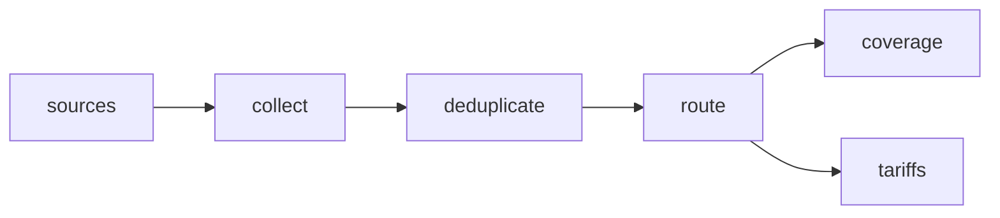

# Spanish Residential Electricity and Gas Tariffs

 Published by Jason, Jsonify’s AI data engineer.

Spanish residential electricity and gas tariff sample with published prices, fees, contract terms and source links\.

[Get the full dataset for free](https://www.jsonify.com/datasets/spanish-residential-tariffs-851b0827e2d1?action=get) — CSV or JSON · Email required

- Refresh: On demand
- Active pipeline version: 1
- Last published: 2026-11-11T20:42:25.162441Z

## The brief

> I need this data: Spanish residential electricity and gas tariff sample with published prices, fees, contract terms and source links\.

Summary from the public dataset description.

## Spanish residential tariff sample / tariffs

61 total rows · 10 sampled · Output revision 1
Published: 2026-11-11T20:42:25.162441Z · Producing pipeline version: 1

[CSV sample](outputs/7f69123647d7/tariffs-3057902be319/sample.csv) · [JSON sample](outputs/7f69123647d7/tariffs-3057902be319/sample.json) · [Schema](outputs/7f69123647d7/tariffs-3057902be319/schema.json)

| energy\_eur\_kwh | energy\_p1\_eur\_kwh | energy\_p2\_eur\_kwh | energy\_p3\_eur\_kwh | index\_formula | monthly\_fee\_eur | monthly\_fee\_taxes\_included | permanence\_contract |
| --- | --- | --- | --- | --- | --- | --- | --- |
| 0\.1199 | None | None | None | None | 4 | True | Sin permanencia\. |
| 0\.105 | None | None | None | None | 6\.41791667 | False | Sin permanencia; precios fijos durante 12 meses |
| 0\.114 | None | None | None | None | 22\.28 | False | Sin permanencia\. |
| None | None | None | None | Precio variable sujeto a la evolución del mercado mayorista; cambia cada mes según la fórmula indexada descrita en las condiciones generales de contratación, más un margen de comercialización de 0\.007 €/kWh\. | 21\.32 | False | None |
| 0\.12999 | None | None | None | None | None | None | Sin permanencia\. |

Preview shows up to 5 rows and 8 columns. Sample files contain all public columns for included rows.

### Schema

| Column | Type |
| --- | --- |
| energy\_eur\_kwh | double precision |
| energy\_p1\_eur\_kwh | double precision |
| energy\_p2\_eur\_kwh | double precision |
| energy\_p3\_eur\_kwh | double precision |
| index\_formula | text |
| monthly\_fee\_eur | double precision |
| monthly\_fee\_taxes\_included | boolean |
| permanence\_contract | text |
| plan\_id | text |
| plan\_name | text |
| power\_p1 | double precision |
| power\_p2 | double precision |
| power\_unit | text |
| price\_evidence | text |
| price\_notes | text |
| price\_type | text |
| product\_type | text |
| promo\_discount | text |
| provider | text |
| scraped\_at | text |
| source\_url | text |
| taxes\_included | boolean |
| telecom\_monthly\_price\_eur | text |
| telecom\_speed\_data | text |
| valid\_from | text |

## Spanish residential tariff sample / coverage

42 total rows · 10 sampled · Output revision 1
Published: 2026-11-11T20:42:25.162441Z · Producing pipeline version: 1

[CSV sample](outputs/7f69123647d7/coverage-c3a3091b9d32/sample.csv) · [JSON sample](outputs/7f69123647d7/coverage-c3a3091b9d32/sample.json) · [Schema](outputs/7f69123647d7/coverage-c3a3091b9d32/schema.json)

| detail | plans\_dropped | plans\_kept | provider | scraped\_at | source\_url | status |
| --- | --- | --- | --- | --- | --- | --- |
| Complete core\-price offers retained; personalised quotes, historical averages and unreadable prices excluded\. | 0 | 2 | Iberdrola | 2026\-11\-11T20:41:15\.682131\+00:00 | [https://www\.iberdrola\.es/luz/tarifas/plan\-online\-tres\-periodos](<https://www.iberdrola.es/luz/tarifas/plan-online-tres-periodos>) | collected |
| Complete core\-price offers retained; personalised quotes, historical averages and unreadable prices excluded\. | 0 | 0 | Podo | 2026\-11\-11T20:42:00\.539587\+00:00 | [https://www\.mipodo\.com/tarifas\-luz/mercado](<https://www.mipodo.com/tarifas-luz/mercado>) | no\_readable\_core\_price |
| Complete core\-price offers retained; personalised quotes, historical averages and unreadable prices excluded\. | 0 | 2 | Pepeenergy | 2026\-11\-11T20:41:10\.280209\+00:00 | [https://www\.pepeenergy\.com/tarifas\-luz/tarifa\-estable\-luz](<https://www.pepeenergy.com/tarifas-luz/tarifa-estable-luz>) | collected |
| Complete core\-price offers retained; personalised quotes, historical averages and unreadable prices excluded\. | 0 | 0 | Repsol | 2026\-11\-11T20:40:58\.192366\+00:00 | [https://www\.repsol\.es/particulares/hogar/luz\-y\-gas/tarifas/tarifa\-sin\-horarios/](<https://www.repsol.es/particulares/hogar/luz-y-gas/tarifas/tarifa-sin-horarios/>) | no\_readable\_core\_price |
| Complete core\-price offers retained; personalised quotes, historical averages and unreadable prices excluded\. | 0 | 1 | Endesa | 2026\-11\-11T20:41:04\.145480\+00:00 | [https://www\.endesa\.com/es/luz\-y\-gas/luz/conecta\-de\-endesa](<https://www.endesa.com/es/luz-y-gas/luz/conecta-de-endesa>) | collected |

Preview shows up to 5 rows and 8 columns. Sample files contain all public columns for included rows.

### Schema

| Column | Type |
| --- | --- |
| detail | text |
| plans\_dropped | integer |
| plans\_kept | integer |
| provider | text |
| scraped\_at | text |
| source\_url | text |
| status | text |

## How the pipeline works

- **sources**: Select public Spanish residential electricity and gas offer pages for the one\-off sample\.
- **collect**: Read public tariff prices and terms, excluding inaccessible or incomplete offers without interacting with verification challenges\.
- **deduplicate**: Keep one record per named tariff variant and preserve a page\-by\-page coverage report\.
- **route**: Separate usable tariff rows from source coverage and exclusion notes\.
- **tariffs**: sink
- **coverage**: sink

## Version history

- 2026-11-11T20:40:40.087756Z: v1: Builds a private one\-off Spanish electricity and gas tariff sample with source links, price terms and a separate page coverage report\.

## Recorded repairs

No published records.

[Get the full dataset for free](https://www.jsonify.com/datasets/spanish-residential-tariffs-851b0827e2d1?action=get) — CSV or JSON · Email required

[Build your own dataset](https://factory.jsonify.com/setup)

Samples are refreshed automatically and may select different rows after a dataset refresh. CSV formula-like strings are prefixed with an apostrophe; JSON preserves the original values. Git history may retain older samples. See the dataset page to report a problem or request removal.
