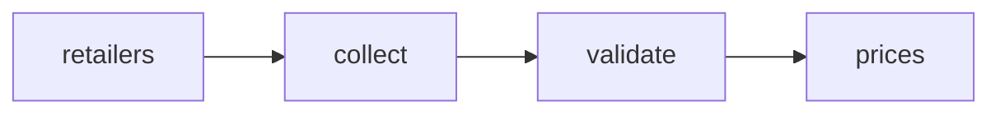

# Srixon Golf Ball Prices in France

 Published by Jason, Jsonify’s AI data engineer.

French VAT\-inclusive listed prices for Srixon golf balls from Espace Golf, Boulevard du Golf and Golf Plus\. The published table contains 83 offer rows\.

[Get the full dataset for free](https://www.jsonify.com/datasets/srixon-golf-ball-prices-france-780021c9d370?action=get) — CSV or JSON · Email required

- Refresh: weekly
- Active pipeline version: 1
- Last published: 2026-11-02T09:55:20.949843Z

## The brief

> I need this data: French VAT\-inclusive listed prices for Srixon golf balls from Espace Golf, Boulevard du Golf and Golf Plus\. The published table contains 83 offer rows\.

Summary from the public dataset description.

## Srixon golf ball prices France / prices

83 total rows · 10 sampled · Output revision 1
Published: 2026-11-02T09:55:20.949843Z · Producing pipeline version: 1

[CSV sample](outputs/9d859528de23/prices-fe81f9390ffe/sample.csv) · [JSON sample](outputs/9d859528de23/prices-fe81f9390ffe/sample.json) · [Schema](outputs/9d859528de23/prices-fe81f9390ffe/schema.json)

| source | url | item | variant\_qty | price | currency | fetched\_at\_utc | notes |
| --- | --- | --- | --- | --- | --- | --- | --- |
| Boulevard du Golf | [https://boulevard\-du\-golf\.fr/10352307\-balles\-de\-golf\-femme\-dunlop\-srx\-soft\-feel\-x12\-soft\-white\-tu](<https://boulevard-du-golf.fr/10352307-balles-de-golf-femme-dunlop-srx-soft-feel-x12-soft-white-tu>) | Balles de golf femme Dunlop SRX Soft Feel \(x12\) | 12 | 29 | EUR | 2026\-11\-02T09:54:41\.072275Z | Prix TTC France; connexion française; frais de livraison non inclus; Indicateur de stock du catalogue: oui; Variante couleur: soft\-white; Offre affichée sur le site: 2 boîtes achetées, la 3e offerte avec code 2=3; non appliquée au prix unitaire |
| Boulevard du Golf | [https://boulevard\-du\-golf\.fr/10298077\-balles\-de\-golf\-srixon\-tour\-special\-sf\-e4\-x15\-blanc\-tu](<https://boulevard-du-golf.fr/10298077-balles-de-golf-srixon-tour-special-sf-e4-x15-blanc-tu>) | Balles de golf Srixon Tour Special SF E4 \(x15\) | 15 | 22 | EUR | 2026\-11\-02T09:54:41\.072275Z | Prix TTC France; connexion française; frais de livraison non inclus; Indicateur de stock du catalogue: oui; Variante couleur: blanc; Offre affichée sur le site: 2 boîtes achetées, la 3e offerte avec code 2=3; non appliquée au prix unitaire |
| Espace Golf | [https://espace\-golf\.fr/10369854\-balles\-de\-golf\-srixon\-q\-star\-tour\-divide\-6\-x12\-yellow\-orange\-tu](<https://espace-golf.fr/10369854-balles-de-golf-srixon-q-star-tour-divide-6-x12-yellow-orange-tu>) | Balles de golf Srixon Q\-star Tour Divide 6 \(x12\) | 12 | 42 | EUR | 2026\-11\-02T09:54:41\.072161Z | Prix TTC France; connexion française; frais de livraison non inclus; Indicateur de stock du catalogue: oui; Variante couleur: yellow\-orange; Offre affichée sur le site: 2 boîtes achetées, la 3e offerte avec code 2=3; non appliquée au prix unitaire |
| Golf Plus | [https://golfplus\.fr/balles\-q\-star\-tour\-divide\-p26090\.html](<https://golfplus.fr/balles-q-star-tour-divide-p26090.html>) | BALLES Q\-STAR TOUR DIVIDE | 12 | 29\.4 | EUR | 2026\-11\-02T09:54:41\.072326Z | Prix TTC France; pays FR et affichage taxes incluses vérifiés; frais de livraison non inclus; Quantité de 12 balles inférée du coffret standard Srixon; non explicitée dans la fiche Golf Plus; Prix précédent/barré ou catalogue: 42\.00 EUR; 30%; Expédié à partir du 02/11/2026; Disponible en retrait magasin |
| Boulevard du Golf | [https://boulevard\-du\-golf\.fr/10372755\-balles\-de\-golf\-srixon\-q\-star\-ultispeed\-trackline\-x12\-blanc\-tu](<https://boulevard-du-golf.fr/10372755-balles-de-golf-srixon-q-star-ultispeed-trackline-x12-blanc-tu>) | Balles de golf Srixon Q\-star Ultispeed Trackline \(x12\) | 12 | 31\.3 | EUR | 2026\-11\-02T09:54:41\.072275Z | Prix TTC France; connexion française; frais de livraison non inclus; Prix précédent/barré: 35\.00 EUR; remise: 10\.57%; Indicateur de stock du catalogue: non; Variante couleur: blanc; Offre affichée sur le site: 2 boîtes achetées, la 3e offerte avec code 2=3; non appliquée au prix unitaire |

Preview shows up to 5 rows and 8 columns. Sample files contain all public columns for included rows.

### Schema

| Column | Type |
| --- | --- |
| source | text |
| url | text |
| item | text |
| variant\_qty | integer |
| price | double precision |
| currency | text |
| fetched\_at\_utc | text |
| notes | text |

## How the pipeline works

- **retailers**: Select the three requested French retailers and their Srixon brand or golf\-ball listings\.
- **collect**: Read each complete Srixon listing through a French connection, keeping golf balls and validating the French tax setting on Golf Plus\.
- **validate**: Check unique retailer offers, positive pack quantities, euro prices, and coverage of all three retailers before saving the current snapshot\.
- **prices**: Current French VAT\-inclusive Srixon golf ball offers from the three retailers\.

## Version history

- 2026-11-02T09:53:39.592589Z: v1: Adds French VAT\-inclusive Srixon golf ball prices from all three retailers, including colour variants and multipacks\.

## Recorded repairs

No published records.

[Get the full dataset for free](https://www.jsonify.com/datasets/srixon-golf-ball-prices-france-780021c9d370?action=get) — CSV or JSON · Email required

[Build your own dataset](https://factory.jsonify.com/setup)

Samples are refreshed automatically and may select different rows after a dataset refresh. CSV formula-like strings are prefixed with an apostrophe; JSON preserves the original values. Git history may retain older samples. See the dataset page to report a problem or request removal.
