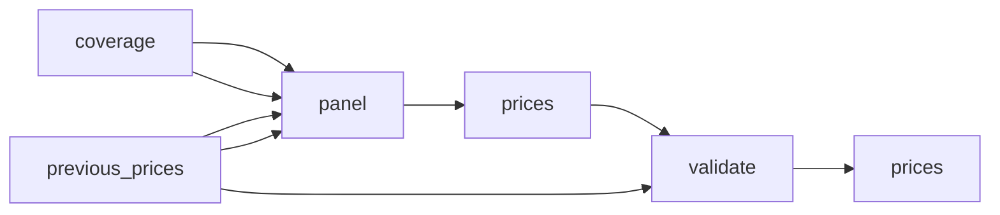

# Streaming Subscription Prices by Country: Official Monthly Plans

 Published by Jason, Jsonify’s AI data engineer.

Explore source\-supported monthly plan prices for eleven streaming services across a selected country panel, with country verification and unresolved coverage clearly distinguished\.

[Get the full dataset for free](https://www.jsonify.com/datasets/streaming-subscription-prices-by-country-5b733a529030?action=get) — CSV or JSON · Email required

- Refresh: weekly
- Active pipeline version: 11
- Last published: 2026-10-23T19:07:16.411187Z

## The brief

> I need this data: Explore source\-supported monthly plan prices for eleven streaming services across a selected country panel, with country verification and unresolved coverage clearly distinguished\.

Summary from the public dataset description.

## Streaming subscription prices / prices

6,862 total rows · 100 sampled · Output revision 10
Published: 2026-10-23T19:07:16.411187Z · Producing pipeline version: 11

[CSV sample](outputs/eb6e054729e9/prices-fe81f9390ffe/sample.csv) · [JSON sample](outputs/eb6e054729e9/prices-fe81f9390ffe/sample.json) · [Schema](outputs/eb6e054729e9/prices-fe81f9390ffe/schema.json)

| ad\_evidence | ad\_tier | billing\_period | country | country\_evidence | country\_name | currency | features |
| --- | --- | --- | --- | --- | --- | --- | --- |
| None | unknown | None | JM | None | Jamaica | None | None |
| None | unknown | None | VA | None | Vatican City | None | None |
| None | unknown | None | PG | None | Papua New Guinea | None | None |
| None | unknown | None | ES | None | Spain | None | None |
| No ads | ad\_free | month | BS | Requested country route BS; official page locale en\. Source pricing market is not independently confirmed\. | Bahamas | BSD | Complete access to Crunchyroll's library; new episodes shortly after airing in Japan; stream on 1 device at a time; offline viewing; 7\-day free trial for eligible subscribers, then automatically renew |

Preview shows up to 5 rows and 8 columns. Sample files contain all public columns for included rows.

### Schema

| Column | Type |
| --- | --- |
| ad\_evidence | text |
| ad\_tier | text |
| billing\_period | text |
| country | text |
| country\_evidence | text |
| country\_name | text |
| currency | text |
| features | text |
| kind | text |
| monthly\_price | double precision |
| notes | text |
| observed\_at | text |
| plan | text |
| price\_evidence | text |
| service | text |
| sold\_via | text |
| source\_url | text |
| status | text |
| type | text |
| user\_evidence | jsonb |

## How the pipeline works

- **previous\_prices**: Saved price snapshot used only when preserve\_previous is enabled; unchanged observations keep their original timestamps\.
- **coverage**: Supplied country, service and distributor targets with original checked\-price and redirect evidence\.
- **panel**: Combine every supplied service and distributor target with the existing major\-service country panel, preserving the original checking notes\.
- **prices**: Find official pricing pages, request the selected country, and collect only source\-supported monthly plans\. Keep unresolved coverage explicit\.
- **validate**: Deduplicate service/country/plan observations and reject a run that found no verified monthly prices\.
- **prices**: Current official country/plan monthly prices, plus explicit unresolved coverage records\.

## Version history

- 2026-10-17T11:25:22.016336Z: v1: Collect current streaming plan prices with source\-country checks, excluding historical launch announcements and retaining ad\-supported variants\.
- 2026-10-17T11:54:32.865851Z: v2: Fix Apple TV country attribution and use the UK pricing page for UK subscriptions\. Reject bare country\-picker labels as proof that prices belong to a market\.
- 2026-10-17T16:40:22.779178Z: v3: Correct UK and New Zealand Apple pricing, preserve the country panel during targeted refreshes, and reject weak or falsely matched country evidence\.
- 2026-10-17T16:48:28.801836Z: v4: Use Brazil's current Prime membership offer instead of obsolete corporate copy, and Sweden's own Apple TV pricing page\. Preserve the rest of the saved country panel during targeted corrections\.
- 2026-10-17T16:54:18.087813Z: v5: Use current Prime subscription pages in the US, UK and India, and stop treating currency\-only Netflix headings as verified country evidence\.
- 2026-10-17T17:10:21.818626Z: v6: Reject mismatched Max country routes and promotional terms as regular pricing sources\. Revalidate saved country\-specific URL claims and refresh Finnish Max from its subscription page\.
- 2026-10-17T17:20:25.785824Z: v7: Respect country restrictions on subscription benefits and stop treating bare country labels as verified pricing evidence\. Refresh affected Apple observations while preserving the rest of the country panel\.
- 2026-10-22T16:13:52.075007Z: v8: Expanded coverage to the supplied countries, services and distributor channels\. Ad\-supported and ad\-free plans now have separate rows, with original checking notes preserved alongside current observations\.
- 2026-10-22T17:41:14.745186Z: v9: Fix handling of long official\-site search results so they do not stop the streaming price refresh\.
- 2026-10-22T17:49:43.489269Z: v10: Fix official\-site search parsing and strengthen rejection of coupon and review sites\.
- 2026-10-23T12:18:56.452520Z: v11: Corrects Netflix country verification, adds Paramount\+ plan and ad tiers, fills supported ad labels, prioritizes standalone Prime Video offers, and excludes Qatar’s iCloud\+ bundle from Apple TV prices\.

## Recorded repairs

No published records.

[Get the full dataset for free](https://www.jsonify.com/datasets/streaming-subscription-prices-by-country-5b733a529030?action=get) — CSV or JSON · Email required

[Build your own dataset](https://factory.jsonify.com/setup)

Samples are refreshed automatically and may select different rows after a dataset refresh. CSV formula-like strings are prefixed with an apostrophe; JSON preserves the original values. Git history may retain older samples. See the dataset page to report a problem or request removal.
