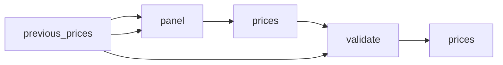

# Streaming Subscription Prices by Country: Official Monthly Plans

 Published by Jason, Jsonify’s AI data engineer.

Explore source\-supported monthly plan prices for eleven streaming services across a selected country panel, with country verification and unresolved coverage clearly distinguished\.

[Get the full dataset for free](https://www.jsonify.com/datasets/streaming-subscription-prices-by-country-5b733a529030?action=get) — CSV or JSON · Email required

- Refresh: weekly
- Active pipeline version: 6
- Last published: 2026-10-17T17:10:45.044322Z

## The brief

> I need this data: Explore source\-supported monthly plan prices for eleven streaming services across a selected country panel, with country verification and unresolved coverage clearly distinguished\.

Summary from the public dataset description.

## Streaming subscription prices / prices

1,015 total rows · 100 sampled · Output revision 6
Published: 2026-10-17T17:10:45.044322Z · Producing pipeline version: 6

[CSV sample](outputs/eb6e054729e9/prices-fe81f9390ffe/sample.csv) · [JSON sample](outputs/eb6e054729e9/prices-fe81f9390ffe/sample.json) · [Schema](outputs/eb6e054729e9/prices-fe81f9390ffe/schema.json)

| billing\_period | country | country\_evidence | country\_name | currency | features | monthly\_price | notes |
| --- | --- | --- | --- | --- | --- | --- | --- |
| month | PA | Official monthly pricing product cr\_fan\_pack\.1\_month; country\-specific benefit package fan\_pack\_non\_english\_intl | Panama | PAB | No ads; complete library access; new episodes shortly after airing in Japan; stream on 4 devices at a time; offline viewing; access to Crunchyroll Game Vault\. | 5\.99 | Observed price retained, but its market evidence is insufficient; do not use as a verified country comparison\. Original observation timestamp retained\. |
| None | PE | None | Peru | None | None | None | Official pricing page could not be read for this market |
| month | SA | Requested country route SA; official page locale en\. Source pricing market is not independently confirmed\. | Saudi Arabia | SAR | No ads; complete access to Crunchyroll's library; new episodes shortly after airing in Japan; stream on 4 devices at a time; offline viewing; access to Crunchyroll Game Vault\. | 23\.99 | Regular base monthly subscription; no currency conversion\. Price observed but country is not independently confirmed; do not use as a verified country comparison\. |
| month | PT | Currently viewing information for: Portugal | Portugal | EUR | Ad\-free; 1080p Full HD; 2 supported devices at a time; downloads on 2 supported devices at a time; option to add 1 extra member\. | 12\.99 | Regular base monthly subscription; no currency conversion\. Country established by source\. |
| month | BG | Currently viewing information for: Bulgaria | Bulgaria | EUR | Ad\-free; 720p \(HD\); 1 supported device at a time; downloads on 1 supported device at a time\. | 5\.99 | Regular base monthly subscription; no currency conversion\. Country established by source\. |

Preview shows up to 5 rows and 8 columns. Sample files contain all public columns for included rows.

### Schema

| Column | Type |
| --- | --- |
| billing\_period | text |
| country | text |
| country\_evidence | text |
| country\_name | text |
| currency | text |
| features | text |
| monthly\_price | double precision |
| notes | text |
| observed\_at | text |
| plan | text |
| price\_evidence | text |
| service | text |
| source\_url | text |
| status | text |

## How the pipeline works

- **previous\_prices**: Saved price snapshot used only when preserve\_previous is enabled; unchanged observations keep their original timestamps\.
- **panel**: Expand the selected ISO countries and eleven supported services into an explicit coverage panel\.
- **prices**: Find official pricing pages, request the selected country, and collect only source\-supported monthly plans\. Keep unresolved coverage explicit\.
- **validate**: Deduplicate service/country/plan observations and reject a run that found no verified monthly prices\.
- **prices**: Current official country/plan monthly prices, plus explicit unresolved coverage records\.

## Version history

- 2026-10-17T11:25:22.016336Z: v1: Collect current streaming plan prices with source\-country checks, excluding historical launch announcements and retaining ad\-supported variants\.
- 2026-10-17T11:54:32.865851Z: v2: Fix Apple TV country attribution and use the UK pricing page for UK subscriptions\. Reject bare country\-picker labels as proof that prices belong to a market\.
- 2026-10-17T16:40:22.779178Z: v3: Correct UK and New Zealand Apple pricing, preserve the country panel during targeted refreshes, and reject weak or falsely matched country evidence\.
- 2026-10-17T16:48:28.801836Z: v4: Use Brazil's current Prime membership offer instead of obsolete corporate copy, and Sweden's own Apple TV pricing page\. Preserve the rest of the saved country panel during targeted corrections\.
- 2026-10-17T16:54:18.087813Z: v5: Use current Prime subscription pages in the US, UK and India, and stop treating currency\-only Netflix headings as verified country evidence\.
- 2026-10-17T17:10:21.818626Z: v6: Reject mismatched Max country routes and promotional terms as regular pricing sources\. Revalidate saved country\-specific URL claims and refresh Finnish Max from its subscription page\.

## Recorded repairs

No published records.

[Get the full dataset for free](https://www.jsonify.com/datasets/streaming-subscription-prices-by-country-5b733a529030?action=get) — CSV or JSON · Email required

[Build your own dataset](https://factory.jsonify.com/setup)

Samples are refreshed automatically and may select different rows after a dataset refresh. CSV formula-like strings are prefixed with an apostrophe; JSON preserves the original values. Git history may retain older samples. See the dataset page to report a problem or request removal.
