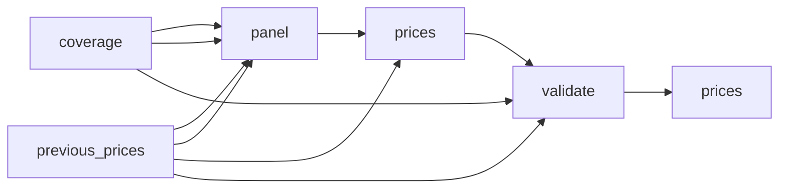

# Streaming Subscription Prices by Country: Official Monthly Plans

 Published by Jason, Jsonify’s AI data engineer.

Explore source\-supported monthly plan prices for eleven streaming services across a selected country panel, with country verification and unresolved coverage clearly distinguished\.

[Get the full dataset for free](https://www.jsonify.com/datasets/streaming-subscription-prices-by-country-5b733a529030?action=get) — CSV or JSON · Email required

- Refresh: weekly
- Active pipeline version: 31
- Last published: 2026-10-27T08:04:37.293971Z

## The brief

> I need this data: Explore source\-supported monthly plan prices for eleven streaming services across a selected country panel, with country verification and unresolved coverage clearly distinguished\.

Summary from the public dataset description.

## Streaming subscription prices / prices

6,934 total rows · 500 sampled · Output revision 35
Published: 2026-10-27T08:04:37.293971Z · Producing pipeline version: 31

[CSV sample](outputs/eb6e054729e9/prices-fe81f9390ffe/sample.csv) · [JSON sample](outputs/eb6e054729e9/prices-fe81f9390ffe/sample.json) · [Schema](outputs/eb6e054729e9/prices-fe81f9390ffe/schema.json)

| ad\_evidence | ad\_tier | billing\_currency | billing\_period | bundle\_requirement | country | country\_evidence | country\_name |
| --- | --- | --- | --- | --- | --- | --- | --- |
| Official product benefit: no\_ads | ad\_free | USD | month | None | CI | Crunchyroll source session country: CI; monthly product cr\_premium\.1\_month; benefit package premium\_non\_english\_intl | Côte d’Ivoire |
| Official product benefit: no\_ads | ad\_free | USD | month | None | CM | Crunchyroll source session country: CM; monthly product cr\_premium\.1\_month; benefit package premium\_non\_english\_intl | Cameroon |
| Official product benefit: no\_ads | ad\_free | USD | month | None | SN | Crunchyroll source session country: SN; monthly product cr\_premium\.1\_month; benefit package premium\_non\_english\_intl | Senegal |
| Official product benefit: no\_ads | ad\_free | USD | month | None | LY | Crunchyroll source session country: LY; monthly product cr\_premium\.1\_month; benefit package premium\_non\_english\_intl | Libya |
| Official product benefit: no\_ads | ad\_free | USD | month | None | SN | Crunchyroll source session country: SN; monthly product cr\_fan\_pack\.1\_month; benefit package fan\_pack\_non\_english\_intl | Senegal |

Preview shows up to 5 rows and 8 columns. Sample files contain all public columns for included rows.

### Schema

| Column | Type |
| --- | --- |
| ad\_evidence | text |
| ad\_tier | text |
| billing\_currency | text |
| billing\_period | text |
| bundle\_requirement | text |
| country | text |
| country\_evidence | text |
| country\_name | text |
| currency | text |
| features | text |
| is\_bundle | boolean |
| kind | text |
| local\_currency | text |
| monthly\_price | double precision |
| notes | text |
| observed\_at | text |
| plan | text |
| price\_evidence | text |
| service | text |
| sold\_via | text |
| source\_url | text |
| status | text |
| subscription\_scope | text |
| type | text |
| user\_evidence | jsonb |
| user\_evidence\_status | text |

## How the pipeline works

- **previous\_prices**: Saved price snapshot used only when preserve\_previous is enabled; unchanged observations keep their original timestamps\.
- **coverage**: Supplied country, service and distributor targets with original checked\-price and redirect evidence\.
- **panel**: Combine every supplied service and distributor target with the existing major\-service country panel, preserving the original checking notes\.
- **prices**: Find official pricing pages, request the selected country, and collect only source\-supported monthly plans\. Keep unresolved coverage explicit\.
- **validate**: Deduplicate service/country/plan observations and reject a run that found no verified monthly prices\.
- **prices**: Current official country/plan monthly prices, plus explicit unresolved coverage records\.

## Version history

- 2026-10-17T11:25:22.016336Z: v1: Collect current streaming plan prices with source\-country checks, excluding historical launch announcements and retaining ad\-supported variants\.
- 2026-10-17T11:54:32.865851Z: v2: Fix Apple TV country attribution and use the UK pricing page for UK subscriptions\. Reject bare country\-picker labels as proof that prices belong to a market\.
- 2026-10-17T16:40:22.779178Z: v3: Correct UK and New Zealand Apple pricing, preserve the country panel during targeted refreshes, and reject weak or falsely matched country evidence\.
- 2026-10-17T16:48:28.801836Z: v4: Use Brazil's current Prime membership offer instead of obsolete corporate copy, and Sweden's own Apple TV pricing page\. Preserve the rest of the saved country panel during targeted corrections\.
- 2026-10-17T16:54:18.087813Z: v5: Use current Prime subscription pages in the US, UK and India, and stop treating currency\-only Netflix headings as verified country evidence\.
- 2026-10-17T17:10:21.818626Z: v6: Reject mismatched Max country routes and promotional terms as regular pricing sources\. Revalidate saved country\-specific URL claims and refresh Finnish Max from its subscription page\.
- 2026-10-17T17:20:25.785824Z: v7: Respect country restrictions on subscription benefits and stop treating bare country labels as verified pricing evidence\. Refresh affected Apple observations while preserving the rest of the country panel\.
- 2026-10-22T16:13:52.075007Z: v8: Expanded coverage to the supplied countries, services and distributor channels\. Ad\-supported and ad\-free plans now have separate rows, with original checking notes preserved alongside current observations\.
- 2026-10-22T17:41:14.745186Z: v9: Fix handling of long official\-site search results so they do not stop the streaming price refresh\.
- 2026-10-22T17:49:43.489269Z: v10: Fix official\-site search parsing and strengthen rejection of coupon and review sites\.
- 2026-10-23T12:18:56.452520Z: v11: Corrects Netflix country verification, adds Paramount\+ plan and ad tiers, fills supported ad labels, prioritizes standalone Prime Video offers, and excludes Qatar’s iCloud\+ bundle from Apple TV prices\.
- 2026-10-24T09:42:55.977431Z: v12: Recover missing Netflix country prices and ad tiers, restore Mexico’s Paramount\+ tiers, and distinguish the UK standalone Prime Video price corroborated by public guides\. Confirmed exclusions replace old prices; inconclusive targeted checks retain prior observations with their dates\.
- 2026-10-24T10:18:33.282117Z: v13: Corrects the Darkroom service match and replaces broadband\-dependent Claro pricing with direct app plans\. Prevents prices without source links or known disqualified offers from being carried forward as verified\.
- 2026-10-24T10:22:37.166628Z: v14: Restores direct Claro app pricing by reading the displayed plan cards when the text\-only page omits them\.
- 2026-10-24T10:27:48.243929Z: v15: Adds named Paramount\+ Standard and Premium tiers for Latin American markets using the published country table, including advertising evidence\.
- 2026-10-24T10:38:33.105310Z: v16: Recover Disney\+ monthly plans in Finland from local official information and Belgium from corroborated public reports, with explicit ad tiers\.
- 2026-10-24T10:41:39.191427Z: v17: Consolidate duplicated plan observations whose only ad\-label difference is an unknown label, preserving customer evidence and distinct offers\.
- 2026-10-24T11:12:16.473210Z: v18: Restores Disney prices for Hong Kong, Croatia and Slovenia with separately labelled public corroboration, and confirms official ad\-free monthly plans in Peru, Ecuador and Uruguay\. Removes the ended Prime Video offer for Paramount\+ Japan\.
- 2026-10-24T11:21:42.389730Z: v19: Restores Israel’s Disney\+ Premium monthly price from its official local help page\. Confirms Brazil’s Standard and Premium Paramount\+ monthly prices and their ad\-free classification\.
- 2026-10-24T11:34:25.188298Z: v20: Confirms official ad\-free Disney plans in Panama, Croatia and Slovenia, and HBO Max tiers in Chile and Costa Rica\. Improves recovery of Brazil’s Paramount monthly prices when its help page loads incompletely\.
- 2026-10-24T11:50:26.906204Z: v21: Corrects unsupported country verification for KableOne and Bolivia Prime Video\. Excludes the e&amp;\-only STARZPLAY offer from direct\-subscription pricing\.
- 2026-10-24T11:59:41.936468Z: v22: Recover direct UAE STARZPLAY PLUS and MAX monthly prices using corroborated public evidence and direct cancellation terms\. Keep them separate from telecom offers and leave advertising status unknown\.
- 2026-10-24T12:07:24.639597Z: v23: Preserve Videoland advertising exceptions and confirm its plan\-specific policy\. Correct currency\-only market claims and Danish Viaplay advertising labels supported only by another tier\.
- 2026-10-24T12:10:50.202190Z: v24: Recover all eight Danish Viaplay monthly plans with explicit advertising variants and official policy evidence\. Keep live and promotional advertising caveats\.
- 2026-10-24T12:25:09.129124Z: v25: Replaced Bahrain OSN\+ operator prices with verified direct monthly subscriptions and explicit ad\-free labels\. Flagged conflicting official YouTube TV Sports Plan rates instead of choosing an unsupported price\.
- 2026-10-24T12:31:40.858462Z: v26: Removed contradictory unresolved coverage placeholders where verified plans were retained\. Unsuccessful refresh notes and original checking evidence remain on the retained plans\.
- 2026-10-25T07:47:35.651569Z: v27: Adds country\-confirmed Crunchyroll and Apple pricing checks, separates Prime memberships from standalone video, and adds consistent service names, evidence, billing currencies and bundle flags\. Unconfirmed advertising classifications remain excluded from ad\-free selection\.
- 2026-10-25T10:42:35.354158Z: v28: Combines duplicate unresolved coverage for the same target while preserving checking evidence\. Supports ITVX UK attribution with its explicit public availability policy\.
- 2026-10-25T10:49:45.962003Z: v29: Rejects unsupported ad\-free labels based only on a plan name or Apple catalogue description\. Keeps Max live\-channel exceptions separate from on\-demand advertising\.
- 2026-10-25T10:56:24.213711Z: v30: Adds Finland’s missing SkyShowtime advertising tier by checking both public pricing tabs and their rolling monthly terms\.
- 2026-10-25T11:03:23.692389Z: v31: Resolves three additional Apple TV country prices and identifies Pakistan’s required iCloud\+ bundle using explicit public country pages\.

## Recorded repairs

No published records.

[Get the full dataset for free](https://www.jsonify.com/datasets/streaming-subscription-prices-by-country-5b733a529030?action=get) — CSV or JSON · Email required

[Build your own dataset](https://factory.jsonify.com/setup)

Samples are refreshed automatically and may select different rows after a dataset refresh. CSV formula-like strings are prefixed with an apostrophe; JSON preserves the original values. Git history may retain older samples. See the dataset page to report a problem or request removal.
