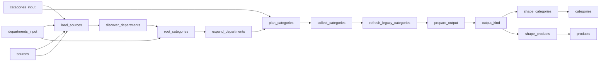

# Supermarket Products in France

 Published by Jason, Jsonify’s AI data engineer.

Supermarket products in France, with selected Paris store prices and availability where supported\.

[Get the full dataset for free](https://www.jsonify.com/datasets/supermarket-products-in-france-6bb96540e5f9?action=get) — CSV or JSON · Email required

- Refresh: weekly
- Active pipeline version: 39
- Last published: 2026-11-02T03:11:45.443522Z

## The brief

> I need this data: Supermarket products in France, with selected Paris store prices and availability where supported\.

Summary from the public dataset description.

## Supermarket Products in France / products

168,261 total rows · 50 sampled · Output revision 3
Published: 2026-11-02T03:11:45.443522Z · Producing pipeline version: 38

[CSV sample](outputs/5bba15b41143/products-0a3e27b8ca81/sample.csv) · [JSON sample](outputs/5bba15b41143/products-0a3e27b8ca81/sample.json) · [Schema](outputs/5bba15b41143/products-0a3e27b8ca81/schema.json)

| availability | brand | category | category\_url | currency | image\_url | location\_scope | observed\_at |
| --- | --- | --- | --- | --- | --- | --- | --- |
| True | ZEW FOR MEN | Colliers | [https://www\.carrefour\.fr/r/animalerie/chiens/colliers\-laisses\-vetements/colliers](<https://www.carrefour.fr/r/animalerie/chiens/colliers-laisses-vetements/colliers>) | EUR | [https://media\.carrefour\.fr/medias/a7ef307c03c04b2ca2bf724f4f62cc72/p\_540x540/9a4f291d15574223ab3131c357b4b6d4\_image\.jpg](<https://media.carrefour.fr/medias/a7ef307c03c04b2ca2bf724f4f62cc72/p_540x540/9a4f291d15574223ab3131c357b4b6d4_image.jpg>) | national\_marketplace | 2026\-11\-01T19:12:40\.198991\+00:00 |
| True | CARREFOUR | Lingettes | [https://www\.carrefour\.fr/r/bebe/change\-soins/lingettes](<https://www.carrefour.fr/r/bebe/change-soins/lingettes>) | EUR | [https://media\.carrefour\.fr/media/referential/media/0618613ca56043329795415523c335bd/p\_540x540/3560071140663\_1\.jpg](<https://media.carrefour.fr/media/referential/media/0618613ca56043329795415523c335bd/p_540x540/3560071140663_1.jpg>) | fixed\_store | 2026\-11\-01T15:52:59\.671399\+00:00 |
| True | CARREFOUR CLASSIC' | Lardons | [https://www\.carrefour\.fr/r/charcuterie\-traiteur/charcuterie/lardons\-des/lardons](<https://www.carrefour.fr/r/charcuterie-traiteur/charcuterie/lardons-des/lardons>) | EUR | [https://media\.carrefour\.fr/medias/45ff1e8076223c1d955b1bfc6a50cd1b/p\_540x540/3560071263812\-0\.jpg](<https://media.carrefour.fr/medias/45ff1e8076223c1d955b1bfc6a50cd1b/p_540x540/3560071263812-0.jpg>) | fixed\_store | 2026\-11\-01T15:23:15\.351401\+00:00 |
| True | NIVEA | Hygiène &amp; Beauté | [https://courses\.monoprix\.fr/categories/hygi%C3%A8ne\-beaut%C3%A9/728041ac\-b078\-4108\-bb22\-3637e8a6194e](<https://courses.monoprix.fr/categories/hygi%C3%A8ne-beaut%C3%A9/728041ac-b078-4108-bb22-3637e8a6194e>) | EUR | [https://courses\.monoprix\.fr/images\-v3/0c44253f\-c4a3\-4340\-9d37\-d41e42b9d14a/7081ad99\-33d2\-4a96\-85c5\-3e5be4b189e1/300x300\.jpg](<https://courses.monoprix.fr/images-v3/0c44253f-c4a3-4340-9d37-d41e42b9d14a/7081ad99-33d2-4a96-85c5-3e5be4b189e1/300x300.jpg>) | national\_online | 2026\-11\-01T22:16:15\.852962\+00:00 |
| True | FLEXI | Laisses | [https://www\.carrefour\.fr/r/animalerie/chiens/colliers\-laisses\-vetements/laisses](<https://www.carrefour.fr/r/animalerie/chiens/colliers-laisses-vetements/laisses>) | EUR | [https://media\.carrefour\.fr/medias/c310441cc56635d7b00c3b5c662eba95/p\_540x540/32c45592134a4de8bc6795095d811330\-image\.jpg](<https://media.carrefour.fr/medias/c310441cc56635d7b00c3b5c662eba95/p_540x540/32c45592134a4de8bc6795095d811330-image.jpg>) | national\_marketplace | 2026\-11\-01T19:27:51\.762423\+00:00 |

Preview shows up to 5 rows and 8 columns. Sample files contain all public columns for included rows.

### Schema

| Column | Type |
| --- | --- |
| availability | boolean |
| brand | text |
| category | text |
| category\_url | text |
| currency | text |
| image\_url | text |
| location\_scope | text |
| observed\_at | text |
| pack\_size | text |
| price | double precision |
| price\_per\_unit | double precision |
| product\_id | text |
| product\_name | text |
| product\_url | text |
| promotion | text |
| retailer | text |
| source\_brand | text |
| source\_name | text |
| store\_address | text |
| store\_id | text |
| store\_name | text |
| unit\_price\_label | text |

## Supermarket Products in France / categories

2,689 total rows · 50 sampled · Output revision 3
Published: 2026-11-02T03:11:45.443522Z · Producing pipeline version: 38

[CSV sample](outputs/5bba15b41143/categories-a6216ea03e57/sample.csv) · [JSON sample](outputs/5bba15b41143/categories-a6216ea03e57/sample.json) · [Schema](outputs/5bba15b41143/categories-a6216ea03e57/schema.json)

| category | category\_url | complete | completed\_at | notes | pages | products | reported\_total |
| --- | --- | --- | --- | --- | --- | --- | --- |
| Légumes cuisinés et plats végétariens | [https://www\.coursesu\.com/c/charcuterie\-traiteur/plats\-cuisines\-et\-snacking/legumes\-cuisines\-et\-plats\-vegetariens](<https://www.coursesu.com/c/charcuterie-traiteur/plats-cuisines-et-snacking/legumes-cuisines-et-plats-vegetariens>) | True | 2026\-11\-02T00:05:37\.646373\+00:00 |  | 1 | 11 | None |
| Abris | [https://www\.carrefour\.fr/r/animalerie/rongeurs/cages\-accessoires/abris](<https://www.carrefour.fr/r/animalerie/rongeurs/cages-accessoires/abris>) | False | 2026\-11\-02T03:10:38\.343128\+00:00 | Specialist animal housing and structures, baby toys, furniture, kitchen appliances, clothing or travel equipment are outside the requested groceries and everyday household scope\. No source completeness claim\. | 0 | 0 | None |
| Fromages blancs allégés et 0% | [https://www\.carrefour\.fr/r/cremerie/yaourts\-fromages\-blancs/fromages\-blancs\-faisselles/fromages\-blancs\-alleges](<https://www.carrefour.fr/r/cremerie/yaourts-fromages-blancs/fromages-blancs-faisselles/fromages-blancs-alleges>) | True | 2026\-11\-01T14:56:40\.821498\+00:00 | final\-page metadata currentPage==totalPage \(1\) with null next link after 15 exact Carrefour API entities The supplied Carrefour category URL redirected to the current first\-party product leaf [https://www\.carrefour\.fr/r/cremerie/yaourts\-fromages\-blancs/fromages\-blancs\-faisselles/fromages\-blancs\-alleges](<https://www.carrefour.fr/r/cremerie/yaourts-fromages-blancs/fromages-blancs-faisselles/fromages-blancs-alleges>)\. The exact Paris Auteuil cart remained stable before and after sequential first\-party JSON catalogue pagination; sponsored DOM placements were not counted as additional products\. | 1 | 15 | 15 |
| Pains et pains de mie | [https://www\.coursesu\.com/c/pains\-viennoiseries\-et\-patisseries/le\-bio/pains\-et\-pains\-de\-mie](<https://www.coursesu.com/c/pains-viennoiseries-et-patisseries/le-bio/pains-et-pains-de-mie>) | True | 2026\-11\-02T00:28:51\.261049\+00:00 |  | 1 | 5 | None |
| Champagnes | [https://www\.coursesu\.com/c/bieres\-vins\-alcools/champagnes\-et\-effervescents/champagnes](<https://www.coursesu.com/c/bieres-vins-alcools/champagnes-et-effervescents/champagnes>) | True | 2026\-11\-02T00:32:19\.022633\+00:00 |  | 2 | 30 | None |

Preview shows up to 5 rows and 8 columns. Sample files contain all public columns for included rows.

### Schema

| Column | Type |
| --- | --- |
| category | text |
| category\_url | text |
| complete | boolean |
| completed\_at | text |
| notes | text |
| pages | integer |
| products | integer |
| reported\_total | integer |
| source\_name | text |
| started\_at | text |
| store\_name | text |
| terminal | text |

## How the pipeline works

- **categories\_input**: Optional saved category inventory for a targeted or resumed catalogue refresh\. Leave empty to discover every configured retailer category\.
- **departments\_input**: Optional saved department inventory for resuming category discovery\.
- **sources**: French retailer storefronts and selected Paris contexts\.
- **load\_sources**: Load the selected French retailer storefronts and Paris store contexts\.
- **discover\_departments**: Read the current grocery and everyday household departments from each French retailer\.
- **root\_categories**: Split retailer navigation into independent category discovery tasks\.
- **expand\_departments**: Resolve department landing pages to their live product\-list categories\.
- **plan\_categories**: Create a reusable inventory of all discovered retailer product categories\.
- **collect\_categories**: Traverse complete category catalogues and retain source\-backed product offers with their store context\.
- **refresh\_legacy\_categories**: Recheck older category observations when their parser evidence requires refresh, saving each completed category independently\.
- **prepare\_output**: Deduplicate offers within each retailer context and retain category completion evidence\.
- **output\_kind**: Separate current product offers from category coverage evidence\.
- **shape\_products**: Publish the current retailer product catalogue with prices, links and Paris context\.
- **products**: sink
- **shape\_categories**: Publish category traversal counts and source completion evidence\.
- **categories**: sink

## Version history

- 2026-11-01T13:14:37.191882Z: v1: Adds nine French supermarket catalogues with Paris store context\. Intermarché products are retained with explicit category coverage warnings when source totals cannot be reconciled\.
- 2026-11-01T13:41:31.510877Z: v2: Fixes Carrefour category links shared across departments so catalogue discovery can continue\.
- 2026-11-01T13:49:51.410991Z: v3: Fixes Carrefour categories that appear twice in its menu by matching the category identity on the page\. Collection can retain those categories and continue from saved progress\.
- 2026-11-01T14:16:46.066570Z: v4: Fixed Carrefour food listings that use a product identifier instead of a barcode\. Categories whose counts change during collection are retried before accepting their results\.
- 2026-11-01T14:31:08.312292Z: v5: Fixed Carrefour store selection when a hidden Drive button appears on the page\. Temporary store\-selection timeouts now use the existing retry process\.
- 2026-11-01T15:02:01.320561Z: v6: Added recovery when a Carrefour browsing session loses its response, restarting the affected category with the correct Paris store selected\.
- 2026-11-01T15:20:34.693957Z: v7: Fixed missing Carrefour products caused by repeated listings between pages\. A verified price\-order fallback now recovers the complete category\.
- 2026-11-01T15:42:06.360451Z: v8: Corrected Carrefour’s baby\-category scope to exclude toys, furniture, clothing and travel equipment while retaining everyday baby\-care products\.
- 2026-11-01T15:58:49.461544Z: v9: Completed the supermarket\-only filter for baby feeding furniture and kitchen appliances, while retaining baby food and everyday feeding accessories\.
- 2026-11-01T16:07:33.983796Z: v10: Separate Carrefour delivery\-only household offers from Paris store offers, preserving products without attributing national prices to a local store\.
- 2026-11-01T17:58:39.055021Z: v11: Recover transient Carrefour catalogue request rejections through the existing bounded fresh\-store retry\.
- 2026-11-01T19:26:32.134147Z: v12: Carrefour categories now retain every returned product when the displayed total is too low, with the discrepancy recorded in coverage notes\. Missing products and conflicting listings still stop the update\.
- 2026-11-01T20:07:27.884878Z: v13: E\.Leclerc department counts now account for products listed in multiple subcategories\. When counts differ, every subcategory is checked before the collection can continue\.
- 2026-11-01T20:13:26.625337Z: v14: E\.Leclerc subcategory collection now keeps the verified Convention store selection instead of repeating it for each page\. Temporary navigation failures get a bounded fresh\-session recovery attempt\.
- 2026-11-01T21:06:13.794864Z: v15: E\.Leclerc offer changes are now checked with one fresh category reading\. Collection continues only when the current prices and product identities agree\.
- 2026-11-01T21:46:05.329026Z: v16: Recovers Intermarché catalogue access after temporary failures and handles its updated cookie\-consent control\.
- 2026-11-01T21:52:10.081113Z: v17: Recovers temporary Intermarché page failures without immediately restarting the whole category, and spaces out page requests\.
- 2026-11-01T22:09:27.554268Z: v18: Fixes Monoprix and Courses U request sessions and handles identical sponsored Monoprix products without counting them twice\.
- 2026-11-01T22:14:09.966838Z: v19: Restarts Monoprix pagination safely when switching to a fresh browser visit\.
- 2026-11-01T22:20:45.606323Z: v20: Retries Auchan collection with a fresh verified Tolbiac visit when the selected\-store confirmation is missing\.
- 2026-11-01T22:34:44.294379Z: v21: Fixes Auchan shelf prices where conditional multi\-buy savings appear before the actual price, and refreshes affected older results\.
- 2026-11-01T22:42:56.509813Z: v22: Uses Auchan’s labelled pickup price instead of signed promotional savings, and safely restarts categories whose totals change during collection\.
- 2026-11-01T22:48:35.526601Z: v23: Auchan can now recover when its store\-selection form stalls, while still checking the exact Paris pickup store before saving prices\.
- 2026-11-01T23:05:54.816940Z: v24: Auchan categories with inconsistent displayed totals are now verified through two complete matching reads, with the discrepancy recorded alongside the products\.
- 2026-11-01T23:11:32.853614Z: v25: Auchan offer verification now ignores changing review\-count badges while continuing to check product details and prices\.
- 2026-11-01T23:40:18.729405Z: v26: Auchan collection now follows category pages that open subcategories and correctly recognizes explicitly empty store categories\.
- 2026-11-01T23:54:12.954952Z: v27: Auchan’s off\-season wine\-fair page is recorded as closed while the regular wine range continues to be collected\.
- 2026-11-02T00:00:00.684250Z: v28: Courses U categories explicitly unavailable at the selected store now produce clear coverage notes instead of stopping the collection\.
- 2026-11-02T00:10:36.905196Z: v29: Courses U image\-only campaign advertisements no longer become nameless products\. Actual product cards remain eligible, with names recovered from matching structured card data where needed\.
- 2026-11-02T00:24:55.560106Z: v30: Courses U editorial links no longer become duplicate product offers\. Previously collected categories with suspect URL identities are rechecked before publication\.
- 2026-11-02T00:38:42.468149Z: v31: Courses U recommendation carousels no longer duplicate the same products collected from category pages\.
- 2026-11-02T00:52:33.676814Z: v32: Houra categories whose totals change mid\-collection now get one fresh complete pass, which must still reconcile fully\.
- 2026-11-02T01:08:54.305579Z: v33: Houra can recover once from an identical offer repeating during pagination, without relaxing product or coverage checks\.
- 2026-11-02T01:17:29.269472Z: v34: Mon Marché recipe content is recognized separately from supermarket products and recorded in category coverage\.
- 2026-11-02T01:40:16.376775Z: v35: H2O now follows its visible links to more products, collecting the full category instead of stopping after the first page\.
- 2026-11-02T01:57:52.427429Z: v36: Final category rechecks now save progress individually\. Temporary Courses U store\-opening refusals receive two bounded retries before failing\.
- 2026-11-02T02:12:48.235626Z: v37: Courses U per\-piece unit prices no longer obscure shelf prices\. Older affected categories are rechecked before the next publication\.
- 2026-11-02T02:40:46.247437Z: v38: Removes specialist animal structures outside the requested supermarket ranges and fills source\-backed Auchan unit prices and Mon Marché pack sizes and unit prices\.
- 2026-11-02T03:17:16.433568Z: v39: Rechecks Auchan category shortfalls and only marks categories complete when collected products reconcile with their displayed totals\.

## Recorded repairs

- 2026-11-02T03:32:29.338093Z: no change
- 2026-11-02T03:39:06.490363Z: temporary blocker

[Get the full dataset for free](https://www.jsonify.com/datasets/supermarket-products-in-france-6bb96540e5f9?action=get) — CSV or JSON · Email required

[Build your own dataset](https://factory.jsonify.com/setup)

Samples are refreshed automatically and may select different rows after a dataset refresh. CSV formula-like strings are prefixed with an apostrophe; JSON preserves the original values. Git history may retain older samples. See the dataset page to report a problem or request removal.
