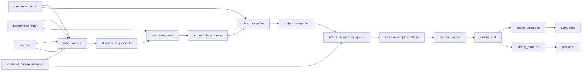

# Paris Supermarket Prices and Product Catalogue

 Published by Jason, Jsonify’s AI data engineer.

Paris supermarket product listings and prices from Carrefour, E\.Leclerc, Auchan, Intermarché, Super U, Monoprix and other retailers\.

[Get the full dataset for free](https://www.jsonify.com/datasets/supermarket-products-in-paris-6bb96540e5f9?action=get) — CSV or JSON · Email required

- Refresh: On demand
- Active pipeline version: 56
- Last published: 2026-11-02T14:53:40.285101Z

## The brief

> I need this data: Paris supermarket product listings and prices from Carrefour, E\.Leclerc, Auchan, Intermarché, Super U, Monoprix and other retailers\.

Summary from the public dataset description.

## Supermarket Products in France / products

169,176 total rows · 50 sampled · Output revision 5
Published: 2026-11-02T14:53:40.285101Z · Producing pipeline version: 46

[CSV sample](outputs/5bba15b41143/products-0a3e27b8ca81/sample.csv) · [JSON sample](outputs/5bba15b41143/products-0a3e27b8ca81/sample.json) · [Schema](outputs/5bba15b41143/products-0a3e27b8ca81/schema.json)

Curated sample from revision 5; saved 2026-11-03T15:32:15.558580Z. This illustrative snapshot does not refresh with the dataset.

| image\_url | product\_name | brand | price | currency | price\_per\_unit | unit\_price\_label | product\_url |
| --- | --- | --- | --- | --- | --- | --- | --- |
| [https://static\.coursesu\.com/dw/image/v2/BBQX\_PRD/on/demandware\.static/\-/Sites\-digitalu\-master\-catalog/default/dw371e58a6/5010034016071\_H1N1\_7249740\_S10\.png?sw=172&amp;sh=172&amp;sm=fit](<https://static.coursesu.com/dw/image/v2/BBQX_PRD/on/demandware.static/-/Sites-digitalu-master-catalog/default/dw371e58a6/5010034016071_H1N1_7249740_S10.png?sw=172&amp;sh=172&amp;sm=fit>) | Riz cuisiné à la Mexicaine express 2min BEN'S ORIGINAL \- Sachet micro\-ondable 220g | BEN'S ORIGINAL | 2\.04 | EUR | 9\.28 | 9,28 €/kg | [https://www\.coursesu\.com/p/riz\-cuisine\-a\-la\-mexicaine\-express\-2min\-bens\-original\-\-\-sachet\-micro\-ondable\-220g/7249740\.html](<https://www.coursesu.com/p/riz-cuisine-a-la-mexicaine-express-2min-bens-original---sachet-micro-ondable-220g/7249740.html>) |
| None | Bjorg Jus de carottes bio sans sucre ajouté, Lot de 2x75cl | Bjorg | 7\.78 | EUR | 5\.19 | None | [https://www\.houra\.fr/bjorg\-jus\-de\-carottes\-bio\-sans\-sucre\-ajoute\-lot\-de\-2x75cl/1452018/](<https://www.houra.fr/bjorg-jus-de-carottes-bio-sans-sucre-ajoute-lot-de-2x75cl/1452018/>) |
| [https://static\.coursesu\.com/dw/image/v2/BBQX\_PRD/on/demandware\.static/\-/Sites\-digitalu\-master\-catalog/default/dw27bad7dd/5056772300447\_A1N1\_6498615\_S13\.png?sw=172&amp;sh=172&amp;sm=fit](<https://static.coursesu.com/dw/image/v2/BBQX_PRD/on/demandware.static/-/Sites-digitalu-master-catalog/default/dw27bad7dd/5056772300447_A1N1_6498615_S13.png?sw=172&amp;sh=172&amp;sm=fit>) | Whisky Clan Campbell 40° 1L | CAMPBELL | 22\.63 | EUR | 22\.63 | 22,63 €/l | [https://www\.coursesu\.com/p/whisky\-clan\-campbell\-40\-1l/6498615\.html](<https://www.coursesu.com/p/whisky-clan-campbell-40-1l/6498615.html>) |
| [https://static\.coursesu\.com/dw/image/v2/BBQX\_PRD/on/demandware\.static/\-/Sites\-digitalu\-master\-catalog/default/dwd7692f3a/3083680613583\_H1C1\_4666038\_S10\.png?sw=172&amp;sh=172&amp;sm=fit](<https://static.coursesu.com/dw/image/v2/BBQX_PRD/on/demandware.static/-/Sites-digitalu-master-catalog/default/dwd7692f3a/3083680613583_H1C1_4666038_S10.png?sw=172&amp;sh=172&amp;sm=fit>) | Haricots blancs cuisinés CASSEGRAIN \- Boîte 400g | CASSEGRAIN | 2\.05 | EUR | 8\.2 | 8,20 €/kg | [https://www\.coursesu\.com/p/haricots\-blancs\-cuisines\-cassegrain\-\-\-boite\-400g/4666038\.html](<https://www.coursesu.com/p/haricots-blancs-cuisines-cassegrain---boite-400g/4666038.html>) |
| [https://static\.coursesu\.com/dw/image/v2/BBQX\_PRD/on/demandware\.static/\-/Sites\-digitalu\-master\-catalog/default/dw93fad947/3181232220286\_A1N1\_1735067\_S13\.png?sw=172&amp;sh=172&amp;sm=fit](<https://static.coursesu.com/dw/image/v2/BBQX_PRD/on/demandware.static/-/Sites-digitalu-master-catalog/default/dw93fad947/3181232220286_A1N1_1735067_S13.png?sw=172&amp;sh=172&amp;sm=fit>) | Steak haché pur boeuf 5%MG CHARAL \- 2x130g \- 260g | CHARAL | 8\.07 | EUR | 31\.04 | 31,04 €/kg | [https://www\.coursesu\.com/p/steak\-hache\-pur\-boeuf\-5mg\-charal\-\-\-2x130g\-\-\-260g/1735067\.html](<https://www.coursesu.com/p/steak-hache-pur-boeuf-5mg-charal---2x130g---260g/1735067.html>) |

Preview shows up to 5 rows and 8 columns. Sample files contain all public columns for included rows.

### Schema

| Column | Type |
| --- | --- |
| image\_url | text |
| product\_name | text |
| brand | text |
| price | double precision |
| currency | text |
| price\_per\_unit | double precision |
| unit\_price\_label | text |
| product\_url | text |
| category | text |
| category\_url | text |
| pack\_size | text |
| promotion | text |
| availability | boolean |
| retailer | text |
| location\_scope | text |
| store\_name | text |
| store\_address | text |
| store\_id | text |
| product\_id | text |
| observed\_at | text |

## Supermarket Products in France / categories

2,689 total rows · 50 sampled · Output revision 5
Published: 2026-11-02T14:53:40.285101Z · Producing pipeline version: 46

[CSV sample](outputs/5bba15b41143/categories-a6216ea03e57/sample.csv) · [JSON sample](outputs/5bba15b41143/categories-a6216ea03e57/sample.json) · [Schema](outputs/5bba15b41143/categories-a6216ea03e57/schema.json)

Curated sample from revision 5; saved 2026-11-03T15:36:07.051432Z. This illustrative snapshot does not refresh with the dataset.

| category | source\_name | store\_name | products | reported\_total | pages | complete | category\_url |
| --- | --- | --- | --- | --- | --- | --- | --- |
| Olives et tapenades | Courses U | Super U Paris Custine | 81 | None | 5 | True | [https://www\.coursesu\.com/c/epicerie\-salee/aperitifs\-et\-chips/olives\-et\-tapenades](<https://www.coursesu.com/c/epicerie-salee/aperitifs-et-chips/olives-et-tapenades>) |
| Fromages râpés et parmesans | Carrefour | Carrefour Paris Auteuil | 58 | 58 | 2 | True | [https://www\.carrefour\.fr/r/cremerie/fromage\-cuisiner/fromages\-rapes](<https://www.carrefour.fr/r/cremerie/fromage-cuisiner/fromages-rapes>) |
| Epicerie | Mon Marché | Mon Marché delivery to 15 Place Vendôme | 26 | None | 1 | True | [https://www\.mon\-marche\.fr/categorie/du\-nouveau\-dans\-vos\-placards](<https://www.mon-marche.fr/categorie/du-nouveau-dans-vos-placards>) |
| Sac poubelle | Courses U | Super U Paris Custine | 26 | None | 2 | True | [https://www\.coursesu\.com/c/entretien\-et\-nettoyage/sacs\-emballages/sac\-poubelle](<https://www.coursesu.com/c/entretien-et-nettoyage/sacs-emballages/sac-poubelle>) |
| Herbes aromatiques, Piments, Epices | Courses U | Super U Paris Custine | 186 | None | 11 | True | [https://www\.coursesu\.com/c/fruits\-et\-legumes/legumes/herbes\-aromatiques\-piments\-epices](<https://www.coursesu.com/c/fruits-et-legumes/legumes/herbes-aromatiques-piments-epices>) |

Preview shows up to 5 rows and 8 columns. Sample files contain all public columns for included rows.

### Schema

| Column | Type |
| --- | --- |
| category | text |
| source\_name | text |
| store\_name | text |
| products | integer |
| reported\_total | integer |
| pages | integer |
| complete | boolean |
| category\_url | text |
| started\_at | text |
| completed\_at | text |

## How the pipeline works

- **categories\_input**: Optional saved category inventory for a targeted or resumed catalogue refresh\. Leave empty to discover every configured retailer category\.
- **collected\_categories\_input**: Optional saved collected categories for reprocessing offers without recollecting retailer catalogues\.
- **departments\_input**: Optional saved department inventory for resuming category discovery\.
- **sources**: French retailer storefronts and selected Paris contexts\.
- **load\_sources**: Load the selected French retailer storefronts and Paris store contexts\.
- **discover\_departments**: Read the current grocery and everyday household departments from each French retailer\.
- **root\_categories**: Split retailer navigation into independent category discovery tasks\.
- **expand\_departments**: Resolve department landing pages to their live product\-list categories\.
- **plan\_categories**: Create a reusable inventory of all discovered retailer product categories\.
- **collect\_categories**: Traverse complete category catalogues and retain source\-backed product offers with their store context\.
- **refresh\_legacy\_categories**: Recheck older category observations when their parser evidence requires refresh, saving each completed category independently\.
- **label\_marketplace\_offers**: Resolve explicit Auchan marketplace listings into source\-confirmed seller offers, without Paris store attribution\.
- **prepare\_output**: Deduplicate offers within each retailer context and retain category completion evidence\.
- **output\_kind**: Separate current product offers from category coverage evidence\.
- **shape\_products**: Publish the current retailer product catalogue with prices, links and Paris context\.
- **products**: sink
- **shape\_categories**: Publish category traversal counts and source completion evidence\.
- **categories**: sink

## Version history

- 2026-11-01T13:14:37.191882Z: v1: Adds nine French supermarket catalogues with Paris store context\. Intermarché products are retained with explicit category coverage warnings when source totals cannot be reconciled\.
- 2026-11-01T13:41:31.510877Z: v2: Fixes Carrefour category links shared across departments so catalogue discovery can continue\.
- 2026-11-01T13:49:51.410991Z: v3: Fixes Carrefour categories that appear twice in its menu by matching the category identity on the page\. Collection can retain those categories and continue from saved progress\.
- 2026-11-01T14:16:46.066570Z: v4: Fixed Carrefour food listings that use a product identifier instead of a barcode\. Categories whose counts change during collection are retried before accepting their results\.
- 2026-11-01T14:31:08.312292Z: v5: Fixed Carrefour store selection when a hidden Drive button appears on the page\. Temporary store\-selection timeouts now use the existing retry process\.
- 2026-11-01T15:02:01.320561Z: v6: Added recovery when a Carrefour browsing session loses its response, restarting the affected category with the correct Paris store selected\.
- 2026-11-01T15:20:34.693957Z: v7: Fixed missing Carrefour products caused by repeated listings between pages\. A verified price\-order fallback now recovers the complete category\.
- 2026-11-01T15:42:06.360451Z: v8: Corrected Carrefour’s baby\-category scope to exclude toys, furniture, clothing and travel equipment while retaining everyday baby\-care products\.
- 2026-11-01T15:58:49.461544Z: v9: Completed the supermarket\-only filter for baby feeding furniture and kitchen appliances, while retaining baby food and everyday feeding accessories\.
- 2026-11-01T16:07:33.983796Z: v10: Separate Carrefour delivery\-only household offers from Paris store offers, preserving products without attributing national prices to a local store\.
- 2026-11-01T17:58:39.055021Z: v11: Recover transient Carrefour catalogue request rejections through the existing bounded fresh\-store retry\.
- 2026-11-01T19:26:32.134147Z: v12: Carrefour categories now retain every returned product when the displayed total is too low, with the discrepancy recorded in coverage notes\. Missing products and conflicting listings still stop the update\.
- 2026-11-01T20:07:27.884878Z: v13: E\.Leclerc department counts now account for products listed in multiple subcategories\. When counts differ, every subcategory is checked before the collection can continue\.
- 2026-11-01T20:13:26.625337Z: v14: E\.Leclerc subcategory collection now keeps the verified Convention store selection instead of repeating it for each page\. Temporary navigation failures get a bounded fresh\-session recovery attempt\.
- 2026-11-01T21:06:13.794864Z: v15: E\.Leclerc offer changes are now checked with one fresh category reading\. Collection continues only when the current prices and product identities agree\.
- 2026-11-01T21:46:05.329026Z: v16: Recovers Intermarché catalogue access after temporary failures and handles its updated cookie\-consent control\.
- 2026-11-01T21:52:10.081113Z: v17: Recovers temporary Intermarché page failures without immediately restarting the whole category, and spaces out page requests\.
- 2026-11-01T22:09:27.554268Z: v18: Fixes Monoprix and Courses U request sessions and handles identical sponsored Monoprix products without counting them twice\.
- 2026-11-01T22:14:09.966838Z: v19: Restarts Monoprix pagination safely when switching to a fresh browser visit\.
- 2026-11-01T22:20:45.606323Z: v20: Retries Auchan collection with a fresh verified Tolbiac visit when the selected\-store confirmation is missing\.
- 2026-11-01T22:34:44.294379Z: v21: Fixes Auchan shelf prices where conditional multi\-buy savings appear before the actual price, and refreshes affected older results\.
- 2026-11-01T22:42:56.509813Z: v22: Uses Auchan’s labelled pickup price instead of signed promotional savings, and safely restarts categories whose totals change during collection\.
- 2026-11-01T22:48:35.526601Z: v23: Auchan can now recover when its store\-selection form stalls, while still checking the exact Paris pickup store before saving prices\.
- 2026-11-01T23:05:54.816940Z: v24: Auchan categories with inconsistent displayed totals are now verified through two complete matching reads, with the discrepancy recorded alongside the products\.
- 2026-11-01T23:11:32.853614Z: v25: Auchan offer verification now ignores changing review\-count badges while continuing to check product details and prices\.
- 2026-11-01T23:40:18.729405Z: v26: Auchan collection now follows category pages that open subcategories and correctly recognizes explicitly empty store categories\.
- 2026-11-01T23:54:12.954952Z: v27: Auchan’s off\-season wine\-fair page is recorded as closed while the regular wine range continues to be collected\.
- 2026-11-02T00:00:00.684250Z: v28: Courses U categories explicitly unavailable at the selected store now produce clear coverage notes instead of stopping the collection\.
- 2026-11-02T00:10:36.905196Z: v29: Courses U image\-only campaign advertisements no longer become nameless products\. Actual product cards remain eligible, with names recovered from matching structured card data where needed\.
- 2026-11-02T00:24:55.560106Z: v30: Courses U editorial links no longer become duplicate product offers\. Previously collected categories with suspect URL identities are rechecked before publication\.
- 2026-11-02T00:38:42.468149Z: v31: Courses U recommendation carousels no longer duplicate the same products collected from category pages\.
- 2026-11-02T00:52:33.676814Z: v32: Houra categories whose totals change mid\-collection now get one fresh complete pass, which must still reconcile fully\.
- 2026-11-02T01:08:54.305579Z: v33: Houra can recover once from an identical offer repeating during pagination, without relaxing product or coverage checks\.
- 2026-11-02T01:17:29.269472Z: v34: Mon Marché recipe content is recognized separately from supermarket products and recorded in category coverage\.
- 2026-11-02T01:40:16.376775Z: v35: H2O now follows its visible links to more products, collecting the full category instead of stopping after the first page\.
- 2026-11-02T01:57:52.427429Z: v36: Final category rechecks now save progress individually\. Temporary Courses U store\-opening refusals receive two bounded retries before failing\.
- 2026-11-02T02:12:48.235626Z: v37: Courses U per\-piece unit prices no longer obscure shelf prices\. Older affected categories are rechecked before the next publication\.
- 2026-11-02T02:40:46.247437Z: v38: Removes specialist animal structures outside the requested supermarket ranges and fills source\-backed Auchan unit prices and Mon Marché pack sizes and unit prices\.
- 2026-11-02T03:17:16.433568Z: v39: Rechecks Auchan category shortfalls and only marks categories complete when collected products reconcile with their displayed totals\.
- 2026-11-02T08:56:03.517434Z: v40: Fully traversed Auchan categories now save all returned products with an explicit incomplete\-coverage warning when displayed totals differ\. Retained category results receive the same warning before publication\.
- 2026-11-02T10:20:15.141033Z: v41: Restores Courses U unit prices and explicit pack descriptions for Courses U and Auchan products\.
- 2026-11-02T12:06:29.431695Z: v42: Auchan categories with changing product lists now retain observed offers and clearly report incomplete coverage\. Timed\-out store searches are retried before stopping an update\.
- 2026-11-02T12:26:50.553693Z: v43: Courses U now distinguishes current single\-item prices from former prices and multi\-buy offers, keeping promotional products in the catalogue with the correct shelf and unit prices\.
- 2026-11-02T13:23:47.887899Z: v44: Mon Marché refreshes now record explicitly removed categories without stopping the catalogue update, while continuing to collect current categories for the selected Paris delivery address\.
- 2026-11-02T14:44:19.956852Z: v45: Auchan marketplace listings now produce separate seller\-labelled offers with their own prices, without Paris\-store attribution\.
- 2026-11-02T14:50:19.287869Z: v46: Auchan products sold by Auchan itself now retain their collected store offers, while third\-party sellers remain separate marketplace offers\.
- 2026-11-09T05:06:29.284975Z: v47: Uses an alternate French connection for Carrefour to reduce interrupted updates, with the existing connection retained as a fallback\. Paris Auteuil store checks and product coverage remain unchanged\.
- 2026-11-09T06:37:33.915973Z: v48: Improves E\.Leclerc Convention access with a verified alternate connection and more time for postcode suggestions to load\. Existing store checks and category coverage requirements are preserved\.
- 2026-11-09T06:46:51.550591Z: v49: Handles delayed cookie prompts during E\.Leclerc store selection and retries unfinished postcode searches before selecting Convention\.
- 2026-11-09T06:55:14.122377Z: v50: Waits for the exact Convention catalogue data to load before collecting, avoiding failures caused by a slow menu link\.
[More history on the dataset page](https://www.jsonify.com/datasets/supermarket-products-in-paris-6bb96540e5f9#history)

## Recorded repairs

- 2026-11-02T03:32:29.338093Z: no change
- 2026-11-02T03:39:06.490363Z: temporary blocker
- 2026-11-09T02:02:34.022135Z: no change
- 2026-11-09T02:05:00.796561Z: repaired
- 2026-11-11T12:35:12.855348Z: no change
- 2026-11-11T12:36:57.350383Z: repaired

[Get the full dataset for free](https://www.jsonify.com/datasets/supermarket-products-in-paris-6bb96540e5f9?action=get) — CSV or JSON · Email required

[Build your own dataset](https://factory.jsonify.com/setup)

Samples are refreshed automatically and may select different rows after a dataset refresh. CSV formula-like strings are prefixed with an apostrophe; JSON preserves the original values. Git history may retain older samples. See the dataset page to report a problem or request removal.
