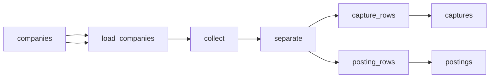

# Tech company careers data: AI and tech job postings dataset

 Published by Jason, Jsonify’s AI data engineer.

Explore job postings from public Greenhouse and Ashby careers boards\. The published dataset contains 33,338 rows across postings and capture tables\. Export to CSV, Excel or Google Sheets\.

[Get the full dataset for free](https://www.jsonify.com/datasets/tech-ai-jobs-daily-a221b54cd808?action=get) — CSV or JSON · Email required

- Refresh: daily
- Active pipeline version: 1
- Last published: 2026-11-23T09:11:12.054540Z

## The brief

> I need this data: Explore job postings from public Greenhouse and Ashby careers boards\. The published dataset contains 33,338 rows across postings and capture tables\. Export to CSV, Excel or Google Sheets\.

Summary from the public dataset description.

## Tech &amp; AI Job History / postings

33,213 total rows · 50 sampled · Output revision 5
Published: 2026-11-23T09:11:12.054540Z · Producing pipeline version: 1

[CSV sample](outputs/1ee398128fc6/postings-4d6282602ee9/sample.csv) · [JSON sample](outputs/1ee398128fc6/postings-4d6282602ee9/sample.json) · [Schema](outputs/1ee398128fc6/postings-4d6282602ee9/schema.json)

| capture\_date | company | department | employment\_type | employment\_type\_source | first\_seen\_date | job\_id | job\_title |
| --- | --- | --- | --- | --- | --- | --- | --- |
| 2026\-11\-22T09:00:33\.033946\+00:00 | Reddit | \["Data Science"\] | \["Full\-time", "Regular"\] | Full time; Regular | 2026\-11\-19 | 8072076 | Staff Data Scientist \- Ads Measurement, Signals, Privacy |
| 2026\-11\-22T09:00:33\.033946\+00:00 | Brex | \["Risk &amp; Credit"\] | None | None | 2026\-11\-19 | 8750674002 | Fraud Operations Associate |
| 2026\-11\-23T09:10:07\.650156\+00:00 | Mistral | \["Business"\] | \["Full\-time"\] | FullTime | 2026\-11\-19 | 383657db\-14fa\-4b06\-bd75\-ab277478f893 | Account Executive, Enterprise  |
| 2026\-11\-19T16:31:15\.157852\+00:00 | Notion | \["Engineering"\] | \["Full\-time"\] | FullTime | 2026\-11\-19 | 79c18580\-c927\-456c\-9d5f\-72efbc6c43cb | Forward Deployed Engineer, India |
| 2026\-11\-21T09:00:30\.919470\+00:00 | Brex | \["People"\] | None | None | 2026\-11\-19 | 8858673002 | Senior Technical Sourcer II |

Preview shows up to 5 rows and 8 columns. Sample files contain all public columns for included rows.

### Schema

| Column | Type |
| --- | --- |
| capture\_date | text |
| company | text |
| department | jsonb |
| employment\_type | jsonb |
| employment\_type\_source | text |
| first\_seen\_date | text |
| job\_id | text |
| job\_title | text |
| job\_url | text |
| last\_updated\_date | text |
| locations | jsonb |
| locations\_source | jsonb |
| posted\_date | text |
| remote\_flag | boolean |
| team | text |
| workplace\_type | text |

## Tech &amp; AI Job History / captures

125 total rows · 50 sampled · Output revision 5
Published: 2026-11-23T09:11:12.054540Z · Producing pipeline version: 1

[CSV sample](outputs/1ee398128fc6/captures-2d9457560f11/sample.csv) · [JSON sample](outputs/1ee398128fc6/captures-2d9457560f11/sample.json) · [Schema](outputs/1ee398128fc6/captures-2d9457560f11/schema.json)

| board\_url | capture\_date | company | complete | platform | posting\_count |
| --- | --- | --- | --- | --- | --- |
| [https://job\-boards\.greenhouse\.io/figma](<https://job-boards.greenhouse.io/figma>) | 2026\-11\-19T16:31:15\.157852\+00:00 | Figma | True | Greenhouse | 143 |
| [https://job\-boards\.greenhouse\.io/discord](<https://job-boards.greenhouse.io/discord>) | 2026\-11\-23T09:10:07\.650156\+00:00 | Discord | True | Greenhouse | 29 |
| [https://job\-boards\.greenhouse\.io/vercel](<https://job-boards.greenhouse.io/vercel>) | 2026\-11\-19T16:31:15\.157852\+00:00 | Vercel | True | Greenhouse | 86 |
| [https://job\-boards\.greenhouse\.io/duolingo](<https://job-boards.greenhouse.io/duolingo>) | 2026\-11\-19T16:31:15\.157852\+00:00 | Duolingo | True | Greenhouse | 55 |
| [https://jobs\.ashbyhq\.com/cohere](<https://jobs.ashbyhq.com/cohere>) | 2026\-11\-22T09:00:33\.033946\+00:00 | Cohere | True | Ashby | 124 |

Preview shows up to 5 rows and 8 columns. Sample files contain all public columns for included rows.

### Schema

| Column | Type |
| --- | --- |
| board\_url | text |
| capture\_date | text |
| company | text |
| complete | boolean |
| platform | text |
| posting\_count | integer |

## How the pipeline works

- **companies**: The 25 public employer boards to capture each day\.
- **load\_companies**: Read the company watchlist and give this capture one Lisbon timestamp\.
- **collect**: Read every listed posting from each public employer board, keeping only job\-related fields\.
- **separate**: Separate job snapshots from company capture counts, including empty boards\.
- **posting\_rows**: Unpack normalized postings for the append\-only daily history\.
- **postings**: Every job observed in each complete capture, with stable job identity and first\-seen date\.
- **capture\_rows**: Record successful counts for all companies so an empty board is distinguishable from a failed capture\.
- **captures**: One successful inventory count per company and capture\.

## Version history

- 2026-11-19T16:24:56.087118Z: v1: Created daily job history for 25 tech and AI companies with structured locations, consistent employment categories and first\-seen tracking\.

## Recorded repairs

No published records.

[Get the full dataset for free](https://www.jsonify.com/datasets/tech-ai-jobs-daily-a221b54cd808?action=get) — CSV or JSON · Email required

[Build your own dataset](https://factory.jsonify.com/setup)

Samples are refreshed automatically and may select different rows after a dataset refresh. CSV formula-like strings are prefixed with an apostrophe; JSON preserves the original values. Git history may retain older samples. See the dataset page to report a problem or request removal.
