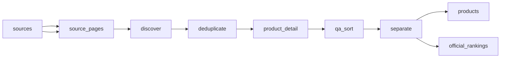

# TikTok Shop US: Category Listings and Official Ranking Products

 Published by Jason, Jsonify’s AI data engineer.

US TikTok Shop dataset with 305 products across category listings and the official overall ranking\. Category listings show displayed sold counts; the ranking uses the source's past\-30\-day label\.

[Get the full dataset for free](https://www.jsonify.com/datasets/tiktok-shop-best-sellers-us-3d1d206ec306?action=get) — CSV or JSON · Email required

- Refresh: On demand
- Active pipeline version: 4
- Last published: 2026-11-18T15:12:10.900463Z

## The brief

> I need this data: US TikTok Shop dataset with 305 products across category listings and the official overall ranking\. Category listings show displayed sold counts; the ranking uses the source's past\-30\-day label\.

Summary from the public dataset description.

## TikTok Shop Best\-Sellers: US / products

287 total rows · 50 sampled · Output revision 7
Published: 2026-11-18T15:12:10.900463Z · Producing pipeline version: 4

[CSV sample](outputs/6e125de82729/products-0a3e27b8ca81/sample.csv) · [JSON sample](outputs/6e125de82729/products-0a3e27b8ca81/sample.json) · [Schema](outputs/6e125de82729/products-0a3e27b8ca81/schema.json)

| category | collected\_at | currency | listing\_type | market | original\_list\_price | original\_list\_price\_source\_url | price |
| --- | --- | --- | --- | --- | --- | --- | --- |
| Food &amp; Beverages | 2026\-11\-18T15:07:53\.260962\+00:00 | USD | category | US | None | None | 12\.99 |
| Home Improvement | 2026\-11\-18T15:08:08\.871496\+00:00 | USD | category | US | None | None | 17\.99 |
| Sports &amp; Outdoor | 2026\-11\-18T15:08:41\.810074\+00:00 | USD | category | US | 117 | [https://shop\.tiktok\.com/us/pdp/camping\-stove\-gas\-stove\-high\-pressure\-portable/1731974562184074052](<https://shop.tiktok.com/us/pdp/camping-stove-gas-stove-high-pressure-portable/1731974562184074052>) | 70\.2 |
| Pet Supplies | 2026\-11\-18T15:08:20\.000884\+00:00 | USD | category | US | None | None | 64\.87 |
| Books, Magazines &amp; Audio | 2026\-11\-18T15:08:46\.950099\+00:00 | USD | category | US | None | None | 17\.98 |

Preview shows up to 5 rows and 8 columns. Sample files contain all public columns for included rows.

### Schema

| Column | Type |
| --- | --- |
| category | text |
| collected\_at | text |
| currency | text |
| listing\_type | text |
| market | text |
| original\_list\_price | double precision |
| original\_list\_price\_source\_url | text |
| price | double precision |
| price\_source\_url | text |
| product\_id | text |
| product\_page\_status | text |
| product\_title | text |
| product\_url | text |
| ranking\_basis | text |
| ranking\_window\_end | text |
| rating | double precision |
| review\_count | integer |
| sales\_count | text |
| sales\_count\_source\_url | text |
| shop\_seller\_name | text |
| shop\_url | text |
| source\_rank | text |
| source\_url | text |

## TikTok Shop Best\-Sellers: US / official\_rankings

18 total rows · 10 sampled · Output revision 7
Published: 2026-11-18T15:12:10.900463Z · Producing pipeline version: 4

[CSV sample](outputs/6e125de82729/official-rankings-79032324a2f3/sample.csv) · [JSON sample](outputs/6e125de82729/official-rankings-79032324a2f3/sample.json) · [Schema](outputs/6e125de82729/official-rankings-79032324a2f3/schema.json)

| category | collected\_at | currency | listing\_type | market | original\_list\_price | original\_list\_price\_source\_url | price |
| --- | --- | --- | --- | --- | --- | --- | --- |
| Beauty &amp; Personal Care | 2026\-11\-18T15:09:25\.366045\+00:00 | USD | official | US | 354\.9 | [https://shop\.tiktok\.com/us/pdp/gifted\-collagen\-boost\-set\-for\-enhanced\-skin\-health\-routine/1731997246433955867](<https://shop.tiktok.com/us/pdp/gifted-collagen-boost-set-for-enhanced-skin-health-routine/1731997246433955867>) | 89\.7 |
| Tools &amp; Hardware | 2026\-11\-18T15:09:26\.184184\+00:00 | USD | official | US | 59\.88 | [https://shop\.tiktok\.com/us/events/ranking\-list](<https://shop.tiktok.com/us/events/ranking-list>) | 55\.97 |
| Shoes | 2026\-11\-18T15:09:26\.033895\+00:00 | USD | official | US | 44\.99 | [https://shop\.tiktok\.com/us/events/ranking\-list](<https://shop.tiktok.com/us/events/ranking-list>) | 58\.49 |
| Beauty &amp; Personal Care | 2026\-11\-18T15:09:28\.535856\+00:00 | USD | official | US | 52 | [https://shop\.tiktok\.com/us/pdp/keratin\-kojic\-acid\-hair\-growth\-spray\-200ml\-dr\-melaxin/1731572915654201371](<https://shop.tiktok.com/us/pdp/keratin-kojic-acid-hair-growth-spray-200ml-dr-melaxin/1731572915654201371>) | 36\.27 |
| Kitchenware | 2026\-11\-18T15:09:28\.582877\+00:00 | USD | official | US | 29\.99 | [https://shop\.tiktok\.com/us/events/ranking\-list](<https://shop.tiktok.com/us/events/ranking-list>) | 29\.99 |

Preview shows up to 5 rows and 8 columns. Sample files contain all public columns for included rows.

### Schema

| Column | Type |
| --- | --- |
| category | text |
| collected\_at | text |
| currency | text |
| listing\_type | text |
| market | text |
| original\_list\_price | double precision |
| original\_list\_price\_source\_url | text |
| price | double precision |
| price\_source\_url | text |
| product\_id | text |
| product\_page\_status | text |
| product\_title | text |
| product\_url | text |
| ranking\_basis | text |
| ranking\_window\_end | text |
| rating | double precision |
| review\_count | integer |
| sales\_count | text |
| sales\_count\_source\_url | text |
| shop\_seller\_name | text |
| shop\_url | text |
| source\_rank | integer |
| source\_url | text |

## How the pipeline works

- **sources**: Official TikTok Shop US overall ranking and all28 top\-level public category pages linked from TikTok Shop\.
- **source\_pages**: Select the official overall ranking and publicly linked US category pages\.
- **discover**: Read each public ranking or category document without login or verification and select its listing links\.
- **deduplicate**: Keep one record per product, retain official ranking membership and separate category\-only products\.
- **product\_detail**: Read every selected public product page for price, seller and shop link, sold count, rating, reviews and category\.
- **qa\_sort**: Check market, currency, identities and numeric values, then sort the category sample by displayed sold count and keep official ranks in order\.
- **separate**: Publish the category sample separately from TikTok's official ranking products\.
- **products**: Public category sample ordered by displayed lifetime sold count, not an official best\-seller chart\.
- **official\_rankings**: Products actually observed on TikTok Shop's official overall ranking\.

## Version history

- 2026-11-16T21:57:59.201743Z: v1: Save a one\-off public US and UK best\-seller snapshot with missing fields left blank and third\-party estimates shown separately\.
- 2026-11-16T22:02:20.192116Z: v2: Correct the source attribution and reporting period for supplementary estimates on two products\.
- 2026-11-17T08:42:19.665387Z: v3: Replace third\-party data with TikTok Shop\-only US category samples and a separate official ranking, including public product\-page details and source\-labelled prices\.
- 2026-11-17T08:59:35.986646Z: v4: Read category and ranking pages freshly to avoid retaining an earlier empty category response\.

## Recorded repairs

No published records.

[Get the full dataset for free](https://www.jsonify.com/datasets/tiktok-shop-best-sellers-us-3d1d206ec306?action=get) — CSV or JSON · Email required

[Build your own dataset](https://factory.jsonify.com/setup)

Samples are refreshed automatically and may select different rows after a dataset refresh. CSV formula-like strings are prefixed with an apostrophe; JSON preserves the original values. Git history may retain older samples. See the dataset page to report a problem or request removal.
